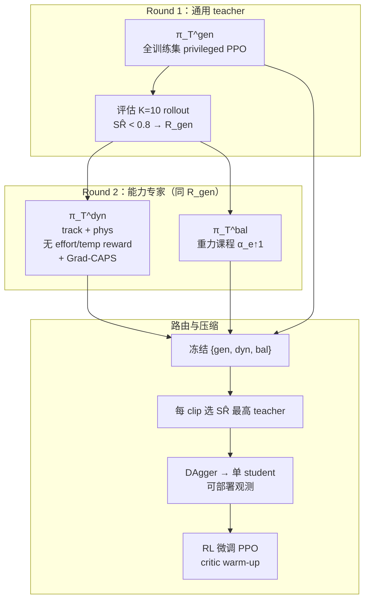

# Athena-WBC：面向人形全身控制长尾的能力对齐策略专家

**Athena-WBC**（*Capability-Aligned Policy Experts for Long-Tail Humanoid Whole-Body Control*，arXiv:2607.04837，v1 2026-07-06 / v2 2026-07-07，**XPENG Robotics**）研究 **高覆盖率人形 motion tracking** 中常被忽视的 **训练集长尾残余失败**：在强基线（SONIC 配方）已覆盖绝大多数动作后，仍有少量 **高动态过渡** 与 **平衡关键** 片段学不会——且部分片段 **仅对失败子集加训仍无法过拟合**，说明瓶颈在 **策略能力（capability）** 而非单纯数据曝光。

> **撤稿与证据边界提示（2026-08-24）：** 该论文 v3 已由作者在 arXiv 撤稿（*Withdrawn by the authors due to unresolved authorization and data-governance concerns affecting the dataset used in the experiments and, consequently, the reported results*）。当前 `arxiv.org/pdf/2607.04837` 默认路径返回 404，历史版本 [v2 PDF](https://arxiv.org/pdf/2607.04837v2) 仍可查阅方法结构；阅读与选型时应将下述实验指标视为「已撤稿预印本的待核查报告」，勿作为已定论基准引用。

## 一句话定义

**两阶段紧凑 teacher–student 管线：全量通用 privileged teacher → 挖掘残余失败集并并行训练 dynamic（去保守奖励 + Grad-CAPS 辅助平滑）与 balance（重力课程）专家 → 按 rollout 成功率路由每段动作的最佳 teacher → DAgger 蒸馏为可部署单策略 → RL 微调，在 80 kg 小鹏人形上相对同平台 SONIC-Base 改善长尾恢复与 held-out 跟踪。**

## 英文缩写速查

| 缩写 | 英文全称 | 简要说明 |
|------|----------|----------|
| WBC | Whole-Body Control | 人形全身运动跟踪与协调控制 |
| SONIC | Supersizing Motion Tracking for Natural Humanoid WBC | 规模化 tracking 基线配方（本文在同平台重实现） |
| STC | Success–Tolerance Curve | 随跟踪容差缩放的成功率曲线 |
| TIS | Threshold-Integrated Success | 对 STC 的标量积分，衡量跨阈值鲁棒性 |
| MPJPE-W | Motion-Salience Weighted MPJPE | 按动作显著性加权的关节跟踪误差 |
| DAgger | Dataset Aggregation | 在 learner 状态上查询 expert 动作的蒸馏范式 |
| Grad-CAPS | Gradient-based CAPS | 对策略均值施加梯度时序正则的辅助损失 |
| SR | Success Rate | 基于根高/偏航/关键点误差的二元成功率 |

## 为什么重要

- **问题视角新：** 将 **训练集 residual coverage** 与 held-out 泛化失败区分开；高平均 SR 仍可能隐藏 **结构化长尾**（dynamic / balance 子集）。
- **能力瓶颈 vs 数据分配：** 实验证明去掉 effort/temporal **奖励惩罚**（No-smoothness）可显著提升跟踪，但 **Action Rate 暴涨** 不可部署——说明保守奖励是 **真实 capability 限制**，而非「再多采样就能解决」。
- **专家按能力对齐而非按动作聚类：** dynamic 与 balance expert **看同一残余集**、用 **不同 acquisition recipe**；最终 **按 rollout SR 路由**，避免手工标注动作类型。
- **蒸馏与 RL 分工清晰：** **multi-teacher 蒸馏** 主要负责 **训练集长尾恢复**；**RL 微调** 主要负责 **held-out TIS/MPJPE 与部署平滑度**（微调后 balance 子集 SR 可能略降）。
- **评测工具可复用：** STC/TIS/MPJPE-W 针对「策略已很强、单阈值 SR 难区分」的高覆盖率 regime，可与 [SONIC](./nvidia-sonic.md)、[Humanoid-GPT](./paper-humanoid-gpt.md) 等 scaling 路线对照使用。
- **产业样本：** 与 [DeepInsight](./deepinsight.md)、[ROVE](./paper-rove-humanoid-vla-intervention.md) 同属小鹏机器人栈；本文聚焦 **System 0 WBC 长尾**，尚无公开项目页与系统真机定量。

## 流程总览

## 核心机制（归纳）

### 1）Capability bottleneck 操作化

奖励分解 $r_t = r^{\mathrm{track}}_t + r^{\mathrm{phys}}_t + r^{\mathrm{effort}}_t + r^{\mathrm{temp}}_t$：

- $r^{\mathrm{phys}}$：关节限位、速度/力矩限、脚滑等 **物理可行性**（应保留）。
- $r^{\mathrm{effort}}/r^{\mathrm{temp}}$：力矩、DoF 速度/加速度、动作率等 **保守控制偏好**（高动态长尾上可能有害）。

**Dynamic expert** 令 $r^{\mathrm{effort}}=r^{\mathrm{temp}}=0$，用 **Grad-CAPS** 在策略均值上约束二阶差分，分离「可激进跟踪」与「高频抖动」。

**Balance expert** 用 $g_e=\alpha_e g_0$ **重力课程**，让未训练策略在弱重力下存活足够长以学到支撑/恢复信号。

### 2）Motion-routed distillation

两专家 **不迭代挖掘**（仅两轮 teacher 训练，保持专家库紧凑）。路由 $k^*(m)=\arg\max_k \widehat{\mathrm{SR}}(\pi_T^k,\tau_m)$ 在蒸馏时选定监督源；student 仅见 **可部署观测**。

### 3）RL fine-tuning

遵循 [Parkour in the Wild](https://doi.org/10.1177/02783649251347436)：**冻结 actor + 加噪 rollout 训 critic** → 渐解冻 actor 继续 PPO；teacher 特权量与课程变量 **全部关闭**。

### 4）实验设定要点

| 项 | 内容 |
|----|------|
| 平台 | **80 kg** 行星滚柱丝杠 + 闭链 **小鹏人形**（非 Unitree G1） |
| 训练数据 | **55,482 clips / 175.88 h**（AMASS、Bones-Seed、BEAT、策展 mocap） |
| 基线 | **SONIC-Base**（同平台重实现 SONIC 配方，非 NVIDIA 发布权重） |
| 算力 | 8×GPU，每 GPU 2048 env；主训 **40k iter** |
| Held-out | AMASS-eval（10 h IID）；Omni-eval（227 clips 难动作） |

## 主要结果（相对 SONIC-Base）

**Held-out（RL 微调最终策略）：**

| 集合 | SR | TIS | MPJPE (mm) |
|------|-----|-----|------------|
| AMASS-eval | 98.18→**99.26%** | 0.7631→**0.8034** | 68.26→**63.63** |
| Omni-eval | 91.81→**94.89%** | 0.7123→**0.7449** | 70.39→**65.11** |

**长尾训练子集（multi-teacher student vs SONIC-Base）：** balance 子集 SR **90.60→94.73%**，MPJPE-W **101.99→88.61 mm**。

**平滑度：** No-smoothness 诊断基线 Action Rate **1.46**；SONIC-Base **0.54**；RL 微调 **1.03**——在保留大部分无平滑跟踪收益的同时避免不可部署的高频抖动。

## 结论

**Athena-WBC 把「高覆盖率 tracking 剩下的那点失败」重新定性为策略能力问题而非数据曝光问题：瓶颈在保守奖励与课程配方，所以解法是能力对齐的专家，而不是更狠的难样本采样。**

- 证据链是这篇最硬的部分：部分 clip **仅对失败子集加训仍无法过拟合**；而去掉 effort/temporal 惩罚后跟踪立刻变好但 Action Rate 从 0.54 暴涨到 1.46 不可部署——两头夹逼出「保守奖励是真实 capability 限制」。
- 起作用的是分工而非单一技巧：dynamic（去保守奖励 + Grad-CAPS）与 balance（重力课程）两专家看 **同一残余集**、按 rollout SR 逐 clip 路由，DAgger 蒸馏负责训练集长尾恢复，RL 微调负责 held-out 与部署平滑度（代价是 balance 子集 SR 可能略降）。
- 收益量级要看清主战场：held-out 是 98.18→99.26% / 91.81→94.89% 这一档的边际改善，长尾 balance 子集才有 90.60→94.73%、MPJPE-W 101.99→88.61 mm；正因为单阈值 SR 在这个 regime 已难区分，才需要 STC/TIS/MPJPE-W。
- 适用边界绑得很紧：结论依附于 **80 kg 行星滚柱丝杠闭链小鹏人形** 与 **同平台重实现的 SONIC-Base**，绝对数值不可与 SONIC 原文或 G1 发布 checkpoint 对齐；与 OmniTrack「参考物理修正即可单策略覆盖难动作」的结论互补且部分对立。
- 落地状态需保守：本文聚焦 System 0 WBC 长尾，尚无公开项目页与系统性真机定量，可复用的更多是 **评测工具与配方思路** 而非现成权重。

## 与其他工作对比

| 对比维度 / 工作 | Athena-WBC（本文，v2） | [SONIC-Base（同平台重实现）](./nvidia-sonic.md) | BumbleBee / [Parkour in the Wild](./paper-parkour-in-the-wild.md) | [EGM](../methods/egm-efficient-general-mimic.md) / GMT（MoE） / OmniTrack |
|---|---|---|---|---|
| 解决长尾的核心思路 | **改能力配方**：在同一残余集 $\mathcal{R}_{\mathrm{gen}}$ 上并行训去保守奖励+Grad-CAPS 动态专家与重力课程平衡专家，按 rollout SR 路由蒸馏 | 单一通用配方 + 自适应采样；受 effort/temp 保守奖励与初始重力条件制约 | 按语义/运动聚类或地形分专家，再蒸馏 + RLFT | 偏重数据分配（难样本过采样 / bin 课程）、MoE 容量路由或参考轨迹物理修正 |
| 平滑性与动态权衡 | 去掉 $r^{\mathrm{effort}}/r^{\mathrm{temp}}$ 后用 Grad-CAPS 抑制高频抖动（8–25 Hz 能量 0.007），RLFT 后 Action Rate 1.03 | 保守平滑奖励使 Action Rate 维持 0.54，但高动态/平衡长尾易失败（No-smoothness 基线虽提跟踪但 Action Rate 升至 1.46） | 多阶段蒸馏与 RLFT 保持部署平滑 | OmniTrack 报告参考物理修正后单策略即可覆盖高难动作（与本文 80 kg 闭链观察互补） |
| 评测与平台口径 | 提出 STC/TIS/MPJPE-W；80 kg 闭链小鹏人形（AMASS-eval SR 99.26%、Omni-eval 94.89%） | 同平台对照（AMASS-eval SR 98.18%、Omni-eval 91.81%），非 NVIDIA G1 发布权重 | 多地形跑酷等特定场景 | 各自平台与协议，不可跨机器人直接对齐绝对 SR |

> **核对边界**：据 [athena_wbc_arxiv_2607_04837.md](../../sources/papers/athena_wbc_arxiv_2607_04837.md) 核查，论文 v3 已于 2026-08-24 因实验数据集授权与治理问题撤稿，上表指标均摘自历史 v2 版本与同平台重实现基线，尚无系统真机定量验证，不可直接视为已定论基准。

## 工程实践

| 环节 | 原文设定与工程要点（arXiv:2607.04837v2） |
|------|----------------------------------------|
| 观测接口 | Teacher 1837 维（含 OmniH2O 特权自/任务状态）；Student 2081 维可部署观测（10 帧本体历史 + 参考目标） |
| 残余挖掘与路由 | 通用 teacher 每 clip 测 $K_{\mathrm{eval}}=10$ 次 rollout，$\widehat{\mathrm{SR}} < 0.8$ 入 $\mathcal{R}_{\mathrm{gen}}$；路由按三专家实测 $\widehat{\mathrm{SR}}$ 自动选优 |
| 训练算力与采样 | 8×GPU（2048 env/GPU = 16,384 并行），主 checkpoint 40k iter；全程开启 adaptive motion sampling |
| 诊断指标 | 高覆盖率下用 **STC / TIS / MPJPE-W** 取代单阈值 SR，配合 Action Rate 与 8–25 Hz 频谱高频占比排查抖动 |
| 开源状态与源码运行时序图 | **不适用**（无公开项目页与代码仓库，且论文 v3 已因数据集授权/治理问题撤稿） |

## 局限与风险

1. **论文 v3 已撤稿（核心风险）：** 2026-08-24 作者因实验数据集授权与数据治理未决问题撤回 v3，明确声明实验结果受影响、审核期间不应依赖该文结论。
2. **「长尾 = 再加难样本采样」的误区：** 论文显示部分 clip **targeted retrain 仍失败**；需改 **奖励/课程/辅助正则** 等 capability 配方。
3. **「去掉平滑奖励就够用」的误区：** No-smoothness 跟踪最好但 Action Rate 达 1.4634（高频 8–25 Hz 能量占比 0.063 vs 0.009），**不可部署**；最终策略靠 **Grad-CAPS + 蒸馏 + RLFT** 折中，但仍残留低频晃动（low-frequency sway，增加 Grad-CAPS 权重亦难消除）。
4. **多阶段工程成本与覆盖权衡：** 需两轮 teacher、DAgger 与 RLFT 多阶段超参；RLFT 有时会以略降训练集平衡子集覆盖为代价换取 held-out 指标提升。
5. **与 OmniTrack 及真机证据边界：** OmniTrack 靠参考物理修正单策略覆盖难动作，本文在 80 kg 闭链平台上仍有残余；且本文尚无系统真机定量验证，绝对 SR 亦不可与 G1 上的 SONIC 发布权重直接对标。

## 关联页面

- **Scaling 对照：** [SONIC](./nvidia-sonic.md)（亿级帧 + 统一 token）、[Humanoid-GPT](./paper-humanoid-gpt.md)（2B 帧 + Transformer 专家蒸馏）、[EGM](../methods/egm-efficient-general-mimic.md)（bin 课程 + CDMoE，偏数据效率）
- **专家蒸馏先例：** BumbleBee（语义/运动聚类专家）、[Parkour in the Wild](./paper-parkour-in-the-wild.md)（地形专家 → DAgger → RLFT）
- **小鹏栈：** [DeepInsight](./deepinsight.md)（全栈评测）、[ROVE](./paper-rove-humanoid-vla-intervention.md)（VLA 后训练）
- **概念：** [Whole-Body Control](../concepts/whole-body-control.md)、[Whole-Body Tracking Pipeline](../concepts/whole-body-tracking-pipeline.md)
- **选型：** [humanoid motion tracking 方法选型](../queries/humanoid-motion-tracking-method-selection.md)

## 参考来源

- [Athena-WBC（arXiv:2607.04837）](../../sources/papers/athena_wbc_arxiv_2607_04837.md)

## 推荐继续阅读

- [机器人论文阅读笔记：Athena-WBC](https://imchong.github.io/Robot_Learning_Paper_Notebooks/papers/04_Loco-Manipulation_and_WBC/Athena-WBC__Capability-Aligned_Policy_Experts_for_Long-Tail_Humanoid_Whole-Body_Control/Athena-WBC__Capability-Aligned_Policy_Experts_for_Long-Tail_Humanoid_Whole-Body_Control.html)
- [arXiv:2607.04837](https://arxiv.org/abs/2607.04837) — 全文与 STC/TIS/MPJPE-W 定义
- [SONIC（arXiv:2511.07820）](https://arxiv.org/abs/2511.07820) — 本文基线配方来源
- [OmniH2O（CoRL 2024）](https://proceedings.mlr.press/v270/he25a.html) — privileged teacher 观测设计参照
- [Parkour in the Wild（IJRR 2026）](./paper-parkour-in-the-wild.md) — 蒸馏后 RL 微调流程参照
- [Humanoid-GPT 实体页](./paper-humanoid-gpt.md) — 另一路「数百 PPO expert → 通才」scaling 对照
