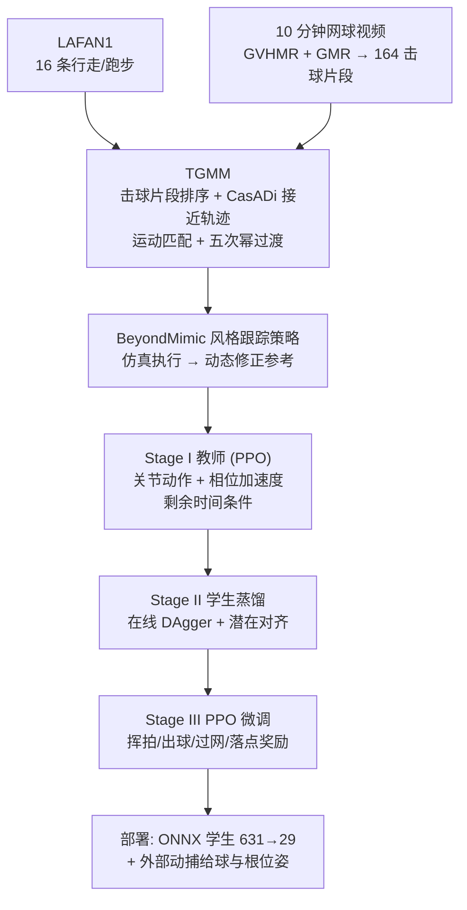
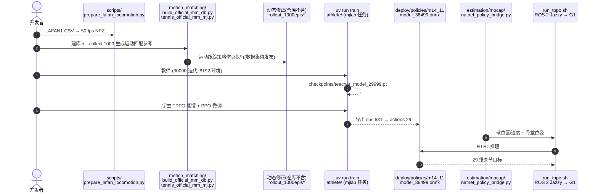

# ATHLETE：用通用行走数据加普通视频学人形反应式网球

**ATHLETE**（论文 *ATHLETE: Learning Reactive Humanoid Tennis via Trajectory-Guided Motion Matching*，[arXiv:2610.13572](https://arxiv.org/abs/2610.13572)，[项目页](https://hazintihoa.github.io/athlete.github.io/)，[代码匿名镜像](https://anonymous.4open.science/r/athlete-humanoid-tennis)）由 **香港科技大学（广州）（HKUST-GZ）** 提出：不采集任务专用的网球动捕，而是把 LAFAN1 通用行走/跑步与从网球练习视频重建的击球动作，用轨迹引导的运动匹配拼成接近-击球参考，再蒸馏为不需要参考动作的反应策略。

## 一句话定义

**用运动匹配按「球落点 → 接近轨迹 → 击球片段」把可复用的行走数据和视频击球拼成多样参考，再用时间自适应教师、DAgger 蒸馏的学生与 PPO 微调，得到部署时只看机器人状态和球观测的人形网球策略。**

## 英文缩写速查

| 缩写 | 英文全称 | 简要说明 |
|------|----------|----------|
| ATHLETE | 论文方法名 | 反应式人形网球框架（全称缩写展开原文摘要未列，未核实） |
| TGMM | Trajectory-Guided Motion Matching | 轨迹引导运动匹配，生成任务条件化参考 |
| DAgger | Dataset Aggregation | 在线模仿蒸馏：学生执行、教师纠正 |
| PPO | Proximal Policy Optimization | 教师训练与学生微调所用强化学习算法 |
| LAFAN1 | Ubisoft LaForge Animation dataset | 通用行走/跑步动捕，本文用其 16 条序列 |
| GVHMR | Gravity-View Human Motion Recovery | 从视频重建世界系人体动作 |
| GMR | General Motion Retargeting | 将人体动作重定向到 G1 |

## 为什么重要

- 网球要覆盖大量接近路径、击球点和时机，逐一动捕成本极高；本文把「可复用的运动经验」与「任务专用片段」分开，数据成本落在一段 10 分钟视频上。
- 部署端只保留学生编码器和动作网络，**无需参考动作、在线检索或显式规划器**，实时 50 Hz。
- 真机对打最长 55 回合（新手）与 88 回合（职业选手），是目前站内少见的人形网球对打证据；同时诚实地依赖外部动捕，不是机载感知。

## 核心信息

| 项 | 内容 |
|----|------|
| 机构 | The Hong Kong University of Science and Technology (Guangzhou)（通讯 Junwei Liang） |
| 平台 | Unitree G1（仓库与部署栈明确；论文正文仅称 humanoid），策略 29 维关节动作 |
| 数据 | 16 条 LAFAN1 行走/跑步；10 分钟网球视频切出 164 段击球（97 正手 + 67 反手）；训练库 200 条生成参考 |
| 算力 | 训练单张 RTX 4090；推理笔记本 RTX 5070 Ti Laptop，有线以太网，50 Hz |
| 开源 | **部分开源**：训练、仿真、ROS 2 部署、学生与教师检查点、164 段击球片段已发布；参考动作数据集与全程飞行微调检查点 Coming soon |

## 方法栈与流程总览

## 方法

- **TGMM：** 按正手/反手筛击球片段并以接触代价排序（高度误差权重大于平面误差）；CasADi 梯形配点 + IPOPT 求平面接近轨迹，目标距离 ≤1.5 m 先平移后对齐，更远则转身奔跑再对齐；在 LAFAN1 帧上做运动匹配（足、根特征与 0.4/0.8/1.2 s 后的平面位置与朝向）；用五次幂偏移衰减过渡；再用 [BeyondMimic](../methods/beyondmimic.md) 风格的跟踪策略在仿真中执行合成参考，其 rollout 作为教师参考。
- **Stage I 教师：** PPO 训练，输出关节动作和相位加速度，输入含状态、参考姿态、目标、剩余时间；奖励为 TaskNPoint 式跟踪/击球项加相位时序项；截止时刻按 κ=2、间隔 0.1 s 采样。
- **Stage II 学生：** 球轨迹与参考接触点按容差与时间窗匹配；在线 DAgger 式 rollout，PPO 更新关闭、教师控制占比逐渐下降；损失为动作蒸馏、参考重建、潜在对齐（权重 0.05，潜变量 128 维，融合五个历史时刻）。
- **Stage III：** 学生接管全部环境，损失 L_PPO+0.05·L_act；奖励含挥拍速度、出球速度朝向目标、过网、落点精度及辅助控制项；控制 50 Hz，骨盆/躯干倾角超 50° 终止。
- **仿真到真机：** 沿用 [LATENT](./paper-notebook-latent.md) 的域随机化（球质量/恢复系数/切向速度保持/阻力；球拍质量/质心/恢复系数）；球拍经 3D 打印件装在右手。

## 源码运行时序图

对齐匿名镜像 [athlete-humanoid-tennis](https://anonymous.4open.science/r/athlete-humanoid-tennis) README（归档见 [repos/athlete-humanoid-tennis.md](../../sources/repos/athlete-humanoid-tennis.md)；本次未实际运行训练或部署）：

- **直接可跑：** 仓库提供已训练学生 `deploy/policies/m14_11/`，可用 `athlete.scripts.play` 回放，或 `bash run_tppo.sh sim g1_tppo_student_m14_11.yaml` 在 MuJoCo 部署；真机需 OptiTrack 刚体 `G1_pelvis`、`Ball`，并设 `TPPO_ENABLE_REAL_ROBOT=YES`。
- **README 声明：** 该策略包未验证可无人值守真机运行。

## 工程实践

| 项 | 建议 |
|----|------|
| 接口 | ONNX 输入 631 维（当前观测 136 + 状态历史 465 + 球历史 30），输出 29 维；控制周期 20 ms，物理步 2.5 ms |
| 球观测延迟 | 训练里加入 20±10 ms（截断 0–50 ms）延迟，感知缓冲不在 ONNX 图内 |
| 真机感知 | 球与根位姿靠外部动捕，换到机载感知需重做 |
| LAFAN1 许可 | Ubisoft 数据为 CC BY-NC-ND 4.0，仓库不分发转换后的 NPZ，需自行下载并用转换脚本 |
| 数据缺口 | 动态修正后的参考数据集（各约 430 MB）暂未发布，完整重训尚不可行 |
| 算力 | 论文报告单张 RTX 4090 训练，8192 环境 |

## 实验与评测

**仿真（300 个成对球：159 正手侧、141 反手侧，3 种子）：**

| 指标（正手 / 反手） | 仅 Stage II | 完整方法 |
|------|------|------|
| 击中率 | 1.26% / 5.67% | 94.97% / 95.04% |
| 回球率 | 0% / 0% | 91.19% / 92.20% |
| 落点误差 (m) | 5.465 / 5.336 | 1.150 / 1.314 |
| 甜区距离 (cm) | 14.09 / 13.92 | 5.61 / 6.54 |

- **教师时序：** 500 次试验 493 次触球（98.6%），362 次（72.4%）在截止时刻 ±50 ms 内，平均绝对误差 71.23 ms。
- **参考覆盖：** K=1、164 条时 TGMM 参考匹配成功率 42.64%，原始库 7.57%；200 条随机子集 K=8 达 99.21%。
- **真机（各 30 球）：** 正手击中 90.00%（27/30）、反手 86.67%（26/30）；过网 46.67%（14/30）/ 53.33%（16/30）。对照 LATENT 回球率 90.90% / 77.78%（场内回球判据、全尺寸场地），AdaPT 击中率 52.00% / 50.67%（数值由分项乘积估计）；协议和指标不同，ATHLETE 捕获区 10.5×5.5 m，AdaPT 约 20×8 m，论文自己提示不能直接比较。
- **对打：** 与新手最长 55 回合，与职业选手最长 88 回合。

## 结论

**用「通用行走 + 普通视频击球」足以训出能真机击球的人形网球策略，但目前的成绩建立在外部动捕感知和小场地之上。**

1. **TGMM 提供覆盖。** 同样 164 条动作，匹配成功率 42.64% 对原库 7.57%。
2. **RL 微调是关键一步。** 仿真击中率从仅蒸馏的 1.26%/5.67% 提到 94.97%/95.04%。
3. **真机击中好，过网一般。** 击中 90.00%/86.67%，过网只有 46.67%/53.33%。
4. **别把对比表当排名。** LATENT 与 AdaPT 的协议、场地、指标都不同。
5. **部署轻。** 学生不需要参考、检索或规划器，50 Hz 笔记本推理。
6. **复现要补数据。** 仓库有训练与已训练学生，但动态修正参考数据集待发布。

## 局限与风险

- 球状态与机器人根位姿来自外部动捕（OptiTrack）；捕获区有限，出球速度奖励在 3.5 m/s 饱和；真机球为手抛，未用发球机。
- 与 LATENT/AdaPT 的数字不是同一协议；真机每类仅 30 球。
- 动作风格多样性的保持留作未来工作；论文 HTML 附录细节未读到，附录内容未核实。
- **开源状态：** 部分开源且为匿名镜像（署名 Anonymous Authors），长期可用性未知；参考数据集与全程飞行微调检查点截至 2026-10-12 未发布。

## 与其他工作对比

| 对照 | 差异读法 |
|------|----------|
| [LATENT](./paper-notebook-latent.md) | 同样做人形网球并借用其域随机化；ATHLETE 强调从通用行走加普通视频合成参考，LATENT 报告场内回球率 |
| [人形乒乓球](./paper-notebook-towards-versatile-humanoid-table-tennis.md) | 另一种球拍类任务，规模与场地不同，未做严格对比 |
| [BeyondMimic](../methods/beyondmimic.md) | ATHLETE 借用其风格的跟踪策略做动态修正；BeyondMimic 本身跟踪单一动作 |
| [LAFAN1](./lafan1-dataset.md) / [GVHMR](./gvhmr.md) / [GMR](../methods/motion-retargeting-gmr.md) | 分别提供通用行走数据、视频重建与重定向，是 ATHLETE 的数据管线 |

## 关联页面

- [34 篇空间落地技术图谱（汇总页）](../overview/embodied-station-34-papers-spatial-grounding-technology-map.md)
- [人形运动控制](../tasks/humanoid-locomotion.md)
- [LATENT](./paper-notebook-latent.md)
- [mjlab](./mjlab.md)
- [Unitree G1](./unitree-g1.md)

## 参考来源

- [具身智能小站 34 篇盘点（2026-10-12）](../../sources/blogs/wechat_embodied_station_34_papers_spatial_grounding_2026-10-12.md)
- [athlete_arxiv_2610_13572.md](../../sources/papers/athlete_arxiv_2610_13572.md) — 论文摘录与开源核查
- [athlete-tennis.md](../../sources/sites/athlete-tennis.md) — 项目页归档
- [athlete-humanoid-tennis.md](../../sources/repos/athlete-humanoid-tennis.md) — 匿名仓库归档
- [arXiv:2610.13572](https://arxiv.org/abs/2610.13572)

## 推荐继续阅读

- [ATHLETE 项目页](https://hazintihoa.github.io/athlete.github.io/)
- [匿名代码镜像](https://anonymous.4open.science/r/athlete-humanoid-tennis)
- [LAFAN1 数据集](https://github.com/ubisoft/ubisoft-laforge-animation-dataset)
