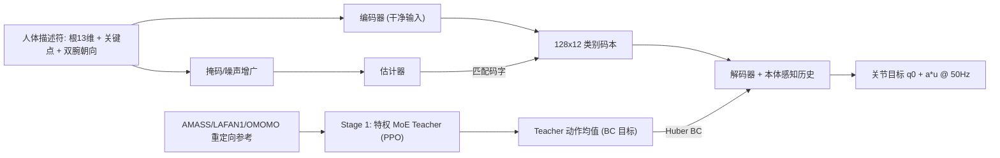

# Beyond Retargeting：学习式原子动作基元的低延迟人形全身遥操作

**Beyond Retargeting**（[arXiv:2610.07891](https://arxiv.org/abs/2610.07891)）把人形全身遥操作里的「人体动作重定向 + 低层跟踪」两步合并成一次前向：先用 PPO 训出特权稀疏 MoE Teacher，再把它蒸馏为一个吃人体描述符、带 **因子化类别码本**（作者称「原子动作基元」）的 Student；码本把残缺、带噪的人体观测投影回合理的全身动作原型，从而同时降低延迟、提升对遮挡/噪声/OOD 动作的鲁棒性。

## 一句话定义

**不经显式重定向，让 Student 策略直接把人体关键点描述符映射为 G1 关节目标，并用离散码本充当「动作先验」去修复残缺或带噪的输入。**

## 英文缩写速查

| 缩写 | 英文全称 | 简要说明 |
|------|----------|----------|
| MoE | Mixture of Experts | Teacher actor：8 细粒度专家 + 1 共享专家，top-2 路由 |
| PPO | Proximal Policy Optimization | Teacher 的训练算法 |
| SR | Success Rate | 骨盆高度误差超过 0.25 m 记为失败 |
| MPJPE / MPJVE | Mean Per-Joint Position / Velocity Error | 关节角（rad）与关节速度（rad/s）误差 |
| OOD | Out-of-Distribution | 未见动作、噪声、掉点等分布外输入 |
| VR | Virtual Reality | 稀疏（头+双腕）遥操作输入源之一 |
| GMR | General Motion Retargeting | 典型的显式重定向基线环节（见 [GMR 方法页](../methods/motion-retargeting-gmr.md)） |

## 为什么重要

- **延迟结构变了：** 在作者共享仿真运行时里，TWIST/TWIST2/ANY2TRACK 的重定向环节约 22 ms，占端到端延迟的绝大部分；去掉它后策略前向仅 0.604 ms。
- **可行性问题前移：** 直接重定向会给出机器人不可执行的姿态，码本把观测拉回「训练中见过的可行动作原型」。
- **输入源统一：** 同一 checkpoint 无微调接 VR、光学动捕、单目视频、文本生成动作，说明描述符 + 码本接口可跨输入源。

## 核心信息

| 项 | 内容 |
|----|------|
| 机构 | 香港科技大学（HKUST）；浙江大学；腾讯 Robotics X；湖南大学 |
| 平台 | Unitree G1，50 Hz 控制 |
| 数据 | AMASS / LAFAN1 / OMOMO 重定向库：14,147 训练 / 4,073 测试片段 |
| 仿真 | IsaacSim 训练；MjLab 跨仿真评测（6,495 条 SONIC bones-seed 轨迹） |
| 开源 | **未发现**官方项目页 / 代码 / 权重（截至 2026-10-12） |

## 流程总览

## 方法

- **Teacher（Stage 1）：** 稀疏 MoE actor（8 细粒度专家 + 1 共享专家，top-k=2，负载均衡权重 0.025）；观测含本体感知、带短前瞻的机器人系参考、特权根速度与足接触；PPO（lr 1e-3、γ 0.99、GAE 0.95、clip 0.2、horizon 24）；自适应采样按 1 s 分段、依失败率重加权。
- **Student（Stage 2）输入：** 人体描述符（根旋转 6D + 高度 + 线/角速度共 13 维、J 个关键点 3J 维、双腕朝向 12 维）与 L 帧本体感知历史；训练时随机关键点掉点（Bernoulli 掩码）并加均匀噪声，掩码并入输入。
- **码本：** C=128 通道 × D=12 项的因子化类别码本（组合码数 12^128），Group-wise straight-through Gumbel-Softmax 量化；编码器看干净描述符，估计器看被污染描述符并匹配编码器码字（stop-gradient），码本损失 λ=0.3。
- **总损失：** 对 Teacher 动作均值的 Huber BC（δ=0.7）+ 码本重建/匹配损失 + 5 个辅助头（根线速度、足接触、基座系关键体位姿速度、近邻帧关节位置/速度）。
- **输出：** 归一化动作 u，关节目标 q0 + α⊙u（α∈[0.07,0.55]），50 Hz；部署时仅运行估计器、量化器、解码器与策略网络。
- **网络规模：** Student actor MLP(1024², 512²)，特征维 256，码本宽度 1024，dropout 0.25，Adam lr 5e-5。

## 实验与评测

| 项目 | 结果 | 对比 |
|------|------|------|
| σ=0.1 m 噪声 SR（Table I） | 码本 0.9590 | MLP 0.9529；TWIST 0.8451；CLONE 0.8335；GMT 0.7540；TWIST2 0.6199；ANY2TRACK 0.0556 |
| MPJVE（rad/s） | 1.1698 | MLP 1.4412；TWIST 2.6869 |
| 仿真 E2E 延迟（RTX 4060） | 0.604 ms | CLONE 0.933 ms；TWIST 22.372 ms；TWIST2 23.346 ms；SONIC(G1) 204.077 ms；GMT 1923.050 ms |
| 真机中位滞后 | 147.5 ms | 单次 55 s 出拳试验（光流对齐，含感知/通信/执行器），无基线 |
| 关键点噪声 0.30 m SR | 码本 0.9487 | MLP 0.8675；TWIST 0.6344；CLONE 0.6167 |
| 未见动作（Motion-X）SR | 0.6067 | MLP 0.5433；CLONE 0.4700；TWIST 0.4467 |
| 根高度漂移 0.20 m SR | 0.8572 | CLONE 0.0000；TWIST2 0.0463 |

- **MLP 对照：** 噪声 σ=0.5 m 时 MLP SR 降到约 0.08，而码本保持约 0.93–0.96，说明鲁棒性主要来自码本而非 Teacher。
- **Teacher 消融（Table IV）：** 完整 98.88；去 MoE 90.23；去自适应采样 97.80；二者皆去 82.13。
- **码本容量（Table V）：** 五种 (C,D) 配置 SR 都在 0.932–0.943，选 128×12 主要依据码字使用健康度（Dead 2.7%）。
- **关键点数：** 仅头+双腕（k=3）SR 0.9153，已超同接口 CLONE 的 0.8725；k=13 为 0.9366。
- **真机：** VR、光学动捕、GVHMR 单目视频、HY-Motion 1.0 文本动作均能驱动 G1，但只有定性展示，无成功率。

## 源码运行时序图

不适用：arXiv 摘要页与正文均未给出代码、项目页或权重链接，截至 2026-10-12 未发现官方可运行实现，无法对齐仓库目录。

## 工程实践

| 项 | 建议 |
|----|------|
| 延迟读法 | 区分「策略前向 0.604 ms（仿真）」与「真机全链路中位 147.5 ms」；前者不含感知/通信/执行器 |
| 输入接口 | 描述符 = 根状态 + 关键点 + 双腕朝向，缺失关键点用掩码；VR 三点即可跑 |
| 复现 | 无官方代码；只能按论文超参（C=128、D=12、λ=0.3、δ=0.7）自行搭 Teacher→Student |
| 对照基线 | 可借 [TWIST2](./paper-twist2.md)、[CLONE](./paper-bfm-12-clone.md) 的开源/复现情况作自家基线 |

## 结论

**把人体关键点直接蒸馏进带离散码本的 Student，能以接近零的策略延迟换来明显更强的噪声/掉点鲁棒性，但真机证据仍是定性的。**

1. **码本是鲁棒性的来源：** 同训练流程下，0.30 m 噪声 SR 由 MLP 的 0.8675 提到 0.9487。
2. **延迟优势主要来自去掉重定向环节：** 仿真里基线的 ~22 ms 几乎全是重定向；策略自身差距仅 0.4–2 ms。
3. **Teacher 质量仍关键：** 去 MoE 使 SR 掉 8.65 个点。
4. **稀疏输入可用：** 3 个关键点已超 CLONE 同接口表现。
5. **别过度解读真机：** 147.5 ms 来自单次试验，且无基线；四类输入源均无成功率。
6. **训练期仍依赖重定向参考：** Teacher 学自重定向数据，「免重定向」仅指部署链路。
7. **开源：** 暂无代码，选型时按「可借鉴设计」而非「可直接跑」评估。

## 与其他工作对比

| 对照 | 差异读法 |
|------|----------|
| [TWIST2](./paper-twist2.md) / [TWIST](./paper-twist.md) | 先重定向再跟踪；本文在其基线表中 SR 与延迟均落后，但 TWIST2 有开源全栈 |
| [CLONE](./paper-bfm-12-clone.md) | 同样无需单独重定向环节（延迟 0.933 ms），但对根高度漂移 SR 为 0 |
| [SONIC](../methods/sonic-motion-tracking.md) | 规模化跟踪基座；本文用其 bones-seed 轨迹评测，延迟 204 ms（含 180 ms 前瞻） |
| [GMR 重定向](../methods/motion-retargeting-gmr.md) | 显式重定向路线，本文试图绕开 |

## 局限与风险

- **开源状态：** 截至 2026-10-12 未发现项目页、GitHub 或权重。
- 码本逐帧，不建模长时结构；真机无量化成功率；OOD 为注入扰动。
- 并行环境数、部分超参含义原文未说明。
- 「首个免重定向遥操作策略」为作者自述（未核实）。

## 关联页面

- [人形/四足前沿周报 2026-10-05~10-09](../overview/frontier-humanoid-quadruped-2026-10-05-10-09.md)
- [遥操作任务页](../tasks/teleoperation.md)
- [TWIST2](./paper-twist2.md) — 全栈开源遥操作基线
- [Teacher-Student 蒸馏训练](../methods/teacher-student-dagger-training.md)

## 参考来源

- [atomic_motion_primitives_teleop_arxiv_2610_07891.md](../../sources/papers/atomic_motion_primitives_teleop_arxiv_2610_07891.md) — 论文来源归档
- [人形/四足周报来源](../../sources/blogs/frontier_humanoid_quadruped_2026_10_05_10_09.md)
- [arXiv:2610.07891](https://arxiv.org/abs/2610.07891)

## 推荐继续阅读

- [arXiv HTML 全文](https://arxiv.org/html/2610.07891v1)
- [TWIST2 项目页](https://yanjieze.com/projects/TWIST2/)
