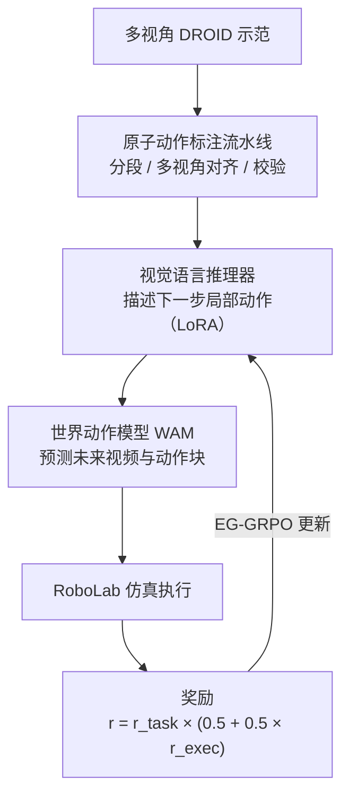
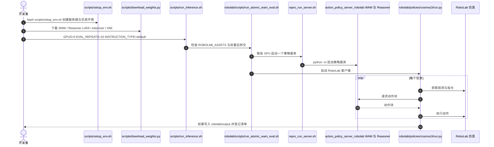

# Atomic-WAM：用执行反馈校准原子动作推理

**Atomic-WAM 在世界动作模型（WAM）之前加一个视觉语言推理器：推理器先描述下一步局部原子动作，再由固定的 WAM 执行；推理器通过 EG-GRPO 以执行成功与动作合理性奖励进行后训练。**

论文 *Atomic-WAM: Execution-Grounded Atomic-Motion Reasoning for World Action Models*（[arXiv:2610.20157](https://arxiv.org/abs/2610.20157)，[代码](https://github.com/ssj9596/Atomic-WAM)，[项目页](https://ssj9596.github.io/Atomic-WAM-project/)）。

## 英文缩写速查

| 缩写 | 英文全称 | 简要说明 |
|------|----------|----------|
| WAM | World Action Model | 联合预测未来视频与动作块的机器人策略，基座来自视频基础模型 |
| EG-GRPO | Execution-Grounded Group Relative Policy Optimization | 本文的执行反馈后训练：WAM 固定，奖励结合任务成功与执行成功 |
| GRPO | Group Relative Policy Optimization | EG-GRPO 的算法基础，对同一提示的一组采样做相对优势估计 |
| VLM | Vision-Language Model | 推理器的基座形式，负责把任务指令细化为局部动作描述 |
| RoboLab | RoboLab benchmark（NVIDIA） | 本文主评测所用的 IsaacLab 系仿真基准（120 个任务） |

## 为什么重要

- 任务级指令常未说明下一步的物理接触动作，WAM 缺少局部动作约束。
- 固定执行模型、只优化推理器，使「描述是否可执行」由执行结果反馈，而不只靠语言相似度。
- 推理代码与权重已公开，并被 RoboLab 组织方用于官方复现（README 报告），对选型与复现有参考价值。

## 核心信息

| 项 | 内容 |
|----|------|
| **机构** | Zhejiang University；University of Hong Kong；ACE Robotics；Jiangnan University（依据仓库 README 作者单位） |
| **平台** | RoboLab 仿真（IsaacSim 5.0.0、IsaacLab 2.2.0，需官方资产）；Cosmos 框架服务端；WAM 与 Reasoner LoRA 权重 |
| **数据** | 从多视角 DROID 示范自动构建原子动作与接触增强监督（论文摘要）；RoboLab-120 评测 |
| **开源** | **部分开源**（2026-10-15 核查）：推理代码、权重（HF datasets 路径）与 RoboLab 评测脚本公开（[ssj9596/Atomic-WAM](https://github.com/ssj9596/Atomic-WAM)）；训练代码与原子动作标注 / 数据准备未发布（README 发布计划未勾选） |

## 核心原理

### 流程总览

推理器把任务指令转为下一步的局部原子动作描述；WAM 以该描述为条件预测未来视频与动作块；动作在仿真中执行并给出任务与执行奖励。奖励只用于更新推理器，WAM 保持冻结。

- 论文中监督版推理器先用标注数据训练，再以 EG-GRPO 做执行反馈后训练；EG-GRPO 的权重与超参以论文为准（未核 PDF 全文）。

## 源码运行时序图

仓库推理路径为：`scripts/run_inference.sh` → `robolab/scripts/run_atomic_wam_eval.sh` → 服务端脚本（启动 WAM 策略服务）与客户端 `robolab/policies/cosmos3/run.py`（驱动 RoboLab 任务）。

- **冒烟测试：** `GPUS=0 EVAL_REPEATS=1 TASKS_FILE="$PWD/scripts/smoke_tasks.txt" bash scripts/run_inference.sh`（BananaInBowlTask）。
- **多卡：** `GPUS=0,1` 将任务分片到多个独立策略服务，不是把单个模型拆到多卡。

## 工程实践

| 项 | 建议 |
|----|------|
| 环境 | Linux + NVIDIA CUDA GPU；RoboLab 另需 IsaacSim 5.0.0、IsaacLab 2.2.0 与官方资产（设置 `ROBOLAB_ASSETS`） |
| 安装 | `bash scripts/setup_env.sh`，可用 `--server-only` / `--client-only` 拆分 |
| 权重 | `cosmos-framework/.venv/bin/python scripts/download_weights.py` |
| 指令设定 | 分别跑 `INSTRUCTION_TYPE=default` 与 `vague`，两者结论不应混用 |
| 训练 | 训练代码未发布（README 发布计划）；推理器无法自行再训练 |
| 调试指标 | RoboLab 成功率（SR）与分数（score）；官方排行榜计算与论文略有不同（README） |

## 实验与评测

- **RoboLab-120，默认指令：** 39.6% SR，score 55.5；官方排行榜第二（Lakeside 51.0% SR / 65.3 score）。
- **RoboLab-120，模糊指令：** 31.6% SR，score 48.6；排名第一。
- **论文消融（默认指令，三次运行）：** 监督推理器 36.7%；GRPO 无执行奖励 34.2%；EG-GRPO 39.2%。
- **评测性质：** real-to-sim 仿真评测；论文主结果不是真机结果。

## 结论

**Atomic-WAM 的增益来自把执行反馈引入推理器后训练，但绝对成功率仍不高，且结果属于仿真评测，应按指令设定分开读。**

1. **执行奖励有效** — 同样是 GRPO，去掉执行奖励为 34.2%，加入后 EG-GRPO 为 39.2%（默认指令，三次运行）。
2. **相对监督推理器的增益有限** — 监督版 36.7%，EG-GRPO 高约 2.5 个百分点，收益不大。
3. **模糊指令下仍具相对优势** — 模糊指令 31.6% 排名第一，但绝对值低于默认指令。
4. **绝对成功率仍低** — 39.6% 距离可部署水平差距大，RoboLab 仿真结果不能直接外推到真机。
5. **复现路径部分可用** — 推理与权重可复现官方排行榜结果，但训练代码与标注未发布，无法自建推理器训练流程。

## 与其他工作对比

| 对照 | 差异读法 |
|------|----------|
| [World Action Models](../concepts/world-action-models.md) | 本文属于 WAM 范式，新增的是前置的原子动作推理器 |
| [VLA](../methods/vla.md) | 直接 VLA 输出动作；本文先由推理器输出局部动作描述再交给 WAM |
| [GRPO](../methods/grpo.md) | 算法基础；本文把执行成功作为额外奖励项 |
| [WAM 设计实证研究](./paper-wam-design-empirical-study.md) | 同属 WAM 设计讨论，侧重不同设计选择的对比 |

## 局限与风险

- **仿真为主：** 主评测是 RoboLab 仿真的 real-to-sim，真机结果论文主文未作为主结论（未核实）。
- **训练不可复现：** 训练代码与原子动作标注未发布，难以验证数据流程。
- **环境门槛高：** IsaacSim / IsaacLab 与官方资产依赖重，服务端需要 CUDA GPU。
- **分数口径：** 官方排行榜分数计算与论文略有差异，比较时需统一口径。
- **数值差异：** 摘要 39.6% 与消融均值 39.2% 来自不同统计口径，引用时需注明。

## 关联页面

- [World Action Models](../concepts/world-action-models.md) — 本文所属范式
- [VLA](../methods/vla.md) — 对照的直接动作策略
- [GRPO](../methods/grpo.md) — 后训练算法基础
- [Sim vs real 评测差距](../concepts/sim-vs-real-eval-gap.md) — 仿真结论外推的语境
- [WAM 设计实证研究](./paper-wam-design-empirical-study.md) — 相关 WAM 设计讨论

## 参考来源

- [atomic_wam_arxiv_2610_20157.md](../../sources/papers/atomic_wam_arxiv_2610_20157.md) — 论文摘录与开源核查
- [arXiv:2610.20157](https://arxiv.org/abs/2610.20157) — 原文
- [ssj9596/Atomic-WAM](https://github.com/ssj9596/Atomic-WAM) — 官方代码仓库（推理与 RoboLab 评测）

## 推荐继续阅读

- [Atomic-WAM 项目页](https://ssj9596.github.io/Atomic-WAM-project/)
- [RoboLab 官方排行榜](https://research.nvidia.com/labs/srl/projects/robolab/leaderboard.html)
- [RoboLab 项目页](https://research.nvidia.com/labs/srl/projects/robolab/)
