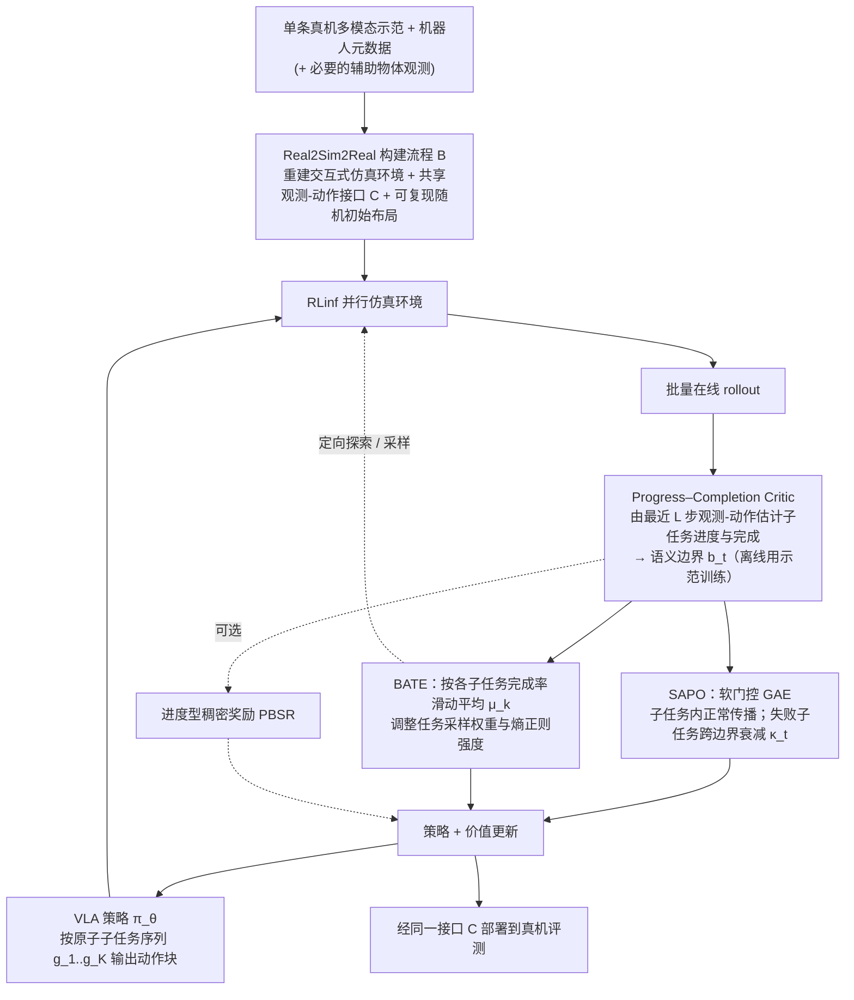

# AtomicRL：长程操作的原子任务强化学习

**一句话定义：** AtomicRL 把长程操作拆成原子子任务，并依据语义边界处理信用分配、根据薄弱子任务调整探索。

## 英文缩写速查

| 缩写 | 英文全称 | 简要说明 |
|------|----------|----------|
| AtomicRL | Atomic Reinforcement Learning | 面向长程操作的原子任务强化学习后训练框架 |
| VLA | Vision-Language-Action | 论文强化学习后训练的视觉语言动作策略 |
| SAPO | Semantic-Aware Policy Optimization | 按子任务语义边界门控 TD residual 跨边界传播的优化方法 |
| BATE | Bottleneck-Adaptive Target Exploration | 根据原子任务掌握程度调整任务采样与局部探索的方法 |
| PCC | Progress–Completion Critic | 估计子任务进度与完成状态、给出语义边界的轻量判别器 |
| GAE | Generalized Advantage Estimation | PPO 中用 TD residual 的指数加权和估计优势的方法 |
| TD | Temporal-Difference | 一步时序差分残差 $\delta_t$，SAPO 保持其形式不变 |
| PBSR | Progress-Based Shaping Reward | 由 PCC 进度估计构造的稠密进度型奖励 |
| PPO | Proximal Policy Optimization | 论文的主要对照基线（同一框架下的 PPO 后训练） |

## 为什么重要

长程操作的最终成败可能由多个连续子任务决定。只在整条轨迹末端给稀疏奖励，会让早期动作承担模糊信用；如果某个子任务掌握不足，其他已会阶段的改进也难以转化成全任务成功。论文指出，两个问题分别表现为：失败段的 TD 残差沿 GAE 向前传播，压低了失败轨迹中已经正确执行的动作的优势（称为 credit contamination）；以及训练后期失败集中在少数瓶颈子任务上，而均匀采样与固定探索会把交互预算浪费在已熟练的子任务上。

## 流程总览

图依据：论文 §3.1 至 §3.5 与 Fig. 2。

## 核心原理

**输入与输出。** 策略 $\pi_\theta$ 接收第三人称图像、腕部图像与本体状态，按原子子任务序列输出动作块；PCC 只使用最近 $L$ 步的观测-动作对来判断当前子任务的进度 $\hat p_t$ 与完成概率 $\hat q_t$，并据此得到语义边界 $b_t = \mathbb{I}[z_{t+1}\neq z_t]$。

**SAPO（信用分配）。** 单步 TD 残差保持不变：$\delta_t = r_t + \gamma(1-d_t)V_\phi(s_{t+1}) - V_\phi(s_t)$。变化的只是 GAE 迹的递推：在子任务内部 $b_t=0$，迹按标准 $\gamma\lambda$ 衰减；在边界处，若后续子任务成功则 $\kappa_t=1$（正常传播），若失败则 $0<\kappa_t<1$，衰减跨边界传播。直觉上，已完成前缀内部的信用保留，而下游失败对前缀的负向污染被削弱。

**BATE（探索分配）。** 对每个原子子任务维护完成率的指数滑动平均 $\mu_k^{(n)} = \beta\mu_k^{(n-1)} + (1-\beta)\hat s_k$；掌握度低的子任务获得更高的整任务采样权重（$w_i = 1 + \rho(\max_{k\in\mathcal{K}_i}(1-\mu_k))^{\eta}$，再归一化为 $P_{\text{task}}(i)$），并在轨迹内通过熵正则系数提高该子任务的局部探索强度。

**PBSR（可选稠密奖励）。** 训练奖励为 $r_t = r_t^{\text{env}} + \alpha_n r_t^{\text{PBSR}}$，其中进度势函数的差分 $r^{\text{PBSR}}_t = \gamma\Phi_{t+1} - \Phi_t$，系数 $\alpha_n$ 线性退火，使早期有更强的稠密引导、后期回归稀疏终局奖励。

**Real2Sim2Real。** 由单条真机多模态示范、机器人元数据及必要的辅助物体观测，自动构建仿真环境、共享观测-动作接口与可复现随机初始布局，RL 在仿真中完成，再经同一接口部署到真机。

## 方法栈

`VLA 初始化 → 原子子任务进度 / 边界 → SAPO 信用分配 + BATE 瓶颈探索 → 仿真 RL 后训练 → 真机部署`

## 实验与评测

以下数字取自论文正文与附录（arXiv v1）：

- **LIBERO-LONG（Table 1，50 次试验 / 任务）**：π0.5 为 SFT 89.0%、PPO 95.4%、AtomicRL 99.0%（相对 PPO +3.6 pp）；OpenVLA-OFT 为 SFT 86.5%、PPO 94.8%、AtomicRL 98.8%（相对 PPO +4.0 pp）。
- **CALVIN ABC→D（Table 2，1000 次评测）**：π0.5 的平均完成长度 SFT 3.56、PPO 4.36、AtomicRL 4.56；连续完成五个任务的成功率 PPO 70.6%、AtomicRL 80.1%（+9.5 pp）。
- **真机（AgiBot G1，三项任务，每任务每方法 25 次）**：平均成功率 SFT 48.0%、PPO 61.3%、AtomicRL 69.3%。即相对 SFT 为 +21.3 pp，相对 PPO 为 +8.0 pp；摘要中的「21.3%」是这一百分点差，不是相对倍率。分任务 AtomicRL 为 BP 76%、WD 72%、TC 60%。
- **Sim2Real 相关性（Fig. 3）**：3 项任务 × 3 种方法共 9 组设定上，仿真与真机成功率的 Pearson r = 0.909。
- **消融（附录式小规模设定：LIBERO-LONG 使用更少示范训练的弱 SFT 初始化，Table 4）**：PPO 78.2% → 加 SAPO 87.8% → 加 PBSR 89.6% → 加 BATE 91.2%。SAPO 是最大单项增益。
- **SAPO 门控系数 κ（附录 Table 6）**：κ = 0 为 87.2%，0.3 为 87.8%，0.5 为 85.0%，0.8 为 81.2%，1.0（即标准 GAE）为 78.2%。
- **PCC（Table 5）**：在 500 条测试 rollout 上准确率 95.92%、召回 89.20%、误检率 4.08%；可训练参数 28.8M，推理延迟 42.4 ms。

## 与其他工作对比

| 路线 | 任务粒度 | 对长程瓶颈的处理 |
|------|----------|------------------|
| AtomicRL | 显式原子子任务 | 边界感知信用分配 + 按掌握度探索 |
| 标准 PPO 后训练 | 整任务 / 轨迹 | 依赖奖励与优势估计，未显式建模子任务边界 |
| STARE-VLA / IG-RFT（论文 §2.1 所述） | 阶段 / 子任务 | 阶段级偏好优化、奖励塑形或轨迹与子任务奖励结合；论文认为稠密奖励无法消除后期失败的干扰 |
| [VLA](../methods/vla.md) | 取决于策略和数据接口 | 可结合不同后训练方法 |

## 工程实践

- 先定义可观测、可判定完成的原子子任务，再构造进度和边界信号。
- 训练诊断需按子任务记录完成率，区分真正瓶颈与奖励/检测器误差。
- 复现配置（附录 A.4）：PCC 使用冻结的 SigLIP 视觉编码器（约 400M，初始化自 π0.5 视觉骨干）加轻量时序与预测模块，离线训练，RL 阶段保持固定；LIBERO 标注 150 条轨迹，每个真机任务标注 50 条；每次 RL 运行 200 次优化步；训练在 8 块 H200 上完成，推理在单张 RTX 5090 上进行。标注由 VLM 自动生成并经人工修正（§4.4）。
- BATE 的 $\beta$、$\eta$、$\rho$，SAPO 的 $\kappa$ 以外的 PCC 阈值（$\tau_s$、$\tau_p$、$N$）及 PBSR 退火参数的具体取值，正文未核到（未核实）。
- 源码开放状态（步骤 2.5）：入库复核（2026-11-06）时，论文正文与 arXiv 摘要页均未列出项目页或代码仓库，未找到官方 GitHub、权重或数据入口；正文中提到的 RLinf、SERL 是所用或相关的开源框架，并非本工作代码。因此当前判定为 **未确认开源**，复现入口待后续核实。
- 源码运行时序图：**不适用**（未列官方代码仓库，无可核实的训练 / 推理运行入口）。

## 结论

**AtomicRL 的主要价值在于分别处理长程 VLA 强化学习中的两个结构性问题：边界处的信用污染，以及子任务间的掌握失衡。**

1. SAPO 是增益主力：它只改变 GAE 迹在语义边界上的传播，不改单步 TD 残差；消融中单独加入它可把 PPO 的 78.2% 提到 87.8%。
2. PBSR 与 BATE 是增量：分别为 +1.8 pp 与 +1.6 pp。论文也指出稠密奖励后期可能稀释终局成功信号，因此采用退火。
3. 结果依赖子任务切分与 PCC 质量；边界误检会同时影响 SAPO 的门控和 BATE 的掌握度估计，且 PCC 标注经过 VLM 生成加人工修正，标注误差如何传递未单独评估。
4. 主结果为 LIBERO +3.6 / +4.0 pp、CALVIN 五连成功率 +9.5 pp、真机相对 SFT 平均 +21.3 pp；真机每个设定仅 25 次试验，且正文未见置信区间或多随机种子统计（未核实）。
5. 截至入库复核未找到官方代码入口，复现成本暂无法判断。

## 局限与风险

- 原子子任务划分、进度估计和完成边界检测均可能成为系统误差来源；PCC 的误检会直接改变 SAPO 的门控与 BATE 的采样权重。
- 对共享状态或强耦合子任务，强边界隔离可能损失有用的跨阶段价值信息；论文只报告了 LIBERO 上 κ 的单一扫描（附录 Table 6），其他任务上的敏感性未展示。
- 论文自述的限制（附录 A.1）：在线 RL 的交互与训练成本仍高，尤其在真机上；实验以桌面长程操作为主，且均从 SFT 策略初始化，对开放、动态、需要更强本体泛化的任务尚未验证；与 agentic RL 路线的结合仍是待探索方向。
- 消融使用较弱的 few-shot SFT 初始化，与主结果的初始化不同，不宜直接当作主结果的分项贡献。
- 表间数值存在口径差异：Table 4(a) 中 PBSR 行加 SAPO 为 89.0%，而 Table 4(b) 的 PBSR 行为 89.6%，引用时需回到原表核对。
- Sim2Real 相关性（r = 0.909）仅基于 9 组设定，不足以证明任意任务上的仿真可迁移性。
- Real2Sim2Real 管线依赖多种工具链与 LLM 辅助编排（附录 A.6），复现时的人工介入程度与可替代性未在正文充分说明。
- 摘要给出的提升没有涵盖所有任务拆分和长程任务类型。

## 关联页面

- [Reinforcement Learning](../methods/reinforcement-learning.md)
- [Manipulation](../tasks/manipulation.md)
- [VLA](../methods/vla.md)

## 参考来源

- [AtomicRL 论文归档](../../sources/papers/atomicrl_arxiv_2610_30097.md)
- [arXiv:2610.30097](https://arxiv.org/abs/2610.30097)
- [arXiv PDF](https://arxiv.org/pdf/2610.30097)：已通读全文（v1，正文 §1–§5 及附录 A.1–A.7；参考文献列表未逐条核对）

## 推荐继续阅读

- [AtomicRL 原论文](https://arxiv.org/abs/2610.30097) — 方法与评测细节
- [Reinforcement Learning](../methods/reinforcement-learning.md) — 强化学习基础与机器人应用
