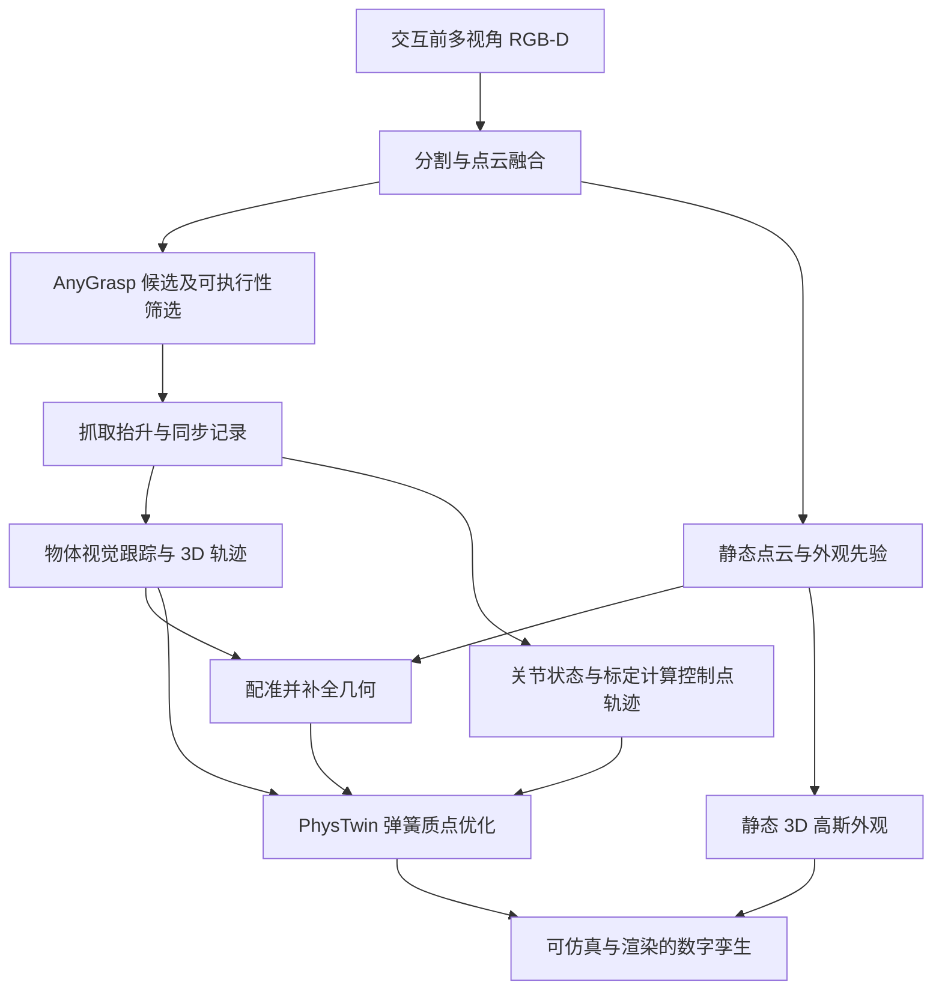
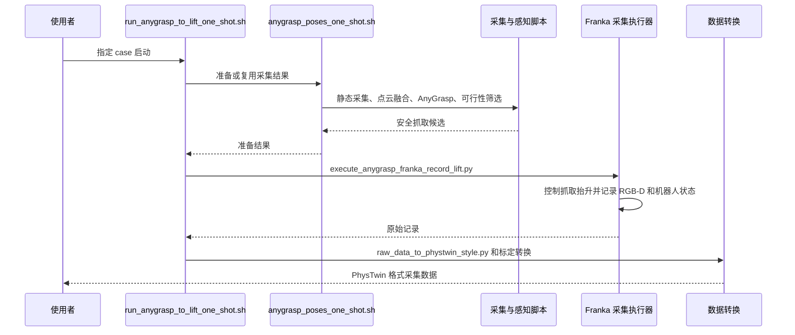

# AuRA: From Atoms to Bits through Autonomous Robot Interaction｜从原子到比特：通过自主机器人交互构建数字孪生

## 一句话定义

AuRA 在人工放置物体和初始化后，自动执行抓取与抬升，采集可变形物体交互数据，用于构建包含几何、外观及动力学的数字孪生。

## 英文缩写速查

| 缩写 | 英文全称 | 简要说明 |
|------|----------|----------|
| AuRA | Autonomous Real-to-sim Asset Reconstruction | 自主实物到仿真资产重建 |
| RGB-D | Red, Green, Blue and Depth | 彩色与深度观测 |
| ICP | Iterative Closest Point | 点云配准算法 |
| 3DGS | 3D Gaussian Splatting | 三维高斯外观表示 |

## 核心机制

基于 [arXiv:2610.34452v1 全文](https://arxiv.org/html/2610.34452v1)，作者来自 University of Maryland, College Park 和 All Purpose AI。系统利用三台 OAK-D 相机和 Franka 机械臂。

1. **采集：**多视角静态 RGB-D 分割、融合点云，AnyGrasp 生成抓取候选；结合桌面净空、PyRoki 逆运动学和关节余量筛选，执行抓取抬升，同时记录影像与关节状态。
2. **处理：**Grounded-SAM2 分割物体；MV-TAP 跟踪多视角可见点，单视角点使用 CoTracker3，再结合深度恢复 3D 轨迹。机器人状态与标定的指尖几何计算控制点轨迹，避免视觉跟踪夹爪。
3. **补全与重建：**将交互前静态点云通过 PCA 初始化和 ICP 配准至交互首帧，补充遮挡区域；用轨迹拟合 PhysTwin 弹簧质点模型，并将静态 3D 高斯绑定到物理模型实现变形渲染。配准假设抓取前后的形变较小。

### 项目流程图

## 源码运行时序图

依据 [官方 README](https://github.com/Yoonkyo/AuRA/blob/main/README.md) 和采集脚本；下图仅覆盖当前 v1 已公开的采集链路，后处理和重建代码尚待 v2。准备脚本可以先单独运行；完整运行脚本会调用准备阶段。

## 实验与评测

- **13 个可变形物体：**AuRA 从 35 次尝试得到 26 个成功资产（74.3%）；人工总体为 78 次中 21 个（26.9%）。
- **每个成功资产的采集成本：**主动人工时间 32.7 秒对 284.4 秒，下降 88.5%；实际采集耗时 126.7 秒对 284.4 秒，下降 55.4%。统计包含失败采集，**不含后处理和重建时间**；专家组的采集耗时为 100.6 秒。
- **已知夹爪轨迹的未来预测：**相对人工采集的 PhysTwin，9 项指标中 7 项更优；单向 L1 Chamfer 从 23.335 降到 16.783 mm。但重模拟中 PhysTwin 有 8 项更优，AuRA 深度 MAE 在未来预测中也更高。
- **未见交互：**每种方法各 13 条，使用人工对齐物体和遥操作拖拽抬升；AuRA 和 PhysTwin 的 mask IoU 为 0.3861 / 0.3849，Chamfer 为 43.554 / 43.430 mm。这不是自主泛化部署评测。
- **消融：**同 26 条机器人轨迹，机器人状态所得控制轨迹重建成功 26/26，视觉夹爪跟踪为 2/26；结果适用于论文所测设置。

## 与其他工作对比

| 维度 | 本页 AuRA | [PhysTwin](./paper-sa-2503-17973-phystwin-physics-informed-reconstruction-and-sim.md) | [Agentic Real2Sim](./paper-agentic-real2sim.md) |
|------|-----------|-----------|-----------|
| 数据来源 | 机器人自主抓取抬升，同步记录 RGB-D 与关节状态 | 3 路 RGB-D 交互视频（手部操作） | 已有真机交互 episode（主攻 DROID） |
| 控制点来源 | 机器人状态 + 标定指尖几何 | 手部 mask 跟踪 + 最远点采样 | — |
| 物理 / 外观表示 | PhysTwin 弹簧质点 + 静态 3D 高斯绑定 | 弹簧质点 + 3D Gaussians（LBS 驱动） | MuJoCo episode twin（刚性为主） |
| 主要评测 | 每个成功资产的人工 / 采集时间；相对人工采集 PhysTwin 的预测指标 | 本站为清单索引页，未搬运数值 | DROID-100 回放成功（三 VLM 裁判） |
| 代码状态 | v1 仅采集链路；重建待 v2 | 官方仓库公开 | 项目页标注 coming soon |

- **怎么选：** AuRA 不替换 PhysTwin 的建模，而是把「人手采集」换成「机器人自主采集」并用机器人状态替代视觉夹爪跟踪；关心刚性操作 episode 的批量回放时看 Agentic Real2Sim。
- **读法：** AuRA 的效率收益只统计采集阶段，与 PhysTwin 比较时需区分采集成本与重建 / 预测质量。

## 局限与工程实践

- 自动化从人工放置与初始化后开始；需要多相机、机械臂及夹爪标定。论文的单次动作主要是抓取抬升。
- 官方 v1 公开采集实现；后处理、训练和资产重建标为 v2 待发布。AnyGrasp SDK、许可证和权重需另行获取；Grounded-SAM-2 及权重需自行安装。
- 官方 README 指出过滤器不是完整碰撞检查器，默认设置下基本不检查抓取成功；不可将过滤通过当作安全或抓取成功保证。源码及第三方许可边界见 [仓库归档](../../sources/repos/aura.md)。
- 项目页面本次访问失败；开放状态根据官方仓库 README 核对，仍需重新核查项目页。

## 结论

AuRA 展示了以机器人自主交互降低可变形物体数字孪生数据采集成本的路径。

1. 对遮挡严重的夹爪，优先利用标定和机器人状态构造控制输入。
2. 保存交互前多视角几何和外观，可为遮挡区域提供先验，但配准依赖小形变假设。
3. 对比效率时区分采集、处理和重建成本，并区分专家与人工总体。
4. 复现端到端资产重建需等待尚未公开的 v2 代码。

## 关联页面

- [具身数据采集四层分类](../concepts/embodied-data-collection-four-layers-taxonomy.md)
- [遥操作](../tasks/teleoperation.md)
- [模仿学习](../methods/imitation-learning.md)
- [同期技术地图](../overview/embodied-station-2026-10-28-59-papers-technology-map.md)

## 参考来源

- [论文来源归档](../../sources/papers/aura_arxiv_2610_34452.md)
- [官方仓库归档](../../sources/repos/aura.md)
- [项目页归档](../../sources/sites/aura.md)
- [论文全文 v1](https://arxiv.org/html/2610.34452v1)
- [官方代码](https://github.com/Yoonkyo/AuRA)
