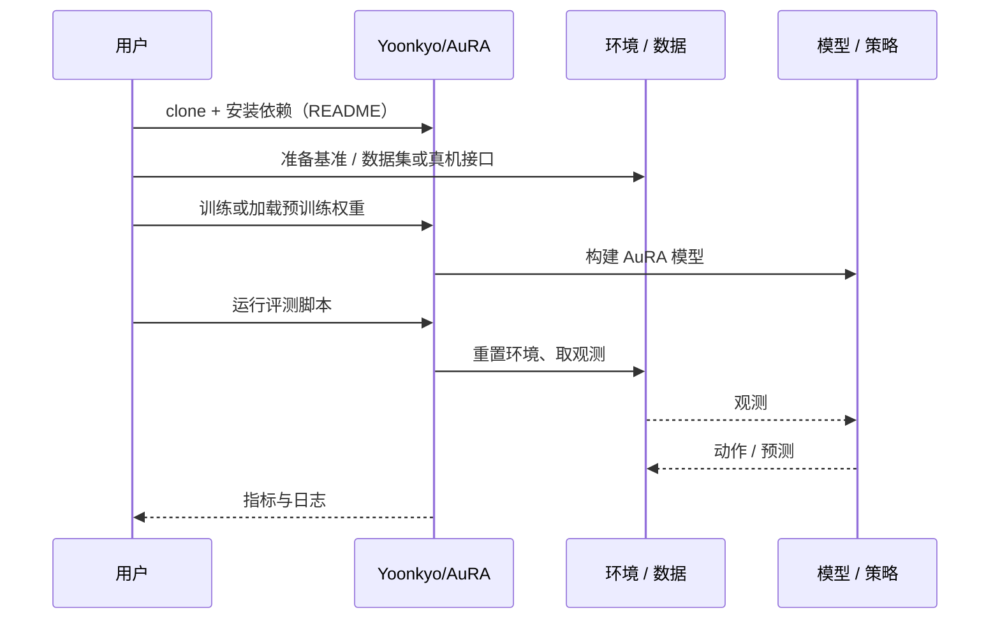

# AuRA（arXiv:2610.34452）

**AuRA**（*AuRA: From Atoms to Bits through Autonomous Robot Interaction*，[arXiv:2610.34452](https://arxiv.org/abs/2610.34452)，[项目页](https://aura-robot.github.io/)，[代码](https://github.com/Yoonkyo/AuRA)）来自 [具身智能小站 2026-10-28 盘点](../../sources/blogs/wechat_embodied_station_59_papers_human_video_to_robot_experience_2026-10-28.md)，属「数据采集与示范迁移」组。

## 一句话定义

**数字孪生重建常被逐物体人工交互与标注拖慢。**

## 英文缩写速查

| 缩写 | 英文全称 | 简要说明 |
|------|----------|----------|
| AuRA | AuRA: From Atoms to Bits through Autonomous Robot Interaction | 本文方法 / 基准的简称 |

## 为什么重要

- 让机器人自己采集可变形物体数据。AuRA 把可执行抓取、机器人状态和交互前场景先验接起来，让机器人自主采集可变形物体交互，直接对应资产建设成本。
- 开源结论：**已开源**（步骤 2.5，2026-10-28）。仓库可达（git ls-remote）。项目页 HTTP 200。
- 同期同组工作见 [潜在动作、免渲染事件仿真与机器人评测：具身智能小站 10-28 期 59 篇阅读坐标](../overview/embodied-station-2026-10-28-59-papers-technology-map.md)。

## 核心机制

| 项 | 内容 |
|----|------|
| **arXiv** | [2610.34452](https://arxiv.org/abs/2610.34452) |
| **开源** | **已开源** |
| **要点** | 数字孪生重建常被逐物体人工交互与标注拖慢。 |
| **文内指标** | 公众号转述：用机器人状态给出夹爪运动：减少视觉跟踪遮挡与误差，再以交互前几何、外观先验补足被机械臂挡住的信息。 |

## 源码运行时序图

以下为按仓库入口（`Yoonkyo/AuRA`）推断的通用运行链路；入库日仅核实仓库可达，未逐文件阅读，具体脚本名以 README 为准。

## 实验与评测

- 公众号转述：用机器人状态给出夹爪运动：减少视觉跟踪遮挡与误差，再以交互前几何、外观先验补足被机械臂挡住的信息。
- **读法：** 本页为索引级摘要，依据公众号转述的官方摘要与仓库信息整理；逐项数字与 baseline 以原文 PDF 为准。

## 与其他工作对比

- 横向索引见 [潜在动作、免渲染事件仿真与机器人评测：具身智能小站 10-28 期 59 篇阅读坐标](../overview/embodied-station-2026-10-28-59-papers-technology-map.md)；同 arXiv 不重复造页。

## 结论

**让机器人自己采集可变形物体数据：用机器人状态给出夹爪运动：减少视觉跟踪遮挡与误差，再以交互前几何、外观先验补足被机械臂挡住的信息。**

1. 开源边界：**已开源** — 仓库可达（git ls-remote）。项目页 HTTP 200。
2. 核心机制：数字孪生重建常被逐物体人工交互与标注拖慢。
3. 复现与选型前核对任务协议、硬件与基准口径，勿直接横比公众号摘录数字。

## 关联页面

- [embodied-data-collection-four-layers-taxonomy](../concepts/embodied-data-collection-four-layers-taxonomy.md)
- [teleoperation](../tasks/teleoperation.md)
- [imitation-learning](../methods/imitation-learning.md)
- [embodied-station-2026-10-28-59-papers-technology-map](../overview/embodied-station-2026-10-28-59-papers-technology-map.md)

## 参考来源

- [aura_arxiv_2610_34452.md](../../sources/papers/aura_arxiv_2610_34452.md)
- [wechat_embodied_station_59_papers_human_video_to_robot_experience_2026-10-28.md](../../sources/blogs/wechat_embodied_station_59_papers_human_video_to_robot_experience_2026-10-28.md)
- [arXiv:2610.34452](https://arxiv.org/abs/2610.34452)

## 推荐继续阅读

- [arXiv PDF](https://arxiv.org/pdf/2610.34452)
- [项目页](https://aura-robot.github.io/)
- [https://github.com/Yoonkyo/AuRA](https://github.com/Yoonkyo/AuRA)
