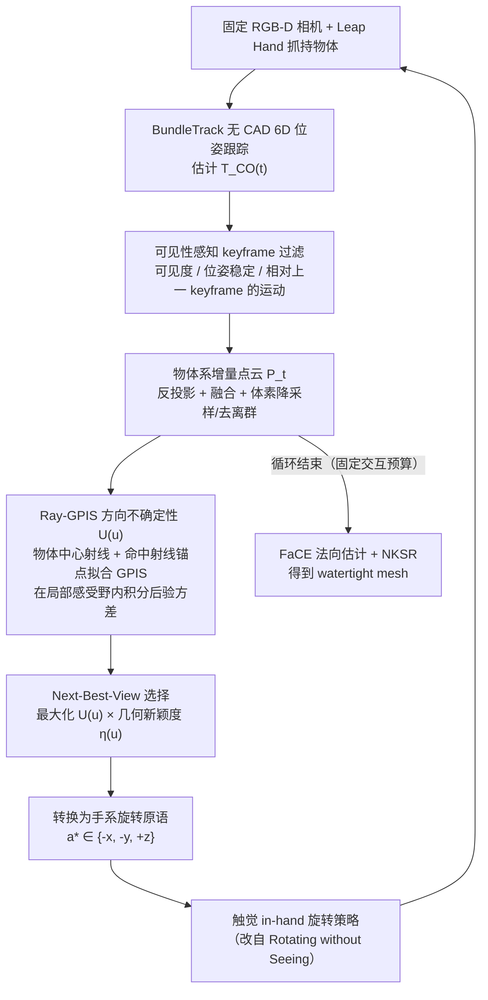

# AURORA

**AURORA**（*Active Uncertainty-Driven Re-Orientation for In-Hand Reconstruction*，[arXiv:2609.08493](https://arxiv.org/abs/2609.08493)，[项目/代码](https://aurorahand.github.io/)）— 详见 [具身智能小站 10 篇盘点（2026-09-09）](../../sources/blogs/wechat_embodied_station_visual_focus_10_papers_2026-09-09.md)。

## 一句话定义

固定相机看手内物体时手和物互相遮挡——AURORA 用重建不确定性选下一最佳视角，再用手内旋转策略主动暴露未观测表面。

## 英文缩写速查

| 缩写 | 英文全称 | 简要说明 |
|------|----------|----------|
| AURORA | Active Uncertainty-Driven Re-Orientation | 本文主动重建框架 |
| NBV | Next Best View | 下一最佳视角规划 |
| RGB-D | RGB-Depth | 固定相机观测 |
| F-score | F-score | 重建精度/召回调和均值 |

## 为什么重要

- Leap Hand + BundleTrack + 视觉融合管线
- 30s 操作预算：online F@10 mean 0.9671，active 优于 x/y/z 单轴与固定 schedule

## 流程总览

图依据：论文 §3.1–3.3 / Fig.2、Fig.3、式(1)–(9)

## 核心信息

| 项 | 内容 |
|----|------|
| **arXiv** | [2609.08493](https://arxiv.org/abs/2609.08493) |
| **开源** | **未开源** |
| **项目/代码** | [https://aurorahand.github.io/](https://aurorahand.github.io/) |

## 核心原理

- Leap Hand + BundleTrack + 视觉融合管线
- 30s 操作预算：online F@10 mean 0.9671，active 优于 x/y/z 单轴与固定 schedule
- 匿名作者项目页；无公开代码链

## 源码运行时序图

**不适用（官方可运行代码尚未发布或待核实）。** 截至 2026-09-09 以项目页/公众号链为准。

## 实验与评测

- 指标与设置以原文 PDF / 项目页为准；上文 Highlights 来自公众号归纳 + 项目页摘要。
- 横向对照见 [视觉聚焦与数据效率 10 篇技术地图](../overview/visual-focus-data-efficiency-10-papers-technology-map.md)。

## 与其他工作对比

> 下表只做**定位对照**，不做跨设定横比：AURORA 的数值来自项目页/公众号归纳（见参考来源），未开源、无可复现脚本，与下列各页的实验设定不共享同一协议。

| 对照 | 差异读法 |
|------|----------|
| **同文开环基线**（x/y/z 单轴旋转、固定 schedule） | 唯一可比的一组：同为 30s 操作预算、同一 Leap Hand + BundleTrack 管线，差别只在「转哪个轴由谁决定」。AURORA 用重建不确定性在线选，report mean F@10=0.9671 优于开环；这是本页最硬的一条主张 |
| [FBI：手内灵巧操作](./paper-sa-2508-14441-fbi-learning-dexterous-in-hand-manipulation-with.md) | 同为手内 re-orientation，但**目标函数相反**：FBI 把旋转本身当任务（学会稳定转物体），AURORA 把旋转当**手段**（转出没看过的面去补重建）。前者看操作成功率/掉落率，后者看重建 F-score，不可互比 |
| [立体匹配基础模型与基准生态](../methods/stereo-matching-foundation-models.md) | 被动路线的对照：靠更强的双目/深度前端把**同一视角**的几何做准；AURORA 不改前端，改的是**观测序列**。遮挡区在被动路线里是缺失数据，在 AURORA 里是可以主动消除的 |
| [2D→3D 语义提升 Gap](../concepts/2d-to-3d-semantic-lifting-gap.md) | 该页归纳的尺度/遮挡歧义正是 AURORA 的动机来源；区别是该页讲误差怎么来，本页讲用主动视角把它减掉 |
| [视觉聚焦与数据效率 10 篇技术地图](../overview/visual-focus-data-efficiency-10-papers-technology-map.md) | 同批盘点的横向位置；本页属「主动改变观测」一支，而非「同样观测下更省数据」一支 |

## 结论

**AURORA 的可迁移主张已写入 Highlights；部署前以原文实验设定与开源边界为准。**

1. **真影响：** 见核心原理 bullets。
2. **次要代价：** 预印本/待开源项需独立复现验证。
3. **部署读法：** 未开源 — 先读 README 或项目页再接真机/智能体栈。

## 关联页面

- [视觉聚焦与数据效率 10 篇技术地图](../overview/visual-focus-data-efficiency-10-papers-technology-map.md)
- [模仿学习](../methods/imitation-learning.md)
- [机器人视觉感知栈选型闭环](../queries/robot-perception-stack-selection-loop.md) — 本页是其 ① 传感与标定层之外的第三条路：不换传感器、不换算法，靠**主动改变物体位姿**补掉遮挡区；该闭环 ① 层「有深度图 ≠ 深度处处可信」的失效区正是这里要主动消除的对象
- [2D→3D 语义提升 Gap](../concepts/2d-to-3d-semantic-lifting-gap.md) — 遮挡/尺度歧义的成因侧
- [立体匹配基础模型与基准生态](../methods/stereo-matching-foundation-models.md) — 被动几何前端对照

## 参考来源

- [aurora_hand_reconstruction_arxiv_2609_08493.md](../../sources/papers/aurora_hand_reconstruction_arxiv_2609_08493.md)
- [具身智能小站 10 篇盘点（2026-09-09）](../../sources/blogs/wechat_embodied_station_visual_focus_10_papers_2026-09-09.md)
- [arXiv:2609.08493](https://arxiv.org/abs/2609.08493)
- [arXiv PDF](https://arxiv.org/pdf/2609.08493)：已通读方法部分（实验与附录以略读为准）：§3 Methodology（3.1–3.3）、§4.1 系统设置；§4 其余实验与附录以略读为准

## 推荐继续阅读

- [原文 PDF](https://arxiv.org/pdf/2609.08493)
- [项目/代码](https://aurorahand.github.io/)
