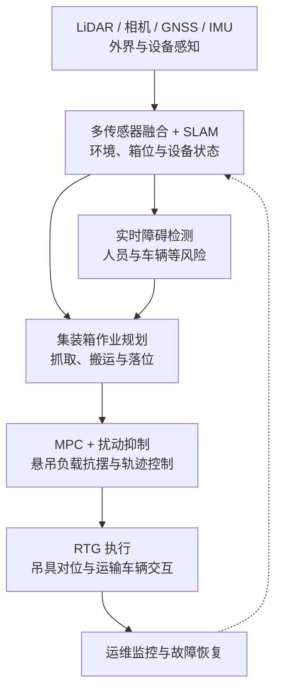

# Autane：面向港口持续作业的自主起重机 | An autonomous crane for sustained port operations

论文：[Yang et al., Science Robotics 2026](https://doi.org/10.1126/scirobotics.ady5784)；机构：**香港科技大学（广州）、东南大学、上海驭矩信息科技有限公司**。本文是港口 RTG 起重机自主作业的工程系统研究，**当前仅完成期刊摘要及研究团队官方介绍的证据核对**，非论文全文精读。

## 一句话定义

**Autane 将远距离多传感器感知、定位建图、障碍检测、作业规划、悬吊负载抗摆控制及运维集成到轮胎式龙门起重机（RTG），实现集装箱自主抓取、搬运和精准落位。**

## 英文缩写速查

| 缩写 | 英文全称 | 简要说明 |
|------|----------|----------|
| RTG | Rubber-Tired Gantry | 轮胎式龙门起重机，本文面向的港口设备 |
| SLAM | Simultaneous Localization and Mapping | 对堆场环境定位与建图，支撑远距离自主作业 |
| MPC | Model Predictive Control | 官方介绍用于悬吊负载运动的模型预测控制 |
| GNSS | Global Navigation Satellite System | 参与室外定位/感知融合的卫星导航系统 |
| IMU | Inertial Measurement Unit | 参与状态估计的惯性测量单元 |
| TEU | Twenty-foot Equivalent Unit | 港口集装箱吞吐量的标准换算单位 |

## 为什么重要

- **大尺度与厘米级精度并存：** RTG 在堆场跨距离搬运重载箱体，抓取、堆叠要求精确对位，且吊具/箱体存在摆动。
- **将单点算法升级为运营闭环：** 港口自主化必须覆盖感知、规划、控制、异常恢复、运维及车辆交接，不只看单次抓取演示。
- **有持续运行证据：** 期刊摘要报告多港口部署与超过 200 万 TEU 的累计自主作业；后续团队报道另给大规模部署数据，需按来源分开引用。

## 核心信息

| 项 | 公开可核实内容 |
|----|----------------|
| 论文 | Science Robotics 11(120): eady5784；2026-11-11；DOI: 10.1126/scirobotics.ady5784 |
| 设备 | 港口轮胎式龙门起重机（RTG），标准集装箱搬运 |
| 感知 | LiDAR、相机、GNSS、IMU；多传感器融合、SLAM、实时障碍检测 |
| 控制 | 作业轨迹调整、MPC 与扰动抑制抗摆（官方报道口径） |
| 系统 | 感知—规划—控制—运维耦合，涵盖箱位对齐和运输车辆交互 |
| 复现 | 本次未核实到官方公开可运行代码；控制律、参数、评测协议待全文核对 |

## 核心原理

来自[期刊摘要](https://pubmed.ncbi.nlm.nih.gov/43013691/)与[研究团队官方介绍](../../sources/sites/hkust-gz-autane-2026-11-16.md)的**高层模块边界**如下。这是基于公开叙述的概念链路，不代表已核验论文内部接口、具体执行顺序或算法实现细节。

### 流程总览

**待论文核验：** 真实闭环频率、状态估计融合结构、摆角模型、MPC 目标函数与约束、避障安全互锁、故障处理/人工接管逻辑。不能由这张概念图反推控制细节。

## 源码运行时序图

**不适用（当前无法核实可运行的 Autane 官方源码）**。出版摘要及团队官方报道未提供代码/部署入口；不虚构模块名或运行调用。

## 工程实践

- **感知链：** 大范围堆场与箱角/吊具局部精确对位同时存在，关注融合定位误差、障碍检测漏检与恶劣天气退化。
- **控制链：** 工程验收不能只看单轴位置误差，应同时核查悬吊摆动、抓放终点误差、轨迹时间以及制动/急停策略；具体论文测试阈值待全文证实。
- **运维链：** 将故障恢复率、人工干预、单箱次时长和长期成功率拆开报告，避免以累计吞吐量替代单次可靠性。
- **开源状态：** 截至 2026-11-19，本次检查的论文摘要和研究团队官网报道均未给出 Autane 的源码/数据下载链接；仍需核查作者版与其他官方发布渠道。

## 实验与评测

| 指标 | 数据 | 信息来源与限制 |
|------|------|----------------|
| 多港口累计作业量 | 超过 200 万 TEU | Science Robotics 摘要；原文表格尚未读到 |
| 后续累计作业量 | 超过 480 万 TEU | 港科大（广州）2026-11-16 官方介绍；与摘要口径不同，未做合并 |
| 部署规模 | 60 多台，5 种机型 | 官方介绍 |
| 作业统计 | 超过 60,000 次；平均成功率 91.23% | 官方介绍，成功判据与分组待原文核验 |
| 作业效率 | 25.93 箱次/小时 | 官方介绍，工况及对照协议待原文核验 |
| 瞬态故障恢复 | 约 90% 不需人工 | 官方介绍，故障分母定义待原文核验 |
| 环境耐受 | 15 m/s 风、25 mm 日降雨、50 m 能见度 | 官方介绍；未确认是否同时发生 |

## 与其他工作对比

- **与 [AWARE](./paper-aware.md)：** AWARE 强调从外部相机与动力学预测识别机器人异常，曾在起重机场景验证；Autane 是 RTG 起重机的**自主操作系统闭环**。研究目标和设备条件不同，不能直接横比性能数字。
- **与 [MPC 方法页](../methods/model-predictive-control.md)：** 通用 MPC 解释滚动优化框架；Autane 官方报道将其用于吊载抗摆这一大型工业机器人案例，但此处尚无方程细节。

## 结论

**Autane 的价值在于港口 RTG 的持续自主运营系统集成，而非仅展示一个独立感知或抗摆算法；公开资料支撑该定位，但精确技术边界仍需论文全文确认。**

1. **优先看系统级闭环：** 感知、箱体对位、轨迹规划、抗摆与异常恢复必须联合验收。
2. **区分吞吐量与成功率：** 累计 TEU、箱次/小时、单次任务成功率的分母不同，不能相互替代。
3. **区分来源时间：** 论文摘要的超过 200 万 TEU 与后续报道的超过 480 万 TEU 先分别保留，不擅自解释差异。
4. **复现暂不可判定：** 无代码入口及完整方法/参数证据；不可将本文标作可开源复现基线。

## 局限与风险

- **原文通读阻塞：** Science.org 本次访问返回 403，用户提供 PDF 不能直接获取；尚未核查论文方法、实验表、附录或补充材料。此节点保持草稿。
- **指标报告边界：** 91.23% 等数字来自团队官方新闻，不冒充独立复核的期刊实验数据。
- **安全边界：** 自主港口作业必须处理人员、车辆、风雨、悬吊重物与应急停机；公开摘要不足以验证功能安全等级或合规认证。

## 关联页面

- [模型预测控制（MPC）](../methods/model-predictive-control.md) — 抗摆控制的相关方法基础
- [AWARE](./paper-aware.md) — 起重机场景的异常检测研究；与自主作业系统侧重点不同

## 参考来源

- [Autane 论文归档（标明通读未完成）](../../sources/papers/autane_science_robotics_ady5784.md)
- [港科大（广州）官方新闻归档](../../sources/sites/hkust-gz-autane-2026-11-16.md)
- [Science Robotics DOI](https://doi.org/10.1126/scirobotics.ady5784)
- [PubMed: PMID 43013691](https://pubmed.ncbi.nlm.nih.gov/43013691/)

## 推荐继续阅读

- [Science Robotics 原文入口](https://www.science.org/doi/10.1126/scirobotics.ady5784)
- [研究团队官方介绍](https://www.hkust-gz.edu.cn/2026/11/16/hkustgz-autonomous-crane-system-makes-science-robotics-cover/)
