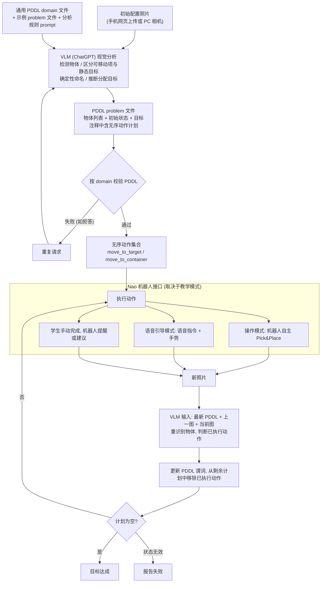

# 面向孤独症教育人形机器人的视觉任务建模与自动规划

**孤独症教育 NAO 规划**（*Visual Task Modeling and Automated Planning for Humanoid Robots in Education of Individuals with Autism Spectrum Disorder*，[arXiv:2610.27162](https://arxiv.org/abs/2610.27162)）收录于 senlanke「具身运控lab」10-19–10-23 前沿论文动态（人形/四足）。本页依据**周报条目 + arXiv 摘要页**整理，流程图依据论文方法部分（见参考来源），未逐页核对实验数字；指标与结论以论文为准。

## 一句话定义

**面向孤独症教育人形机器人的视觉任务建模与自动规划——使用视觉大模型把 Shoebox Task 照片转换为 PDDL 问题，再自动生成计划；NAO 可据此演示下一步、发出语音提示并检测操作失败。**

## 英文缩写速查

| 缩写 | 英文全称 | 简要说明 |
|------|----------|----------|
| RL | Reinforcement Learning | 强化学习 |
| WBC | Whole-Body Control | 全身控制 |

## 为什么重要

- 周报所述待解决的问题：教育机器人需要仅根据教具外观理解任务目标，并规划可向学生演示的操作步骤。

## 流程总览

图依据：论文 §II-A–D / Fig.2（感知–分析–动作循环）

## 核心机制

| 项 | 内容 |
|----|------|
| **arXiv** | [2610.27162](https://arxiv.org/abs/2610.27162) · [PDF](https://arxiv.org/pdf/2610.27162) |
| **作者（arXiv）** | Lada Kudláčková |
| **机构（周报所述，未逐条核实）** | 查理大学 |
| **arXiv 评论栏** | 6 pages, presented at conference AICCONF 2026 in Prague, Czech Republic |
| **开源** | arXiv 摘要页与评论未见代码或项目页链接（仅核对 arXiv 摘要页，不代表未发布）（2026-10-26） |
| **周报所述创新点** | 使用视觉大模型把 Shoebox Task 照片转换为 PDDL 问题，再自动生成计划；NAO 可据此演示下一步、发出语音提示并检测操作失败。 |

### arXiv 摘要节选（英文原文）

> In robot-assisted education, a robot must understand how to complete a task in order to effectively guide a student through it. We present a novel method that enables a semi-autonomous, camera-equipped robot to recognise the task goal and plan actions to achieve it.

## 源码运行时序图

**不适用**：arXiv 摘要页与评论未见代码或项目页链接（仅核对 arXiv 摘要页，不代表未发布），无可对齐的官方代码流程。

## 实验与评测

- 周报与摘要给出的数字/场景已写入上表「创新点」与摘要节选；其余实验细节、基线与成功率定义请回到论文正文。
- 读法：先对齐任务设定、传感器与成功定义（仿真/真机），再解读 headline 数字，勿跨论文直接比较。

## 与其他工作对比

| 维度 | 读法 |
|------|------|
| **同周对照** | 见 [人形/四足周报技术地图](../overview/senlanke-weekly-2026-10-19-23-humanoid-quadruped-technology-map.md)，按方向浏览同期论文 |
| **开源状态** | arXiv 摘要页与评论未见代码或项目页链接（仅核对 arXiv 摘要页，不代表未发布） |

## 结论

**面向孤独症教育人形机器人的视觉任务建模与自动规划。**

1. 本页是入库级摘要，复现前请核对论文正文、附录与代码仓库。
2. 指标须连同实验条件解读。
3. 关注 arXiv 版本更新与代码发布。

## 关联页面

- [senlanke-weekly-2026-10-19-23-humanoid-quadruped-technology-map](../overview/senlanke-weekly-2026-10-19-23-humanoid-quadruped-technology-map.md)
- [humanoid-locomotion](../tasks/humanoid-locomotion.md)
- [reinforcement-learning](../methods/reinforcement-learning.md)

## 参考来源

- [autism-education-humanoid-visual-task-planning_arxiv_2610_27162.md](../../sources/papers/autism-education-humanoid-visual-task-planning_arxiv_2610_27162.md)
- [wechat_senlanke_weekly_humanoid_quadruped_2026-10-19_23.md](../../sources/blogs/wechat_senlanke_weekly_humanoid_quadruped_2026-10-19_23.md)
- [arXiv:2610.27162](https://arxiv.org/abs/2610.27162)
- [arXiv PDF](https://arxiv.org/pdf/2610.27162)：已通读方法部分（实验与附录以略读为准）：摘要、§I 引言、§II Method（系统总览 / 视觉-语言分析 / PDDL 问题生成 / 机器人接口）、§III 实验设定与结果表、§IV 结论（全文较短，基本通读）

## 推荐继续阅读

- [arXiv PDF](https://arxiv.org/pdf/2610.27162)
