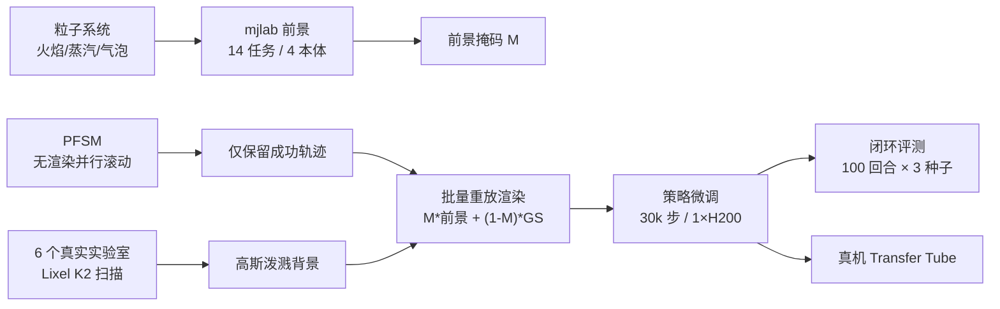

# AutoBio+：带动态实验现象的生物实验室灵巧操作基准

**AutoBio+**（*Benchmarking Dexterous Manipulation with Dynamic Experimental Phenomena in Realistic Laboratories*，[arXiv:2610.13643](https://arxiv.org/abs/2610.13643)，[项目页](https://autobio-plus.github.io/AutoBioPlus)）由 Shanghai AI Laboratory、华中科技大学、上海交通大学、南加州大学的作者提出（机构取自 arXiv HTML 页首）。它在 [mjlab](./mjlab.md) 上搭建 14 个实验室灵巧操作任务，把火焰、蒸汽、气泡这类随时间变化的现象与高斯泼溅重建的真实实验室背景结合起来，并提供并行示范生成与模型无关的闭环评测。

## 一句话定义

**一个把“会变的实验现象”和“真实实验室外观”同时放进仿真的灵巧操作基准：14 任务 × 4 种机器人形态，附并行有限状态机示范生成和批量闭环评测。**

## 英文缩写速查

| 缩写 | 英文全称 | 简要说明 |
|------|----------|----------|
| PFSM | Parallel Finite-State Machine | 每个并行环境各自维护阶段与路点索引，异步生成示范 |
| GS | Gaussian Splatting | 用 6 个真实实验室扫描重建背景，与仿真前景合成 |
| DP | Diffusion Policy | 基线策略之一 |
| SEM | Standard Error of the Mean | 结果表的误差度量（3 个种子） |
| MJCF | MuJoCo XML Format | 场景描述；纹理需在其中预先索引 |

## 为什么重要

- **补足动态现象：** 点火、加热搅拌、移液等实验室任务里状态会随时间变化，静态刚体基准测不到。
- **背景真实性可量化：** 论文做了只改背景的对照，结果显示高斯背景对真机迁移有明显帮助（仅一个任务，见下）。
- **评测暴露短板：** 12 个任务、4 种策略的结果表显示，语言条件视觉定位与接触丰富任务整体很低，没有任何任务被可靠解决。

## 方法栈 / 流程总览

## 方法

- **任务集：** 4 类能力（功能性工具使用、精细操作、语言条件视觉定位、仪器操作），涉及 Shadow Hand、Wuji Hand、XHand 与双臂 Aloha。例如 Attach Pipette Tip（Shadow）、Manipulate Tweezers（Wuji）、Ignite Bunsen Burner（XHand）、Tighten Tube Cap（Aloha）。各本体自由度原文页面未给出。
- **动态现象：** 粒子系统与物理引擎解耦。火焰：上升立方体粒子加随机漂移、透明度指数衰减、颜色随本生灯两个调节环位置变化；蒸汽：膨胀的球形粒子云；气泡：带浮力和旋转偏移的上升粒子。它们是视觉/状态现象的近似，不是流体求解。
- **混合渲染：** I_final = M⊙I_origin + (1−M)⊙R({G_i}, T_cam)，M 为 mjlab 前景掩码，R 为高斯渲染器。
- **并行框架：** 先无渲染并行滚动，只对成功轨迹批量重放渲染；PFSM 使各环境阶段异步。纹理预先在 MJCF 中索引，因为 Warp 不支持运行时换纹理。
- **渲染成本：** 339 帧、2 相机、640×480 下，MuJoCo Warp 13.95 s，AutoBio+ 15.57 s（约 +11.6%），Blender（前作 AutoBio）1092.02 s（约 70.14 倍）。

## 实验与评测

- **设置：** 12/14 任务，Diffusion Policy、π0.5、GR00T-N1.7、Fast-WAM；每格为 3 个种子 × 100 回合的成功率均值±SEM；每个模型在 1 张 H200 上微调 30,000 步，Operate Mixer Panel 用进度奖励。
- **代表数字（成功率 %）：**

| 任务（本体） | DP | π0.5 | GR00T-N1.7 | Fast-WAM |
|---|---|---|---|---|
| Close Centrifuge Lid（Wuji） | 30.0 | 81.7 | 100.0 | 43.3 |
| Close Thermal Cycler Lid（XHand） | 87.0 | 5.3 | 49.7 | 99.7 |
| Ignite Bunsen Burner（XHand） | 60.7 | 77.7 | 40.0 | 23.3 |
| Attach Pipette Tip（Shadow） | 5.0 | 12.0 | 2.7 | 20.7 |
| Tighten Tube Cap（Aloha） | 0.0 | 0.7 | 0.0 | 0.0 |

- **读法：** 同一类模型在不同任务上排名翻转（π0.5 在 Close Thermal Cycler Lid 仅 5.3，在 Open Thermal Cycler Lid 却是 56.7）；接触丰富任务（镊子、拧瓶盖、装移液枪头、装离心机）普遍低于约 21%。
- **真机 sim-to-real：** UR5e + XHand，任务 Transfer Tube，“10 真机 + 90 仿真示范”下仅背景不同的对照，各 20 次试验：高斯背景归一化均分 66%，MuJoCo 背景 17%。
- 论文讨论里的判断：语言条件视觉定位是主要瓶颈；灵巧手预训练对容差大的任务更有帮助。

## 源码运行时序图

不适用：截至 2026-10-12 项目页写 “Code coming soon”，没有可核对的仓库或脚本入口（见 [项目页核查](../../sources/sites/autobio_plus_project_page.md)）。

## 工程实践

- 想复用的是思路：把成功轨迹与渲染解耦、用粒子系统做动态视觉现象、背景用高斯泼溅替换。
- 复现前需等代码放出；当前只能依据论文公式和 [mjlab](./mjlab.md) 自行实现。
- 评测时区分任务类别：语言定位类与接触类的失败原因不同，不宜取单一平均数。

## 结论

**AutoBio+ 的价值主要是一个暴露短板的评测集，而不是一个已验证的数据引擎。**

1. 动态现象用解耦粒子系统实现，渲染开销仅约 +11.6%，但不是物理级流体。
2. 高斯背景在 Transfer Tube 上把真机均分从 17% 提到 66%（单任务、20 次试验）。
3. 12 任务 4 策略的结果任务间差异极大，没有策略通吃。
4. 语言条件视觉定位与接触丰富任务是主要失败区。
5. 代码和数据截至 2026-10-12 未发布，复现要等待。

## 局限与风险

- **开源：** 未发布（项目页 “Code coming soon”）。
- 液体与整体场景交互保真度有限（作者自述）；真机只验证 1 个任务。
- 另外 2 个任务（14−12）未出现在策略结果表中，原因原文页面未交代。示范总量原文未报告。
- 附录 PDF 未读取。

## 与其他工作对比

| 对照 | 读法 |
|------|------|
| [Fast-WAM](./paper-fast-wam.md) | 本基准中的被测策略之一；在 Close Thermal Cycler Lid 上最高，但在多数任务偏低 |
| [Shadow Hand](./shadow-hand.md) | 基准中使用的灵巧手本体之一 |
| [mjlab](./mjlab.md) | 本基准的并行仿真底座 |
| 前作 AutoBio（Blender 渲染） | 同一方向的前一版本；本文报告新版渲染约快 70 倍 |

## 关联页面

- [34 篇空间落地技术图谱（汇总页）](../overview/embodied-station-34-papers-spatial-grounding-technology-map.md)
- [操作任务总览](../tasks/manipulation.md)
- [mjlab](./mjlab.md)
- [Fast-WAM](./paper-fast-wam.md)
- [具身评测基准选型回路](../queries/embodied-eval-benchmark-selection-loop.md)

## 参考来源

- [公众号盘点：具身智能小站 34 篇](../../sources/blogs/wechat_embodied_station_34_papers_spatial_grounding_2026-10-12.md)
- [autobio_plus_arxiv_2610_13643.md](../../sources/papers/autobio_plus_arxiv_2610_13643.md)
- [autobio_plus_project_page.md](../../sources/sites/autobio_plus_project_page.md)
- [arXiv:2610.13643](https://arxiv.org/abs/2610.13643)

## 推荐继续阅读

- [AutoBio+ 项目页](https://autobio-plus.github.io/AutoBioPlus)
- [arXiv HTML 全文](https://arxiv.org/html/2610.13643v1)
