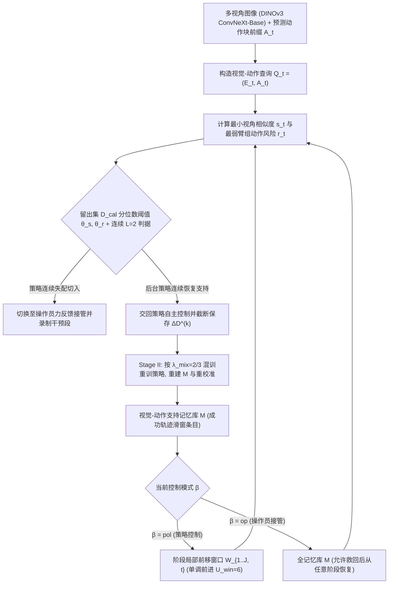

# AutoIntervene: Calibrated Intervention for Action-Chunking Imitation Learning Policies

## 一句话定义

**AutoIntervene**（arXiv:2608.07065）是一种面向[动作分块（Action Chunking）](../methods/action-chunking.md)[模仿学习](../methods/imitation-learning.md)策略的双向自动化接管与[DAgger 迭代微调](../methods/dagger.md)框架：在策略运行期检索“视觉-动作支持记忆库”，结合非对称双范围规则（切入人工用阶段局部支持、交回策略用全局支持）和留出验证集经验分位数自动校准阈值，精准捕获偏离示范分布的片段并转化为纠偏监督数据。

## 英文缩写速查

| 缩写 | 英文全称 | 简要说明 |
| :--- | :--- | :--- |
| **ACT / DP / FM** | Action Chunking with Transformers / Diffusion Policy / Flow Matching | AutoIntervene 兼容并实验验证的三类动作分块策略解码头 |
| **DAgger / HG-DAgger** | Dataset Aggregation / Human-Gated DAgger | 通过在策略自身诱导状态上叠加专家纠偏来缓解协变量偏移的交互式学习方法 |
| **OOD** | Out-of-Distribution | 感知误差或执行漂移导致机器人进入未覆盖训练分布的状态空间 |
| **RND** | Random Network Distillation | 基于随机网络蒸馏特征预测误差判断状态新颖度的传统单阈值接管基线（RND-DAgger） |

## 为什么重要

在真实[双臂精细操作](../tasks/bimanual-manipulation.md)部署中，动作分块策略在发生轻微视觉偏移或接触错位时，仍会在局部平滑地输出“看着合理但实际与当前状态脱节”的动作块（如反复空抓或停滞）。传统方案面临三重痛点：

1. **视觉相似但相位歧义：** 折叠毛巾或反复抓取中，不同阶段的 RGB 图像高度相似却需要完全不同的下一段动作；仅做单帧视觉检索极易误判或无法识别原地打转失败。
2. **单向或对称阈值导致交接振荡：** 传统 LazyDAgger 或 RND-DAgger 对「切入人工」与「交回策略」共用同一新颖度尺度或单一判定方向，要么切入滞后、要么交回策略后瞬间因同阈值被反向踢回人工控制（假触发与抖动高达 0.80–0.90）。
3. **手工盯盘与重录整条演示代价过高：** 人工介入往往收不住尾，会把无需纠偏的后续常规阶段也录进纠正段从而稀释监督密度；若直接重采全条成功演示，耗时和人控时间代价远高于定点救火。

## 核心原理与方法架构

AutoIntervene 由 **Stage I（在线监测-双向接管-片段回收循环）** 与 **Stage II（混合采样迭代更新与重校准）** 构成：

### 1. 联合视觉-动作支持评分（Sec. III-A–B, Eq. 1–3）

- **视角短板准则：** 对当前 $C=3$ 路视角（顶视 + 双腕）嵌入向量与记忆条目逐视角求余弦相似度后取最小值 $s_t(m) = \min_{1\le c\le C}\operatorname{sim}(e_t^{(c)}, e^{(c)})$，防止全局相机匹配度高而掩盖腕部局部偏差；据此选出 Top-$K$（$K=16$）候选集合 $N_{\beta,t}$。
- **双臂最弱组动作风险：** 将 14 维动作划分为左臂与右臂两组 $g$，按记忆库各维标准差 $\sigma_g$ 计算预测前缀（$H_r=40$ 步）与记忆参考块的归一化 $L_2$ 距离 $d_{t,g}(m)$，取各自最接近的 $M=3$ 个邻域 $P_g$，然后**取平均风险最差的那条手臂 $g^\star$** 同时度量行动风险 $r_{\beta,t}$（再经 $W=5$ 步均滑平滑为 $\bar{r}_{\beta,t}$）与瞬时视觉支持 $s_{\beta,t}$。

### 2. 非对称双检索范围与单调窗口推进（Eq. 4）

- **策略控制期（$\beta=\text{pol}$）— Phase-Local Support：** 首次进入策略控制时全局挑选 $J=16$ 条最佳匹配轨迹并生成前向 $B=40$ 步窗口。之后每执行 $U_{\text{win}}=6$ 步，窗口起止点按 $u_{j,t+1} = \max(\{u_{j,t}\} \cup \{u \mid m_{i_j,u} \in P_{g^\star}\})$ 单调向前推进。即使机械臂反复抓空（RGB 外观变化极小），检索窗口也会走到尽头并耗尽支撑，从而果断触发接管（消融显示去掉单调推进后切入召回率从 `1.00` 跌至 `0.30`）。
- **人工接管期（$\beta=\text{op}$）— Global Support：** 人工操作员接管纠偏时可能直接推进若干任务步骤。因此在 30 Hz 后台监测下对全记忆库 $\mathcal{M}$ 检索，只要策略后台输出的动作块在**任意合法阶段**重获视觉与动作双重支撑，即收回人工权交还自主执行。

### 3. 留出验证集分位数校准与滞回交接（Sec. III-C–D, Eq. 5–7）

留出 6 条专家演示 $D_{\text{cal}}$（与训练集 $D^{(0)}=30$ 条及记忆库隔离），分别在「阶段局部（策略模式）」和「全局（接管模式）」范围下计算经验分布，用分位点 $\theta_s^\beta = \hat{Q}_{\alpha_s^\beta}(S_{\text{cal}}^\beta)$ 与 $\theta_r^\beta = \hat{Q}_{1-\alpha_r^\beta}(R_{\text{cal}}^\beta)$ 自动定标（策略端 $\alpha=0.05$ 严格放行、人工端 $\alpha=0.30$ 平滑恢复），叠加连续 $L_{\text{pol}}=L_{\text{op}}=2$ 次判定形成滞回保护。每轮保留 5 条成功轨迹里的干预片段 $\Delta D^{(k)}$，以 2:1 混合比（$\lambda_{\text{mix}}=2/3$）微调策略并重建记忆库与阈值。

## 实验评测与方法对比

### 1. 七项双臂真机主基准（Table II，每格 25 次无辅助真机评测）

平台为双臂 AgileX PiPER-X（6-DoF + 夹爪 + TriPilot-FF 力反馈遥操），`DINOv3 ConvNeXt-Base` 视觉主干 + 1 层编码/4 层解码 Transformer（$H=100$）。每轮新增 5 条成功滚动轨迹中的纠正片段：

| 任务 | Initial（30 demos） | Human R2 | AutoIntervene R1 | **AutoIntervene R2** | Additional Full Data（+10 全演示） |
| :--- | :---: | :---: | :---: | :---: | :---: |
| **Peg Disassembly** | 16% (1173.7s) | 56% (+286.9s) | 64% (+49.3s) | **72% (+127.1s)** | 60% (1853.0s 总) |
| **Potato Transfer** | 44% (368.7s) | **80% (+74.2s)** | 48% (+29.6s) | 76% (+50.2s) | 64% (547.3s 总) |
| **Towel Folding** | 56% (766.2s) | **100% (+144.8s)** | 76% (+61.4s) | 96% (+140.4s) | 68% (1100.0s 总) |
| **Towel Bagging** | 24% (1761.1s) | 36% (+266.5s) | 44% (+121.6s) | **60% (+171.0s)** | 40% (2536.7s 总) |
| **Lidded Box Packing** | 8% (989.6s) | 92% (+246.7s) | 52% (+63.1s) | **100% (+130.2s)** | 60% (1440.0s 总) |
| **Plant Sorting** | 24% (450.2s) | 56% (+157.1s) | 52% (+76.6s) | **72% (+128.9s)** | 32% (693.1s 总) |
| **Towel Box Packing** | 44% (1332.4s) | 60% (+83.3s) | 80% (+61.4s) | **84% (+112.3s)** | 68% (1930.5s 总) |
| **七任务均值** | **30.9%** (977.4s) | **68.6%** (+179.9s) | **59.4%** (+66.1s) | **80.0%** (+122.9s) | **56.0%** (+465.5s 增量 / 1442.9s 总) |

**关键效率对比：** 仅经过两轮，AutoIntervene R2 平均成功率超越初始策略 `+49.1` 个百分点，高出人工手动开关（Human R2 `68.6%`）与追加 10 条完整专家演示（`56.0%`），且额外人控数据时间（`122.9 s`）较全量新演示增量（`465.5 s`）**节省约 74%**，也低于人工开关（`179.9 s`）。

### 2. 长程三轮迭代与多动作头兼容（Tables III–IV）

- **两项复杂长程延伸任务（3 轮微调）：**
  - `Two-Towel Box Packing`：`28% (Init) → 44% (R1) → 64% (R2) → 88% (R3)`（追加全演示仅 `52%`）；
  - `Towels-and-Cable Bagging`：`8% (Init) → 20% (R1) → 28% (R2) → 48% (R3)`（追加全演示 `28%`）。
- **跨动作生成机制通用性（`Two-Towel Box Packing`）：** 在完全不改动监控器的前提下，ACT（`28% → 88%`）、Diffusion Policy（`32% → 92%`）与 Flow Matching（`32% → 80%`）三类解码头均大幅跨越各自的追加全演示基线（`52% / 44% / 40%`）。

### 3. 受控双向接管评测与核心消融（Table V，`Lidded Box Packing` 10 扰动 + 10 名义）

| 监测框架 | Cut-in Recall ↑ | Cut-in Precision ↑ | Cut-out Recall ↑ | Cut-out Precision ↑ | False-trigger Rate ↓ |
| :--- | :---: | :---: | :---: | :---: | :---: |
| **AutoIntervene** | **1.00** | **1.00** | **1.00** | **1.00** | **0.00** |
| LazyDAgger | 0.40 | 1.00 | 0.00 | N/A | 0.80 |
| RND-DAgger ($W_{\text{rec}}=5$ / $30$) | 0.80 / 0.80 | 0.16 / 0.16 | 0.00 / 0.75 | 0.00 / 0.12 | 0.90 / 0.90 |
| 消融：`w/o visual support` | 0.00 | N/A | N/A | N/A | 0.00 |
| 消融：`w/o action risk` | 0.90 | 1.00 | 0.56 | 0.56 | 0.00 |

## 结论

**AutoIntervene 将动作分块的运行期异常检测与双向精准人机交接融合为同一套免手工调阈值的记忆检索系统，让纠偏数据只集中在最致命的分布外恢复段上，在九项真实双臂任务上用不到三成的新增人控时间取得了远超人工介入与重录全演示的迭代提升。**

- **双评分互补缺一不可：** 视觉相似度（含多相机短板取 $\min$）负责在盒子被挪位时及时呼救（cut-in），动作块归一化风险负责在状态刚回正但预测动作尚未稳定时不草率交回（cut-out）。
- **检索作用域必须与控制方向解耦：** 切入监测用单调前进的阶段局部窗口防止视觉相似的反复动作混淆进度；人工接管期切换全库检索以支持跨阶段跳跃恢复。
- **只收成功滚动中的介入片段：** 保留的纠偏段按 2:1（$\lambda_{\text{mix}}=2/3$）独立混训可避免策略跨越“机器/人控切换接缝”学到不连续跳转。
- **硬件与源码现状：** 实施该闭环依赖主从同构力反馈对齐硬件（如 ALOHA / TriPilot-FF）防止切换瞬间跳变；截止 2026-11-14 官方尚未公开可运行的算法源码。

## 工程实践

- **开源核查结论：算法与遥操控制代码未开源。**
  - 官方项目页 <https://aus.bot/research/autointervene/>（及第一作者 `jt2079` 对应的静态托管库 `123qwedsa123/AutoIntervene`）仅包含网页 HTML/CSS、论文 PDF 与 9 项任务的 MP4 演示视频，**不含任何 Python 训练、记忆库索引或策略部署源码**，且论文正文未给出算法代码仓库链接。
- **论文披露的系统复现配置（Sec. IV）：**
  - **视觉主干：** `DINOv3 ConvNeXt-Base`，输入 3 路 `256×256` RGB。
  - **监测参数：** 策略执行 30 Hz + 监控 5 Hz（$U_{\text{win}}=6$），遥操执行 200 Hz + 监控 30 Hz；记忆参数 $J=K=16, B=H_r=40, H=100, M=3, W=5$；滞回计数 $L_{\text{pol}}=L_{\text{op}}=2$；校准分位数 $(0.05, 0.05)$ 与 $(0.30, 0.30)$；每轮取 6 条固定留出轨迹校准、加采 5 条成功滚动轨迹干预段并以 $\lambda_{\text{mix}}=2/3$ 更新。

## 源码运行时序图

**不适用。** 经核实论文 `arXiv:2608.07065`、项目官网 `https://aus.bot/research/autointervene/` 及作者静态页面仓库 `123qwedsa123/AutoIntervene` 后确认，目前仅发布静态网页与实验视频，尚未公开任何可运行的监控器、记忆索引或微调实现代码，故无源码调用链可供绘制。

## 局限与风险

1. **视觉与力反馈硬件依赖：** 实验依赖低延迟主从对齐（ALOHA + TriPilot-FF 力反馈映射），若采用延迟较大的异步遥操手柄（无主臂随动对齐），在自动切入瞬间可能出现机械臂位姿跃变或操作员接管手忙脚乱。
2. **固定校准集与专家依赖：** 校准集 $D_{\text{cal}}$ 固定使用初期 6 条专家演示，若任务在后期演化出新的合法多模态解法，固定留出分位数阈值可能趋于保守；需周期性扩充代表性验证集。
3. **尚未开源且长程上限待突破：** 目前仍未发布代码实现，且在最高复杂度的 `Towels-and-Cable Bagging` 上三轮微调成功率仅到 `48%`，长程多柔软体协同仍需配合更强底座模型或阶段级恢复机制。

## 关联页面

- 核心方法：[动作分块（Action Chunking）](../methods/action-chunking.md) · [DAgger 交互式模仿学习](../methods/dagger.md) · [模仿学习综述](../methods/imitation-learning.md) · [VLA 综述](../methods/vla.md)
- 任务与部署指南：[双臂协同操作](../tasks/bimanual-manipulation.md) · [VLA 实机部署指南](../queries/vla-deployment-guide.md)
- 相关研究节点：[动作分块为何有效](./paper-why-action-chunking-improves-bc.md) · [ROVE：人形 VLA 人工干预与恢复](./paper-rove-humanoid-vla-intervention.md) · [NestDex：嵌套式灵巧操作](./paper-nestdex.md)

## 参考来源

- **论文精读归档：** [arXiv:2608.07065 AutoIntervene 论文归档](../../sources/papers/autointervene_arxiv_2608_07065.md)
- **项目官网与静态仓库核查：** [aus.bot/research/autointervene 站点归档](../../sources/sites/aus-bot-autointervene.md)
- **关联论文对照档案：** [NestDex 论文归档](../../sources/papers/nestdex_arxiv_2608_13362.md)

## 推荐继续阅读

- 想深入理解 AutoIntervene 所保护的动作分块机制为何能缓解误差累积与时序失调，阅读：[动作分块为什么能改善行为克隆](./paper-why-action-chunking-improves-bc.md)。
- 想对比视觉-动作运行期监测之外的人形真机干预与安全恢复设计，阅读：[ROVE](./paper-rove-humanoid-vla-intervention.md) 与 [VLA 部署实战指南](../queries/vla-deployment-guide.md)。
