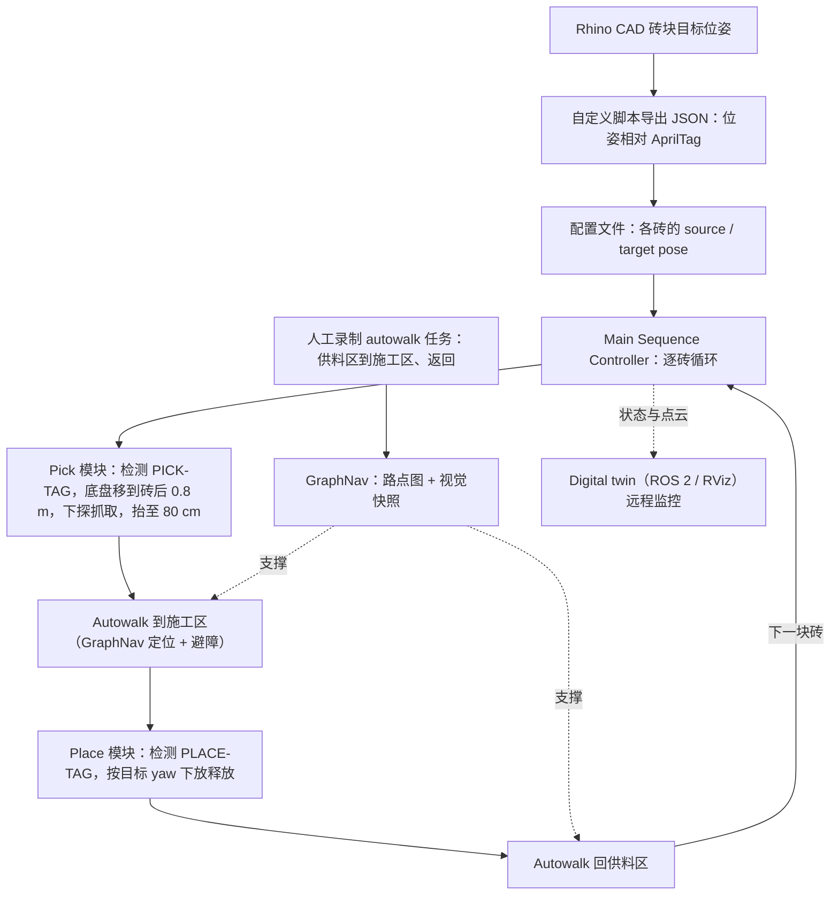

# 使用 Boston Dynamics Spot 实现自主砌砖

**Spot 砌砖**（*Towards Autonomous Bricklaying Using Boston Dynamics Spot*，[arXiv:2610.27472](https://arxiv.org/abs/2610.27472)）收录于 senlanke「具身运控lab」10-19–10-23 前沿论文动态（人形/四足）。本页依据**周报条目 + arXiv 摘要页**整理，流程图依据论文方法部分（见参考来源），未逐页核对实验数字；指标与结论以论文为准。

## 一句话定义

**使用 Boston Dynamics Spot 实现自主砌砖——将 CAD 砖块位姿直接转换为 Spot 操作任务，以 AprilTag 定位并通过 Autowalk 完成区域间导航；在重复曲面墙体搭建实验中定量测量放置误差，并进行室外楼梯测试。**

## 英文缩写速查

| 缩写 | 英文全称 | 简要说明 |
|------|----------|----------|
| RL | Reinforcement Learning | 强化学习 |
| WBC | Whole-Body Control | 全身控制 |

## 为什么重要

- 周报所述待解决的问题：建筑机器人需要在分离的供料区和施工区之间移动，并准确执行 CAD 定义的砌筑任务。

## 流程总览

图依据：论文 §3.1 / Fig.1b、§3.2–3.3

## 核心机制

| 项 | 内容 |
|----|------|
| **arXiv** | [2610.27472](https://arxiv.org/abs/2610.27472) · [PDF](https://arxiv.org/pdf/2610.27472) |
| **作者（arXiv）** | Karl-Johan Sorensen, Nico vom Hofe, Frank H. P. Fitzek |
| **机构（周报所述，未逐条核实）** | 麻省理工学院、德累斯顿工业大学、CeTI |
| **arXiv 评论栏** | 8 pages. Published in the Proceedings of the 43rd International Symposium on Automation and Robotics in Construction (ISARC 2026), Singapore |
| **开源** | arXiv 摘要页与评论未见代码或项目页链接（仅核对 arXiv 摘要页，不代表未发布）（2026-10-26） |
| **周报所述创新点** | 将 CAD 砖块位姿直接转换为 Spot 操作任务，以 AprilTag 定位并通过 Autowalk 完成区域间导航；在重复曲面墙体搭建实验中定量测量放置误差，并进行室外楼梯测试。 |

### arXiv 摘要节选（英文原文）

> Mobile legged robots offer unique advantages for on-site construction, including the ability to traverse unstructured terrain, climb stairs, and operate independently between spatially separated work zones. This paper presents a proof-of-concept system for autonomous brick stacking using a Boston Dynamics Spot quadrupedal robot equipped with a manipulator arm.

## 源码运行时序图

**不适用**：arXiv 摘要页与评论未见代码或项目页链接（仅核对 arXiv 摘要页，不代表未发布），无可对齐的官方代码流程。

## 实验与评测

- 周报与摘要给出的数字/场景已写入上表「创新点」与摘要节选；其余实验细节、基线与成功率定义请回到论文正文。
- 读法：先对齐任务设定、传感器与成功定义（仿真/真机），再解读 headline 数字，勿跨论文直接比较。

## 与其他工作对比

| 维度 | 读法 |
|------|------|
| **同周对照** | 见 [人形/四足周报技术地图](../overview/senlanke-weekly-2026-10-19-23-humanoid-quadruped-technology-map.md)，按方向浏览同期论文 |
| **开源状态** | arXiv 摘要页与评论未见代码或项目页链接（仅核对 arXiv 摘要页，不代表未发布） |

## 结论

**使用 Boston Dynamics Spot 实现自主砌砖。**

1. 本页是入库级摘要，复现前请核对论文正文、附录与代码仓库。
2. 指标须连同实验条件解读。
3. 关注 arXiv 版本更新与代码发布。

## 关联页面

- [senlanke-weekly-2026-10-19-23-humanoid-quadruped-technology-map](../overview/senlanke-weekly-2026-10-19-23-humanoid-quadruped-technology-map.md)
- [locomotion](../tasks/locomotion.md)
- [reinforcement-learning](../methods/reinforcement-learning.md)

## 参考来源

- [autonomous-bricklaying-boston-dynamics-spot_arxiv_2610_27472.md](../../sources/papers/autonomous-bricklaying-boston-dynamics-spot_arxiv_2610_27472.md)
- [wechat_senlanke_weekly_humanoid_quadruped_2026-10-19_23.md](../../sources/blogs/wechat_senlanke_weekly_humanoid_quadruped_2026-10-19_23.md)
- [arXiv:2610.27472](https://arxiv.org/abs/2610.27472)
- [arXiv PDF](https://arxiv.org/pdf/2610.27472)：已通读方法部分（实验与附录以略读为准）：§3 方法、§3.5 实验设置、§4 结果

## 推荐继续阅读

- [arXiv PDF](https://arxiv.org/pdf/2610.27472)
