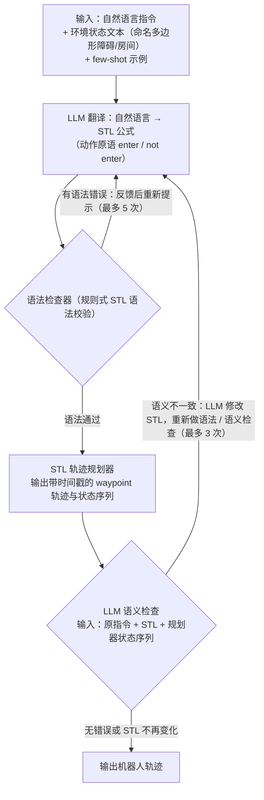

# AutoTAMP

**AutoTAMP**（[arXiv:2306.06531](https://arxiv.org/abs/2306.06531)）收录于 Lumina [Embodied-AI-Guide 微信专辑](../../wiki/overview/embodied-ai-guide-wechat-album-curator.md)。本页为独立详情节点；实验数字以原文为准。

## 流程总览

图依据：论文 §III-C / Fig.1、Fig.3

## 一句话定义

**用 LLM 填 TAMP 的问题 formulation 缺口。**

## 英文缩写速查

| 缩写 | 英文全称 | 简要说明 |
|------|----------|----------|
| VLA | Vision-Language-Action | 视觉–语言–动作策略 |
| LLM | Large Language Model | 大语言模型 |
| IL | Imitation Learning | 模仿学习 |
| BC | Behavior Cloning | 行为克隆 |

## 核心信息

| 项 | 内容 |
|----|------|
| **机构** | — |
| **arXiv** | [2306.06531](https://arxiv.org/abs/2306.06531) |
| **开源** | 待核实 |

## 实验与评测

- **本页为索引级节点**（Lumina Embodied-AI-Guide 微信专辑）：正文固化定位与开源边界，**未转存原文实验表**。
- **回原文须核对的证据**：本页结论已点明「评估看规划成功率」——回原文须核对该成功率的**判定口径**：是否含几何可行性检查、是否允许重规划、contact-rich 长程任务的任务长度分布。
- **读法：** 先对齐本体、任务集与成功判定，再读任何数字；勿把专辑摘要当实验结论。

## 与其他工作对比

| 维度 | 读法 |
|------|------|
| **对照工作** | 与 [LLM+P](./paper-llm-p.md) 同属「LLM + 符号规划」增强路线：LLM+P 让 LLM 写 PDDL 问题，本文进一步自动生成 TAMP 问题与约束 |
| **横比口径** | 规划成功率对任务集与允许的重规划次数极敏感，且各论文对「成功」的定义不一致，不可直接横比。 |
| **开源状态** | **待核实** — 复现前以项目页 / 官方仓实际链接为准 |

## 结论

AutoTAMP 面向 contact-rich 长程任务。

- 与 LLM+P 同属符号增强路线
- 评估看规划成功率

## 源码运行时序图

**不适用**

## 关联页面

- [paper-llm-p](./paper-llm-p.md)
- [paper-text2motion](./paper-text2motion.md)

## 参考来源

- [wechat_lumina_embodied_practice_part1_llm_planner_2026-09-20.md](../../sources/blogs/wechat_lumina_embodied_practice_part1_llm_planner_2026-09-20.md)
- [arXiv PDF](https://arxiv.org/pdf/2306.06531)：已通读方法部分（实验与附录以略读为准）：摘要、§I、§II 问题描述、§III 方法（含 STL 语法与规划器、语法 / 语义检查）、§IV 开头的实验设计

## 推荐继续阅读

- [arXiv:2306.06531](https://arxiv.org/abs/2306.06531)
