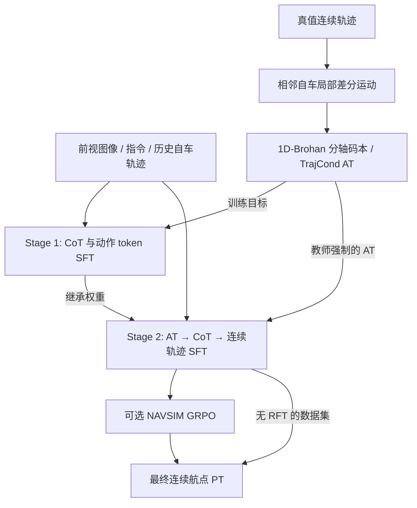
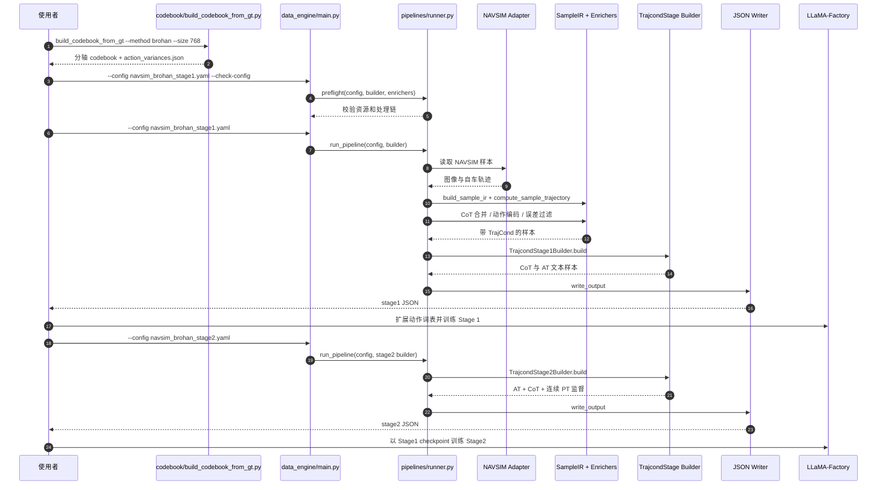

# AutoVLA-D：从驾驶推理学习轨迹几何条件 / Learn a Trajectory-Geometric Condition from Reasoning for Autonomous Driving VLA

## 一句话定义

**AutoVLA-D（Double）** 把从视觉、驾驶意图和推理学到的离散自车局部动作轨迹 **TrajCond** 放在最终连续航点预测之前，使动作语义先变成轨迹几何条件，最终输出仍是可回归的连续 `(x,y,yaw)` 轨迹，而不是离散 token 本身。论文为 [NeurIPS 2026 / arXiv:2611.12382v1](https://arxiv.org/abs/2611.12382)，配套 [ShivaTeam/AutoVLA-D](https://github.com/ShivaTeam/AutoVLA-D)。

## 英文缩写速查

| 缩写 | 英文全称 | 简要说明 |
|---|---|---|
| VLA | Vision-Language-Action | 视觉与指令到规划动作的模型 |
| TrajCond | Trajectory-geometric Condition | 作为最终连续轨迹条件的离散局部运动序列 |
| AT | Action Tokens | 表示分轴差分运动的动作 token |
| CoT | Chain-of-Thought | 驾驶解释、关键对象和行为意图的推理监督 |
| PT | Predicted Trajectory | 最终连续航点序列 |
| SFT | Supervised Fine-Tuning | 两阶段自回归监督微调 |
| RFT / GRPO | Reinforcement Fine-Tuning / Group Relative Policy Optimization | NAVSIM 可选强化后训练 |
| PDMS / EPDMS | Predictive Driver Model Score / Extended Predictive Driver Model Score | NAVSIM 两种不同评测口径 |

## 为什么重要

- **语义到状态的桥梁：** “让行 / 保持 / 转向”是局部动作指令，直接映射未来绝对位置时对齐困难；TrajCond 中间编码先表达运动变化。
- **两个表示各司其职：** 论文消融发现离散动作 token 作为最终预测弱于连续航点，却在当作中间条件时更有效。
- **不是又一个独立动作专家：** 两阶段是同一 VLA 的先后微调与一次自回归生成流程；NAVSIM 按 `AT → CoT → PT`，不能理解为训练/部署时同时跑两个独立模型。
- **工程价值：** 官方已公开 codebook、NAVSIM data engine、SFT YAML，可用于比较 3D 聚类与 1D 分轴 tokenization；真实道路验证另论。

## 核心信息

| 项目 | 已核对信息 |
|---|---|
| 作者 | Yuguang Yang、Zhewen Tan、Canyu Chen、Linlin Yang、Cheng Chi、Chunyang Liu、Kehua Sheng、Jinyu Yang、Baochang Zhang、Bo Zhang、Yan Wang、Xianbin Cao |
| 机构 | 北京航空航天大学；清华大学智能产业研究院；滴滴；中国传媒大学；中国人民大学；哈尔滨工业大学（深圳） |
| 发表 | NeurIPS 2026，arXiv:2611.12382v1，2026-11-09 |
| 输入 / 输出 | 图像 + 指令 + 运动历史 / 未来自车连续 `x,y,yaw` 航点 |
| 骨干 | NAVSIM 以 Qwen3-VL-4B 为主；nuScenes / NeuroNCAP 另评估 Qwen2.5-VL |
| 时域 | NAVSIM 4 秒 / 8 个未来位姿 / 2 Hz |
| 代码 | [Apache-2.0 官方仓库](https://github.com/ShivaTeam/AutoVLA-D)，数据与训练入口可用；GRPO 主仓外置 |

## 核心原理

### 1. 将车体位姿差分转到上一时刻局部坐标系

定义未来航点 `τ_t=(x_t,y_t,θ_t)`。相邻自车位姿的平移在 `θ_(t-1)` 朝向下做 `R(-θ_(t-1))` 旋转，得到 `Δx_t, Δy_t`，转角差为 `Δθ_t`。它描述**局部状态转移**，不是同一个固定全局坐标系上的绝对位移。

### 2. 1D-Brohan 分轴动作 token

x、y、yaw 各使用一套离散 token。主配置 **768 = 256 × 3**，每个未来时刻生成三个 token。论文 §3.2 记录以每轴 1% / 99% 分位区间等间距离散化，再从每轴 4 个最接近候选构成的 64 个组合里选择车辆角点重建误差最低者。相比 3D K-Means / K-Disks 共用动作字典，分轴量化在论文报告中降低重建误差及训练-测试分布偏移。

**复现特别注意：** 已发布源码 `codebook/build_codebook_from_gt.py` 使用全样本 **min/max inclusive** 栅格，而非论文文字所写分位裁切。此处差异需实际核对 codebook 与数值统计，不能把两种配置视为等价。

### 3. 同一模型的分阶段监督与自回归推理

- **Stage 1：** 让新加入动作词表学习视觉、指令和推理相关语义；NAVSIM 用 `CoT → AT` 输出监督。
- **Stage 2：** 从 Stage-1 checkpoint 继续训练，让 VLA 条件于 `AT`（及 NAVSIM 推理）输出最终 **连续归一化文本航点**；NAVSIM 训练/推理顺序为 `AT → CoT → PT`。
- **可选 GRPO：** NAVSIM 论文还在 SFT 后进行 RFT；nuScenes、NeuroNCAP 两者均 **不使用 CoT 或 GRPO**，不可混称统一训练链路。

## 流程总览

## 源码运行时序图

以下按官方 README 的命令和已核对的 `data_engine/main.py`、`pipelines/runner.py`、`TrajcondStage1Builder` / `TrajcondStage2Builder`、`codebook/build_codebook_from_gt.py` 梳理**离线构建与训练调用顺序**，并非声称已在本机跑通。

**解释：** 上图后半部分压缩展示了 Stage-2 与 Stage-1 共用的数据引擎处理路径；`GRPO` 不属于这个主仓 `data_engine` 的内部调用，官方 README 引导使用 [Curious-VLA](https://github.com/Mashiroln/curious_vla) 的外置 GRPO。

## 实验与评测（作者报告，arXiv v1）

| 基准 | 结果与协议 | 核验位置 |
|---|---|---|
| NAVSIM navtest | **92.0 PDMS**（单相机、Qwen3-VL-4B，含 GRPO） | Table 1 |
| NAVSIM navtest | **86.8 EPDMS**（修订后的扩展评分） | Table 2 |
| NAVSIM SFT-only | 连续 6 ep. **88.5 PDMS** → Brohan TrajCond 两阶段 3+3 ep. **90.8** | Supplement Table 9 |
| NAVSIM + GRPO | 连续 **89.7** → 两阶段 Brohan **92.0 PDMS** | Supplement Table 9 |
| nuScenes 开环 | Qwen3-VL-4B ST-P3 L2 **0.30 m**、碰撞率 **0.09%**；无 CoT/GRPO | Table 3 |
| NeuroNCAP 闭环 | Qwen2.5-VL-3B score **3.63**、collision **0.36**（对照无 TrajCond：2.76、0.49） | Table 4 |
| 离散重建误差 | 768 tokens 1D-Brohan 在 4s test **1.56 cm**；3D KMeans **7.01 cm**；KDisks **7.09 cm** | Supplement Table 10 |

**实验口径：** PDMS/EPDMS 不能混用；nuScenes 的 ST-P3 和 UniAD 指标互不等价，NeuroNCAP score 也不是 NAVSIM score。上述均为论文指标，未独立复现。

## 与其他工作对比

| 工作 | 解决的主要问题 | 与 AutoVLA-D 区别 |
|---|---|---|
| [DriveTeach-VLA](./paper-driveteach-vla.md) | DVD 学视觉交通要素、2D-TGP 给出投影轨迹提示 | AutoVLA-D 不依赖双模型 TGP Prompter / Planner，而是同一 VLA 学中间离散动作条件 |
| [S²-VLA](./paper-s-squared-vla.md) | 语义和空间特征流结构解耦 | AutoVLA-D 侧重 **token 形式 / 阶段监督 / 最终轨迹条件** |
| AutoVLA（论文引用） | 直接输出 K-Means / K-Disks 离散轨迹 | AutoVLA-D 把离散动作改作**中间条件**，最终输出连续航点 |
| [GRPO](../methods/grpo.md) | 强化后训练目标与奖励优化 | GRPO 是可选增强项，不替代 SFT 与 TrajCond 学习 |

## 结论

**关键不是把自动驾驶轨迹全部离散化，而是利用离散动作 token 作为可学习的语义—几何中间桥梁，保留连续终态规划的精度。**

1. **先判断输出角色：** 离散 token 做最终轨迹通常不如连续航点；用作 TrajCond 才带来增益。
2. **先分轴再条件化：** 768 token 的分轴 Brohan 在作者实验中兼顾低重建误差与更小的 train/test shift。
3. **阶段训练不可省略：** NAVSIM 单阶段 TrajCond **89.2**，两阶段 **90.8 PDMS**（同为 SFT，Supplement Table 9）。
4. **分清推理和 RL：** SFT 阶段移除显式文本推理仍可发挥条件作用，但 GRPO 时没有可靠 CoT 可能退化。
5. **部署前先对齐源码：** 论文分位区间与当前仓库 min/max 码本实现存在差别；额外 token 解码开销尚需实测。
6. **数据集不能混议：** NAVSIM 有 CoT+GRPO，nuScenes / NeuroNCAP 是无 CoT/GRPO 的 SFT-only。

## 工程实践与开源状态

- **已开放：** [codebook](https://github.com/ShivaTeam/AutoVLA-D/tree/master/codebook)、[data_engine](https://github.com/ShivaTeam/AutoVLA-D/tree/master/data_engine)、[sft](https://github.com/ShivaTeam/AutoVLA-D/tree/master/sft)、DeepSpeed 配置及 README 所链接的数据标注。详细代码路径见 [source repo 归档](../../sources/repos/autovla-d.md)。
- **准备数据：** NAVSIM v2（4 秒 / 8 点）、训练样本标注、Qwen3-VL 基模与 768-token codebook；先用 `--check-config` 确认资源路径。
- **训练：** 词表扩展后用 LLaMA-Factory 执行 Stage 1 / Stage 2 YAML。GRPO 参考外部 Curious-VLA 并修改 AT/CoT/PT parser，**主仓不含直接一键跑通的完整 GRPO 实现**。
- **发布边界：** 官方主仓可见工程代码与数据链接，但 README 没有 AutoVLA-D 官方可直接下载的完整权重/车端控制栈。本次仅核验源码静态入口，未实际执行训练或评测。

## 局限与风险

- 新的 TrajCond 序列增加模型输出长度和训练/解码成本，低频动作 token 仍可能学习不足（论文 §5）。
- TrajCond **不能在 RFT 中完全替代显式 CoT**：Table 6 的 w/o Reason + GRPO 性能下降。
- 论文 §3.2 的 1/99 分位边界和公开 `build_codebook_from_gt.py` 的 min/max 栅格不一致，直接套用公开 JSON 之前应做同协议对照。
- NAVSIM / nuScenes / NeuroNCAP 仅覆盖公开基准；无真实道路安全认证、长时序稳定性或车端硬实时 latency 保证。
- 代码提供模块化准备和训练配置，但有外部数据、基模与独立 RL 系统依赖。

## 关联页面

- [DriveTeach-VLA](./paper-driveteach-vla.md) — 同团队不同空间对齐路径
- [S²-VLA](./paper-s-squared-vla.md) — 驾驶 VLA 空间表征对照
- [VLA](../methods/vla.md) — 机器人 VLA 的离散动作输出与连续输出方案
- [GRPO](../methods/grpo.md) — NAVSIM RFT 的方法背景
- [自动驾驶核心算法](../overview/autonomous-driving-core-algorithms-series.md)
- [VLA 纵深路线](../../roadmap/depth-vla.md)

## 参考来源

- [AutoVLA-D 论文全文核对归档](../../sources/papers/autovla_d_arxiv_2611_12382.md)
- [AutoVLA-D 官方代码核验归档](../../sources/repos/autovla-d.md)
- [arXiv v1 PDF](https://arxiv.org/pdf/2611.12382)
- [ShivaTeam/AutoVLA-D 官方仓库](https://github.com/ShivaTeam/AutoVLA-D)

## 推荐继续阅读

- [DriveTeach-VLA（ECCV 2026）](./paper-driveteach-vla.md) — 另一种驾驶语义与空间对齐
- [NAVSIM 官方框架](https://github.com/autonomousvision/navsim)
- [Curious-VLA / GRPO](https://github.com/Mashiroln/curious_vla)
