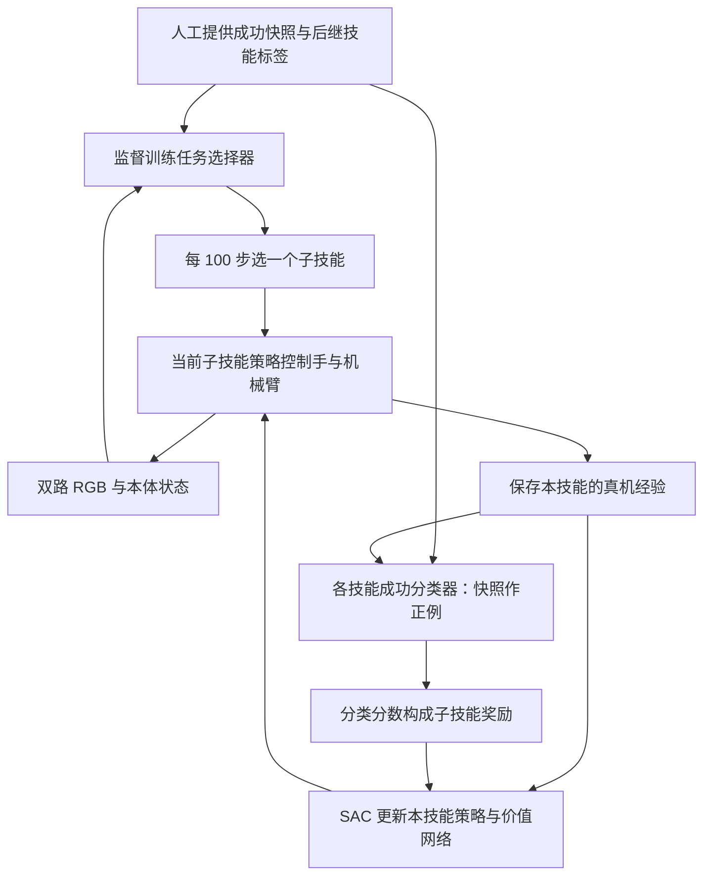

# 基于图像的灵巧操作：用子步骤引导真机自主强化学习 / Dexterous Manipulation from Images: Autonomous Real-World RL via Substep Guidance

## 一句话定义

AVAIL 把人给的成功快照和下一步标签变成两个信号：当前子技能做得怎样、接下来该练哪个子技能；四指手因此能在掉落后重抓，再试重定向、挂钩或插接。

## 英文缩写速查

| 缩写 | 英文全称 | 含义 |
|---|---|---|
| AVAIL | Autonomy ViA mILestones | 用视觉里程碑监督自主练习 |
| VICE | Variational Inverse Control with Events | 用成功样例与在线经验训练分类器，以分类分数构造奖励 |
| SAC | Soft Actor-Critic | 用于根据回放经验更新各子技能的最大熵强化学习算法 |
| DroQ | Dropout Q-Functions | 论文采用带 dropout 的价值网络和图像数据增强，提高样本效率 |
| DoF | Degrees of Freedom | 自由度 |

## 为什么重要

真机不适合在每次失败后都由人摆回初始状态。AVAIL 把恢复编进训练本身，同时把人要提供的监督从连续遥操作轨迹换成离散成功样例和后继标签。

## 核心原理与方法

1. **定义子任务，而不是录整段轨迹。** 人先摆出机器人和物体的成功状态并拍图，再标注该状态之后可以练的技能。实验中软管与挂钩的每个子技能各有 300 个里程碑图像样例。任务图要求没有只进不出的终点，以便持续练习。
2. **把识别成功与选择下一步拆开。** 各子技能的成功分类器以人工快照为正例，以在线交互样本为负例；分类分数用于奖励学习。任务选择器在训练开始前从当前观测与下一技能标签做监督学习。两者目的不同：奖励回答「这一步做到了吗」，选择器回答「现在该练哪一步」。
3. **按观测切换，按技能分别学习。** 论文伪代码每 100 步选一次技能（argmax），期间执行对应策略；各技能有独立策略、价值网络和回放，以 SAC 更新，并在循环中训练奖励分类器。§V-B 也用抽样描述任务选择；下图以算法 2 为准。真机使用两路 RGB 及机器人本体状态，22 维动作控制四指手关节和 Sawyer 末端位姿，论文报告控制频率为 8 Hz。

## 评测与局限

| 实验 | 论文报告 | 解读 |
|---|---|---|
| 刷子操作（图 1、6） | 约 18 小时无人值守训练后，抓取、刮擦、手内转刷、刷洗各里程碑约 80% 或更高 | 分阶段成功率；手内转动是让刷毛转向盘面，不是腕部单独翻转 |
| 挂钩、软管插接（图 5、6） | 约 36 小时无人值守训练后，挂钩约 95%、插接约 80% | 图 5 还展示掉落后重抓和重定向；不把单项成绩当作全链路成功率 |
| 学习任务图 vs. 手工顺序图（图 8、15） | 在真机软管插接中，最终插接趋于稳定约需 15 万步 vs. 20 万步 | 该实验少约 25% 步数，并非所有任务的平均提升 |

真机技能直接在台面训练，仿真阀门用于比较方法。约 48 小时描述可无人值守运转的时长，不是每个技能的训练用时。实验使用被动系绳保持物体可达，并依赖工作台、固定安装的相机与夹具；不能据此推断在无保护装置或物体掉出工作区后也能自行恢复。

## 与其他工作对比

- **Zhu 等的 [R3L](https://arxiv.org/abs/2004.12570)：** 三指固定底座使用新奇性驱动的扰动策略拓宽初始状态；AVAIL 在四指手加机械臂上显式学习何时换到重抓等技能。论文图 7 的对照只在模拟阀门拾取任务说明该设置下 R3L 未能取得明显进展，不是对 R3L 全部任务的复现或否定。
- **Gupta 等的 [MTRF](https://arxiv.org/abs/2104.11203)：** 同样通过多任务学习减少人工重置；AVAIL 在此思路上用视觉里程碑推断奖励和任务切换，减少对真值物体状态和手工奖励的依赖，代价是要准备有代表性的图像及后继标签。

## 结论

这篇工作的关键不是单独把抓取练得更稳，而是把恢复动作也纳入多技能训练，让机器人失败后能回到可继续练习的状态。

- 设计任务时，同步定义成功图像、常见失败状态和可以回到有效工作区的后继技能。
- 评估时分别记录子技能成功率、完整任务成功率、掉落后的恢复率及人工介入次数。
- 复现时把系绳、视角及夹具纳入实验条件，不把「无人工重置」解读为「无环境装置」。

## 工程实践与开放状态

**源码运行时序图：不适用。** 截至 2026-11-28，官方项目页有硬件细节、示例与实验视频，但未找到对应的可运行实现、完整训练数据或模型权重入口。上图依据论文图 4 与算法 2，不代表对实际代码或设备接口的验证。

## 关联页面

- [操作任务](../tasks/manipulation.md)
- [手内重定向](../methods/in-hand-reorientation.md)
- [分层强化学习](../methods/hierarchical-reinforcement-learning.md)
- [接触丰富操作纵深路线](../../roadmap/depth-contact-manipulation.md)

## 参考来源

- [论文原文归档](../../sources/papers/avail_arxiv_2212_09902.md)
- [官方项目页归档](../../sources/sites/avail-dexterous.md)

## 推荐继续阅读

- [官方项目的三项真机任务与里程碑图像](https://sites.google.com/view/dexterous-avail/)
