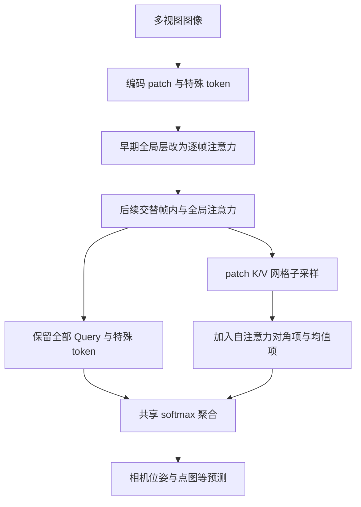

# AVGGT：多视图几何注意力加速

## 一句话定义

AVGGT 利用早期全局注意力与后续跨视图对齐的不同作用，在不重新训练模型的条件下减少 VGGT 和 π³ 的推理计算。

## 英文缩写速查

| 缩写 | 英文全称 | 简要说明 |
|------|----------|----------|
| VGGT | Visual Geometry Grounded Transformer | 多视图几何预测骨干 |
| SGA | Subsampling Global Attention | 对全局注意力的 patch K/V 子采样 |
| AUC | Area Under the Curve | 论文中相对位姿准确率曲线的面积 |
| K/V | Key / Value | 注意力中的键和值 |

## 核心信息

| 字段 | 内容 |
|------|------|
| 机构 | 上海交通大学；蚂蚁集团 |
| 论文 | [arXiv:2512.02541](https://arxiv.org/abs/2512.02541)，CVPR 2026 |
| 阅读状态 | 已核对主文方法、实验和部分附录；全文及附录仍待逐页核对 |
| 官方实现 | 截至 2026-10-30，论文页面未列代码，尚未核实到官方实现 |

## 流程总览

以下为已核实的论文方法主干，尚需完成全文和附录复核。

## 核心机制

- 早期层的全局注意力可改为帧内计算；论文默认 VGGT 将编号 0–8 的全局层转换，π³ 转换前 10 层。
- 后续层保留所有 Query：每帧 patch 网格按固定窗口选择 K/V；VGGT 首帧作为参考帧保留完整 patch，π³ 对各帧采样。
- 对采样保留集合、自身对角项及被丢弃 patch 的均值近似共同归一化。末层仍保留全局作用，不能将其视为完全无贡献。

## 实验与局限

论文在 A100 80 GiB、FlashAttention-2 下评估相机位姿与点图。7-Scenes 800 帧时，VGGT 为 397.133 秒，AVGGT(9) 为 50.034 秒，约 7.9 倍；AUC@5 从 23.551 到 24.896。π³ 为 298.477 秒，Aπ³(9) 为 30.273 秒，约 9.9 倍，AUC@5 从 27.429 到 26.579。速度与精度依赖模型、输入长度和采样配置。

稀疏视图下更激进采样会降低准确率：RealEstate10K 的 VGGT AUC@5 为 63.176，AVGGT(2) 为 61.959，AVGGT(9) 为 53.257。上述基准不等同于机器人实时系统的端到端性能。

## 结论

论文展示了针对多视图注意力结构的免训练加速，但选型需结合视图密度与误差实测。

- 长序列可重点测试 K/V 采样收益。
- 稀疏场景应谨慎提高采样因子，联合核对位姿及点图质量。
- 延迟数字仅适用于论文的硬件与评测配置。
- 完成原文逐页核对和代码开放状态核实后，再考虑将本页标为完成。

## 源码运行时序图

不适用：截至入库日尚未核实到该论文作者的可运行官方实现。

## 关联页面

- [VGGT 几何状态综述](../overview/vggt-geometric-state-survey.md)
- [VGG-T³](./paper-vgg-ttt.md)

## 参考来源

- [AVGGT 论文来源归档](../../sources/papers/avggt_2512_02541.md)

## 推荐继续阅读

- [CVPR 2026 论文页面](https://openaccess.thecvf.com/content/CVPR2026/html/Sun_AVGGT_Rethinking_Global_Attention_for_Accelerating_VGGT_CVPR_2026_paper.html)
