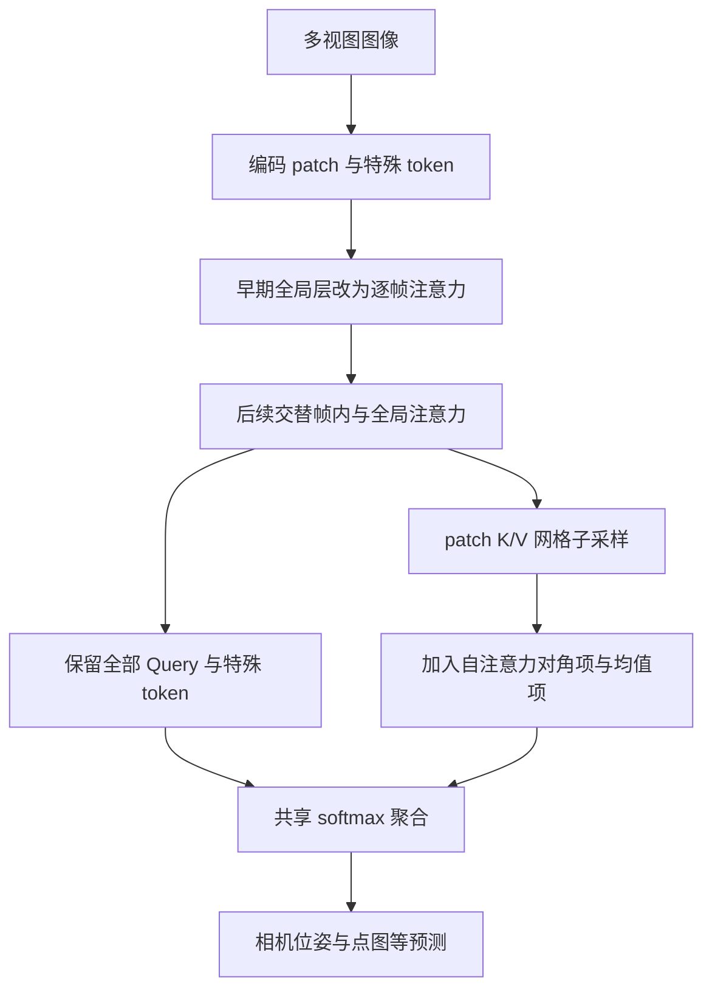

# AVGGT：多视图几何注意力加速

## 一句话定义

AVGGT 利用早期全局注意力与后续跨视图对齐的不同作用，在不重新训练模型的条件下减少 VGGT 和 π³ 的推理计算。

## 英文缩写速查

| 缩写 | 英文全称 | 简要说明 |
|------|----------|----------|
| VGGT | Visual Geometry Grounded Transformer | 多视图几何预测骨干，统一预测相机位姿、深度、点图与跟踪 |
| SGA | Subsampling Global Attention | 对全局注意力的 patch K/V 子采样（论文中的子采样全局注意力） |
| K/V | Key / Value | 注意力中的键和值；本文只对 patch 的 K/V 子采样，Query 全部保留 |
| AUC | Area Under the Curve | 对阈值曲线 min(RRA, RTA) 取面积，作为统一位姿指标 |
| RRA | Relative Rotation Accuracy | 相对旋转精度，在给定角度阈值下统计 |
| RTA | Relative Translation Accuracy | 相对平移精度，在给定角度阈值下统计 |
| ATE | Absolute Trajectory Error | 绝对轨迹误差（TUM 等序列实验中报告） |

## 为什么重要

VGGT 与 π³ 这类前馈多视图模型能一次输入多张图并输出位姿与点图，但每个全局注意力块的代价随帧数二次增长（输入 $N$ 帧、每帧 $L$ 个 token 时，全局注意力为 $O((NL)^2)$）。在几百到几百上千帧的稠密序列上，这一项成为推理瓶颈。已有稀疏注意力类方法（如 FastVGGT、FasterVGGT）要么在长序列上仍然较慢，要么在稀疏视图下精度下降明显。AVGGT 的价值在于先用层级分析解释全局注意力到底做了什么，再据此设计一个无需训练、可直接套在已有权重上的加速方案。

## 核心信息

| 字段 | 内容 |
|------|------|
| 机构 | 上海交通大学；蚂蚁集团（据 PDF 作者信息） |
| 论文 | [arXiv:2512.02541](https://arxiv.org/abs/2512.02541)（本页依据 v2 PDF，2026-03-10），CVPR 2026（会议页 [OpenAccess](https://openaccess.thecvf.com/content/CVPR2026/html/Sun_AVGGT_Rethinking_Global_Attention_for_Accelerating_VGGT_CVPR_2026_paper.html) 可访问） |
| 阅读状态 | 2026-11-06 已通读 arXiv v2 PDF 主文全部内容与补充材料的方法、消融文字；补充材料中 π³ 的逐行数值表（表 7–13 中部分数据集）与逐层注意力可视化图未逐行核对 |
| 官方实现 | 截至 2026-11-06，arXiv 摘要页与 CVPR 页均未列代码链接；GitHub 搜索因服务端 502 未完成，**官方代码仓库未核实（未核实）** |

## 流程总览

以下为论文方法主干（依据主文第 4 节）。

## 核心原理

**输入与输出。** 输入为 $N$ 张图像，每张图经 DINOv2 编码得到 $n_h \times n_w$ 个 patch token，另有相机 token 与 4 个 register token，故每帧 $L = T + 5$ 个 token（$T = n_h n_w$）。输出为相机位姿、深度与点图等。VGGT 的聚合器共 48 个块，帧内注意力与全局注意力交替。

**层级分析（动机）。** 论文对 VGGT 的全局层做 Top-k 注意力可视化（主文 1、5、12、22 层）并得出三段式分工：

- 早期层（如第 1、5 层）的高响应多来自位置编码（第 1 层）或固定的少量 key 中心，180° 旋转输入后这些中心不随场景移动，因此不对应跨视图几何；
- 中间层（如第 12 层）注意力更稀疏，高响应集中在同一 patch 自身或不同视图的同一空间位置，是跨视图对齐发生的地方；
- 末层的注意力更均匀，主要做小幅修正，但并非完全无贡献。

**两步加速。**

1. **Global-to-Frame 转换。** 将索引 $< t_{\mathrm{early}}$ 的全局块改为逐帧注意力（只改计算布局，不改参数）。论文设 VGGT 的 $t_{\mathrm{early}}=9$（即转换索引 0–8），π³ 的 $t_{\mathrm{early}}=10$。该块代价从 $O((NL)^2)$ 降为 $O(NL^2)$。
2. **Subsampling Global Attention（SGA）。** 对剩余全局块，只保留每帧 patch 网格中的一部分作为 K/V，Query 与特殊 token 全部保留。子采样因子 $\sigma = s_h s_w$，映射为 $\sigma=2 \Rightarrow (1,2)$、$\sigma=4 \Rightarrow (2,2)$、$\sigma=6 \Rightarrow (2,3)$、$\sigma=9 \Rightarrow (3,3)$，每个 $s_h \times s_w$ 窗口取第一个 patch token。注意力分为三个不相交部分，共享同一次 softmax 归一化：(i) 保留子集 $S$，(ii) 自身对角项，(iii) 所有被丢弃 patch 的均值 K/V。论文称全局注意力约快 $\sigma$ 倍，对角与均值项只带来 $O(N)$ 额外开销。

**为何不采样 Query。** 论文认为子采样 Query 会减少接收跨视图更新的 token，使稠密 3D 预测的 token 多样性下降；补充材料中用全局均值 Query 近似被跳过 Query 的变体，论文认为会压缩 token 差异，对稠密 3D 任务有害。

## 实验与评测

评测协议遵循 π³，指标包括 RRA/RTA/AUC、ATE、RPE 以及点图的 Acc./Comp./N.C.。实验在 A100 80 GiB 上启用 FlashAttention-2。

- **稀疏设置（10 帧）：** RealEstate10K 上 VGGT AUC@5 为 63.176，AVGGT(2) 为 61.959，AVGGT(4) 为 59.583，AVGGT(9) 为 53.257（表 6）。单次推理时间上，AVGGT(2) 约 0.298 s，略快于 VGGT 的 0.307 s，加速很小。
- **稠密设置（7-Scenes，每场景 333 帧，步长 3）：** 论文称精度差异较小，本方法在各设置中提速最大（表 4）。
- **极稠密设置（7-Scenes，800 帧，表 5）：**

| 方法 | 时间 (s) | AUC@5 |
|---|---|---|
| VGGT | 397.133 | 23.551 |
| AVGGT(2) | 126.913 | 24.716 |
| AVGGT(4) | 76.500 | 25.508 |
| AVGGT(9) | 50.034 | 24.896 |
| π³ | 298.477 | 27.429 |
| Aπ³(9) | 30.273 | 26.579 |

  表 5 中 FastVGGT 与 FasterVGGT 等基线在 800 帧下记为 OOM（A100 80 GiB）。本页数字来自论文表格，不代表其他硬件与推理框架下的结果。

- **消融（RealEstate10K，表 6）：** VGGT(G2F)（早期层改帧内）AUC@5 为 62.826，VGGT(G2M)（早期层 K/V 替换为均值）为 61.788；AVGGT(2) 末层改帧内为 59.637，原 AVGGT(2) 为 61.959。

## 结论

论文的核心结论是：免训练的 K/V 子采样在长序列上收益最大，但稀疏视图下要谨慎选择子采样因子。

- **长序列（几百到上千帧）收益最大。** 论文 800 帧 7-Scenes 上报告 VGGT 约 7.9×、π³ 约 9.9× 的时间加速；AUC@5 对 VGGT 基线上升（23.551 → 24.896），对 π³ 略降（27.429 → 26.579）。
- **稀疏视图收益小且掉点明显。** 10 帧场景加速有限，σ 增大时 RealEstate10K AUC@5 从 63.176 降到 53.257。
- **σ 不是越大越好。** 800 帧场景中 AVGGT(4) 的 AUC@5（25.508）高于 AVGGT(9)（24.896），需要在目标数据集上扫描子采样因子。
- **采样点必须保留空间锚点。** 论文消融显示固定网格优于 SIFT 选点、随机采样与均值聚合。
- **论文的 3D 对齐解释是假设，不是保证。** 实验与消融支持其动机，但不能直接当作机器人闭环中的感知质量保证。

## 工程实践

| 项目 | 建议 | 依据 |
|---|---|---|
| 应用对象 | 已有 VGGT / π³ 权重的推理侧替换；无需训练 | 论文 Sec. 4 |
| 早期层转换 | 默认 VGGT 转换索引 0–8（`t_early=9`），π³ 转换 0–9（`t_early=10`） | 论文 Sec. 4.2、表 6 与图 4 |
| 子采样因子 | 长序列可先测 σ=4 与 σ=9；稀疏输入从 σ=2 开始，逐步增大 | 表 1、表 5、表 6 |
| 首帧 | VGGT 保留参考帧完整 patch；π³ 对所有帧均子采样 | 论文 Sec. 4.3 |
| 末层 | 论文默认保留末层全局注意力，替换会带来小幅掉点 | 论文 Sec. 3.1、表 6 |
| 调试指标 | 同时看 AUC@5/15/30、ATE/RPE、点图 Acc./Comp.，以及单次推理时间与显存 | 论文 Sec. 5.1 |
| 基线 | 与 FastVGGT、FasterVGGT 等同场对比；注意 800 帧下这些基线会 OOM | 表 5 |

**源码运行时序图** 见下节说明。

## 源码运行时序图

不适用：截至 2026-11-06 未核实到论文作者的官方可运行仓库（见「核心信息」），故不绘制运行时序图。

## 局限与风险

- **证据范围有限。** 论文只在 RealEstate10K、TUM-dynamics、DTU、7-Scenes 等标准基准及补充材料中的 Sintel、ETH3D、NRGBD 上评测；主文未设独立的「局限」小节。
- **稀疏视图风险。** 10 帧、σ=9 的 RealEstate10K 实验显示 AUC@5 降幅明显；论文自己也承认全局注意力在稀疏设置中负责对齐，减少 token 会损失精度。
- **稠密收益依赖重叠。** 论文认为 800 帧场景的重叠冗余使模型对子采样更鲁棒，若机器人轨迹重叠较少，结论不能外推。
- **延迟数字的边界。** 时间与 FLOPs 基于 A100 80 GiB 与 FlashAttention-2；在其他 GPU、推理框架或端侧硬件上需重测。
- **不是实时闭环结论。** 论文评测为离线批处理的位姿与点图，不含机器人控制延迟、传感器时序或在线建图场景。
- **对基线的比较有条件。** 论文承认 FasterVGGT 在部分指标上数值更高，但其运行时间与计算量设定不同，论文主张在可比运行时预算下 AVGGT 更优；比较时需统一计算预算。
- **未核实的代码与复现条件。** 截至入库日未核实官方实现，复现需自行按论文实现 SGA 的三段式注意力。

## 与其他工作对比

| 对象 | 关系 | 差异 |
|---|---|---|
| VGGT / π³ 原模型 | AVGGT 的加速对象 | 保持权重不变，只改早期全局层为帧内注意力并对后续 patch K/V 子采样；论文中稠密长序列提速明显，稀疏视图下精度下降更明显 |
| FastVGGT / FasterVGGT | 同样针对 VGGT 全局注意力成本的加速方法 | FastVGGT 用 token 合并；FasterVGGT 用块稀疏注意力（SpargeAttention）。论文认为这些方法缺少对全局注意力作用的系统分析，且在短序列上可能反而变慢 |
| [VGG-T³](./paper-vgg-ttt.md) | 同样针对 VGGT 全局注意力的计算瓶颈 | VGG-T³ 用 TTT 压缩的固定 MLP 替换全局 softmax 注意力，需要训练；AVGGT 免训练，保留 softmax 结构 |

## 关联页面

- [E0.5 几何世界动作模型](./paper-e05-geometry-world-action.md)：同样把几何先验引入世界/动作建模。
- [DepthWorld 3D 世界模型](./paper-depthworld-3d-world-model.md)：另一条基于深度/3D 几何的世界模型路线。
- [几何感知 4D 视频生成](./paper-geometry-aware-4d-video-generation.md)：视频生成中的几何一致性问题。

## 参考来源

- [AVGGT 论文来源归档](../../sources/papers/avggt_2512_02541.md)
- arXiv 原文：<https://arxiv.org/abs/2512.02541>（v2，2026-03-10；本页依据 PDF 核对）

## 推荐继续阅读

- [CVPR 2026 论文页面](https://openaccess.thecvf.com/content/CVPR2026/html/Sun_AVGGT_Rethinking_Global_Attention_for_Accelerating_VGGT_CVPR_2026_paper.html)
- [VGGT 几何状态综述](../overview/vggt-geometric-state-survey.md)（本库内相关综述）
