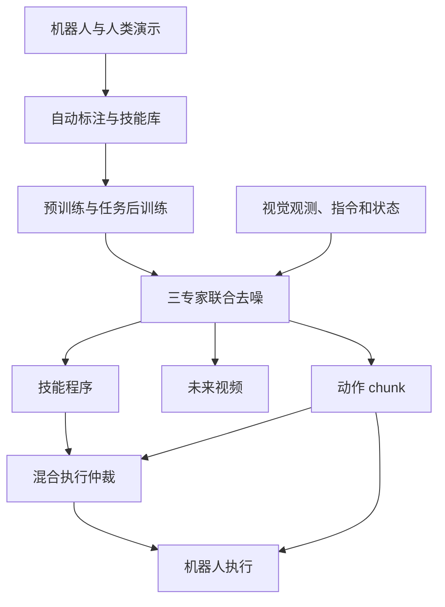
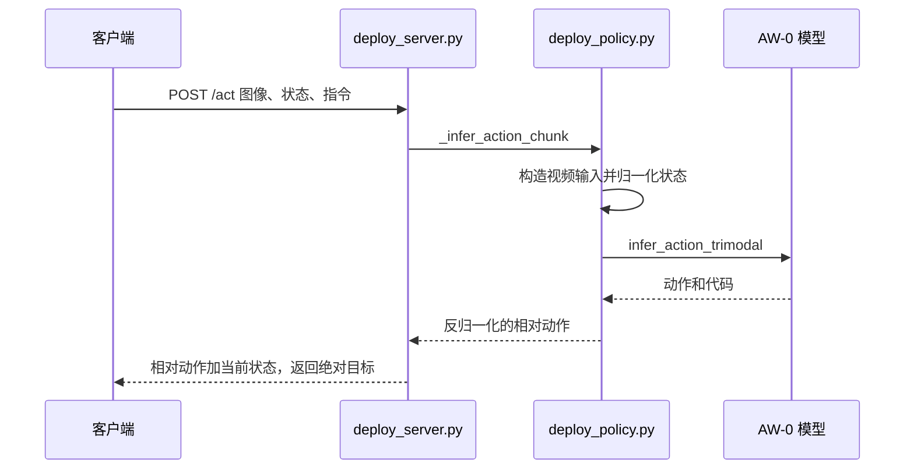

# AW-0：Agentic World Action Models

**一句话定义：** AW-0 把程序化技能规划、未来视频预测和机器人动作生成放进一个联合生成的世界动作模型，让代码结构为预测与控制提供语义条件。

## 英文缩写速查

| 缩写 | 英文全称 | 简要说明 |
|------|----------|----------|
| AW-0 | Agentic World Action Models | 将程序规划纳入世界动作模型的框架 |
| WAM | World Action Model | 联合建模视觉动态与机器人动作的模型路线 |
| MoT | Mixture-of-Transformers | 由代码、视频、动作专家组成的 Transformer 混合架构 |
| CaP | Code-as-Policies | 通过可执行程序表达机器人任务规划的路线 |
| VLA | Vision-Language-Action | 以视觉、语言和动作建模为核心的具身策略 |

## 为什么重要

传统 WAM 学习观察之后的未来视觉状态与机器人动作，但组合技能的表达和复用较弱；单独的代码规划能表达结构化步骤，却缺少对物理动态的预测。AW-0 让代码计划、视觉未来和连续控制在同一模型中交互。

## 核心原理

MoT 包含三个专家：代码专家生成参数化技能程序与控制逻辑；视频专家生成未来视觉状态；动作专家生成连续动作 chunk。三个生成流协同去噪，代码为视频和动作提供结构化规划条件，动作专家也能利用视频表征。

自动标注流程将机器人及第一人称人类演示对齐到子任务程序，并从中整理可复用技能。默认执行方式可直接使用动作专家输出；混合评测则会在重规划点按程序有效性等检查结果切换到程序技能调用。

## 项目流程图

依据 [arXiv v1 §2](https://arxiv.org/html/2610.30136v1) 绘制。注意混合模式可执行程序；默认路径只将程序作为模型条件。

## 源码运行时序图

以下为 [deploy/deploy_server.py](https://github.com/ZhuoyangLiu2005/agentic-wam/blob/275818e5787d59012eba4c43504342f1201ad25b/deploy/deploy_server.py) 的三专家服务路径，不代表混合执行实现。

该服务将响应中的 `code` 固定为 `None`；程序技能执行与仲裁不在此时序图中。参见[源码归档](../../sources/repos/aw0_agentic_wam.md)。

## 方法栈

`多视角观察 + 指令 + 机器人状态 → 代码 / 未来视频 / 动作联合生成 → 动作 chunk 或混合程序执行`

- **代码流：** 使用离散 masked diffusion 生成技能程序。
- **视频与动作流：** 使用连续 flow matching 生成未来视觉和低层动作。
- **技能库：** 将重复任务套路整理为带参数的程序，供后续规划复用。
- **混合执行：** 结构化步骤可调用程序技能；更依赖连续灵巧控制的阶段可执行动作 chunk。

## 实验与评测

论文在 RoboTwin 2.0 的 50 个任务上，每任务每设置评测 50 次。默认 AW-0 在 clean / random 设置下成功率为 80.8% / 20.6%；混合模式分别为 63.1% / 29.2%，但混合模式使用单独收集的程序生成示范数据，不能将差异全部归因于执行仲裁。8 项真机任务的平均分为 71.1，对比最强基线 DreamZero 的 46.0；这是分项评分均值，并非任务成功率。

## 与其他工作对比

| 路线 | 规划表达 | 物理未来预测 | 执行接口 |
|------|----------|--------------|----------|
| AW-0 | 结构化代码和可复用技能 | 与代码、动作联合生成 | 动作 chunk；混合模式可调用技能程序 |
| [World Action Models](../concepts/world-action-models.md) | 取决于具体 WAM | 观察条件的未来预测 | 机器人动作 |
| Code-as-Policies | 程序化技能与控制逻辑 | 通常由外部环境或仿真提供 | 执行程序 |

## 工程实践

- 检查技能 API、程序语法、阶段依赖和白名单，避免把生成代码未经验证地直接交给机器人执行。
- 代码规划适合表达对象、顺序与可复用套路；接触丰富、连续精细的动作仍可能依赖动作专家。
- 官方代码与预训练权重已发布；预训练数据和起始视频模型权重不随代码仓库提供。

## 结论

**AW-0 的重点是让可复用程序成为 WAM 内部的规划条件，使语义结构影响未来预测与机器人动作。**

1. 代码、视频和动作由 MoT 联合去噪，形成共享的规划与预测接口。
2. 混合执行允许在程序技能调用和动作 chunk 之间选择。
3. 代码作为规划表示能补充长时序语义，但不消除感知、工具调用和低层接触控制错误。
4. 论文在 RoboTwin 2.0 和所测真实双臂任务中的结果不能直接外推到所有机器人平台。

## 局限与风险

- 程序参数或对象 grounding 出错时，结构化代码仍可能选择错误目标或动作。
- 视觉分布变化会影响未来预测和技能执行；混合仲裁本身也可能偏向无效程序。
- 复现需准备训练数据、公开权重及论文指定的视觉/语言模型组件，不能只凭仓库源码运行完整训练。

## 关联页面

- [World Action Models](../concepts/world-action-models.md)
- [生成式世界模型](../methods/generative-world-models.md)

## 参考来源

- [AW-0 项目页归档](../../sources/sites/aw0_agentic_wam.md)
- [AW-0 源码归档](../../sources/repos/aw0_agentic_wam.md)
- [AW-0 论文归档](../../sources/papers/aw0_arxiv_2610_30136.md)
- [AW-0 官方项目页](https://agentic-wam.github.io/)
- [AW-0 官方代码](https://github.com/ZhuoyangLiu2005/agentic-wam)
- [arXiv:2610.30136](https://arxiv.org/abs/2610.30136)

## 推荐继续阅读

- [AW-0 项目页](https://agentic-wam.github.io/) — 结构图、方法和演示
- [AW-0 代码仓库](https://github.com/ZhuoyangLiu2005/agentic-wam) — 训练、部署、RoboTwin 2.0 指南
- [World Action Models](../concepts/world-action-models.md) — WAM 方法脉络
