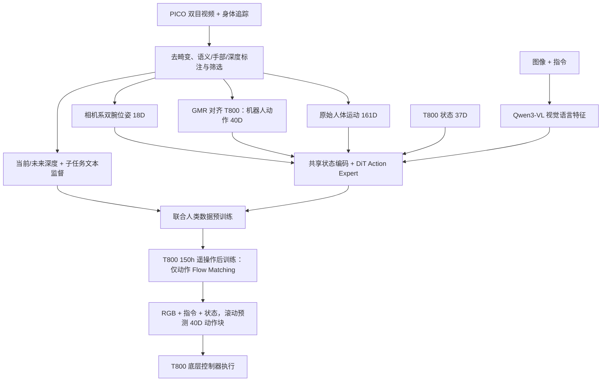

# Awaken-HI：以全身人类经验扩展人形智能 / Scaling Humanoid Intelligence with Whole-Body Human Experience

## 一句话定义

**Awaken-HI**（众擎机器人 EngineAI，arXiv:2611.26420v1，2026-11-19 UTC）是面向 T800 人形机器人的 **视觉-语言-全身动作 VLA**：利用 Awaken-Human 的约 50,000 小时第一人称双目视觉与同步人体运动，通过同一动作专家联合预测原始人体运动和重定向机器人动作，再以真机遥操作数据适配边走边操作（loco-manipulation）。

## 英文缩写速查

| 缩写 | 英文全称 | 简要说明 |
|---|---|---|
| VLA | Vision-Language-Action | 根据视觉、语言和机器人状态预测全身动作 |
| DiT | Diffusion Transformer | 共享动作专家中的 Transformer 结构 |
| GMR | General Motion Retargeting | 人体运动向目标人形运动空间的几何重定向 |
| EEF | End Effector | 末端执行器，本文主要关注双腕/双手对齐 |
| MSE | Mean Squared Error | 用于衡量归一化动作预测的离线均方误差 |
| PICO | PICO head-mounted tracking system | 双目视频及身体追踪数据采集设备 |

## 为什么重要

- 人形机器人真机全身遥操作很贵；只有无动作标注的视频又不能直接监督步态与手臂协调。论文用统一可穿戴采集协议把**视觉 + 全身姿态**共同变成预训练资源。
- 人体与机器人形态差别使重定向轨迹失真：保留原始人体运动，让共享动作专家不仅拟合失真的机器人标签，还学习未被重定向改写的人类运动先验。
- 在固定机器人后训练数据下检验随人类数据规模提升而出现的行动误差与成功率变化，优于仅展示大模型单点成功率。

## 核心信息

| 项目 | 论文报告及协议 |
|---|---|
| 研究机构 | 众擎机器人（EngineAI） |
| 数据集 | Awaken-Human：约 50,000 h；17.02M episodes；5.41B 姿态帧；11.18M 有效指令；100+ 技能 |
| 采集 | PICO 双目 RGB + 五个身体追踪器；全身/手部/语义标签/双目深度 |
| 骨干 | Qwen3-VL 图文特征 + 共享状态编码器及 DiT action expert |
| 预训练分支 | 40D T800 动作、161D 人体运动、18D 相机系双腕位姿；另有当前/未来深度及 subtask 文本损失 |
| 真机后训练 | 约 150 h T800 遥操作；仅优化 40D 机器人动作 flow-matching 损失 |
| 硬件与任务 | EngineAI T800，八项单任务 + 工厂/家庭连续长程任务；主对照单张 RTX 5090 推理 |

## 核心原理

### Awaken-Human 数据对齐

先用相机参数去畸变与时间同步，再对片段做人机复核的语义标注；用视频重建 MANO 手部 21 关键点，剔除不可靠片段；用 Fast-FoundationStereo 计算深度；借助基于 GMR 的 T800 重定向与双腕方向优化，得到机器人身体和双夹爪动作标签，同时保留**原始人体轨迹**。相比原 GMR，作者报告双末端平均位置误差由 16.423 cm 降至 2.422 cm、方向误差由 39.590° 降至 15.596°，这是构建标签的几何对齐误差，不是真机末端操作误差。

### 共享 Action Expert 与动作接口

- 输入为头部 RGB 视图、文本指令、37D 机器人状态（根 6D 姿态 + 29 关节 + 双夹爪）。
- T800 动作块逐帧输出 40D：局部根位移 3D、根姿态 6D、29 个关节角目标、双夹爪 2D。根系以预测时刻的重力对齐 heading frame 为准；**不直接输出电机力矩**。
- 人运动分支直接预测 161D 人体骨架和手；双腕分支预测 18D 相机系位姿。三个分支各自有输入/输出适配器，却共享状态编码器与 DiT，使用 flow matching 在同一专家里学习。
- 辅助目标包括当前及未来深度（DPT 与深度残差），以及语言模型对当前 subtask 的文本预测；后训练只保留与真机动作有关的分支。

### 主干数据与训练流程

该图表示**论文的方法与监督路径**，不是经源码核实的可运行调用图。人体运动、腕姿与 T800 action 三分支共享专家；后训练使用真机机器人动作监督，不能把训练目标误说成部署时必须同时生成三类动作。

## 源码运行时序图

**不适用（截至 2026-11-21）**：官方 [Awaken-HI 仓库](https://github.com/engineai-robotics/Awaken-HI) README 的 TODO 仍将「Code including inference code」「Model weights」「Simulation platform」列为未发布；当前仅文档、GIF/图片等，没有可辨识训练、推理或部署脚本。**不以通用 sequenceDiagram 冒充已经读过源码**；发布后再核对入口并补图。

## 工程实践

1. **先核实数据可用性：** 作者报告 50K h 数据用于论文；[当前 HF 数据卡](https://huggingface.co/datasets/EngineAI-Embodied/Awaken-Human) 只开放一条 33.8 s、1,014 帧、8 段动作标注的记录，含去畸变左眼视频、姿态追踪、相机参数与语义 JSON；并不等于全量可训练语料。
2. **建模对照：** 若有自采数据，至少区分「只监督重定向动作」「加原始人体 161D」「加双腕位姿」「加深度」四种消融，同时用同一机器人后训练集与相同动作归一化口径比较。
3. **部署接口：** 论文是全身 40D 目标动作块经 receding-horizon 策略交付低层，不是关节力矩直控；需要额外检查低层跟踪误差、接触、碰撞、观测延迟及动作块执行频率。论文并未给出这些指标的跨硬件普适保证。
4. **复现边界：** 目前没有可运行官方模型代码或检查点，无法独立跑出论文 T800 成绩。官方样例数据的许可仅允许非商业学术研究，禁止分发；不应把数据样例当作可自由商用全量数据。

## 评测与结果

全部数字来自论文 v1 §5 的**作者报告**，未独立复现实验。

| 评测协议 | π₀.₅ | GR00T N1.7 | Awaken-HI |
|---|---:|---:|---:|
| T800 八项独立任务成功率均值 | 57.5% | 58.75% | **93.75%** |
| 工业上架长程（连续、不重置） | 10% | 30% | **90%** |
| 家务整理长程（连续、不重置） | 20% | 10% | **80%** |
| 新物体—目的地组合（四组均值） | 10% | 17.5% | **90%** |

各方法使用相同的约 150 h T800 后训练遥操作数据，30,000 steps / batch 256，每任务 10 次独立试验并对齐十组初始条件；长程任务中间不 reset。论文另测试后训练未见的纸巾、药瓶：逐物体完成率 **50% / 30%**，不宜解读为未知物体全面成功。

**受控 Scaling：** 人类预训练数据 5k→50k h，归一化机器人动作 MSE 0.06649→0.05926（约 -11%），validation loss 0.04955→0.04025（-18.8%）；在固定 T800 后训练条件下三项家务成功率均值 56.7→90.0%。幂律指数为 0.051 / 0.090，是该数据区间内的**经验拟合**。

**辅助监督消融（只用 5k h 人类预训练）：** Base 三项家务均值 13.3%；仅加 human motion 为 43.3%、仅加 depth 为 40.0%、仅加 wrist 为 20.0%、Full 为 53.3%。Full 相比 Base 的离线 action MSE 下降 4.29%；单加 wrist 并非所有任务均有收益。

## 结论

**核心判断：原始人类全身运动不仅是机器人动作重定向的输入，它本身也是规模化学习人形全身控制的有效监督信号。**

- 优先保留**原始人体动作 + 重定向机器人动作**双标注，避免仅在 robot action 上丢失人体运动先验。
- 比较数据规模时固定 held-out 集、equivalent epochs 和真机后训练数据；不要把离线幂律外推成任意任务成功率保证。
- 关注**动作接口与低层控制**：40D 是全身目标，不是关节力矩，也不意味着无须独立安全保护。
- 分开记录八单任务、两长程、四新指令组合与未见对象的指标；样本量均有限。
- 项目应归类为**论文与数据样例公开、模型运行资源待发布**，不能标成已可复现开源 VLA。

## 与其他工作对比

| 对比维度 / 工作 | Awaken-HI（本文） | $\pi_{0.5}$ / GR00T N1.7（同平台后训练对照） | [Open-HumanWAM](./paper-open-humanwam.md) | [λ₀](./paper-lambda0-egocentric-human-pretraining.md) |
|---|---|---|---|---|
| 预训练数据与形态信号 | Awaken-Human ~50k h（PICO 双目 + 5 身体追踪器），联合监督 161D 原始人体运动 + 40D 重定向动作 + 18D 腕姿 | 未含 Awaken-Human 50k h 全身人类预训练，仅共享相同 ~150 h T800 遥操作后训练 | 同量级（~50k h）人机经验规模化与世界-动作建模开放配方 | 聚焦人类第一视角全身经验向人形机器人的迁移预训练 |
| T800 八任务 / 长程均值 | **93.75%**（工业/家务长程 **90% / 80%**，新组合 **90%**） | $\pi_{0.5}$：**57.5%**（长程 10%/20%，新组合 10%）；GR00T N1.7：**58.75%**（30%/10%，17.5%） | 不同平台与评测协议 | 不同平台与评测协议 |
| 开放与可复现边界 | 代码、权重、仿真平台未发布；HF 仅开放 1 条 33.8 s 样例（学术非商用） | 依各自公开/后训练基线版本 | 对照开放配方程度 | 依其公开实现口径 |

> **核对边界**：论文 §5 的 $\pi_{0.5}$ 与 GR00T N1.7 对比均在 T800 上使用同份 ~150 h 遥操作数据后训练（每任务 10 次独立试验），且 Awaken-HI 未开放权重/推理代码与全量 50k h 人类数据集，无法独立复现验证。

## 局限与风险

- 主评测仅 T800 和论文定义的八个任务，每任务 10 次；任务选择、场景、低层控制器、动作接口不同不能直接比较外部 SOTA。
- 原数据中人体 50K h 规模是论文报告；HF 当前**只有一条样例记录**，不足以完整重现预训练/Scaling；未提供全部训练与推理代码/权重。
- 论文的幂律拟合是 5k–50k h 的经验关系，不能推断训练到无限小时也持续增益。消融仅 5k h，效果与最终 50k h 模型区分。
- 单臂/双臂任务成功率不能取代碰撞、接触力、鲁棒性、失败恢复与安全验证；部署仍需具体系统检验。

## 关联页面

- [Open-HumanWAM：人机经验规模化与 WAM 开放配方](paper-open-humanwam.md) — 对照相同 50K h 量级但不同采集协议、动作/视频建模与开放程度。
- [λ₀：人类第一视角全身经验预训练](paper-lambda0-egocentric-human-pretraining.md) — 对照人—人形转移与全身监督。
- [Loco-Manipulation 任务页](../tasks/loco-manipulation.md) 与 [VLA 方法](../methods/vla.md)
- [VLA 纵深](../../roadmap/depth-vla.md) · [移动操作纵深](../../roadmap/depth-loco-manipulation.md)

## 参考来源

- [arXiv v1 通读与实验核对](../../sources/papers/awaken_hi_arxiv_2611_26420.md)
- [EngineAI 官方项目页核对](../../sources/sites/awaken-hi.md)
- [官方 GitHub 开放状态核对](../../sources/repos/awaken-hi.md)
- [Awaken-Human HF 样例与许可证核对](../../sources/datasets/awaken-human-sample.md)

## 推荐继续阅读

- [论文 arXiv v1 全文 HTML](https://arxiv.org/html/2611.26420v1)
- [论文 PDF](https://arxiv.org/pdf/2611.26420)
- [Awaken-HI 项目与真机演示](https://engineai-robotics.github.io/Awaken-HI/)
- [HF 数据卡（仅样例）](https://huggingface.co/datasets/EngineAI-Embodied/Awaken-Human)
