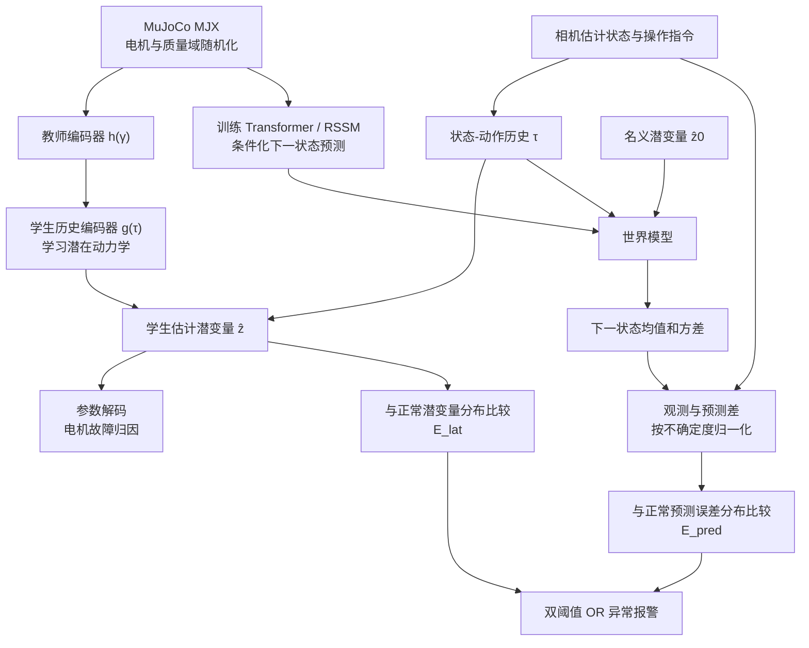
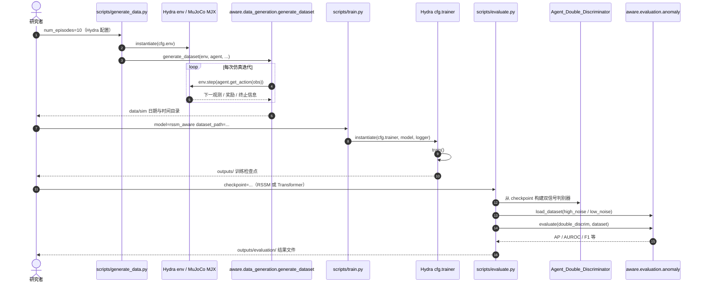

# AWARE：Adaptive World-Models for Anomaly Recognition | 自适应世界模型异常识别

*A Framework for Robot Dynamics Prediction and Introspection*（[arXiv:2610.32742v1](https://arxiv.org/html/2610.32742v1)，CoRL 2026 Poster）由 Imperial College London / BOLD 团队提出，提供 [官方项目](https://adaptive-intelligent-robotics.github.io/aware/) 和 [代码](https://github.com/adaptive-intelligent-robotics/aware)。论文一手精读覆盖方法、实验、附录和源码入口，见[通读归档](../../sources/papers/aware_arxiv_2610_32742.md)。

## 一句话定义

**AWARE 用外部相机推测被监控机器人状态，结合「潜在动力学估计偏离」与「世界模型状态预测残差」两种异常信号，实现无需机器人内部传感器权限的故障报警和部分故障来源解释。**

## 英文缩写速查

| 缩写 | 英文全称 | 简要说明 |
|------|----------|----------|
| AWARE | Adaptive World-Models for Anomaly Recognition | 本论文双信号世界模型监测框架 |
| RSSM | Recurrent State-Space Model | 可选的递归世界模型骨干，与 Transformer 对照 |
| ROA | Regularized Online Adaptation | AWARE 修改的教师—学生动力学估计思路 |
| AP | Average Precision | 异常识别质量的阈值无关指标 |
| OOD | Out of Distribution | 训练域随机化范围以外的更严重电机退化 |
| DR | Domain Randomization | 在仿真中随机化电机属性与负载等参数 |
| MAE | Mean Absolute Error | 故障参数解码误差度量 |

## 为什么重要

- **无需内部通信访问：** 老旧或安全隔离设备的电机编码器未必可用，外置相机仍可对动力学变化进行监测。
- **区分不同故障机理：** 长时电机退化与短时负载碰撞对异常分数的表现不同，单一残差检测在高噪声下不稳。
- **有对照与开源证据：** 论文在真实起重机上采集 240 条轨迹，并发布训练、仿真数据生成、评测脚本以及公开数据。

## 核心信息

| 项 | 经原文核对的结果 |
|----|----------------|
| 任务 | 被动视觉监控机械系统的动力学异常，不负责操控起重机 |
| 实验平台 | 3 个驱动轴（回转、俯仰、起升）+ 4 个被动关节的欠驱动小型起重机 |
| 观测 | 高质量运动捕捉与高噪声纯相机两种配置；20 Hz |
| 数据 | 240 条：80 正常 + 40 负载碰撞 + 120 电机退化；5 名操作员 |
| 模型 | 动力学学生网络 + Transformer 或 RSSM 世界模型 + 参数解码器 |
| 高噪声性能 | Transformer AWARE AP 0.77、F1 0.68；88.0% 故障电机定位准确率 |
| 代码 | [官方仓库](https://github.com/adaptive-intelligent-robotics/aware)，含训练 / 评测 / 数据脚本、checkpoint 与数据 |
| 许可 | 代码 MIT，数据 CC BY-NC-SA 4.0（README） |

## 核心原理

### 1. 动力学参数估计

将系统动力学区分为已建模参数 `γ`（电机强度/转子惯量/负载质量）与未建模扰动 `ζ`（碰撞、外力）。仿真随机化 `γ`，教师编码器 `hψ(γ)` 提供潜空间监督；学生估计器 `gφ(τt)` 从状态/动作历史预测 `ẑt`，世界模型通过 `ẑt` 条件化。AWARE 去掉 ROA 的潜变量瓶颈与正则化，并加入参数解码器供故障定位。

### 2. 预测分布和双信号报警

世界模型根据历史、动作和动力学潜变量预测下一状态的高斯均值与方差。归一化的预测残差形成 `E_pred`，潜在动力学表示相对名义轨迹的偏移形成 `E_lat`；二者采用 Mahalanobis 距离对正常参考分布分别评分和校准阈值，通过 OR 组合。

- **`E_lat`：** 长时状态/动作历史对电机参数改变更敏感，尤其是训练域范围内的退化，抗视觉噪声。
- **`E_pred`：** 更敏感于负载碰撞及训练域之外的强烈退化；模型预测标准差用于归一化预测误差。
- **名义潜变量固定：** 论文 §3.4 / Appendix C.2 以名义 `ẑ0` 条件化预测模型，避免把故障后的变化解释为新正常。

### 3. 流程总览

下图基于论文 §3、Fig. 2 与 Appendix A，不是实时控制策略的动作链。

## 源码运行时序图

依据官方仓库实际入口 [`scripts/generate_data.py`](https://github.com/adaptive-intelligent-robotics/aware/blob/main/scripts/generate_data.py)、[`scripts/train.py`](https://github.com/adaptive-intelligent-robotics/aware/blob/main/scripts/train.py)、[`scripts/evaluate.py`](https://github.com/adaptive-intelligent-robotics/aware/blob/main/scripts/evaluate.py)，读取对应 Hydra 配置、调用模块后整理：

**最短复现：** README 提供 CUDA/Docker 或 Python 3.10+uv 环境；可直接下载 Releases 的两个模型 checkpoint，并在作者公开的 240 条高/低噪声数据上执行 `python scripts/evaluate.py checkpoint=...`。生成论文量级模拟数据成本较高，README 给出 448 个 episode / 约 1.3 TB 的生成规模；本页只核验代码入口，**未实际运行 GPU 实验**。

## 工程实践

1. **区分检测信号与执行安全链：** AWARE 输出监测信号和故障线索，不是通过 RL/规划自主控制起重机的执行器。
2. **评测时保留相机噪声：** 不能仅用运动捕捉模式评估被动监控效果；采样为 20 Hz，历史窗口 `H=64`，异常残差平均窗口 `N=20`（论文 Appendix A）。
3. **标定名义参考分布：** 运行前收集固定工况下的正常轨迹，再标定双阈值；改变作业工况时需重新评估误报。
4. **对比公平性：** 原文 240 条轨迹的持续时序报警转换为轨迹级判定，AP/F1/阈值选择协议必须匹配，而非用直接帧分类简单横比。
5. **许可与依赖：** 官方 README 代码 MIT、数据 CC BY-NC-SA 4.0；JAX RSSM / PyTorch Transformer 对应 CUDA 环境，读 `configs/train.yaml`、`configs/evaluate.yaml` 复现。

## 实验与评测

论文 Table 1 的 AP/F1（均为实验原文结果；不是本次复现）：

| 方法 | 低噪声 AP | 高噪声 AP | 高噪声 F1 |
|------|-----------|-----------|------------|
| RWM（双信号） | 0.90 | 0.61 | 0.59 |
| RSSM AWARE | 0.91 | 0.76 | 0.69 |
| Transformer AWARE | **0.93** | **0.77** | 0.68 |

- **26% 的正确含义：** 高噪声 AP 从 RWM 0.61 提升到 0.77，按相对改进约 26%，不是增加 26 个百分点。
- **故障归因：** 高噪声电机定位 88.0%，强度估计 MAE 18.1%；低噪声 93.3% / 16.7%（§5）。
- **消融读法：** Appendix B/C 对比单信号、双信号、预测方差归一化、固定名义动力学及潜变量瓶颈；双信号互补而非只改骨干结构。

## 与其他工作对比

- **[Autane](./paper-autane-autonomous-crane.md)：** 同有起重机场景，但 Autane 是港口 RTG 自主装卸系统，AWARE 是外部视觉安全监测框架；平台和任务不同，不可直接横比成功率。
- **RWM、ROA：** RWM 的动力学条件化为 AWARE 提供模型对照，ROA 的教师—学生机制是动力学潜变量估计起点；AWARE 去瓶颈、采用预测目标且引入潜变量与预测双信号。
- **AESOP / AnyAnomaly：** 侧重语义表征或短视频异常判断；论文实验指出其对细粒度时间动力学变化不如显式世界模型。

## 结论

**对工业机器人被动监控，更可靠的架构是同时对比“长期动力学是否变了”和“下一状态是否偏离预测”，而不是依赖纯视觉语义判断或单一世界模型残差。**

1. **感知接入：** 只有外部相机权限也可以做动力学异常监测，但需要动作估计、传感器同步与可信名义参考。
2. **潜变量作用：** `E_lat` 对域内电机衰减更稳定，`E_pred` 对碰撞/域外强衰减更敏感；两条报警链应保留。
3. **实测口径：** 240 条轨迹高噪声 AP 0.77、F1 0.68；较 RWM 的 AP 相对提升约 26%。
4. **故障解释：** 参数解码器帮助定位退化电机（高噪声 88%），但不等同于确定所有故障根因。
5. **部署限制：** 固定名义分布的假设在变化工况下易误报；实地落地必须分场景做阈值/误报验证。

## 局限与风险

- **固定名义工况：** 论文 §6 承认不同但正常的作业条件可能被误判为异常；需要参考分布维护策略。
- **平台外推：** 只在一套小型实验起重机验证；结果不能推断大型港口 RTG 的安全效果。
- **数据采集筛选：** 原文 §4 排除摄像头严重遮挡、目标离开视野等轨迹；对感知管线失效的监测能力仍未知。
- **安全责任：** 异常分数不是功能安全认证或经过验证的自动停机决策，不能绕过专用硬件保护与人工应急机制。

## 关联页面

- [Autane：面向港口持续作业的自主起重机](./paper-autane-autonomous-crane.md) — 起重机自主作业 vs 外部被动监测
- [仿真与评测基础设施](../concepts/simulation-evaluation-infrastructure.md)
- [视觉-语言-动作方法（VLA）](../methods/vla.md) — 论文与 AnyAnomaly 视觉语义异常检测基线的对照
- [机器人操作任务](../tasks/manipulation.md) — 被监控的起重机执行负载搬运任务，AWARE 本身仅提供异常监控
- [具身评测选择闭环](../queries/embodied-eval-benchmark-selection-loop.md)
- [多样示范与异常评测研究地图](../overview/embodied-station-2026-10-29-58-papers-technology-map.md)

## 参考来源

- [AWARE 原文通读归档](../../sources/papers/aware_arxiv_2610_32742.md)
- [官方源码归档](../../sources/repos/aware.md)
- [项目页归档](../../sources/sites/aware.md)
- [arXiv:2610.32742v1 全文](https://arxiv.org/html/2610.32742v1)

## 推荐继续阅读

- [AWARE 官方 GitHub README 与评测命令](https://github.com/adaptive-intelligent-robotics/aware)
- [AWARE 官方项目及视频](https://adaptive-intelligent-robotics.github.io/aware/)
- [论文 HTML（含 Appendix A–D）](https://arxiv.org/html/2610.32742v1)
