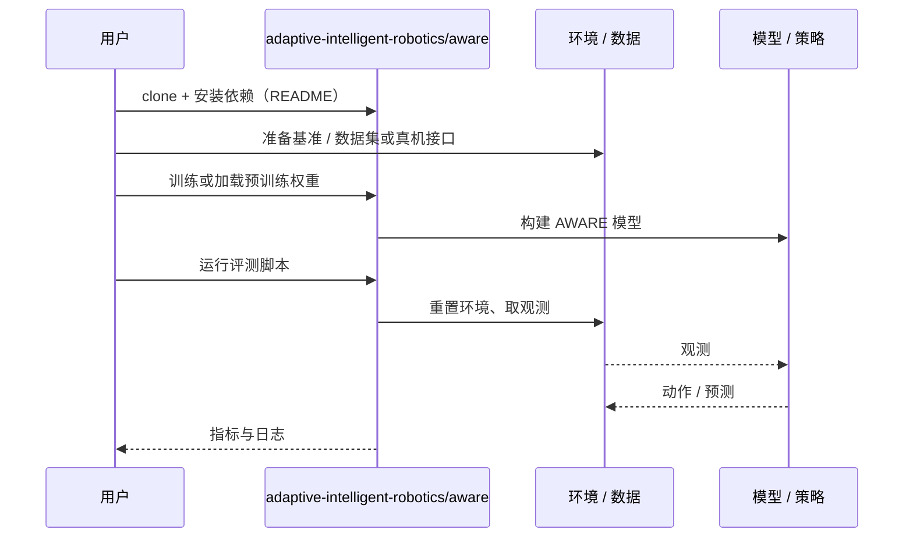

# AWARE（arXiv:2610.32742）

**AWARE**（*Adaptive World-Models for Anomaly Recognition (AWARE): A Framework for Robot Dynamics Prediction and Introspection*，[arXiv:2610.32742](https://arxiv.org/abs/2610.32742)，[项目页](https://adaptive-intelligent-robotics.github.io/aware/)，[代码](https://github.com/adaptive-intelligent-robotics/aware)）来自 [具身智能小站 2026-10-29 盘点](../../sources/blogs/wechat_embodied_station_58_papers_diverse_demonstrations_2026-10-29.md)，属「评测、安全与不确定性」组。

## 一句话定义

**AWARE从相机轨迹估计隐含动力学，再结合预测误差识别异常；在真实起重机上验证碰撞与电机退化，正常工况变化仍可能触发误报。**

## 英文缩写速查

| 缩写 | 英文全称 | 简要说明 |
|------|----------|----------|
| AWARE | Adaptive World-Models for Anomaly Recognition (AWARE): A Framework for Robot Dynamics Prediction and Introspection | 本文方法 / 基准的简称 |

## 为什么重要

- 只靠外部相机识别设备异常。
- 开源结论：**已开源**（步骤 2.5，2026-10-29）。仓库可达（git ls-remote）。项目页 HTTP 200。
- 同期同组工作见 [多样成功示范、触觉工具链与预见式感知：具身智能小站 10-29 期 58 篇阅读坐标](../overview/embodied-station-2026-10-29-58-papers-technology-map.md)。

## 核心机制

| 项 | 内容 |
|----|------|
| **arXiv** | [2610.32742](https://arxiv.org/abs/2610.32742) |
| **开源** | **已开源** |
| **要点** | AWARE从相机轨迹估计隐含动力学，再结合预测误差识别异常；在真实起重机上验证碰撞与电机退化，正常工况变化仍可能触发误报。 |
| **文内指标** | 公众号未给具体数字，本页不引用。 |

## 源码运行时序图

以下为按仓库入口（`adaptive-intelligent-robotics/aware`）推断的通用运行链路；入库日仅核实仓库可达，未逐文件阅读，具体脚本名以 README 为准。

## 实验与评测

- 公众号未给具体数字，本页不引用。
- **读法：** 本页为索引级摘要，依据公众号转述的官方摘要与仓库信息整理；逐项数字与 baseline 以原文 PDF 为准。

## 与其他工作对比

- 横向索引见 [多样成功示范、触觉工具链与预见式感知：具身智能小站 10-29 期 58 篇阅读坐标](../overview/embodied-station-2026-10-29-58-papers-technology-map.md)；同 arXiv 不重复造页。

## 结论

**只靠外部相机识别设备异常：AWARE从相机轨迹估计隐含动力学，再结合预测误差识别异常；在真实起重机上验证碰撞与电机退化，正常工况变化仍可能触发误报。**

1. 开源边界：**已开源** — 仓库可达（git ls-remote）。项目页 HTTP 200。
2. 核心机制：AWARE从相机轨迹估计隐含动力学，再结合预测误差识别异常；在真实起重机上验证碰撞与电机退化，正常工况变化仍可能触发误报。
3. 复现与选型前核对任务协议、硬件与基准口径，勿直接横比公众号摘录数字。

## 关联页面

- [simulation-evaluation-infrastructure](../concepts/simulation-evaluation-infrastructure.md)
- [vla](../methods/vla.md)
- [manipulation](../tasks/manipulation.md)
- [embodied-station-2026-10-29-58-papers-technology-map](../overview/embodied-station-2026-10-29-58-papers-technology-map.md)

## 参考来源

- [aware_arxiv_2610_32742.md](../../sources/papers/aware_arxiv_2610_32742.md)
- [wechat_embodied_station_58_papers_diverse_demonstrations_2026-10-29.md](../../sources/blogs/wechat_embodied_station_58_papers_diverse_demonstrations_2026-10-29.md)
- [arXiv:2610.32742](https://arxiv.org/abs/2610.32742)

## 推荐继续阅读

- [arXiv PDF](https://arxiv.org/pdf/2610.32742)
- [项目页](https://adaptive-intelligent-robotics.github.io/aware/)
- [https://github.com/adaptive-intelligent-robotics/aware](https://github.com/adaptive-intelligent-robotics/aware)
