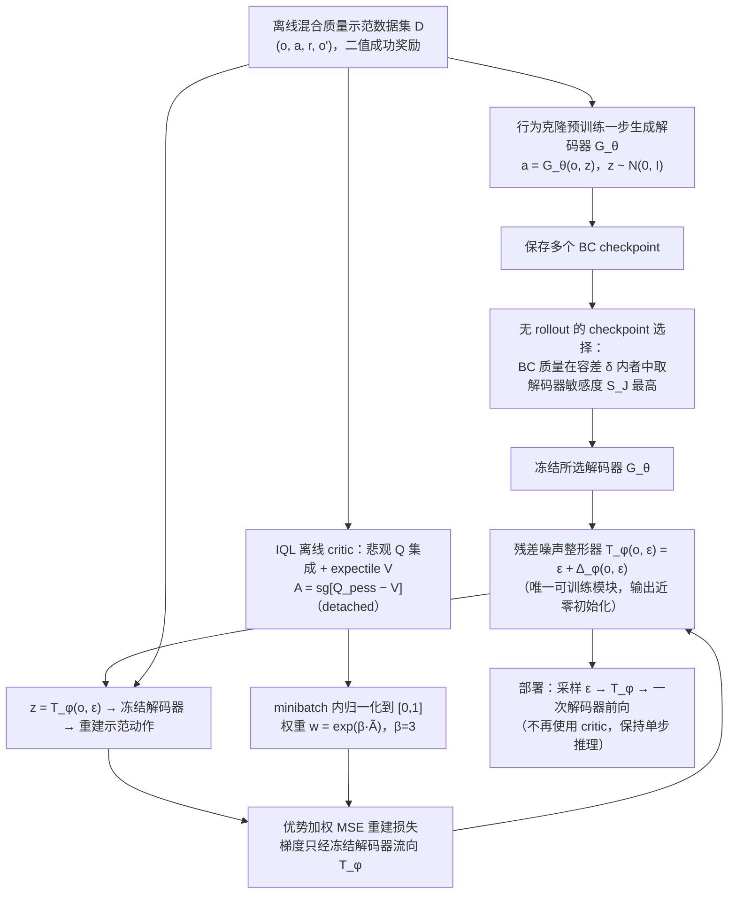

# AWLS：面向单步生成式机器人操作策略的优势加权潜在引导

**AWLS**（*AWLS: Advantage-Weighted Latent Steering for One-Step Generative Robotic Manipulation Policies*，[arXiv:2610.27736](https://arxiv.org/abs/2610.27736)）收录于 senlanke「具身运控lab」10-19–10-23 前沿论文动态（Manipulation）。本页依据**周报条目 + arXiv 摘要页**整理，流程图依据论文方法部分（见参考来源），未逐页核对实验数字；指标与结论以论文为准。

## 一句话定义

**AWLS：面向单步生成式机器人操作策略的优势加权潜在引导——AWLS 将优势加权与潜在空间引导结合，通过动作价值信息调整生成式策略的潜在表示，研究在保留单步生成效率的同时改善操作性能。论文已被 CoRL 2026 接收。**

## 英文缩写速查

| 缩写 | 英文全称 | 简要说明 |
|------|----------|----------|
| RL | Reinforcement Learning | 强化学习 |
| VLA | Vision-Language-Action | 视觉–语言–动作模型 |

## 为什么重要

- 周报所述待解决的问题：单步生成式策略具有较低推理延迟，但策略优化仍需要区分高质量动作与低质量动作。

## 流程总览

图依据：论文 §3.1–3.4（Fig.2、式 (1)–(7)）及 Optimization and deployment 段。

## 核心机制

| 项 | 内容 |
|----|------|
| **arXiv** | [2610.27736](https://arxiv.org/abs/2610.27736) · [PDF](https://arxiv.org/pdf/2610.27736) |
| **作者（arXiv）** | Jiahong Tang, Jiaju He, Zhiyuan Yang, Ruyang Han, Haiyue Zhu |
| **机构（周报所述，未逐条核实）** | 待核实（作者：Jiahong Tang、Jiaju He、Zhiyuan Yang 等）。 |
| **arXiv 评论栏** | Accepted at CoRL 2026 |
| **开源** | arXiv 摘要页/评论给出项目页或外链（https://awls-corl2026.github.io/）；未发现代码仓库链接（2026-10-26） |
| **周报所述创新点** | AWLS 将优势加权与潜在空间引导结合，通过动作价值信息调整生成式策略的潜在表示，研究在保留单步生成效率的同时改善操作性能。论文已被 CoRL 2026 接收。 |

### arXiv 摘要节选（英文原文）

> Human-collected real-world robotic manipulation demonstrations often contain mixed-quality trajectories, including hesitant, indirect, or inefficient action segments. While diffusion- and flow-based policies can model such multimodal data, standard behavior cloning (BC) assigns equal likelihood to all demonstrated actions and may therefore reproduce suboptimal modes.

## 源码运行时序图

**不适用**：arXiv 摘要页/评论给出项目页或外链（https://awls-corl2026.github.io/）；未发现代码仓库链接，无可对齐的官方代码流程。

## 实验与评测

- 周报与摘要给出的数字/场景已写入上表「创新点」与摘要节选；其余实验细节、基线与成功率定义请回到论文正文。
- 读法：先对齐任务设定、传感器与成功定义（仿真/真机），再解读 headline 数字，勿跨论文直接比较。

## 与其他工作对比

| 维度 | 读法 |
|------|------|
| **同周对照** | 见 [Manipulation周报技术地图](../overview/senlanke-weekly-2026-10-19-23-manipulation-technology-map.md)，按方向浏览同期论文 |
| **开源状态** | arXiv 摘要页/评论给出项目页或外链（https://awls-corl2026.github.io/）；未发现代码仓库链接 |

## 结论

**AWLS：面向单步生成式机器人操作策略的优势加权潜在引导。**

1. 本页是入库级摘要，复现前请核对论文正文、附录与代码仓库。
2. 指标须连同实验条件解读。
3. 关注 arXiv 版本更新与代码发布。

## 关联页面

- [senlanke-weekly-2026-10-19-23-manipulation-technology-map](../overview/senlanke-weekly-2026-10-19-23-manipulation-technology-map.md)
- [manipulation](../tasks/manipulation.md)
- [vla](../methods/vla.md)

## 参考来源

- [awls-advantage-weighted-latent-steering_arxiv_2610_27736.md](../../sources/papers/awls-advantage-weighted-latent-steering_arxiv_2610_27736.md)
- [wechat_senlanke_weekly_manipulation_2026-10-19_23.md](../../sources/blogs/wechat_senlanke_weekly_manipulation_2026-10-19_23.md)
- [arXiv:2610.27736](https://arxiv.org/abs/2610.27736)
- [arXiv PDF](https://arxiv.org/pdf/2610.27736)：已通读方法部分（实验与附录以略读为准）：摘要、§1 引言、§2 相关工作（节选）、§3 方法（3.1–3.4 与 Optimization and deployment）、§4.1–4.3 实验设定

## 推荐继续阅读

- [arXiv PDF](https://arxiv.org/pdf/2610.27736)
