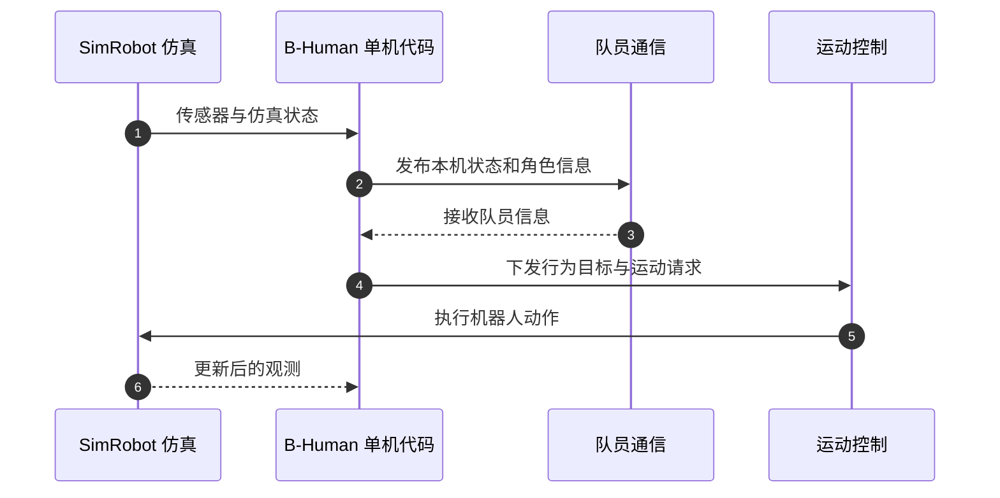

# B-Human '26：可扩展人形足球团队协作

## 一句话定义

**B-Human '26 是一篇 RoboCup 系统报告，介绍团队如何把既有足球软件迁移到更大型的人形平台，并支持 3v3、5v5 常规赛和 11v11 展示赛。**

## 英文缩写速查

| 缩写 | 英文全称 | 简要说明 |
|------|----------|----------|
| HSL | Humanoid Soccer League | RoboCup 人形足球联赛 |
| SPL | Standard Platform League | RoboCup 标准平台组，B-Human 曾长期参赛 |
| RL | Reinforcement Learning | 2026 代码中用于起立、行走和踢球等运动策略 |

## 核心信息

| 项目 | 内容 |
|------|------|
| **论文** | [B-Human '26 – Scalable Team Play up to 11 vs. 11](https://arxiv.org/abs/2610.14733) |
| **作者** | Arne Hasselbring、Tim Laue、Thomas Röfer、Philip Reichenberg |
| **机构** | 不来梅大学（Universität Bremen）、德国人工智能研究中心（DFKI） |
| **发表形式** | arXiv 预印本，cs.RO，2026-10-10 提交 |
| **完整比赛代码** | [BHumanCodeRelease](https://github.com/bhuman/BHumanCodeRelease) |
| **官方文档** | [B-Human Code Release 2026](https://docs.b-human.de/coderelease2026/) |

## 为什么重要

B-Human 从长期使用的 NAO 标准平台转入 Humanoid Soccer League，改用体型更大、重量更高的 Booster 人形机器人。论文记录了这次平台迁移中的软件与行为调整，特别呈现了团队行为怎样适配不同球员数量。

这是一份系统报告，价值在于可核实的系统设计与比赛实践；11v11 是展示赛案例，不能与常规联赛赛制或受控基准结果混为一谈。

## 核心机制

| 队伍人数 | 策略设计 | 适用场景 |
|----------|----------|----------|
| 3v3 / 5v5 | 一套按五名球员设计、也能适应更小队伍的策略 | 2026 年常规比赛 |
| 11v11 | 单独策略，并改进位置/角色分配算法 | 展示赛；需实时为十名场上球员分配位置 |

团队在角色分配部分遇到的主要扩展问题是：原有方法无法足够快地实时为十名场上球员安排位置。因此，11v11 场景使用更高效的分配算法。规模扩展的重点不只是多启动机器人进程，也涉及团队策略与位置规划的计算开销。

## 系统与平台迁移

官方 2026 文档说明，该年度代码发布面向 Booster K1 与 T1，并覆盖感知、队员通信、行为控制、位置/角色分配、仿真和运动控制。运动方面，起立、行走和踢球动作由强化学习策略替换；这属于完整足球系统中的运动子系统，不代表团队战术由端到端 RL 学得。

开源入口分为两部分：

- [BHumanCodeRelease](https://github.com/bhuman/BHumanCodeRelease)：官方年度比赛代码快照，是完整比赛软件与系统文档的入口。
- [MachineLearning/IsaacGymRL](https://github.com/bhuman/MachineLearning/tree/master/IsaacGymRL)：起立、行走、踢球策略的训练框架与预训练策略。仓库 README 说明，这些策略用于 B-Human 2026。

使用前需先阅读官方代码许可和安装文档。年度快照可能依赖特定平台、工具链和硬件条件。

## 源码运行时序图

官方文档说明，SimRobot 可运行完整的 11v11 比赛，并为每台机器人运行一份完整 B-Human 代码。下图概括单台机器人的控制闭环；在 11v11 仿真中，该闭环按机器人实例复制，队员信息通过团队通信交换。

## 实验与评测

论文摘要报告 B-Human 在 2026 年 HSL Middle Division 赢得多项比赛，并通过 11v11 展示赛展示了战术灵活性和系统鲁棒性。官方代码发布说明，常规比赛以 3v3 为主、部分为 5v5，11v11 使用独立策略。

这是竞赛系统报告而非标准化跨团队基准。比较不同队伍或方法时，应先核对赛制、机器人平台、场上人数及胜负统计口径；本文摘要未提供可直接横比的统一分数。

## 结论

**这项工作的主要贡献是把成熟的人形足球系统扩展到新平台和不同队伍规模，并以 11v11 展示赛检验团队策略的可扩展性。**

1. 将 11v11 理解为展示赛能力，不要误写成常规比赛规模。
2. 将 3v3/5v5 共用策略与 11v11 独立策略分开评估。
3. 复现团队规模扩展时，重点检查位置/角色分配能否满足实时性。
4. 研究整体比赛系统时使用 BHumanCodeRelease；研究运动策略时再看 MachineLearning/IsaacGymRL。
5. 跨团队比较前核对比赛规则、平台和统计口径；摘要中的赛事胜利不能替代受控基准。

## 与其他工作对比

- 与 [人形足球](../tasks/humanoid-soccer.md) 关联：这是一个从感知、队员通信到行为与运动控制的完整竞赛系统实例。
- 与 [人形多机器人协调](../concepts/humanoid-multi-robot-coordination.md) 关联：11v11 案例把角色/位置分配的实时计算成本带入大规模实体机器人足球。

## 关联页面

- [人形足球](../tasks/humanoid-soccer.md)
- [人形多机器人协调](../concepts/humanoid-multi-robot-coordination.md)
- [具身智能小站 2026-10-14 论文技术地图](../overview/embodied-station-2026-10-14-41-papers-technology-map.md)

## 参考来源

- [arXiv 预印本与摘要](../../sources/papers/b_human_26_scalable_team_play_arxiv_2610_14733.md)
- [B-Human Code Release 2026 官方文档](../../sources/sites/bhuman_code_release_2026.md)
- [BHumanCodeRelease 官方代码](../../sources/repos/bhuman_code_release_2026.md)
- [MachineLearning/IsaacGymRL 运动策略仓库](../../sources/repos/b_human_26_scalable_team_play.md)

## 推荐继续阅读

- [论文 PDF](https://arxiv.org/pdf/2610.14733)
- [2026 年更新记录：策略与位置/角色分配](https://docs.b-human.de/coderelease2026/changelog/2026/)
- [B-Human Code Release 2026](https://github.com/bhuman/BHumanCodeRelease)
