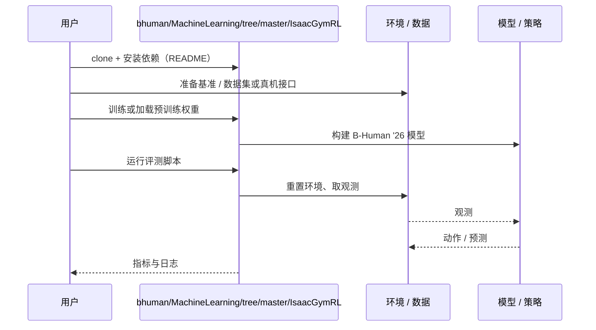

# B-Human '26（arXiv:2610.14733）

**B-Human '26**（*B-Human '26 - Scalable Team Play up to 11 vs. 11*，[arXiv:2610.14733](https://arxiv.org/abs/2610.14733)，[代码](https://github.com/bhuman/MachineLearning/tree/master/IsaacGymRL)）来自 [具身智能小站 2026-10-14 盘点](../../sources/blogs/wechat_embodied_station_41_papers_streamingwam_2026-10-14.md)，属「多机器人协作与评测」组。

## 一句话定义

**总结从标准平台向更大型人形机器人的迁移，以及支持不同队伍规模直至 11 vs 11 的行为架构。**

## 英文缩写速查

| 缩写 | 英文全称 | 简要说明 |
|------|----------|----------|
| SPL | Standard Platform League | RoboCup 标准平台组 |
| RL | Reinforcement Learning | 强化学习 |
| HL | Humanoid League | 人形组 |

## 为什么重要

- 足球队伍规模扩大后，行为架构与角色分配需要可扩展设计。
- 开源结论：**已开源**（步骤 2.5，2026-10-14）。仓库可达。
- 同期同组工作见 [流式动作块与世界模型记忆：具身智能小站 10-14 期 41 篇阅读坐标](../overview/embodied-station-2026-10-14-41-papers-technology-map.md)。

## 核心机制

| 项 | 内容 |
|----|------|
| **arXiv** | [2610.14733](https://arxiv.org/abs/2610.14733) |
| **开源** | **已开源** |
| **要点** | 十一人对抗来自展示赛经验，应与常规比赛和受控基准区分。 |
| **文内指标** | 赛事经验；以原文为准。 |

## 源码运行时序图

以下为按仓库入口（`bhuman/MachineLearning/tree/master/IsaacGymRL`）推断的通用运行链路；入库日仅核实仓库可达，未逐文件阅读，具体脚本名以 README 为准。

## 实验与评测

- 赛事经验；以原文为准。
- **读法：** 本页为索引级摘要，依据公众号转述的官方摘要与仓库信息整理；逐项数字与 baseline 以原文 PDF 为准。

## 与其他工作对比

- 横向索引见 [流式动作块与世界模型记忆：具身智能小站 10-14 期 41 篇阅读坐标](../overview/embodied-station-2026-10-14-41-papers-technology-map.md)；同 arXiv 不重复造页。

## 结论

**RoboCup 架构向大队伍扩展时，角色分配与通信比单机技能更关键。**

1. 开源边界：**已开源** — 仓库可达。
2. 核心机制：十一人对抗来自展示赛经验，应与常规比赛和受控基准区分。
3. 复现与选型前核对任务协议、硬件与基准口径，勿直接横比公众号摘录数字。

## 关联页面

- [humanoid-soccer](../tasks/humanoid-soccer.md)
- [humanoid-multi-robot-coordination](../concepts/humanoid-multi-robot-coordination.md)
- [embodied-station-2026-10-14-41-papers-technology-map](../overview/embodied-station-2026-10-14-41-papers-technology-map.md)

## 参考来源

- [b_human_26_scalable_team_play_arxiv_2610_14733.md](../../sources/papers/b_human_26_scalable_team_play_arxiv_2610_14733.md)
- [wechat_embodied_station_41_papers_streamingwam_2026-10-14.md](../../sources/blogs/wechat_embodied_station_41_papers_streamingwam_2026-10-14.md)
- [arXiv:2610.14733](https://arxiv.org/abs/2610.14733)

## 推荐继续阅读

- [arXiv PDF](https://arxiv.org/pdf/2610.14733)
- [https://github.com/bhuman/MachineLearning/tree/master/IsaacGymRL](https://github.com/bhuman/MachineLearning/tree/master/IsaacGymRL)
