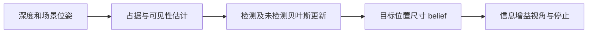
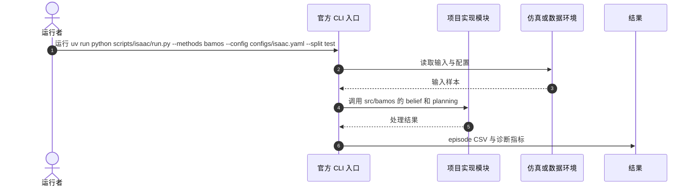

# What World Model Does Active Object Search Need? A Study under Imperfect Detection｜BAMOS：不完美检测下的主动物体搜索

## 一句话定义

**BAMOS：不完美检测下的主动物体搜索**：利用检测和未检测事件更新目标位置后验，以信息增益决定观察视角与停止条件。

## 英文缩写速查

| 缩写 | 英文全称 | 简要说明 |
|---|---|---|
| BAMOS | Bayesian Active Mask-based Object Search | 贝叶斯主动搜索 |
| HSSD | Habitat Synthetic Scene Dataset | 室内场景数据集 |
| IG | Information Gain | 信息增益 |

## 为什么重要

利用检测和未检测事件更新目标位置后验，以信息增益决定观察视角与停止条件。 本项目的机制、指标和开放边界需要分开理解，不能把单个结果推广到所有机器人平台。

## 核心信息

| 项 | 一手来源 |
|---|---|
| 论文 | [arXiv:2611.15689v1](https://arxiv.org/abs/2611.15689) |
| 代码 | [官方仓库](https://github.com/gokyeongryeol/BAMOS)；开放范围见源码归档 |

## 核心原理

从深度建立占据和可见性，结合 detector 的 mask 与漏检更新目标位置及尺寸 belief；再根据预计检测事件的信息增益选视角，以联合概率阈值决定停下而非首个命中。

### 流程总览

该图表示论文机制的主要数据或控制方向，不表示已经运行作者模型。

## 源码运行时序图

已核对 [官方代码归档](../../sources/repos/bamos-search-2611-15689.md) 的 README 与公开运行入口（仅说明所发布组件，不代表实机复现）：

## 工程实践

1. 核实数据许可、训练/测试切分、时序观测和动作坐标系，建立与原文一致的对照协议。
2. 参照[官方源码归档](../../sources/repos/bamos-search-2611-15689.md)核实入口、依赖及模型数据权限。
3. 分别统计训练预算、模拟指标、真机成功率与执行延迟，记录失败模式和软硬件约束。

## 实验与评测

Isaac Sim 与 HSSD 场景、多种误检/漏检条件的消融说明未检更新和可靠停止尤其重要。

## 结论

**利用检测和未检测事件更新目标位置后验，以信息增益决定观察视角与停止条件。**

1. 对照同数据与同测评协议，不混淆不同平台/样本统计口径。
2. 在复现前单列训练数据、预训练、控制接口和硬件依赖。
3. 验证边界是研究结论的必要组成，不能由示例直接推出可量产部署。

## 与其他工作对比

- **对比真值几何与世界模型组件消融（Table 1，Isaac Sim / HSSD × Oracle / SAM 3 / Falcon-Perception）：** 在 Isaac Sim 中，BAMOS 与使用完美场景重建的 `true geometry` 变体基本持平甚至略高（Oracle 0.977 vs 0.971、SAM 3 0.913 vs 0.893、Falcon-Perception 0.884 vs 0.872）；在多房间杂乱 HSSD 中则落后 0.001–0.072，主要源于短距深度下的占据估计误差。移除未检测更新（`No non-detection update`）或掩码位置（`No mask position`）在全部六组评测均显著掉分（如 SAM 3 下分别由 0.913 降至 0.664 与 0.597）。
- **对比视角选择与停止规则（Table 2，Isaac Sim）：** 完整 BAMOS（信息增益选视角 + 联合 belief 停止：SAM 3 **0.913** / Falcon-Perception **0.884**）优于可见性加权覆盖 + belief 停止（0.846 / 0.788）与无权重 FOV 覆盖 + belief 停止（0.490 / 0.574）；若把停止判据换回传统的首个检测停止（`first-mask`），误检较多的 Falcon-Perception 成功率在信息增益下直接腰斩（0.884 → 0.438），说明不完美检测下概率停止判据比视角策略本身更关键。

## 局限与风险

假设静态场景、近似准确相机及机器人位姿；实际移动场景与位姿漂移尚未验证。

## 关联页面

- [机器人视觉感知栈选型闭环](../queries/robot-perception-stack-selection-loop.md) — 将检测、深度几何与搜索决策串联，分别检查漏检建模、视角选择和停止判据。
- [2026-11-16 具身研究论文阅读地图](../overview/embodied-frontier-29-papers-2026-11-16.md)
- [ActionCodec2：流式动作编解码](./paper-actioncodec2-streaming-action-tokenizer.md)

## 参考来源

- [论文原文核对归档](../../sources/papers/bamos-search-2611-15689.md)
- [源代码归档](../../sources/repos/bamos-search-2611-15689.md)

## 推荐继续阅读

- [arXiv HTML v1](https://arxiv.org/html/2611.15689v1)
- [官方代码](https://github.com/gokyeongryeol/BAMOS)
