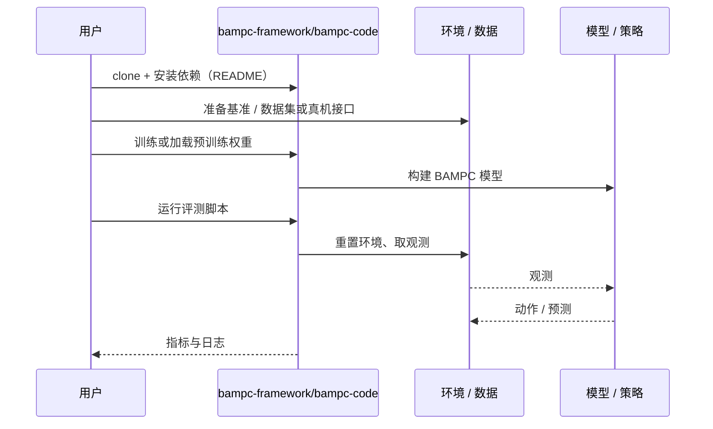

# BAMPC（arXiv:2610.14064）

**BAMPC**（*Do My Samples Help? Compute Budget Allocation for Real-World Sampling-Based MPC in Contact-Rich Manipulation*，[arXiv:2610.14064](https://arxiv.org/abs/2610.14064)，[项目页](https://bampc-framework.github.io/)，[代码](https://github.com/bampc-framework/bampc-code)）来自 [具身智能小站 2026-10-14 盘点](../../sources/blogs/wechat_embodied_station_41_papers_streamingwam_2026-10-14.md)，属「操作与柔顺控制」组。

## 一句话定义

**同一控制栈下比较动作探索、动力学/状态不确定性、重规划频率与时间对齐的预算分配；动力学随机化并非总最优。**

## 英文缩写速查

| 缩写 | 英文全称 | 简要说明 |
|------|----------|----------|
| MPC | Model Predictive Control | 模型预测控制 |
| MPPI | Model Predictive Path Integral | 采样式 MPC |
| DR | Domain Randomization | 域随机化 |

## 为什么重要

- 采样 MPC 的算力有限，预算该花在哪取决于主要仿真迁移误差来源。
- 开源结论：**已开源**（步骤 2.5，2026-10-14）。项目页链接的 bampc-code 仓库可达（基于 hydrax）。
- 同期同组工作见 [流式动作块与世界模型记忆：具身智能小站 10-14 期 41 篇阅读坐标](../overview/embodied-station-2026-10-14-41-papers-technology-map.md)。

## 核心机制

| 项 | 内容 |
|----|------|
| **arXiv** | [2610.14064](https://arxiv.org/abs/2610.14064) |
| **开源** | **已开源** |
| **要点** | 统一框架切换预算分配；接触操作真机实验。 |
| **文内指标** | 以原文为准。 |

## 源码运行时序图

以下为按仓库入口（`bampc-framework/bampc-code`）推断的通用运行链路；入库日仅核实仓库可达，未逐文件阅读，具体脚本名以 README 为准。

## 实验与评测

- 以原文为准。
- **读法：** 本页为索引级摘要，依据公众号转述的官方摘要与仓库信息整理；逐项数字与 baseline 以原文 PDF 为准。

## 与其他工作对比

- 横向索引见 [流式动作块与世界模型记忆：具身智能小站 10-14 期 41 篇阅读坐标](../overview/embodied-station-2026-10-14-41-papers-technology-map.md)；同 arXiv 不重复造页。

## 结论

**先诊断 sim2real 误差来源，再决定预算投向探索还是不确定性采样。**

1. 开源边界：**已开源** — 项目页链接的 bampc-code 仓库可达（基于 hydrax）。
2. 核心机制：统一框架切换预算分配；接触操作真机实验。
3. 复现与选型前核对任务协议、硬件与基准口径，勿直接横比公众号摘录数字。

## 关联页面

- [model-predictive-control](../methods/model-predictive-control.md)
- [mppi](../methods/mppi.md)
- [contact-rich-manipulation](../concepts/contact-rich-manipulation.md)
- [sim2real](../concepts/sim2real.md)
- [embodied-station-2026-10-14-41-papers-technology-map](../overview/embodied-station-2026-10-14-41-papers-technology-map.md)

## 参考来源

- [bampc_compute_budget_sampling_mpc_arxiv_2610_14064.md](../../sources/papers/bampc_compute_budget_sampling_mpc_arxiv_2610_14064.md)
- [wechat_embodied_station_41_papers_streamingwam_2026-10-14.md](../../sources/blogs/wechat_embodied_station_41_papers_streamingwam_2026-10-14.md)
- [arXiv:2610.14064](https://arxiv.org/abs/2610.14064)

## 推荐继续阅读

- [arXiv PDF](https://arxiv.org/pdf/2610.14064)
- [项目页](https://bampc-framework.github.io/)
- [https://github.com/bampc-framework/bampc-code](https://github.com/bampc-framework/bampc-code)
