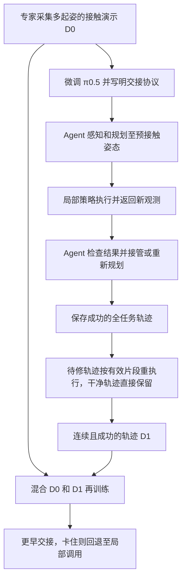

# 边界感知策略学习（Boundary-Aware Policy Learning for Agent-Orchestrated Robot Manipulation）

## 一句话定义

BAPL 先训练一个能从目标附近多种起始状态完成接触动作的策略，并告诉编排 Agent 在哪里交出控制；再用成功任务轨迹扩展这块可交接区域，让 Agent 更早委托策略。

## 英文缩写速查

| 缩写 | 英文全称 | 简要说明 |
|---|---|---|
| BAPL | Boundary-Aware Policy Learning | 显式塑造并扩展策略交接边界 |
| VLA | Vision-Language-Action | 接收视觉与指令、输出机器人动作的策略 |
| TCP | Tool Center Point | 定义末端参考点，作为状态和动作表示的基础 |
| C2R | Clean-to-Randomized | 干净场景采集/探索，官方随机化场景评测 |
| LLM | Large Language Model | 驱动 Agent 编排和检查的模型 |

## 核心信息

| 项目 | 内容 |
|---|---|
| 作者 | Kaipeng Fang、Yuhao Wang、Ji Zhang、Yunsong Zhou、Jingkuan Song、Lianli Gao |
| 机构 | 电子科技大学、上海人工智能实验室、同济大学、上海创智学院 |
| 版本 | arXiv:2611.32238v1，2026-11-24 |
| 一手资料 | [PDF](https://arxiv.org/pdf/2611.32238v1) · [HTML](https://arxiv.org/html/2611.32238v1) · [项目主页](https://kaipengfang.github.io/bapl-agentic-manip/) |
| 开源 | 项目页展示演示，Code 标为 soon；2026-11-28 未见可用的公开代码、权重或训练数据链接 |

## 为什么重要

把从起点完成整项任务训练好的策略当成可在任意中间状态调用的技能，容易在失败后重复从训练分布外启动。BAPL 把这个接口问题转成训练分布设计问题：先让策略有一个可描述的可靠局部，再考察是否可从更早状态调用，而不是只改提示词或放宽重试次数。

## 核心原理

1. **显式边界（Boundary-Explicit Training）。** 从干净场景采集接触段，不记录前面的接近动作。以抓取为例，脚本把夹爪起姿采样在可行抓点上方 8–12 cm，并扰动水平位置和偏航；这不是所有技能或真机的硬编码安全距离。RoboTwin 2.0 的 D0 包括 147 个子任务、24 种技能、2,699 条训练段；RoboDojo 以作者编写的原子技能脚本收集 112 个子任务的 3,464 条训练段。用接触段、小指令微调 π₀.₅ 全部参数，两基准训练动作间隔都是 40 ms、chunk 50 步，但 RoboTwin 动作为世界系绝对末端表示，RoboDojo 动作相对当前 chunk 起点。
2. **运行时交接。** Agent 用图像和分割定位物体、用运动规划到达预接触状态，再用短技能命令调用策略，单次调用强制最多四个 chunk。得到新观测后收回控制，必要时重新定位，或接管搬运、释放与失败恢复。提示词给出经验区域，不是形式验证的成功概率，也不是安全监控。
3. **扩边自改进（Boundary-Expanding Self-Improvement）。** 从成功的全任务回放中标注并保留有效片段。删除失败或重复段后直接拼接会留下状态跳变，因此对待修轨迹在同场景按有效片段重执行，重新记录连续且通过验收的轨迹；原本无低效段的成功轨迹可直接保留，共同形成 D1。D1 的全任务指令与 D0 的接触指令共同监督微调；更新交接协议并重新探索形成记忆，正式评估时冻结。新协议先尝试全任务（单次最多 24 个 chunk），只在进度停滞或步骤失败时回退到最多四个 chunk 的局部接触调用。第一轮 D1 为每任务 30 条、合计 1,500 条。

## 实验与结果

| 实验 | 作者报告 | 解读 |
|---|---|---|
| RoboTwin 2.0 C2R（Table 1） | BAPL 98.4%（492/500），Harness VLA 72.0%，整任务 π₀.₅ 40.0% | 50 项、每项 10 个种子；C2C 中 BAPL 95.6%、Harness VLA 96.0%，改善重点是随机化场景 |
| RoboDojo（Table 1 / S10） | 26 项加权成功率 69.2%，Harness VLA 40.8%；泛化/记忆/开放词汇 62.5%/80.0%/71.3% | 排除长时程与精密子集；基线泛化子集使用官方发布数值，模型设置与作者自行运行的配置不同 |
| 策略/协议消融（Fig. 6） | C2R 72.0% 基线，换策略 93.0%，仅换协议 86.0%，两项合用 98.4% | 每项配置各自探索；并非同一冻结记忆上的孤立干预 |
| 扩边前后（Table S8） | RoboTwin easy 96.4%→97.2%、hard 93.6%→94.2%；每回合 API 成本/执行时间跨设置平均降 41.3%/37.5% | easy 是同随机化配置未见种子，hard 额外更换纹理、干扰物及灯光；不含训练与采集开销 |
| 真机（App. E.2） | 双臂灵巧手用 40 条接触演示微调，公开展示一个把梨与橙放入碗的完整回合 | 与干净训练场景相比用了不同桌布与干扰物；无成组定量真机试验，不是成功率 |

## 工程实践

做 [操作任务](../tasks/manipulation.md) 的复现计划时，应把交接的任务命令、夹爪状态、观测时间、坐标基准和动作语义分别记入日志，按技能区分空中接近与实际接触，记录首次/重试交接及失败恢复。扩边前后固定评测种子、超时和接口，另记采集与训练成本。对于真实硬件，不把论文中的 8–12 cm 当作通用阈值；在仿真或记录观测上先检验动作空间和回退逻辑。

## 与其他工作对比

| 工作 | 接口不可靠时的处理方式 | 判断依据 |
|---|---|---|
| [Harness VLA](./paper-harness-vla.md) | 保持整任务 VLA 冻结，通过参考场景探索、记忆及重试选择何时交接 | 能复用现有策略，但不能改变策略可靠的起始状态分布 |
| 整任务 π₀.₅ | 吸收接触段与整任务示范后直接执行，没有 Agent 检查与恢复层 | 简化系统但易受场景和任务规划长尾影响；比较时注意示范来源和动作表示 |
| BAPL | 显式训练局部接口，再让系统产生、重执行并筛选全任务数据以提前交接 | 交接协议和训练覆盖相互匹配；要付出新的数据、微调和探索开销 |

## 局限与风险

- 论文将交接边界视为给定技能的可靠起始状态区，测试的轨迹距离只是代理指标，无法由空间距离给单次动作做充分保证。需要区分视觉外观、夹爪偏航、接触几何及真正的软件交接条件。
- 扩边从成功轨迹去掉低效/失败段，未直接把这些片段学成恢复能力。失败例包括规划运动碰倒物体、倾斜起姿超出训练范围、以及扩边后执行全任务时掉落物体。
- App. G 的 Agent 直接控制试验用不同工具接口和探索设计，不可与主表直接横比；尤其不要将仿真成功率、服务报价或延迟外推到实际硬件。项目实现尚未公开供检验，示意流程不是运行时源码时序图。

## 结论

BAPL 的可迁移经验是让训练时覆盖的交接状态、运行时的交接协议与失败恢复互相对应，再用连续、成功的轨迹扩展委托策略的范围。当前有较强的基准实验证据，但没有支持同等真机成功率的统计数据。

## 关联页面

- [接触丰富操作](../concepts/contact-rich-manipulation.md) — 接触段与几何接近不是同一控制问题。
- [模仿学习](../methods/imitation-learning.md) — 起姿和成功轨迹筛选影响训练分布。
- [VLA](../methods/vla.md) — 局部策略承担接触闭环。
- [RoboTwin](./robotwin.md) · [RoboDojo](./robodojo.md) — 检查任务与泛化分布的基准。

## 参考来源

- [论文归档：全文与附录](../../sources/papers/bapl_arxiv_2611_32238.md)
- [作者站点归档：演示与开放范围](../../sources/sites/bapl-agentic-manip.md)

## 推荐继续阅读

- [论文附录 B–D](https://arxiv.org/html/2611.32238v1#A2) — 数据语义、轨迹重执行和边界消融。
- [论文附录 E.2](https://arxiv.org/html/2611.32238v1#A5.SS2) — 真机展示及外推限制。
