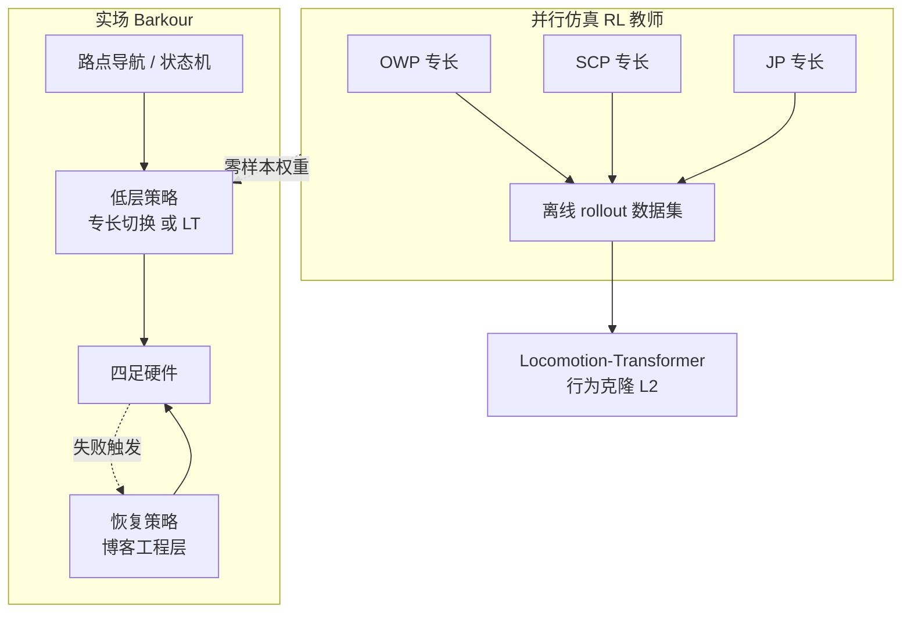
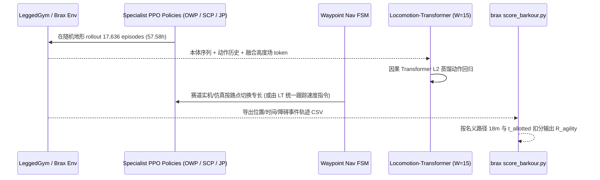

# Barkour（四足敏捷评测基准与开源生态）

**Barkour** 是 Google DeepMind 提出的 **四足敏捷 locomotion 基准**：把 **犬敏捷赛** 中的障碍序列与 **时间型评分** 压缩进 **约 5 m × 5 m** 的实验场地，用 **单一标量敏捷分** 同时压 **速度、可控性与多技能组合**（arXiv:2305.14654）。同一研究脉络下，团队后续开源了 **整机 CAD / 电子 / 固件与装配文档**（`barkour_robot`），并在 **MuJoCo Menagerie** 中维护 **MJCF** 资产。

## 一句话定义

**用一小套障碍课 + 犬赛式计时扣分，把「多primitive敏捷」压成一个可比分数；再用并行 RL 的专长教师与 Transformer 蒸馏通才，在自研四足上零样本跑完实场课。**

## 英文缩写速查

| 缩写 | 英文全称 | 简要说明 |
|------|----------|----------|
| Sim2Real | Simulation to Real | 把仿真中学到的策略迁移落地真机的工程主线 |
| PPO | Proximal Policy Optimization | 人形/足式 locomotion 中最常用的 on-policy 策略梯度算法 |
| Locomotion | Robot Locomotion | 足式/人形等无轮移动能力的总称 |
| MuJoCo | Multi-Joint dynamics with Contact | 接触丰富的刚体物理仿真引擎 |
| CAD | Computer-Aided Design | 计算机辅助设计，硬件结构建模 |
| MJCF | MuJoCo XML Format | MuJoCo 的模型与场景描述格式 |
| RL | Reinforcement Learning | 通过与环境交互最大化长期回报来学习策略的范式 |
| EtherCAT | Ethernet for Control Automation Technology | 高实时性工业以太网总线 |
| Isaac Gym | NVIDIA Isaac Gym | GPU 并行刚体仿真训练环境 |
| DR | Domain Randomization | 训练时随机化仿真参数以提升跨域鲁棒迁移 |
| SLAM | Simultaneous Localization and Mapping | 同步定位与建图 |
| Isaac Lab | NVIDIA Isaac Lab | 基于 Omniverse 的机器人学习训练框架 |

## 为什么重要

- **评测缺口：** 腿足论文长期依赖 **ad hoc 指标**；Barkour 提供 **可复现场地几何 + 明确扣分规则**，与 **ImageNet / Gym 式** 基准叙事一致（论文 Introduction）。
- **方法对照面宽：** 同时覆盖 **分层专长 + 状态机导航** 与 **单网络通才（Locomotion-Transformer）**，便于讨论 **切换边界平滑性 vs 峰值分数**（官方博客实验观察）。
- **工程闭环：** 开源 **EtherCAT 执行器链路 + Pigweed 固件** 与 **Menagerie MJCF**，把 **论文—仿真—硬件** 串到同一品牌线下。

## 核心结构

| 模块 | 作用 |
|------|------|
| **障碍课** | 起点台 → **绕杆** → **A 字坡** → **宽跳（论文写作 0.5 m 板）** → 终点台；全课名义长度约 **18 m**、规定时间约 **10.64 s**（目标平均速度 **1.69 m/s**，arXiv Table I）。 |
| **敏捷分** | \(R_{\text{agility}} = 1.0 - \max(t_{\text{run}}-t_{\text{allotted}},0)\times0.01 - \text{penalties}\)；失败/跳过障碍扣 **0.1**/次。 |
| **专长基线** | **OWP**（ uneven 全向行走）、**SCP**（爬坡课程）、**JP**（跳跃课程）；**PPO + LeggedGym（Isaac Gym）**；观测含 **高度场 + 0.3 s 本体历史**，动作为 **目标关节角**（相对名义站姿）。 |
| **通才基线** | rollout 收集多地形 **状态—动作** 数据集 → **因果 Transformer** 行为克隆（**L2**）为 **Locomotion-Transformer**；上下文 **W=15** 步。 |
| **导航** | **路点 + 容差**；专长模式需 **行为类型** 切换策略；通才主要跟踪 **速度指令**。 |
| **sim2real** | 在 Rudin 式 DR 上加强 **惯量、电机与关节静摩擦** 等随机化以支撑 **>1 m/s** 敏捷动作迁移（论文 Table II）。 |

### 流程总览（训练—部署）

## 版本脚注：v0 机体 / Menagerie 路径 vs 当前 vB

- **论文与早期开放资产** 多指向 **Menagerie `google_barkour_v0`**（障碍课 + 较早机体网格），并与 **Brax 实验性计分脚本** 同代际入口共存于官方 README。
- **`barkour_robot` 仓库当前主推** 的 CAD / 说明与 README 默认仿真链路指向 **`google_barkour_vb`**；复现论文图与数值时应 **核对 MJCF 代际** 是否与论文一致。

## 结论

**Barkour 的价值在于把四足敏捷从各说各话的 ad hoc 指标压成一个可复现的标量分；两条基线的对照说明这个分数逼出的是「多 primitive 平滑组合」，而不是单项峰值。**

- 评分设计本身就是方法：约 5 m × 5 m 场地、名义 **18 m** 课程、\(t_{\text{allotted}}\approx 10.64\) s（对应平均 **1.69 m/s**），超时按 **0.01/s** 扣、失败或跳过障碍每次扣 **0.1**——速度、可控性与技能组合被强制放进同一个数里。
- 两条基线划出方法学对照面：**专长（OWP/SCP/JP，PPO + LeggedGym）+ 路点状态机** vs **因果 Transformer 行为克隆的 Locomotion-Transformer**（W=15），争点是切换边界平滑性与峰值分数的取舍。
- sim2real 的关键不在算法而在随机化范围：在 Rudin 式 DR 上追加**惯量、电机与关节静摩擦**随机化，才撑得住 >1 m/s 的敏捷动作迁移。
- 适用边界要看清：基线依赖**特权高度场 + 仿真地形课程**，导航使用全状态/真位姿，与纯机载 SLAM 导航不是同一层问题；分数接近 1 也只能作相对参照，不能跨物种严格比较。
- 工程栈完整但有约束：`barkour_robot` 开源 CAD/电子/固件、Menagerie 维护 MJCF，但硬件设计资料为 **CC BY-NC**；复现论文数值前须核对 v0 与 vB 代际。

## 常见误区或局限

- **误区：「分数接近 1 就等于接近真实犬」。** 论文与博客都用 **小型犬敏捷 novice 速度量级** 设 \(t_{\text{allotted}}\)，但机体尺度、步态与场地版本不同，**只能作相对参照**，不能当作跨物种严格可比实验。
- **局限：** 论文基线 **依赖特权式高度场与仿真地形课程**；导航在基线中使用 **全状态/真位姿** 信息，和 **纯机载 SLAM 导航** 仍是不同问题层。
- **许可：** 硬件与设计资料为 **CC BY-NC**，商业复用需自行评估条款。

## 关联页面

- [Locomotion（任务总览）](../tasks/locomotion.md)
- [四足机器人（平台语境）](./quadruped-robot.md)
- [MuJoCo](./mujoco.md)
- [Legged Gym](./legged-gym.md)
- [Isaac Gym / Isaac Lab](./isaac-gym-isaac-lab.md)（论文训练栈语境）
- [Sim2Real](../concepts/sim2real.md)
- [Domain Randomization](../concepts/domain-randomization.md)
- [Terrain Adaptation](../concepts/terrain-adaptation.md)
- [RSS 2018 敏捷四足 sim2real](./paper-tan-quadruped-agile-locomotion-sim2real.md)
- [Walk These Ways（MoB）](./paper-walk-these-ways-quadruped-mob.md)
- [具身大模型评测基准选型闭环](../queries/embodied-eval-benchmark-selection-loop.md) — 本页是其 ③ 策略任务成功率评测层的四足敏捷代表基准，双向回链
- [PPO（Proximal Policy Optimization）](../methods/ppo.md) — 专长策略基线采用 PPO；与 Transformer 蒸馏基线比较时应分清训练阶段和数据来源。

## 方法栈（核心机制）

完整模块拆解见前文 **核心结构** 与 **流程总览**；工程实践、定量表现与代码追踪时序如下。

## 工程实践

- **硬件与资产代际核对**：`google-deepmind/barkour_robot` 开源机械/电子/固件（`actuator/firmware` 基于 Pigweed，`actuator/ethercat_host` 负责主机通信），而 `mujoco_menagerie` 同时存在早期 `google_barkour_v0` 与后续 `google_barkour_vb`；复现论文 11.5 kg 四足基准前须对齐模型与阻尼/摩擦参数。
- **双线评测接口**：专长路线依赖 LeggedGym/Isaac Gym 中的特权高度场、地形课程与上层路点状态机；Brax 侧 `brax/experimental/barkour/score_barkour.py` 提供基于日志轨迹 CSV 的标准化敏捷计分脚本，用于复算赛道得分与罚分。
- **商业使用边界**：硬件设计资料采用 **CC BY-NC** 许可，工程复用或二次改装前需先核对授权边界。

## 实验与评测

- **敏捷课程规格（Table I）**：5 m × 5 m 场地，名义路径约 18 m，规定时间 \(t_{\text{allotted}} \approx 10.64\text{ s}\)（目标均值 1.69 m/s）；满分 1.00，超时每秒扣 0.01，跳过/失败障碍每次扣 0.1。
- **真机对比结果（Table III）**：在 11.5 kg 自研四足实机上，三专长+状态机取得 **`0.77 ± 0.064`**（用时 **`24.6 ± 1.1 s`**），专长蒸馏的 Locomotion-Transformer 通才取得 **`0.73 ± 0.062`**（用时 **`25.8 ± 1.6 s`**）；分项障碍成功率报告为绕杆 **100%**、A 字坡 **100%**、宽跳 **38%**，同期小型犬基准为 **`1.00`**（用时 **`9.02 ± 0.65 s`**）。
- **蒸馏数据与训练吞吐**：三专长在随机台阶/楼梯/间隙/斜坡共采集 **17,636 episodes**（约 **57.58 robot hrs**），以因果 Transformer（窗口 \(W=15\) 即 0.3 s）经 L2 回归蒸馏；Brax 侧亦验证可在 TPU 上约 **200 s** 内完成 **200M** 步仿真训练。

## 源码运行时序图

> **源码边界**：`google-deepmind/barkour_robot` 公开硬件 CAD/PCBA、Pigweed 固件（`actuator/firmware`）与 EtherCAT 主机接口（`actuator/ethercat_host`），Brax 公开 `brax/experimental/barkour/score_barkour.py` 轨迹评分器及 Menagerie 公开 `google_barkour_v0` / `google_barkour_vb`；论文中三专长 PPO 与 Locomotion-Transformer 蒸馏训练脚本未随 `barkour_robot` 主仓一并开源。

## 与其他工作对比

- 与 [RSS 2018 敏捷四足 sim2real](./paper-tan-quadruped-agile-locomotion-sim2real.md) 相比，Barkour 从单地形快跑推进到含绕杆、A 字坡（5°–33° 课程）与宽跳的多技能串联课程，并加入机身惯量、电机模型与关节静摩擦的增强域随机化。
- 与 [Walk These Ways（MoB）](./paper-walk-these-ways-quadruped-mob.md) 的显式步态参数条件化控制不同，Barkour 侧重用标准敏捷赛道分数 \(R_{\text{agility}}\) 统一评测专长切换与单策略蒸馏通才（`0.77` vs `0.73`）的整场敏捷表现。

## 结论

Barkour 用统一的时间—失误敏捷分 \(R_{\text{agility}}\) 将四足机器人的多种高速障碍动作纳入可复测赛道基准，真机上专长状态机（`0.77`）与蒸馏通才（`0.73`）均已显著跨越平地行走边界，但跳过率仍受限于宽跳稳定性（38%）及特权高度场/全状态导航假设。

- **评测不要只看单任务速度**：串联障碍课会直接暴露技能切换（绕杆/爬坡 100% vs 宽跳 38%）与加减速过渡损耗。
- **专长状态机 vs 蒸馏通才存在轻微折中**：实机总分 `0.77` 对 `0.73`，蒸馏用统一接口换取免显式技能切换，代价是高动态窄余量动作略微保守。
- **>1 m/s 敏捷动作的 Sim2Real 门槛在于物理随机化细节**：仅用常规平地 DR 不足以过宽跳与陡坡，需补充躯干惯量、电机非线性与静摩擦随机化。
- **核对代码与资产版本**：使用 `score_barkour.py` 对齐指标定义，并区分 `barkour_robot` 硬件仓与 Menagerie `v0`/`vB` 模型差异。

## 参考来源

- [Barkour 论文摘录（arXiv:2305.14654）](../../sources/papers/barkour_arxiv_2305_14654.md)
- [Google Research 官方博客（2023-05-26）](../../sources/blogs/google-research-barkour-quadruped-agility-2023-05-26.md)
- [barkour_robot 仓库索引](../../sources/repos/google_deepmind_barkour_robot.md)
- [MuJoCo Menagerie：google_barkour_v0 / vb](../../sources/repos/mujoco_menagerie_google_barkour_models.md)

## 推荐继续阅读

- 论文 PDF：<https://arxiv.org/pdf/2305.14654.pdf>
- 主仓库：<https://github.com/google-deepmind/barkour_robot>
- Menagerie v0：<https://github.com/google-deepmind/mujoco_menagerie/tree/main/google_barkour_v0>
- Menagerie vB：<https://github.com/google-deepmind/mujoco_menagerie/tree/main/google_barkour_vb>
- 官方博客：<https://research.google/blog/barkour-benchmarking-animal-level-agility-with-quadruped-robots/>
