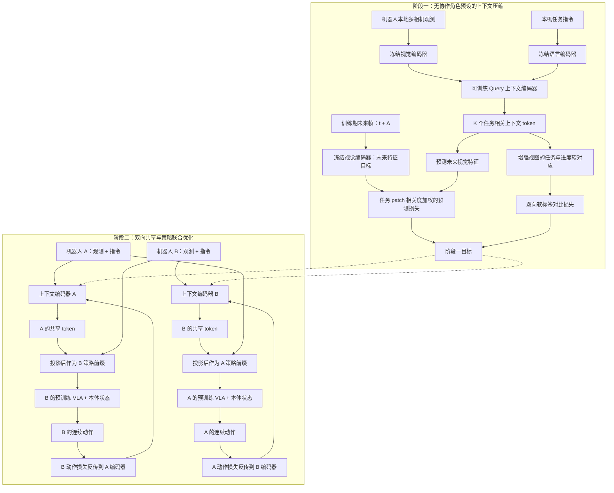

# CoMind / Be My Eye：超越机器人自身视角的任务相关上下文共享
*Be My Eye: Learning to See Beyond a Robot's Own Perspective*

## 一句话定义

**CoMind / Be My Eye** 是星尘智能的双机器人协作感知—动作方法：每台机器人用任务条件化编码器把多相机视觉压缩为少量上下文 token，双向发送给队友，使队友的视觉–语言–动作策略在局部遮挡时仍能利用互补观测生成动作。

## 英文缩写速查

| 缩写 | 英文全称 | 简要说明 |
|---|---|---|
| VLA | Vision-Language-Action | 用视觉、语言及本体状态输出连续动作的策略 |
| ACS | Active Context Sharing | 本文的任务导向主动上下文共享（不是主动安排发信时机） |
| VLM | Vision-Language Model | 用于视觉 patch 与指令相关性打分的预训练模型 |
| FP32 | 32-bit Floating Point | 论文计算通信载荷的单元素精度 |
| SigLIP | Sigmoid Loss for Language Image Pre-Training | 原始视觉 token 共享的对比基线 |

## 为什么重要

- **遮挡导致的信息不对称：** 单机看不见目标或队友进度，传递全量图像又有冗余；本文把“队友需要什么信息”作为表征学习目标。
- **沟通目标直接服务控制：** 发送端编码器不仅学习视觉压缩，还接受接收端 VLA 动作损失的反向监督。
- **可度量的通信预算：** 以 token 数和 FP32 载荷比较共享策略，为带宽受限多机操作提供对照；但这不等于已验证网络时延。

## 核心信息

| 项 | 内容 |
|---|---|
| 主论文 | [Be My Eye: Learning to See Beyond a Robot's Own Perspective](https://arxiv.org/abs/2611.12295)（2026-11-09，v1） |
| 官网项目 | [CoMind / Be My Eye](https://www.astribot.com/AI/CoMind/) |
| 机构 | 星尘智能（Astribot Team） |
| 作者 | Baifu Huang、Shilin Fang；项目负责人 Jianan Wang |
| 真实机器人 | 两台 Astribot S1，双机器人协作操作 |
| 动作模型 | 预训练 `π₀.₅` VLA 策略，使用双方共享的网络参数 |
| 默认共享预算 | `K=32` 个上下文 token，维度 1152，FP32 共 144 KiB/方向/决策步（不计协议头） |
| 代码与权重（2026-11-13） | 官网未列官方可运行实现、权重或数据下载链接；[核对记录](../../sources/repos/astribot-comind-code-status.md) |

## 核心原理

**“主动”（active）的定义：** 本文主动选择编码哪些*任务相关信息*，**不表示**系统自动学习通信时刻、对象或网络调度，这些可由高层规划处理。双机对称交换共享上下文，不要求固定主从角色。

### 流程总览

> 流程图来自 arXiv v1 §2，表示**方法与训练监督路径**，不是已经核验的代码调用时序。A/B 编码器与策略在论文中采用**共享参数的对称结构**；图中分开表示运行角色。

### 1. 可学习查询编码多相机视觉

冻结视觉与语言编码器得到视觉 patch 特征和任务语言特征；可训练编码器使用 `K` 个 learnable queries 聚合信息，联合或逐相机分配 token。发送的是任务条件化 token，而不是所有 RGB 帧。经投影后的 token 注入接收端 VLA 的多模态前缀。

### 2. Stage 1：两类互补监督

- **任务相关未来特征预测**：从当前 token 预测未来时刻的*视觉特征*，根据图像 patch 与指令的相似度为误差加权；不是训练一个像素视频生成器。
- **软任务进度对应学习**：两份增强视图经对比头监督；相同任务且归一化进度相近的样本软标签更接近。进度标签只在训练中使用，**不**作为输入或消息直接传输。
- 目标：`L_S1 = λ_pred L_pred + λ_con L_con`；未来预测解码器和对比头只用于训练。

### 3. Stage 2：用接收端动作反馈改善发送内容

- 对每一方向，`A_i = π(V_i, instruction_i, state_i, projected(Z_j))`。
- 训练目标：`L_S2^(j→i) = L_VLA^i + η L_S1^j`。动作监督穿过伙伴传来的 token，回传至发送方编码器，提升其对接收端动作决策的效用。
- 推理期双方分别产生并交换 token，各自生成动作；论文未声称实现了异步按需通信调度。

## 实验与评测

**两项受控任务**均用两台 S1 与预训练 `π₀.₅` 策略；不能和后面的定性场景混为同一组成功率。

| 实验 / 指标 | 无共享 | Generic SigLIP（160 tokens） | Ours-Joint（32 tokens） |
|---|---:|---:|---:|
| 遮挡目标选框：准确率（各设置 18 次） | 38.9% | 72.2% | **88.9%** |
| 交替主从取马克笔：双阶段完整成功率（共 48 次） | 0% | 100% | **100%** |

**方法消融（取笔任务的归一化 Process Score，非成功率）：**

原文 §3.3 按成功的 Leader 抓取计 0.25 分、正确触发的 Follower 动作计 0.5 分、颜色匹配的 Follower 抓取计 1.0 分，再以百分数报告归一化过程分数。它衡量部分完成程度，不能与完整双阶段成功率混用。

| 条件 | Process Score |
|---|---:|
| Full 两类 Stage 1 目标 + 联合优化 | 100% |
| 去未来预测目标 | 96.7% |
| 去软对比目标 | 68.9% |
| 冻结压缩器，只训接收端策略 | 83.3% |
| 联合优化压缩器和动作策略 | 100% |

**通信容量（论文 Table 5）：**

| 方法 | token 数 | 载荷 KiB/方向/决策步 | 过程分数 |
|---|---:|---:|---:|
| Ours | 4 | 18 | 90.5% |
| Ours | 16 | 72 | 97.6% |
| Ours | 32 | 144 | 100% |
| Generic SigLIP | 160 | 720 | 100% |

每个 token 为 1152 个 FP32 数值，以上仅是原始 payload 估算、**不含协议开销**。32 token 比 160 token 少 80%，不是独立网络延迟测试。

**另外三项定性展示：** 冰箱补货、盒体组装、叠被收纳，论文 §3.6 提供关键帧与注意力热区；它们**没有**对应上表的独立成功率统计，热区也不是因果归因。

## 与其他工作对比

| 研究 | 协作需要的额外信息 | 主要差异 |
|---|---|---|
| [CHORUS](./paper-chorus.md) | **推理时零通信**，共享权重 + 机器人身份 prompt | 本文明确**有**双向跨机消息；解决本机视角无法观察的关键任务/进度信息，不能套用 CHORUS 的零通信部署结论 |
| Generic SigLIP（论文基线） | 直接交换较多通用视觉 token | 160 tokens、720 KiB/步，与本文 32 tokens、144 KiB/步比较；除了预算，表征目标也不同 |
| [多机器人协作](../concepts/humanoid-multi-robot-coordination.md) | 任务分配、通信、同步 | 本文补全**细粒度感知到 VLA 动作**的接口，不替代高层任务规划 |

## 结论

**在本文双 S1、受控遮挡与轮换主从任务下，任务相关压缩与接收端动作监督使跨机上下文共享更省 token，且能改善合作决策；其泛化与统计可靠性仍需要额外验证。**

1. **通信评测先划清口径：** 对比 32 vs 160 tokens 与 144 vs 720 KiB 的载荷，不把它写成实测带宽或时延降低 80%。
2. **先验证“需要队友才能看到”的任务：** 遮挡选框准确率 38.9%→88.9%，比无共享更能说明互补观测价值。
3. **保留进度学习与联合优化：** 去对比进度目标过程分数 100%→68.9%；冻结上下文压缩器 100%→83.3%。
4. **角色切换与通信机制分开看：** 双向共享能支撑 ABBA 序列，但“active”并不自动实现消息路由。
5. **谨慎外推：** 18 次遮挡选择评测没有报告置信区间，16.7pp 优于 SigLIP 的差距不能直接当作统计显著结论。
6. **复现条件尚不充分：** 官方未发布可验证的实现/权重/数据；异构团队、三机以上、真实通信故障仍待验证。

## 源码运行时序图

**不适用（截至 2026-11-13）。** 已核查 [CoMind 项目页](https://www.astribot.com/AI/CoMind/) 的技术报告与资源入口，未见该方法官方可运行训练/推理源码；上面展示的 Mermaid 是论文**方法流程图**，不是编造的源码调用图。详见[开放状态归档](../../sources/repos/astribot-comind-code-status.md)。

## 工程实践

| 阶段 | 实现/评测建议 | 论文证据边界 |
|---|---|---|
| 观测与编码 | 每机多相机图像 + 本机语言；冻结视觉/文本 backbone，再训练 `K` query 压缩器 | §2.2；相机个数与真实部署拓扑需按硬件具体核实 |
| 表征目标 | 未来**特征**预测 + 任务/进度软对比；进度仅是监督标签 | §2.3；别把真实进度当成推理侧信息泄露 |
| 策略接口 | 将伙伴 token 投影进 VLA 多模态前缀，和本机视觉、本体状态联合生成动作 | §2.4；模型和上下文编码共享参数 |
| 通信预算 | 记录 K、特征维数、精度、双向通信周期与实际传输时延 | Table 5 只计算 FP32 payload |
| 验证 | 同时测无通信、通用 SigLIP、冻结 encoder 与联合优化 | Tables 1–4；需更大的 trial 数/置信区间 |
| 部署 | 断链/延迟/时钟偏差降级、状态一致性和碰撞安全须另行设计 | 论文未提供上述工程可靠性实测 |

## 局限与风险

- **实验范围有限：** 定量对照为两个双 S1 任务，三个额外场景只有定性过程演示；尚不能证明跨团队规模、跨本体泛化。
- **统计与比较边界：** 遮挡任务每设置 18 次；缺置信区间/多随机种子，不能判断对通用 SigLIP +16.7pp 是否稳定显著；两者压缩方式与 token 数亦不同。
- **潜在语义未完全可解释：** 作者在 §5 承认共享 token 如何编码任务状态/决策因果关系仍未充分理解；注意力图不构成因果说明。
- **通信系统非本文重点：** 异步、按需/选择性通信、触觉/历史记忆及规模化是作者未来工作，不能将其写作已实现能力。
- **开放材料不足：** 截至入库日项目页未列本方法源码/权重/原始协作示范数据；论文 CC BY 许可不能自动适用于代码与数据集。

## 关联页面

- [CHORUS：零通信的去中心化多机器人 VLA](./paper-chorus.md)
- [人形多机协调](../concepts/humanoid-multi-robot-coordination.md)
- [VLA](../methods/vla.md)
- [π₀.₅ 开放世界 VLA](./paper-pi05-open-world-vla.md)

## 参考来源

- [Be My Eye 技术报告核对归档](../../sources/papers/be-my-eye-arxiv-2611-12295.md)
- [Astribot CoMind 官方项目页归档](../../sources/sites/astribot-comind-project.md)
- [CoMind 源码开放状态归档](../../sources/repos/astribot-comind-code-status.md)
- [arXiv:2611.12295v1 HTML 全文](https://arxiv.org/html/2611.12295v1)

## 推荐继续阅读

- [Astribot CoMind 官方项目页与演示](https://www.astribot.com/AI/CoMind/)
- [Be My Eye 技术报告（PDF）](https://arxiv.org/pdf/2611.12295)
- [CHORUS：独立运行且零通信的多机器人 VLA 对照](./paper-chorus.md)
