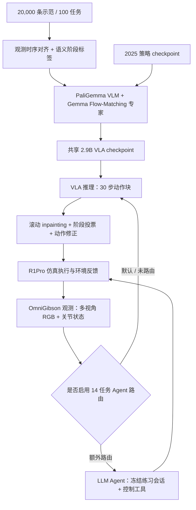
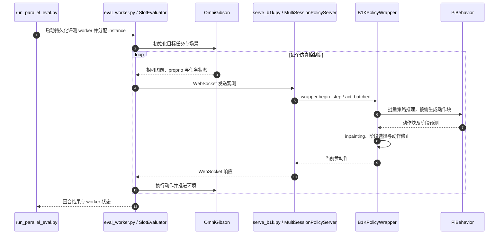

# One Policy for 100 Household Tasks: Our Solution for the 2026 BEHAVIOR Challenge｜单策略覆盖 100 项家务任务：BEHAVIOR Challenge 2026 解决方案

## 一句话定义

Robot Learning Collective 基于 **π₀.₅** 改进出约 **2.9B 参数**的通用视觉语言动作策略（VLA），用**同一 checkpoint**在 BEHAVIOR 2026 的 **100 项长程家务任务**控制 Galaxea R1Pro；其中作者本地**纯策略 Q-score 0.392**，最终公开榜 **0.446** 使用**额外的 14 任务 LLM Agent**，两者不能混为一谈。[论文 v1](https://arxiv.org/html/2611.14432v1) · [源码](https://github.com/Robot-Learning-Collective/behavior-1k-solution-2026)。

## 英文缩写速查

| 缩写 | 英文全称 | 简要说明 |
|---|---|---|
| VLA | Vision-Language-Action | 视觉与状态输入、动作输出的策略 |
| B1K | BEHAVIOR-1K | 日常家务模拟任务基准 |
| VLM | Vision-Language Model | 模型中的视觉语言主干 |
| FM | Flow Matching | 训练连续动作生成专家的目标 |
| Q-score | Quality Score | 按官方任务进展判定的分数，不等于成功率 |
| EMA | Exponential Moving Average | 参数训练滑动平均 |

## 为什么重要

百任务通用操作的问题不只是模型能否识别语言指令，还包括多阶段序列、观测延迟、动作分块边界、夹爪修正和长尾任务失败。本工作提供了**开放权重、数据及运行脚本**，且展示在单个策略之外增加任务专用高层 agent 的收益与额外复现成本。

## 核心原理

- **数据与本体**：BEHAVIOR 2026 发布 **100 项任务、20,000 次示范**的 LeRobot v3 数据；R1Pro 在 OmniGibson/Isaac Sim 中以多视角 RGB、关节状态为输入。训练将躯干表示压缩为遥操作可逆 2-DoF，动作/状态采用 21 维配置。
- **单模型**：PaliGemma VLM + Gemma 动作专家，通过 **flow matching** 输出连续动作块。作者在主干和专家之间引入跨层 KV 混合、注意力 sink、register/scratch token 与混合离散/连续关节状态编码。
- **任务分解**：不是每任务一个 checkpoint，而是共享网络结合 **100 个任务嵌入与 413 个语义阶段**；阶段监督帮助长时任务按顺序推进。
- **训练与推理**：从 2025 checkpoint warm start；在 20 万步训练中使用多流时间/反向噪声配对，EMA 等。推理预测 30 个动作，执行前 26 个动作并保留 4 个供下轮 soft inpainting；以滚动阶段投票解决上下文切换。
- **竞赛扩展**：困难的 14 项任务可被 WebSocket 服务端路由到预先练习的 LLM 工具型 agent。该 agent **不是纯 VLA checkpoint 的组成部分**。

### 方法与部署流程总览

图中分明区分纯策略路径与混合方案额外路由，基于论文与官方仓库 README。



## 实验评测与基线对比

| 条件 | 任务/回合口径 | Q-score | 解读 |
|---|---|---:|---|
| **仅共享 VLA** | 本地 100 任务 × 每任务 10 回合 | **0.392** | 作者本地评估 |
| 其中旧 50 任务 | 同一 2026 设置 | 0.371 | 不能与旧版仿真直接等同 |
| 其中新 50 任务 | 同一 2026 设置 | 0.412 | 新任务集合不同 |
| **VLA + Agent** | 公开挑战榜，14 项困难任务分流 | **0.446** | 综合方案，公开榜第 **9** |
| 纯策略公开榜 | 公开赛提交口径 | 约 0.389 | 与本地 0.392 不是同一评测记录 |

- **Q-score 不等于完整任务成功率**，不能把 44.6% 简写为“100 项任务成功率 44.6%”。
- 对 14 项任务，作者报告额外 Agent 可修补基本策略低分的任务，但实践会话仍是未公开的评测资源。
- 论文的训练配方是可运行的配置参考，作者说明已发布 checkpoint 的训练途径历经硬件环境与设置调整，并非严格可复现的 bitwise recipe。

## 结论

**BEHAVIOR 2026 方案展示了一个 checkpoint 可覆盖 100 项复杂任务，但公开榜最高成绩来自“通用 VLA + 少量工具型 Agent”的混合系统，不能将它全部归因于基础模型。**

1. 评估通用模型必须核对是否为**同一 checkpoint**与明确的任务/实例划分。
2. 分开报告纯 VLA、本地 Q-score、公开榜分数和完整成功率。
3. 多阶段任务的状态对齐、阶段监督、滚动动作块和后处理共同影响结果；不能把所有增益仅归因于参数规模。
4. 对真实部署，WebSocket、动作 chunk、仿真 tick 与低层控制时钟必须独立验证。
5. 开源了权重、训练和仿真运行路径，但**未公开全部冻结 Agent 练习会话**，对完整混合方案的复现存在边界。

## 源码运行时序图

根据官方 `scripts/serve_b1k.py`、`scripts/run_parallel_eval.py`、`scripts/eval_worker.py`、`src/b1k/shared/eval_b1k_wrapper.py`、`src/b1k/models/pi_behavior.py` 的静态调用路径概括；图中“推理”是对应代码主干，非真实运行 trace。



源代码从 `policy_config.create_trained_policy` 加载 checkpoint；训练入口则为 `scripts/train.py::main`，使用 `b1k.training.data_loader` 与 `PiBehavior.compute_loss`，不应与上述**评测/推理时序**混淆。可参考 [源码归档](../../sources/repos/behavior-1k-solution-2026.md)。

## 工程实践

官方 README 的基础复现步骤（需要 Isaac Sim/OmniGibson 环境、子模块、GPU、checkpoint）：

```bash
git clone --recurse-submodules https://github.com/Robot-Learning-Collective/behavior-1k-solution-2026.git
cd behavior-1k-solution-2026
bash setup_remote.sh
uv run hf download IliaLarchenko/BEHAVIOR2026VLA --local-dir models/behavior2026_vla
uv run scripts/serve_b1k.py --policy.config configs/train_b1k_2026.yaml --policy.dir models/behavior2026_vla
# 第二终端
uv run scripts/run_parallel_eval.py --task-name turning_on_radio --instance-indices 0 1 2 3 --num-envs 4
```

训练时另取 [2026 示范集](https://huggingface.co/datasets/behavior-1k/2026-challenge-demos)；不要混同权重仓库地址。上述命令来自官方 README，本次**未执行**，不构成环境已验证声明。

## 局限与风险

- 公开榜 0.446 是额外 Agent 路由的综合成绩；其昂贵的练习与工具调用不等于 VLA 的单步推理成本。
- Agent 冻结练习会话未公开；源码不能独立重放全部高分方案。
- 真机成功率、全任务跨机器人迁移和绝对安全性不由 OmniGibson 比赛成绩保证。
- 对旧 50 任务的 2025 年分数来自不同仿真版本；横比不能直接作受控改进百分比。

## 关联页面

- [VLA](../methods/vla.md)
- [动作分块](../methods/action-chunking.md)
- [流匹配具身策略](../concepts/flow-matching-embodied-policy.md)
- [Uni-Robot-Agent](./paper-uni-robot-agent.md)

## 参考来源

- [技术论文原文与评测口径归档](../../sources/papers/behavior_2026_solution_arxiv_2611_14432.md)
- [官方项目页归档](../../sources/sites/behavior-1k-2026.md)
- [官方源码、运行入口核对](../../sources/repos/behavior-1k-solution-2026.md)

## 推荐继续阅读

- [官方项目与视频](https://robot-learning-collective.github.io/behavior-1k-2026/)
- [论文 v1 全文](https://arxiv.org/html/2611.14432v1)
- [公开 checkpoint](https://huggingface.co/IliaLarchenko/BEHAVIOR2026VLA)
