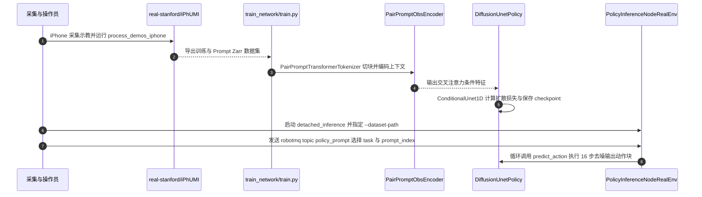

# Behavior Prompting Policy（arXiv:2606.30457）

**Behavior Prompting Policy（BPP）**（Austin Patel, Ben Pekarek, Joel Enrique Castro Hernandez, Shuran Song；Stanford University & UC Berkeley；[arXiv:2606.30457v2](https://arxiv.org/abs/2606.30457)，[项目页](https://behavior-prompting.github.io/)，[代码](https://github.com/real-stanford/behavior_prompting)）提出将单条完整人类或机器人演示作为测试时「行为提示（behavior prompt）」，输入多任务扩散策略，无需参数微调即可执行未见任务、长程组合或用户个性化风格。

## 一句话定义

**把单条演示按时间块压缩为含「低频观测 + 全分辨率动作」的上下文 prompt token，经 Cross-Attention Transformer 对齐当前观测后驱动扩散 UNet 动作头，实现测试时零梯度任务切换与风格继承。**

## 英文缩写速查

| 缩写 | 英文全称 | 简要说明 |
|------|----------|----------|
| BPP | Behavior Prompting Policy | 本文提出的行为提示上下文扩散策略 |
| iPhUMI | iPhone Universal Manipulation Interface | 基于 iPhone 的低成本手持示教采集与提示接口 |
| ICL | In-Context Learning | 权重冻结、依靠上下文示范适配新任务 |
| DP | Diffusion Policy | 后端 ConditionalUnet1D 扩散动作生成架构 |
| ICRT | In-Context Robot Transformer | 论文对照的自回归多模态上下文策略基线 |

## 为什么重要

- **示范比语言更直观地定义「怎么做」与风格：** 目标图只给终点，语言难描述「波浪折线、偏爱路径或自定义符号」，单条多模态演示能同时指定任务意图与连续轨迹风格。
- **验证机器人上下文学习的数据缩放规律：** 论文在固定总示范预算下系统证明——**任务多样性远比每任务堆叠大量示范关键**，为采集策略指明方向。
- **补全低成本生态闭环：** 结合仅需 iPhone 即可采集的 `iPhUMI`，使得「个人随手录一段示范 → 真机即刻模仿」在消费级硬件上可运行。

## 核心信息

| 字段 | 内容 |
|------|------|
| **论文** | Behavior Prompting Policy: Demonstrations as Prompts for Manipulation（[arXiv:2606.30457v2](https://arxiv.org/abs/2606.30457)，2026-10-05） |
| **作者 / 机构** | Austin Patel, Ben Pekarek, Joel Enrique Castro Hernandez, Shuran Song（Stanford University; UC Berkeley） |
| **策略结构** | 151M 参数（57M Prompt Encoder + FiLM 条件化 `ConditionalUnet1D` 16 步去噪，约 49 ms/步） |
| **硬件与基准** | `DrawAnything-Sim`、`DrawAnything-Real`（ARX 臂 + 弹簧笔座 + iPhUMI）、`LIBERO-Gen`（Combination / Chain）、`Laundry Folding` |
| **开源边界** | MIT 开源训练/评估/RobotMQ 离线 prompt 部署代码 + iPhUMI + HF 数据权重；无线实时传 prompt TODO 与真机 DrawAnything 脚本生成/自动评测未释出 |

## 流程总览

## 核心原理

### 1. Prompt Chunk 压缩编码（低频感知 + 全分辨率动作）

直接保留长演示全帧序列会导致注意力过载，因此 BPP 每隔 $\Delta t$ 步切分为一个 Prompt Chunk：每个 chunk 仅保留该段首帧图像（例如 1 Hz 采样）及本体状态，但拼接窗口内全部高分辨率 $\Delta t$ 步动作序列，再经 `AttentionPoolLatent` 池化为单个上下文 token $p_i$。消融证实：若把提示观测降频到 1 Hz 以下，或去掉提示动作仅保留纯视觉观测，未见任务泛化会显著恶化。

### 2. Cross-Attention Prompt Encoder 与 Attention Sink

编码后的历史 chunk token（`PairPromptTransformerTokenizer` / `PairPromptObsEncoder`）被缓存为 Key-Value；当前机器人观测与本体特征经自注意力投影为 Query，通过多层 `TransformerDecoderWithAttn`（默认 4–6 层）跨注意力检索相关示范段落，输出紧致条件向量。在任务切换剧烈的 `LIBERO-Gen` 上引入可学习的 **attention sink token** 稳定早期或无效注意权重，防止推理漂移。

### 3. 扩散 UNet 动作解码与多样性训练原则

条件向量通过 FiLM 调制注入 151M 参数的 `DiffusionUnetPolicy`（`ConditionalUnet1D`），经 16 步 DDIM/DDPM 去噪生成连续动作块。相比回归型 L1 基线 ICRT（6.5 ms）推理约 49 ms，但对多模态示范与物理干扰更具鲁棒性。更重要的是训练数据分布：在总示范条数相等时，**跨 2,000 任务各采少量样本远胜于在少数任务堆叠数百条演示**，否则策略会记忆任务 ID 而丧失上下文追随能力。

## 实验与评测

| 评测域 | 任务规模与设置 | 核心量化结果 |
|--------|----------------|--------------|
| **DrawAnything-Sim** | 2,000 训练任务 × 5 demos；50 手绘未见测试任务 | 未见任务 Chamfer 误差相对 Goal-Image **−80.7%**；BPP **`3.43±0.10`** 优于 ICRT **`5.07±0.22`**（**−32.3%**）及 L1 消融 **`4.84±0.22`** |
| **DrawAnything-Sim 抗干扰** | 在轨迹执行中段擦除画布内容 | BPP 误差 **`5.48±0.15`**，明显低于 ICRT 的 **`10.47±0.98`** |
| **DrawAnything-Real** | ARX 臂 + 弹簧笔座；1,000 训练（200 iPhUMI × 5 + 800 脚本 × 6）；4 已见 + 6 未见 | 未见绘制任务 Chamfer 误差相对 Goal-Image 降低 **47.9%** |
| **LIBERO-Gen** | 扩展 Combination（+164 任务）与 Chain（+311 任务），各含 10 个未见组合/两步链 | 未见 Combination 相对语言策略 **+13.2%**；未见 Chain **+10.7%**（无第二步单独训练样本时 **+20.8%**），比肩微调后 $\pi_{0.5}$ |
| **原始 LIBERO 4 套件** | LIBERO-Spatial / Object / Goal / 10 | BPP 平均 **`97.48±0.33%`**（Language DP `96.23±0.55%`，$\pi_{0.5}$ `97.15%`） |
| **Laundry Folding（反例）** | 仅 3 种折叠毛衣任务（约 150 demos/类 + 1k 纠错） | 任务多样性极低，Language DP `96% / 100% / 100%` 优于 BPP `76% / 100% / 60%`（BPP 出现 `8% / 0% / 40%` 错折） |

- **Prompt 质量扰动敏感度（DrawAnything-Sim）：** 1.25× 慢放使 Chamfer 误差增加 `+5.9%`、手部抖动（$\sigma=5$ px）增加 `+7.4%`、3 次人为停顿增加 `+24.0%`。

## 结论

**BPP 把「单条人类示范」做成扩散策略的测试时可编程接口，并给出明确边界条件：当训练库足够多样时，行为提示能以零梯度切换动作与风格；当训练任务种类极少时，语言条件反而更稳。**

- **Prompt 必须带全分辨率动作**：低频视觉锚定场景进展，窗口内高频动作提供局部轨迹细节，二者缺一均会掉点。
- **数据采集优先「多任务少示范」**：与其对单一物体采上百条遥操作，不如借助 `iPhUMI` 覆盖上千种微任务。
- **扩散解码换取抗干扰与多模态表达**：49 ms 时延足以满足桌面操作控制频率，且在画布擦除等状态扰动下保持纠偏能力。
- **当前真机流水线仍分步走**：公开代码先把 iPhone 数据转为 `.zarr` 再由节点读取索引，尚未放出直接流式无线传 prompt 模块。

## 源码运行时序图

仓库 [real-stanford/behavior_prompting](https://github.com/real-stanford/behavior_prompting) 的真实训练、仿真评估与真机部署主干如下：

- **核对入口：** 训练见 `behavior_prompting/train_network/train.py`（`TrainPolicyWorkspace`），仿真评估见 `RolloutPolicyWorkspace`，真机推理见 `behavior_prompting/deployment/detached_inference.py` 中的 `PolicyInferenceNodeRealEnv`。

## 工程实践

| 实践项 | 具体要求与边界 |
|--------|----------------|
| **数据与特征格式** | 训练与真机测试示范均通过 `iPhUMI` 转换脚本统一写入 `.zarr` ReplayBuffer（包含 `task_name`、低频图像及全频位姿/夹爪动作） |
| **模型与权重获取** | Hugging Face `austinpatel/*` 已提供 DrawAnything-Sim/Real、LIBERO-Gen、Laundry Folding 数据及 `bp_*` / `pi05_*_lora` 对照权重 |
| **真机部署接口** | `detached_inference.py` 通过 `robotmq.RMQServer("policy_server", ...)` 暴露 `policy_prompt` 主题切换测试示范，免重启切换任务 |
| **未开源限制** | `README.md` 标记无线 iPhUMI 在线传输 prompt 尚在 TODO；`docs/drawanything_real.md` 说明真机脚本数据生成及自动 Chamfer 测评脚本未释放 |

## 局限与风险

- **低任务多样性下表现不及语言基线：** 当只有 3 种毛衣折叠方式时，BPP 在其中两折分别退化到 `76%` 与 `60%`（错折率最高 40%），说明策略容易被表面姿态而非任务语义混淆。
- **对 Prompt 节奏停顿较敏感：** 示范中包含 3 次长停顿时，DrawAnything-Sim 误差上升 24.0%，需操作员保持相对流畅的示教过程。
- **精度与接触依赖边界：** 依靠视觉和末端姿态 prompt 尚未覆盖高动态接触或长程跨阶段记忆依赖任务（后者需结合如 [GMP](./paper-gated-memory-policy.md) 的门控记忆或力触觉控制）。

## 与其他工作对比

| 工作 | 上下文表示 | 适应机制 | 核心差异 |
|------|------------|----------|----------|
| **BPP（本页）** | 低频帧+全频动作切块 pool + cross-attn | 零梯度测试时示范提示 | 兼顾连续动作风格与泛化；扩散头抗干扰但比 ICRT 慢 |
| **ICRT** | 全时序视觉-动作自回归 token | 零梯度 ICL | L1 回归速度快（6.5 ms），但误差（5.07）与擦除扰动（10.47）显著落后 |
| **Goal-Image / Language DP** | 目标静态图或自然语言 | 零梯度条件化 | 高多样性未见组合任务显著落后 BPP；极低多样性（3 任务）更稳 |
| **[GMP](./paper-gated-memory-policy.md)** | 缓存轨迹块 + 门控回忆历史 | 自身回放记忆（非外部他人示范） | 解决单机器人长程非马尔可夫歧义，而非跨任务模仿单条示范 |
| **[HOST](./paper-host-one-shot-human-video.md)** | 人/机进度流形对齐 + 自接地未来帧预测 | 零梯度单条人视频迁移 | 面向第三人称跨具身人类视频 + Wan2.2 MoT，不依赖手持遥操作/iPhUMI 动作 |

## 关联页面

- [Gated Memory Policy（GMP）](./paper-gated-memory-policy.md) — REALab 同系记忆机制（处理自身非马尔可夫历史 vs 外部示范提示）
- [机器人 In-Context Learning](../concepts/robot-in-context-learning.md) — BPP 在具身上下文学习中的位置
- [Imitation Learning](../methods/imitation-learning.md) — 行为提示作为多任务条件化模仿范式
- [Diffusion Policy](../methods/diffusion-policy.md) — 后端 `ConditionalUnet1D` 动作解码器底座
- [Manipulation](../tasks/manipulation.md) — 桌面物体与绘制操作评测语境
- [Teleoperation](../tasks/teleoperation.md) — `iPhUMI` 采集接口与手持遥操作生态
- [REALab 14 篇技术地图（2026）](../overview/realab-14-papers-technology-map-2026.md) — 脉络 #03（数据接口与跨具身操作 #10）
- [具身上下文学习（ICL）纵深路线](../../roadmap/depth-icl.md) — Stage 2 单示范上下文策略代表

## 参考来源

- [arXiv 论文全文精读笔记（2606.30457v2）](../../sources/papers/behavior_prompting_arxiv_2606_30457.md)
- [官方项目页核查归档](../../sources/sites/behavior-prompting-github-io.md)
- [GitHub 仓库源码解析（real-stanford/behavior_prompting）](../../sources/repos/real-stanford-behavior-prompting.md)
- [深蓝 AI：斯坦福 REALab 14 篇工作盘点](../../sources/blogs/wechat_shenlan_realab_14_papers_2026.md)

## 推荐继续阅读

- 论文 PDF：<https://arxiv.org/abs/2606.30457>
- 官方项目页：<https://behavior-prompting.github.io/>
- GitHub 源码：<https://github.com/real-stanford/behavior_prompting>
- 手持采集配套仓库：<https://github.com/real-stanford/iPhUMI>
