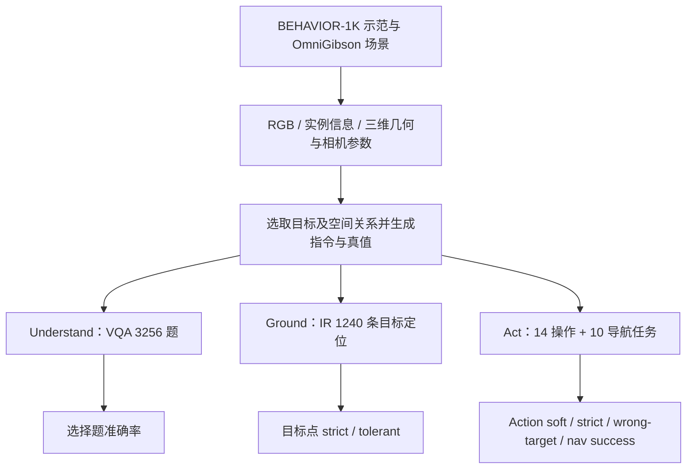
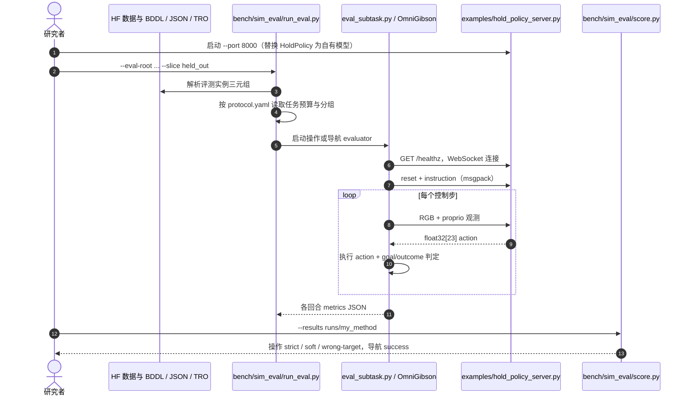

# BEHAVIOR-Spatial Benchmark：评测机器人空间理解能力

**英文：** *BEHAVIOR-Spatial Benchmark: Evaluating Spatial Understanding for Robotics*  
**中文：** BEHAVIOR-Spatial 基准：评测机器人空间理解能力  
**论文：** [arXiv:2610.34051v2](https://arxiv.org/abs/2610.34051)（2026-10-28）  
**机构：** 美国斯坦福大学（Stanford University）、美国西北大学（Northwestern University）等；作者 Sirui Chen、Huang Huang、Qineng Wang、Wenlong Huang、Manling Li、Ruohan Zhang、Li Fei-Fei、Jiajun Wu。

## 一句话定义

**BEHAVIOR-Spatial 不是新的机器人控制算法，而是让空间问答、语言指代定位与真实执行使用可追踪的空间关系，检验模型究竟理解了目标，还是只记住了场景或动作模式。**

## 英文缩写速查

| 缩写 | 英文全称 | 简要说明 |
|---|---|---|
| VQA | Visual Question Answering | Understand：对场景相对方向、距离、大小等进行空间问答 |
| IR | Intermediate Representation | 论文中的目标点/视觉标记中间表示；Ground 评测其定位准确率 |
| VLM | Vision-Language Model | 在图像与自然语言上回答空间问题、预测目标点的感知语言模型 |
| VLA | Vision-Language-Action | Act：接收指令和观测并预测机器人动作的策略 |
| BDDL | BEHAVIOR Domain Definition Language | BEHAVIOR-1K 任务状态与目标谓词描述 |
| LoRA | Low-Rank Adaptation | 论文对照的 VLM 低秩适配方式 |

## 为什么重要

机器人成功靠近一个杯子，不代表它正确理解了“靠左、最近、第二个”等空间限定词：动作策略可能复用训练场景里的默认目标。只比较最终任务完成率，难以把**空间语言理解**、**图像指代定位**和**运动/接触控制**的错误拆开。BEHAVIOR-Spatial 以同一类 BEHAVIOR-1K 场景为基础分层评测，并加入**训练布局不变、指令目标改变**的 prompt-probe 子集，专门暴露靠场景记忆而非指令选择目标的现象。

## 核心信息

| 项 | 内容 |
|---|---|
| 原始生态 | [BEHAVIOR-1K](./behavior-1k.md) / OmniGibson |
| 空间关系 | direction、distance、size；包含相对方向、序数、最近/最远、大小等 |
| Understand（VQA） | **3,256** 道：一般空间题 1,572 + 任务相关 1,684 |
| Ground（IR） | **1,240** 条指令目标点查询，覆盖 14 个操作任务 |
| Act（Action） | **14** 个操作任务和 **10** 个导航任务；仿真执行 |
| Action held-out | 操作 **469** 回合；导航 **401** 回合 |
| Action prompt-probe | 操作 **700** 回合：复用训练场景配置，但切换指向的目标 |
| 开放状态（2026-11-07） | [评测代码](https://github.com/arielchen07/BEHAVIOR-Spatial-benchmark) 与 [数据](https://huggingface.co/datasets/behavior-spatial-benchmark/BEHAVIOR-Spatial) 已发布；论文中的 VLA 训练代码和 checkpoint **未包含于评测仓库** |

## 核心原理

### 三层诊断，而非单一总分

1. **Understand / BEHAVIOR-Spatial-VQA**：输入单帧或多帧图像与空间问题，输出选择题答案；一般题涉及场景方向、距离、尺寸，任务题对应操作与导航目标。
2. **Ground / BEHAVIOR-Spatial-IR**：对自然语言指代预测目标像素点（操作的 reach 物体或 place 区域），用严格与容忍两档定位分数反映图像落点是否匹配。
3. **Act / BEHAVIOR-Spatial-Action**：向具身策略输入视觉、机器人状态和指令，在 OmniGibson 仿真中执行；分别观察正确目标成功、朝正确目标推进以及错误目标承诺率。

论文用带 flow-matching action expert 的 π0.5 风格基线并替换 VLM backbone 为 Qwen3.5-4B；比较 frozen-VLM、LoRA、DROID 初始化，以及带**仿真真值空间定位**的 dot / attention-map IR 辅助。特别注意 oracle IR **不等于模型自主从图像中学会了可靠的目标定位**。

### 流程总览

以下是基于论文方法与评测协议归纳的**基准数据与诊断流**，不表示三个套件共享一个模型或必须串联推理。



### 数据及评测切片

- **一般 VQA**：单帧 1,078，多帧 494（旋转 239 + 导航 255）。
- **任务 VQA**：操作 1,082，导航 602；两类共 1,684。
- **Ground**：14 个操作任务合计 1,240 条查询；严格命中目标范围，reach 的 tolerant 允许目标边缘附近一定误差。
- **Action held-out**：未见场景配置，469 个操作、401 个导航评测实例。
- **Action prompt-probe**：700 个操作实例，训练布局不变，只改变有效目标指令，从而检测策略是否真正响应空间限定条件。
- **指标**：soft success 包括严格完成或满足协议要求的朝正确目标显著推进，不能当作 strict 完成；wrong-target 单独计量错误目标选择；导航用二值到达成功。

## 源码运行时序图

**以下图对应已公开的官方 *评测 harness*（仓库 main @ `e9c96b9`），而非论文未发布的 VLA 训练流程。**已核查 [README](https://github.com/arielchen07/BEHAVIOR-Spatial-benchmark)、`docs/protocol.md`、`run_eval.py`、`eval_subtask.py`、`score.py`、两份 VQA/IR 评分脚本以及 `hold_policy_server.py` 的关键入口与调用接口；见 [源码归档](../../sources/repos/behavior-spatial-benchmark.md)。



说明：官方 `hold_policy_server.py` 默认只有“保持不动”的模板策略，用于验证通信管线；**不是论文 frozen-VLM baseline**。使用 `--with-ir` 的回合有仿真真值定位（privileged IR），代码单独汇报，不得混入普通模型结果。

## 工程实践

**使用官方代码复现评测协议（而非论文训练）：**

```bash
# 按官方 README 先单独准备 HF 数据、OmniGibson 和依赖环境
python bench/vqa_ir/score_vqa.py --data "$DATA/vqa" --predictions answers.json
python bench/vqa_ir/score_ir.py --data "$DATA/ir" --predictions points/

# 先用官方模板检查 evaluator ↔ policy 的通讯，不代表论文策略性能
python examples/hold_policy_server.py --port 8000

# 在另一个已正确安装 OmniGibson 的环境中执行
python bench/sim_eval/run_eval.py --eval-root "$DATA/action/eval/manipulation" --slice held_out --host localhost --port 8000 --out runs/my_method
python bench/sim_eval/score.py --results runs/my_method
```

- **环境隔离**：评测端在 OmniGibson，策略端是独立 WebSocket 服务；观测含头部、手腕相机与本体状态，输出 23 维机器人动作。
- **版本分流**：餐厅场景的四个导航任务需要 OmniGibson 3.9.2，其余主要在 3.7.2；不可把两版本的运行错误误记为模型失败。
- **协议一致性**：保持 `bench/sim_eval/protocol.yaml` 不变；报告 soft/strict/wrong-target、使用的 VLM/策略、是否有 oracle IR，以及同步还是异步动作推理。
- **数据读取**：HF 文件多且有下载速率限制，`hf download` 遇 429 后可能留下不完整本地副本，需核对官方 MANIFEST。
- **工程诊断**：对固定模型先跑 VQA/IR，再跑 held-out 与 prompt-probe。若后者错目标显著增多，优先追查 referring-expression grounding，而非只调末端控制精度。

## 实验与评测

以下操作指标均为原文 Table 4 的 episode pooled **百分比**；**soft 成功不等同于 strict 完成率**。

| 策略 | Held-out soft | Held-out strict | Probe soft | Probe strict | Probe wrong-target |
|---|---:|---:|---:|---:|---:|
| frozen VLM 基线 | **41.6** | 27.9 | **16.1** | 10.0 | **70.0** |
| + LoRA | 43.5 | 30.9 | 17.9 | 9.6 | 68.1 |
| + DROID 初始化 | 40.1 | 24.7 | 16.6 | 8.9 | 66.0 |
| + oracle dot IR | **60.3** | 44.8 | **38.0** | 24.9 | **43.9** |
| + oracle attention map | 59.3 | 39.0 | 35.0 | 17.0 | 46.0 |

- **重要对照**：在已见布局但变更指令目标的 prompt-probe 中，frozen-VLM 的 soft 从 held-out **41.6% → 16.1%**，wrong-target 达 **70.0%**，表明任务完成率可能掩盖空间指代失败；这两个子集难度不同，数字下降不能被解释为单一变量的严格因果效应。
- **Oracle 上限**：真值点 dot-IR 的 held-out/probe soft 分别为 **60.3% / 38.0%**，但 oracle 点本身不来自可部署的视觉模型；预测 IR 比真值定位弱（论文 Qwen3.5-4B 预测 IR held-out soft **48.8%**）。
- **能力关联**：在 dot IR 设定中，任务级 IR tolerant 与 soft 成功的 Spearman ρ **0.701**，VQA 与 soft 成功为 **0.560**；attention-map 设定对应 **0.753** 和 **0.608**（Table 3）。是该实验配置下的关联，不表示提升 IR 必然同比例提升成功率。
- **任务限制**：导航任务成功率横跨 **22.5%–92.5%**（§5.4），不可用一项 VQA 均值替代导航终态指标。

## 结论

**BEHAVIOR-Spatial 最有价值的不是新策略，而是把“识别目标”“按照空间语言选目标”“实际执行到目标”分别量化，揭示常规成功率的盲区。**

1. **报告 held-out 与 prompt-probe 两组**，避免模型靠熟悉的布局完成任务而误判为懂空间指令。
2. **soft、strict、wrong-target 同时看**；错目标属于 grounding 问题，不能归因于“差一点就够到了”。
3. **优先分析目标定位错误**：IR 与操作成功有一定关联，但无法用 VQA 分数直接预测机器人是否成功。
4. **区分预测 IR 与 oracle IR**：后者用了仿真真实目标，不是实际端到端空间理解能力。
5. **可复现的是官方评测栈**：论文所报告的 VLA 训练实现和 checkpoint 未随本次评测仓库发布，不能声称已有一键复现完整模型。

## 与其他工作对比

| 项目 | 定位区别 |
|---|---|
| [BEHAVIOR-1K](./behavior-1k.md) | 1000 类日常活动与高保真综合任务环境；BEHAVIOR-Spatial 在其中强调**指令相关的空间诊断** |
| [Manipulation](../tasks/manipulation.md) | 机器人抓取与操作的任务体系；本 benchmark 特别测量空间指代与目标选择 |
| [仿真评测基础设施](../concepts/simulation-evaluation-infrastructure.md) | 泛化的仿真 rollout 与指标工程；本项目给出了具体的 VQA/IR/Action 分层协议 |

## 局限与风险

- **仿真为主**：未提供完整真机泛化、安全性或接触故障的验证，不能直接视为 Sim2Real 结论。
- **任务范围有限**：14 操作、10 导航，不代表长时序多任务家庭能力全面覆盖。
- **oracle IR 是特权信息**：模拟器知道目标的真值像素位置，真机需感知模型提供对应信息。
- **成功率不能混用**：held-out 与 prompt-probe 的分布不同，soft 与 strict 的物理含义不同；涉及 24 任务的指标细则以官方 `METRICS.md` 为准。
- **开源边界**：官方 GitHub 公开打分器、仿真评测 harness、协议和示例服务器；论文 VLA policy 的训练代码/权重不在本次发布中。数据卡 MIT、代码 Apache-2.0 **不表示**可不受限制商用 OmniGibson 依赖的 3D 资产。
- **验证边界（2026-11-07）**：论文正文与附录已通读、官方关键评测入口已核对；本条入库没有运行 OmniGibson 仿真、下载整套数据或验证真机策略。项目页 URL 通过官方仓库/论文核验身份，但本次抓取未取得项目网页正文。

## 关联页面

- [BEHAVIOR-1K 仿真基准](./behavior-1k.md)
- [Manipulation：机器人操作](../tasks/manipulation.md)
- [仿真评测基础设施](../concepts/simulation-evaluation-infrastructure.md)
- [具身大模型评测基准选型闭环](../queries/embodied-eval-benchmark-selection-loop.md)

## 参考来源

- [论文原文通读归档](../../sources/papers/behavior_spatial_arxiv_2610_34051.md)
- [官方项目页与开源状态](../../sources/sites/behavior-spatial-benchmark.md)
- [GitHub 评测源码及运行入口](../../sources/repos/behavior-spatial-benchmark.md)
- [Hugging Face 官方数据归档](../../sources/datasets/behavior-spatial-benchmark.md)
- [BEHAVIOR-Spatial 论文（arXiv:2610.34051v2）](https://arxiv.org/pdf/2610.34051)

## 推荐继续阅读

- [BEHAVIOR-Spatial 研究主页](https://arielchen07.github.io/behavior-spatial/)
- [官方 benchmark README 与评测代码](https://github.com/arielchen07/BEHAVIOR-Spatial-benchmark)
- [官方数据集](https://huggingface.co/datasets/behavior-spatial-benchmark/BEHAVIOR-Spatial)
- [BEHAVIOR-1K 原始任务生态](https://behavior.stanford.edu/)
