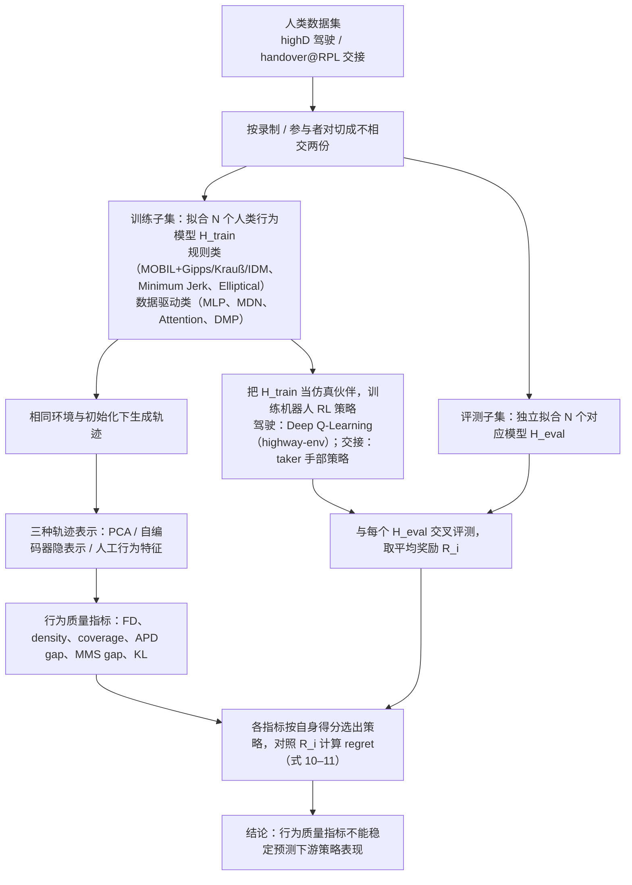

# Behavioural Quality vs Learning Utility（arXiv:2610.34839）

**Behavioural Quality vs Learning Utility**（*Behavioural Quality Is Not Learning Utility: Objective Mismatch in Human Behaviour Models for Robot Learning*，[arXiv:2610.34839](https://arxiv.org/abs/2610.34839)，[项目页](https://objective-mismatch-hri.github.io/supplementary/)）来自 [具身智能小站 2026-10-28 盘点](../../sources/blogs/wechat_embodied_station_59_papers_human_video_to_robot_experience_2026-10-28.md)，属「控制、规划与系统」组。

## 一句话定义

**在驾驶与物体交接中，把人类行为生成质量与下游强化学习收益分别评测。**

## 英文缩写速查

| 缩写 | 英文全称 | 简要说明 |
|------|----------|----------|
| Behavioural Quality vs Learning Utility | Behavioural Quality Is Not Learning Utility: Objective Mismatch in Human Behaviour Models for Robot Learning | 本文方法 / 基准的简称 |

## 为什么重要

- 像人的行为未必最适合训练机器人。发现常见行为指标不能稳定预测策略表现，提醒训练伙伴模型的选择应服务于最终交互能力。
- 开源结论：**项目页未列 GitHub**（步骤 2.5，2026-10-28）。项目页 HTTP 200，未见 GitHub 链接或 coming soon 字样。
- 同期同组工作见 [潜在动作、免渲染事件仿真与机器人评测：具身智能小站 10-28 期 59 篇阅读坐标](../overview/embodied-station-2026-10-28-59-papers-technology-map.md)。

## 流程总览

图依据：论文 §III–IV（含式 8–11、Table I/III）。

## 核心机制

| 项 | 内容 |
|----|------|
| **arXiv** | [2610.34839](https://arxiv.org/abs/2610.34839) |
| **开源** | **项目页未列 GitHub** |
| **要点** | 在驾驶与物体交接中，把人类行为生成质量与下游强化学习收益分别评测。 |
| **文内指标** | 公众号转述：发现常见行为指标不能稳定预测策略表现，提醒训练伙伴模型的选择应服务于最终交互能力。 |

## 源码运行时序图

**不适用（项目页未列 GitHub）** — 项目页 HTTP 200，未见 GitHub 链接或 coming soon 字样。 不编造运行脚本；代码公开后再补。

## 实验与评测

- 公众号转述：发现常见行为指标不能稳定预测策略表现，提醒训练伙伴模型的选择应服务于最终交互能力。
- **读法：** 本页为索引级摘要，依据公众号转述的官方摘要与仓库信息整理；逐项数字与 baseline 以原文 PDF 为准。

## 与其他工作对比

- 横向索引见 [潜在动作、免渲染事件仿真与机器人评测：具身智能小站 10-28 期 59 篇阅读坐标](../overview/embodied-station-2026-10-28-59-papers-technology-map.md)；同 arXiv 不重复造页。

## 结论

**像人的行为未必最适合训练机器人：发现常见行为指标不能稳定预测策略表现，提醒训练伙伴模型的选择应服务于最终交互能力。**

1. 开源边界：**项目页未列 GitHub** — 项目页 HTTP 200，未见 GitHub 链接或 coming soon 字样。
2. 核心机制：在驾驶与物体交接中，把人类行为生成质量与下游强化学习收益分别评测。
3. 复现与选型前核对任务协议、硬件与基准口径，勿直接横比公众号摘录数字。

## 关联页面

- [manipulation](../tasks/manipulation.md)
- [impedance-control](../concepts/impedance-control.md)
- [llm-robotics-control-interfaces](../concepts/llm-robotics-control-interfaces.md)
- [embodied-station-2026-10-28-59-papers-technology-map](../overview/embodied-station-2026-10-28-59-papers-technology-map.md)

## 参考来源

- [behavioural_quality_vs_learning_utility_arxiv_2610_34839.md](../../sources/papers/behavioural_quality_vs_learning_utility_arxiv_2610_34839.md)
- [wechat_embodied_station_59_papers_human_video_to_robot_experience_2026-10-28.md](../../sources/blogs/wechat_embodied_station_59_papers_human_video_to_robot_experience_2026-10-28.md)
- [arXiv:2610.34839](https://arxiv.org/abs/2610.34839)
- [arXiv PDF](https://arxiv.org/pdf/2610.34839)：已通读方法部分（实验与附录以略读为准）：§I–IV 与 §V 开头

## 推荐继续阅读

- [arXiv PDF](https://arxiv.org/pdf/2610.34839)
- [项目页](https://objective-mismatch-hri.github.io/supplementary/)
