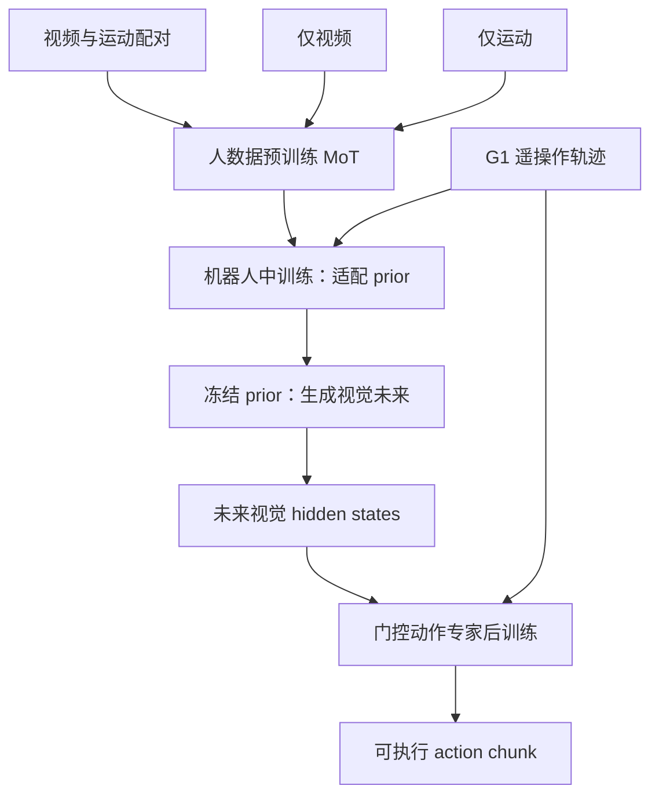
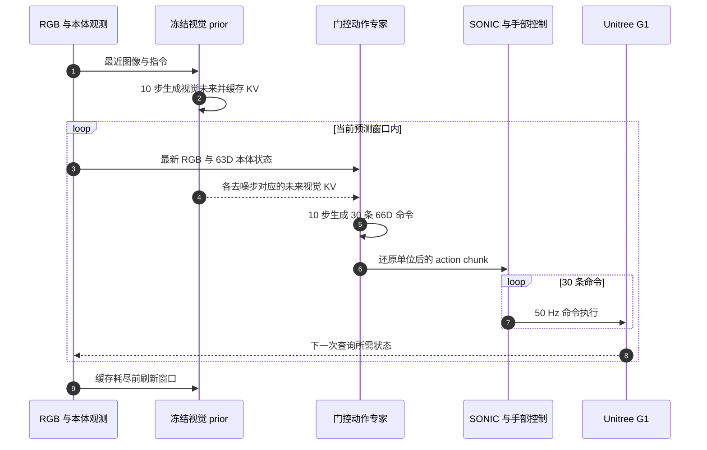

# Being-M0.7: A Latent World-Action Model for Humanoid Robots（人形机器人潜空间世界–动作模型）

## 一句话定义

**先用人类视频与运动学数据学会预测，再适配机器人视角，最后训练动作专家把预测转成全身控制命令。** 本页以 2026-10-08 的 [arXiv v1](https://arxiv.org/abs/2610.11283) 为方法和评测依据；官方项目页仍标注 2026-07-14，不能将两个版本的结果混用。

## 英文缩写速查

| 缩写 | 英文全称 | 简要说明 |
|------|----------|----------|
| WAM | World-Action Model | 用未来预测辅助动作生成的模型 |
| MoT | Mixture of Transformers | 模态分别计算，注意力交换视觉与运动信息 |
| FM | Flow Matching | 学习将噪声变成未来状态或动作的流场 |
| FK | Forward Kinematics | 从机器人关节状态计算身体点的位置 |
| KV | Key / Value | 动作专家复用的预测上下文缓存 |
| VR | Virtual Reality | 机器人全身示范的采集接口 |
| SMPL | Skinned Multi-Person Linear Model | 遥操作中间人体姿态表示 |
| DoF | Degrees of Freedom | 机器人自由度 |

## 为什么重要

它把“人体运动不是机器人命令”拆成三个可检查的学习阶段。运动数据提供结构化监督；机器人中训练处理人机视角及身体动力学差异；动作后训练负责可执行命令。预测先验与动作专家单向连接，能分别核查预测质量与动作接地。

**关键版本更正：** 新版在动作后训练与部署关闭显式 motion 预测，仅将未来视觉 hidden states 提供给动作专家。人数据学到的运动知识仍影响视觉表示，但部署并不要求先生成一段人体 motion，再直接交给 SONIC。

## 核心信息

| 项目 | 核验内容 |
|------|----------|
| 机构 | 超越智能（BeingBeyond） |
| 发布时间 | 项目页 2026-07-14；arXiv v1 首次提交 2026-10-08 |
| 论文 | arXiv:2610.11283；沿用已有实体 ID，未新建重复节点 |
| 预训练数据 | 过滤和切片前超过 10,000 小时；配对视频–运动、仅视频、仅运动三流 |
| 真机 | Unitree G1、Linker Hand O6、头部 RealSense D435i；外部 RTX 4090 策略工作站 |
| 开放状态 | 论文和演示公开；截至 2026-10-12 未在项目页找到 M0.7 专属代码、权重或处理后训练集入口 |

## 方法：三阶段与梯度边界

| 阶段 | 数据 / 目标 | 更新参数 | 应核查什么 |
|------|-------------|----------|-------------|
| Pre-training | 人中心三流；可用模态的视觉/运动 FM 损失，运动还加几何约束 | Video-Motion prior | 单模态样本不等于补齐另一模态；缺失 token 被屏蔽 |
| Robot mid-training | 机器人视频、语言与 22D motion；视觉与可用运动预测 | Prior | 将人先验适配到机器人场景和身体变化 |
| Action post-training | 同一机器人轨迹中的当前图像、本体状态、示范 action chunk | Action expert 及观测/上下文投影；prior 冻结 | 动作损失不回传 prior；上下文来自 prior 自身采样 |

DINO 与 DistilBERT 在三阶段均冻结。MoT 保留视觉/运动各自的投影、归一化及 FFN，通过共享注意力联合建模。未来 token 并行去噪；历史 token 不访问未来，防止监督泄漏。

动作专家先处理当前观测与动作 token，再以动作 token 为 query 读取 prior 的未来视觉 hidden states。token-wise gate 决定注入多少预测 residual；本体 token 通过局部 self-attention 起作用，不直接查询世界上下文。该 gate 控制信息注入量，不是已经验证的模型置信度或安全保证。

### 训练流程图

## 表示、参数与控制接口

| 接口 | 具体含义 |
|------|----------|
| 22D motion | 头根平移 3D、连续旋转 6D、初始头高 1D、双手双脚局部位置 12D；用于预训练/中训练 |
| 63D 本体观测 | roll/pitch、角速度、关节位置与速度；另输入当前单帧 RGB |
| 66D 真机动作 | 64D SONIC universal control token + 左右手各 1D 开合；不是 66 个关节目标 |
| Prior | 30 层、宽度 768、24 个注意力头；视觉/运动 FFN expansion 分别为 6/2 |
| Action expert | 30 层、宽度 1024、32 个注意力头；每三层连接一次 prior（3、6、…、30） |
| 归一化 | 本体和动作按机器人训练集逐通道标准化，执行前还原控制单位 |

22D motion 用头为根连接人和机器人，而不要求二者有相同关节角。机器人中训练读取预处理 motion；部署设 `use_robot_motion=false`，运动 slot 仍可能经过共享前向计算，但输出被丢弃，不能理解成已裁掉全部运动分支算力。

### 部署频率与 action chunk

| 时间量 | 新版附录设定 | 正确读法 |
|--------|--------------|----------|
| 预测帧间距 | 5 Hz | 未来视觉状态间隔 0.2 秒；不是 prior 实际重新调用频率 |
| Prior 窗口 | 1 帧已观测 + 24 帧未来 | 未来范围 4.8 秒；缓存耗尽前刷新，未给统一固定刷新 Hz |
| Action chunk | 30 条命令 | 50 Hz 执行时覆盖 0.6 秒 |
| 动作专家查询 | 约 1.67 Hz | 执行完整 chunk 后再取当前观测查询；不是每 20 ms 重新跑专家 |
| 命令执行 | 50 Hz | 每 20 ms 执行一条控制命令 |
| FM 采样 | 后训练 prior 3 步；部署 prior / expert 各 10 步 | 训练上下文采样与部署去噪步数不同 |

这些是命令时间跨度对应的名义调度；去噪计算耗时另计，论文未将其等同于端到端实时吞吐。

缓存只包含未来视觉 token，排除 prior 的历史输入 token；当前观测另走专家输入。执行计数器用于窗口进度管理，配置关闭额外 execution-progress policy token。

### 论文描述的部署时序图

图依据论文 §7.4–7.5，是系统行为说明，不是已公开源码的调用图。

## 源码运行时序图

**不适用。** 截至核查日项目页 GitHub 按钮指向 BeingBeyond 组织，未提供 M0.7 可运行训练/推理仓库。组织中其他 Being-H、Being-M0.5 项目不能作为 M0.7 的实现替代；不虚构 `train.py`、安装命令或 checkpoint 路径。

## 实验与评测

### 新版结果（arXiv v1 Tables 1–3）

| 方法 | SIMPLE 成功数 / 180 | 真机 W2F / 5 | W2M / 5 | W2D / 5 | 真机合计 / 15 |
|------|-------------------|-------------|---------|---------|----------------|
| GR00T-N1.6 | 61 | 3 | 5 | 5 | 13 |
| Ψ0 | 116 | 0 | 1 | 2 | 3 |
| π0.5 | 95 | 2 | 2 | 3 | 7 |
| Being-M0.7 | 128 | 3 | 5 | 5 | 13 |

SIMPLE 为六任务 × 三个随机化难度 × 每配置十次；多任务模型总成功率 71.1%，为比较方法中的最高合计，但并非逐任务都第一。真机三任务分别是走到水箱捞鱼、走到镜面抓隐藏玩偶、走到桌边抓可见玩偶；每任务五次、单次限时 30 秒、人工判定成功。Being-M0.7 真机合计与 GR00T-N1.6 **并列 13/15**，不能写成显著超越。

| SIMPLE 消融 | 成功数 / 180 | 相对完整模型说明 |
|-------------|--------------|------------------|
| 完整模型 | 128 | 基准 |
| 去掉人数据预训练 | 88 | 总成功数下降 40 |
| 去掉机器人中训练 | 107 | 总成功数下降 21 |
| 上游替换为语言上下文 | 105 | 当前图像与本体仍在；不是无视觉策略 |

消融支持三个组件对合计结果的贡献，但语言上下文在 XMoveBendPick 上反而更好。不能把 aggregate 增益等同于每个场景必然获益，也不能把三次消融当成门控机制的独立消融。

### 版本边界

旧档案曾记录镜面与捞鱼两类设置的 7/15，以及四项演示任务。新版增加 SIMPLE 和三项完整真机任务，评测协议及基线结果发生变化；两组结果不构成同协议性能趋势。本页替换旧结论，旧来源摘要仍在归档中明确标记为历史版本。

## 与相关路线对比

| 路线 | 本页关注的区别 | 继续阅读 |
|------|----------------|----------|
| Being-M0.7 | 人视频–motion 先验 → 机器人适配 → 冻结视觉预测上下文与动作专家 | 当前节点 |
| MotionWAM | 视频预测表示与人形动作生成的另一系统设计；数据与协议不同，避免直接横比成功率 | [MotionWAM](./paper-motionwam-humanoid-loco-manipulation-wam.md) |
| Being-H0.7 | 同机构操作方向；latent queries 与未来表示对齐，不能将 H 系代码默认为 M 系实现 | [Being-H0.7](../methods/being-h07.md) |
| SONIC | 接收动作接口并执行全身运动，属于控制层；50 Hz 执行不等于上层专家查询频率 | [SONIC](../methods/sonic-motion-tracking.md) |

## 结论

**Being-M0.7 将人类运动监督转移到视觉预测表示，再经机器人适配和门控动作专家接地；新版证据支持仿真合计领先和真机并列基线。**

1. 将三阶段及参数冻结边界分开记录，动作后训练不再更新 prior。
2. 22D motion 是训练监督，66D action 才是本文真机控制接口。
3. 5 Hz 预测帧间距、1.67 Hz 查询、50 Hz 执行对应不同环节。
4. 未来 KV 缓存提供可复用上下文，专家仍读取当前观测；完整 chunk 内不代表每步重新推理。
5. 复现需等待明确的源码、权重和数据入口；论文附录能指导架构审查，不能代替实现。

## 局限与工程判断

- 超过一万小时指过滤前原始语料，含内部与商业获得数据，不是可直接下载的一万小时公开训练集。
- 真机每任务仅五次，不提供长期稳健性或统计显著领先的充分证据；长时程任务仍未建立结论。
- 作者指出 SONIC 末端跟踪精度限制了示范采集；上层预测改善不能消除底层误差。
- 模型在外部 RTX 4090 工作站运行，不能据此推出 Jetson 板载延迟或部署吞吐。
- 项目介绍与 arXiv 方法描述存在版本差异；工程选型以明确版本附录为准。

## 开源状态与许可核查

截至 **2026-10-12**，核对[项目页](https://research.beingbeyond.com/being-m07)、[组织仓库列表](https://github.com/orgs/BeingBeyond/repositories)及项目名检索：论文/演示公开，未找到 M0.7 专属训练代码、推理代码、权重或处理后语料入口。该结论是“未发现可获取入口”，不推断作者一定不发布。arXiv 论文许可不等于代码或训练数据许可，原始数据集需各自核对。

## 关联页面

- [世界–动作模型](../concepts/world-action-models.md)
- [移动操作](../tasks/loco-manipulation.md)
- [遥操作](../tasks/teleoperation.md)
- [Being-H0.7](../methods/being-h07.md)
- [MotionWAM](./paper-motionwam-humanoid-loco-manipulation-wam.md)
- [ω-0](./paper-omega-0.md)
- [SONIC](../methods/sonic-motion-tracking.md)
- [动作分块](../methods/action-chunking.md)
- [G1](./unitree-g1.md)

## 推荐继续阅读

- [新版论文全文](https://arxiv.org/html/2610.11283v1) — §3、Tables 1–5、§7.4–7.5
- [官方项目页](https://research.beingbeyond.com/being-m07)
- [官方项目 PDF](https://research.beingbeyond.com/being-m07/being-m07.pdf) — 标注版本后再比较

## 参考来源

- [论文来源归档](../../sources/papers/being_m07.md) — 新版摘要及历史版本边界
- [项目页与开放状态归档](../../sources/sites/being-m07.md)
- [Being-M0.7 arXiv v1](https://arxiv.org/abs/2610.11283)
