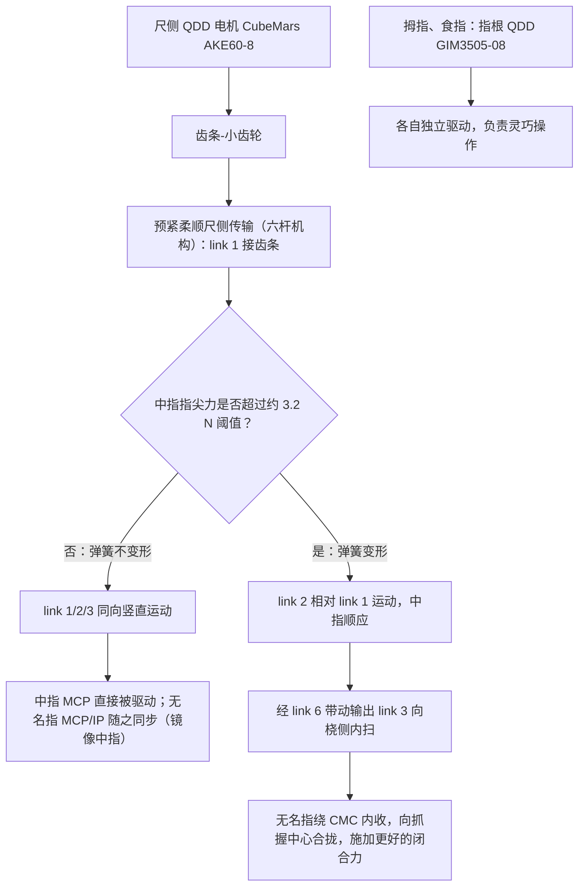

# Berkeley QUAD Hand（arXiv:2609.27240）

**Berkeley QUAD Hand**（*A Quasi-Direct-Drive Underactuated Asymmetric Hand for Dexterous and Efficient Grasping and Manipulation*，[arXiv:2609.27240](https://arxiv.org/abs/2609.27240)，[项目页](https://benudavis.github.io/berkeley-quadhand/)）来自 [具身智能小站 2026-10-18 盘点](../../sources/blogs/wechat_embodied_station_26_papers_embodiedswe_2026-10-18.md)，属「灵巧与触觉」组。

## 一句话定义

**用非对称驱动和柔顺耦合让不同手指分工，兼顾灵巧与持续握力，并控制体积与发热。**

## 英文缩写速查

| 缩写 | 英文全称 | 简要说明 |
|------|----------|----------|
| QDD | Quasi-Direct-Drive | 准直驱 |

## 为什么重要

- 灵巧与持续握力难以由同一指实现，指分工是硬件层面的折中。
- 开源结论：**项目页未列 GitHub**（步骤 2.5，2026-10-18）。项目页 HTTP 200，未见 GitHub 链接或 coming soon 字样。
- 同期同组工作见 [编程智能体造数据与 VLA 闭环评测：具身智能小站 10-18 期 26 篇阅读坐标](../overview/embodied-station-2026-10-18-26-papers-technology-map.md)。

## 流程总览

图依据：论文 §III（Fig. 2，A. Hybrid Actuation Strategy、B. Finger Transmissions）及摘要。

## 核心机制

| 项 | 内容 |
|----|------|
| **arXiv** | [2609.27240](https://arxiv.org/abs/2609.27240) |
| **开源** | **项目页未列 GitHub** |
| **要点** | 准直驱 + 欠驱动 + 非对称手指分工 + 柔顺耦合。 |
| **文内指标** | 公众号称硬件实现了 Feix 分类中 29 种抓型，分母为 33 种。 |

## 源码运行时序图

**不适用（项目页未列 GitHub）** — 项目页 HTTP 200，未见 GitHub 链接或 coming soon 字样。 不编造运行脚本；代码公开后再补。

## 实验与评测

- 公众号称硬件实现了 Feix 分类中 29 种抓型，分母为 33 种。
- **读法：** 本页为索引级摘要，依据公众号转述的官方摘要与仓库信息整理；逐项数字与 baseline 以原文 PDF 为准。

## 与其他工作对比

- 横向索引见 [编程智能体造数据与 VLA 闭环评测：具身智能小站 10-18 期 26 篇阅读坐标](../overview/embodied-station-2026-10-18-26-papers-technology-map.md)；同 arXiv 不重复造页。

## 结论

**29/33 的抓型覆盖说明该硬件范围广但并非全覆盖。**

1. 开源边界：**项目页未列 GitHub** — 项目页 HTTP 200，未见 GitHub 链接或 coming soon 字样。
2. 核心机制：准直驱 + 欠驱动 + 非对称手指分工 + 柔顺耦合。
3. 复现与选型前核对任务协议、硬件与基准口径，勿直接横比公众号摘录数字。

## 关联页面

- [dexterous-kinematics](../concepts/dexterous-kinematics.md)
- [manipulation](../tasks/manipulation.md)
- [embodied-station-2026-10-18-26-papers-technology-map](../overview/embodied-station-2026-10-18-26-papers-technology-map.md)

## 参考来源

- [berkeley_quad_hand_arxiv_2609_27240.md](../../sources/papers/berkeley_quad_hand_arxiv_2609_27240.md)
- [wechat_embodied_station_26_papers_embodiedswe_2026-10-18.md](../../sources/blogs/wechat_embodied_station_26_papers_embodiedswe_2026-10-18.md)
- [arXiv:2609.27240](https://arxiv.org/abs/2609.27240)
- [arXiv PDF](https://arxiv.org/pdf/2609.27240)：已通读方法部分（实验与附录以略读为准）：§I 引言、§III 设计、§IV 运动学分析（略读）、§V 实验评估（略读）

## 推荐继续阅读

- [arXiv PDF](https://arxiv.org/pdf/2609.27240)
- [项目页](https://benudavis.github.io/berkeley-quadhand/)
