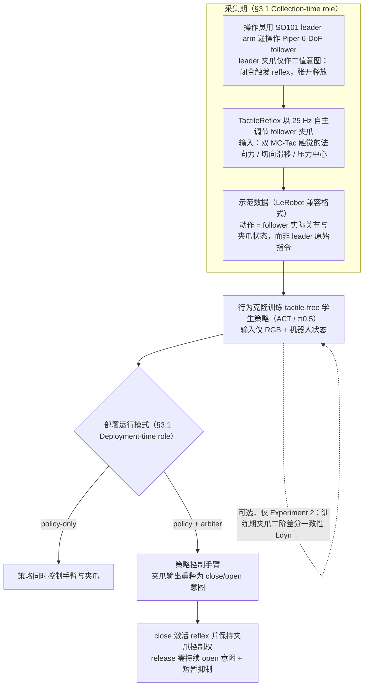

# Better Curriculum（arXiv:2609.25887）

**Better Curriculum**（*What is the Better Curriculum? Controller-Shaped Grasping Behavior for Contact Force-Sensitive Manipulation*，[arXiv:2609.25887](https://arxiv.org/abs/2609.25887)，[项目页](https://shayfeng.github.io/better-curriculum/)）来自 [具身智能小站 12 篇盘点](../../sources/blogs/wechat_embodied_station_12_papers_collab_wm_2026-09-23.md)。

## 一句话定义

**采集期 25 Hz 触觉反射教师塑形示范，学生 ACT/π0.5 推理无触觉；名义塑料杯稳定抓取（reflex 示范 vs 目视筛选人工示范）：ACT 95% vs 15%，π0.5 95% vs 5%（依据 arXiv:2609.25887 表 1、表 3）。**

## 英文缩写速查

| 缩写 | 英文全称 | 简要说明 |
|------|----------|----------|
| ACT | Action Chunking Transformer | 动作分块模仿策略 |
| CoRL | Conference on Robot Learning | 机器人学习会议 |
| GUI | Graphical User Interface | 操作员触觉监视界面 |
| Hz | Hertz | 控制/采样频率 |

## 为什么重要

- 把触觉当策略输入未必增益；触觉可在采集期当 teacher 把 force-valid 接触写进示范分布。
- 开源结论：**待发布**（步骤 2.5，2026-09-23）。
- 与 [12 篇技术地图](../overview/collab-wm-12-papers-technology-map.md) 中同类工作可横向对照。

## 流程总览

图依据：论文 §3.1–3.2（Fig. 2）

## 核心机制

| 项 | 内容 |
|----|------|
| **arXiv** | [2609.25887](https://arxiv.org/abs/2609.25887) |
| **开源** | **待发布** |
| **要点** | SO101 leader arm 遥操作 Piper follower + TactileReflex 25 Hz 触觉反射，记录 follower 实际动作（依据 §3.1，非导纳式 kinesthetic）；学生仅 RGB+状态；部署可选 re-engage arbiter。 |
| **文内指标** | 30 demo / 20 trial；扰动下 policy-only 55% vs +arbiter 100%；入库日无官方 GitHub。 |

## 源码运行时序图

**不适用**（入库日模型/训练权重未公开，或仅有 API/CLI 封装；无可运行官方训练/推理入口。）

## 实验与评测

- 30 demo / 20 trial；扰动下 policy-only 55% vs +arbiter 100%；入库日无官方 GitHub。
- **读法：** 索引级摘要；逐项对照与 baseline 以原文 PDF 为准。

## 与其他工作对比

- 横向索引见 [12 篇技术地图](../overview/collab-wm-12-papers-technology-map.md)；与同 arXiv 节点不重复造页。

## 结论

**Better Curriculum 的「curriculum」指示范分布而非分阶段训练；部署期保护仍不可省。**

1. 开源边界：**待发布** — 以项目页实际链接为准（入库日 2026-09-23）。
2. 核心机制：SO101 leader arm 遥操作 Piper follower + TactileReflex 25 Hz 触觉反射，记录 follower 实际动作（依据 §3.1，非导纳式 kinesthetic）；学生仅 RGB+状态；部署可选 re-engage arbiter。…
3. 部署前核对任务协议与硬件条件，勿直接横比公众号摘录数字。

## 关联页面

- [imitation-learning](../methods/imitation-learning.md)
- [manipulation](../tasks/manipulation.md)
- [paper-pakt](./paper-pakt.md)
- [paper-me-dex-1-0](./paper-me-dex-1-0.md)

## 参考来源

- [better-curriculum_arxiv_2609_25887.md](../../sources/papers/better-curriculum_arxiv_2609_25887.md)
- [wechat_embodied_station_12_papers_collab_wm_2026-09-23.md](../../sources/blogs/wechat_embodied_station_12_papers_collab_wm_2026-09-23.md)
- [arXiv:2609.25887](https://arxiv.org/abs/2609.25887)
- [arXiv PDF](https://arxiv.org/pdf/2609.25887)：已通读方法部分（实验与附录以略读为准）：§1 引言、§3 Method（3.1–3.3）、§4 实验设定
- 核对（2026-11-02）：对照 arXiv:2609.25887 §3.1、表 1、表 3、表 5；采集方式由「导纳式 kinesthetic」改为 SO101 leader arm 遥操作 + TactileReflex；「95% vs 5%」补明是 π0.5（ACT 为 95% vs 15%）。

## 推荐继续阅读

- [arXiv PDF](https://arxiv.org/pdf/2609.25887)
- [项目页](https://shayfeng.github.io/better-curriculum/)

