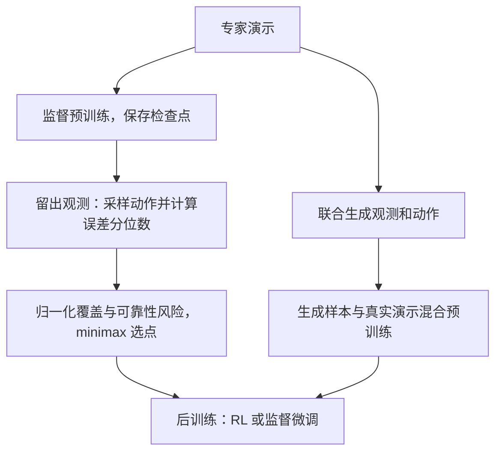

# Beyond Validation Loss：超越验证损失，理解机器人策略预训练的覆盖率与可靠性

## 一句话定义

对随机机器人策略比较固定初始条件的 pass@k，研究预训练检查点如何影响直接执行与后训练，并提出离线选点和生成式数据扩增。

## 英文缩写速查

| 缩写 | 英文全称 | 简要说明 |
|---|---|---|
| BC | Behavior Cloning | 用专家演示进行监督式策略学习 |
| RL | Reinforcement Learning | 通过交互优化策略 |
| SFT | Supervised Fine-Tuning | 用目标任务数据监督微调 |
| MSE | Mean Squared Error | 均方误差，用于比较动作块 |
| VLA | Vision-Language-Action | 视觉语言动作策略 |

## 核心信息

| 项 | 内容 |
|---|---|
| 机构 | 斯坦福大学；卡内基梅隆大学 |
| 原文 | [arXiv:2611.01565v1](https://arxiv.org/abs/2611.01565) |
| 核对状态 | 正文主要方法与实验已核对，附录尚需完整核对，本页为草稿 |
| 开源 | 截至 2026-11-03，项目页代码和模型按钮链接为空，未发现可运行实现 |

## 流程总览

## 核心机制

- 固定初始条件 $c$ 下单次成功概率为 $q(c)$，$\mathrm{pass@}k=\mathbb{E}_c[1-(1-q(c))^k]$。pass@1 是平均成功率；较大的 k 衡量可通过多次独立采样触及成功的初始条件。它是可重置仿真中的诊断，不意味着部署时需要重复尝试。
- 后期训练可能让容易条件更可靠，同时让困难条件的低概率成功行为消失；相近的 pass@1 因此可能对应不同后训练能力。large-k pass@k 并非所有检查点和所有训练预算下的全局排序。
- 对留出观测多次采样动作，逐观测计算动作 MSE 分位数再取平均；对每个分位数的对数误差跨检查点归一化，分别平均低于 0.5 与不低于 0.5 的分位数，选取两类风险最大值最小的检查点。该方法不需要闭环评测，但仍需留出专家动作与多次策略采样。
- JointAug 训练联合观测—动作生成模型，混合生成数据与真实演示进行 BC。RoboCasa 的轻量变体从所选检查点估计每个训练观测的动作协方差，随后向目标动作加入零均值噪声。

## 源码运行时序图

不适用：截至核查日，项目页 Code 按钮未给出链接，尚无法核实官方运行入口。

## 实验与评测

- 仿真：单任务 MimicGen 的 Diffusion Policy 与 65 个 RoboCasa 任务上的 π0.5；比较过滤成功轨迹的 BC、critic 排序、残差 RL 和目标任务 SFT。
- 在所评估的任务中，相近 pass@1 下保留更高大 k 覆盖的检查点支持更好的后训练；生成式扩增在多数实验中保持覆盖并维持或改善 pass@1。
- 真机 Push-T：740 条演示（680 训练、60 留出），20 个固定初始状态各运行 5 次；第 46 epoch 与第 200 epoch 的 pass@1 分别为 0.62 和 0.52，pass@5 为 0.95 和 0.75。样本规模有限，不能直接推广到所有任务。

## 结论

平均成功率和验证损失不足以完整描述可继续优化的策略。

- 需要后训练时，应保存并比较多个检查点，而非默认最后一个。
- 在可重置仿真中按相同初始条件重复采样，联合观察 pass@1 和较大 k 的 pass@k。
- 真机闭环评测昂贵时，可探索动作误差分位数离线选点，但应在目标任务验证其有效性。
- 生成扩增可能改善覆盖与可靠性的折中，计算成本和实际泛化仍需按场景评估。

## 关联页面

- [Behavior Cloning](../methods/behavior-cloning.md)
- [Diffusion Policy](../methods/diffusion-policy.md)

## 参考来源

- [论文归档](../../sources/papers/beyond_validation_loss_arxiv_2611_01565.md)
- [项目页归档](../../sources/sites/robot_policy_learning_dynamics.md)
- [论文原文 v1](https://arxiv.org/pdf/2611.01565v1)
