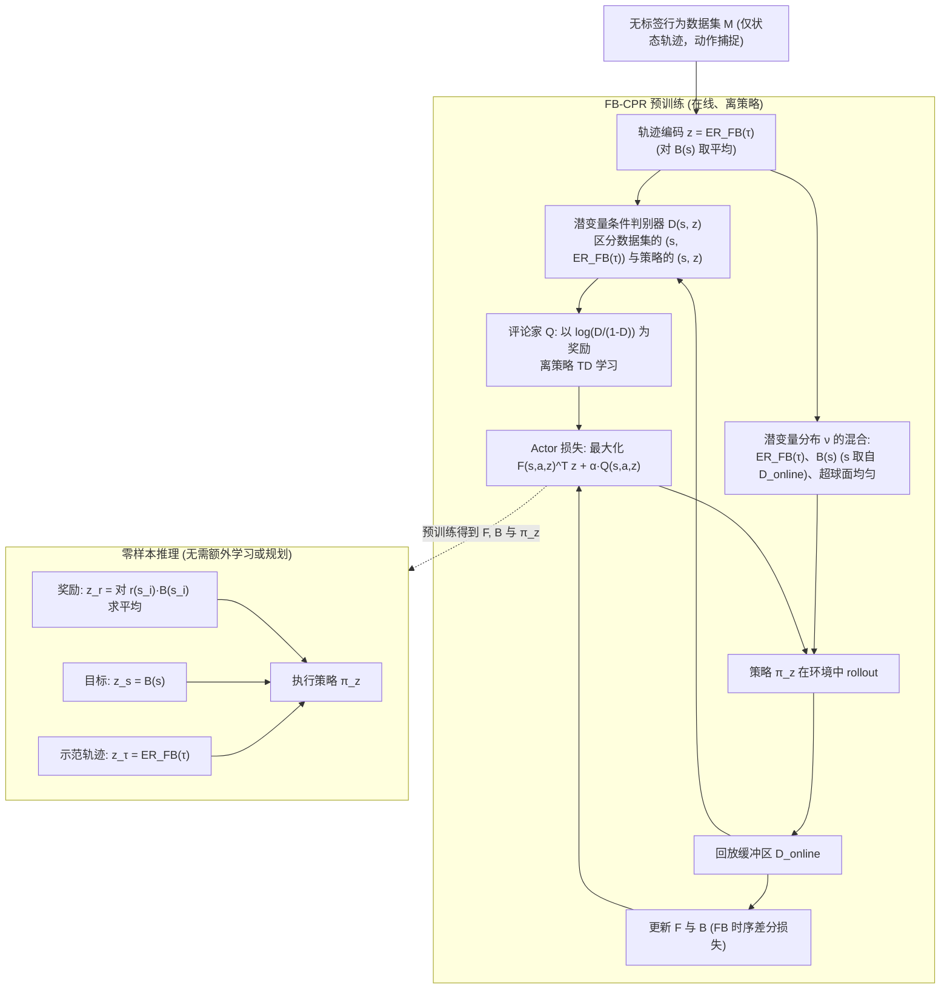

---

type: entity
tags: [paper, bfm, behavior-foundation-model, awesome-bfm-papers, meta]
status: complete
updated: 2026-06-25
arxiv: "2504.11054"
venue: "2025 · ICLR"
code: https://github.com/facebookresearch/metamotivo
summary: "与 BFM-Zero 对照：zero-shot WBC 依赖可调用行为表示，任务变时尽量在潜空间找方向而非重训。"
related:
  - ../concepts/behavior-foundation-model.md
  - ../overview/bfm-41-papers-technology-map.md
  - ../overview/bfm-category-01-forward-backward-representation.md
sources:
  - ../../sources/papers/bfm_awesome_metamotivo_arxiv_2504_11054.md
  - ../../sources/papers/bfm_awesome_41_catalog.md
  - ../../sources/blogs/wechat_embodied_ai_lab_bfm_41_papers_survey.md
---

# Zero-shot Whole-body Humanoid Control via Behavioral Foundation Models

**Zero-shot Whole-body Humanoid Control via Behavioral Foundation Models** 收录于 [awesome-bfm-papers](https://github.com/friedrichyuan/awesome-bfm-papers) **第 02/41** 篇，归类为 **01 Forward-backward 表征**（2025 · ICLR）。

## 一句话定义

与 BFM-Zero 对照：zero-shot WBC 依赖可调用行为表示，任务变时尽量在潜空间找方向而非重训。

## 英文缩写速查

| 缩写 | 英文全称 | 简要说明 |
|------|----------|----------|
| BFM | Behavior Foundation Model | 大规模行为数据预训练的可复用全身行为先验 |
| WBC | Whole-Body Control | 协调全身关节满足多任务/约束的控制基础设施 |
| AMP | Adversarial Motion Prior | 用对抗判别约束状态转移接近专家运动分布的先验 |

## 为什么重要

- 与 BFM-Zero 对照：zero-shot WBC 依赖可调用行为表示，任务变时尽量在潜空间找方向而非重训。
- 在 [BFM 41 篇技术地图](../overview/bfm-41-papers-technology-map.md) 中属于 **01 Forward-backward 表征**（#02/41）。

## 流程总览

图依据：论文 §2–§3 / Fig.2（FB-CPR 的 Eq.5–11 与零样本推理）；humanoid 实验设置不在图内。

## 核心信息

| 字段 | 内容 |
|------|------|
| 编号 | 02/41 |
| 分组 | 01 Forward-backward 表征 |
| 出处 | 2025 · ICLR |
| 论文 | <https://arxiv.org/abs/2504.11054> |
- **代码/项目：** <https://github.com/facebookresearch/metamotivo>

## 核心机制（归纳）

### 1）策展导读要点

在无监督或多任务 RL 中学习 **forward-backward（FB）** 或 successor 结构，把异构任务压进可调用的身体潜空间。

### 2）策展导读要点

上层通过 **目标姿态、奖励向量或 latent prompt** 在潜空间中检索/组合行为，而非为每个技能单独训练策略。

### 3）策展导读要点

与单技能 motion tracking 对照：BFM 关心 **覆盖面与可组合性**，不只单一参考跟踪成功率。

## 结论

**这条目的价值在于把 zero-shot 全身控制的胜负手定位在「行为表示能否被调用」：任务变了就在潜空间里找方向，而不是再训一条策略。**

- 起作用的机制是 **forward-backward / successor 结构** 把异构任务压进可调用的身体潜空间，上层用 **目标姿态、奖励向量或 latent prompt** 检索与组合行为。
- 评价口径与单技能 motion tracking 不同：看 **覆盖面与可组合性**，而非单一参考的跟踪成功率；常见误读是把它当「更大的动作数据集」。
- 边界：本页是 **#02/41 清单索引策展编译**，量化 benchmark、消融与实机指标须回原文 PDF / 项目页；工程侧有官方开源实现（facebookresearch/metamotivo）可直接上手。

## 常见误区

1. BFM-Zero 类工作不是「更大动作数据集」本身，而是 **潜空间可被 prompt 检索** 的身体接口。

## 实验与评测

- 本页在公众号/survey **策展编译**基础上补充机制归纳；**量化 benchmark、消融与实机指标以原文 PDF / 项目页为准**（链接见 [参考来源](#参考来源)）。
- 与同栈姊妹篇对照时，请回到对应 **技术地图 / 42 篇栈 / BFM 地图 / VLN 地图** 总览中的实验段落。

## 与其他页面的关系

- 技术地图：[bfm-41-papers-technology-map.md](../overview/bfm-41-papers-technology-map.md)
- BFM 概念：[behavior-foundation-model.md](../concepts/behavior-foundation-model.md)
- 原始 source：[bfm_awesome_metamotivo_arxiv_2504_11054.md](../../sources/papers/bfm_awesome_metamotivo_arxiv_2504_11054.md)

## 参考来源

- [bfm_awesome_metamotivo_arxiv_2504_11054.md](../../sources/papers/bfm_awesome_metamotivo_arxiv_2504_11054.md) — awesome-bfm 策展摘录
- [bfm_awesome_41_catalog.md](../../sources/papers/bfm_awesome_41_catalog.md) — 41+10 总表
- [wechat_embodied_ai_lab_bfm_41_papers_survey.md](../../sources/blogs/wechat_embodied_ai_lab_bfm_41_papers_survey.md) — 微信公众号编译导读
- 论文：<https://arxiv.org/abs/2504.11054>
- [arXiv PDF](https://arxiv.org/pdf/2504.11054)：已通读方法部分（实验与附录以略读为准）：§2 预备知识、§3 FB-CPR 方法（含 Fig.2）；§4 humanoid 实验与附录略读

## 推荐继续阅读

- [awesome-bfm-papers](https://github.com/friedrichyuan/awesome-bfm-papers) — 完整列表与数据集表
- [A Survey of Behavior Foundation Model](https://arxiv.org/abs/2506.20487) — TPAMI 2025 综述
