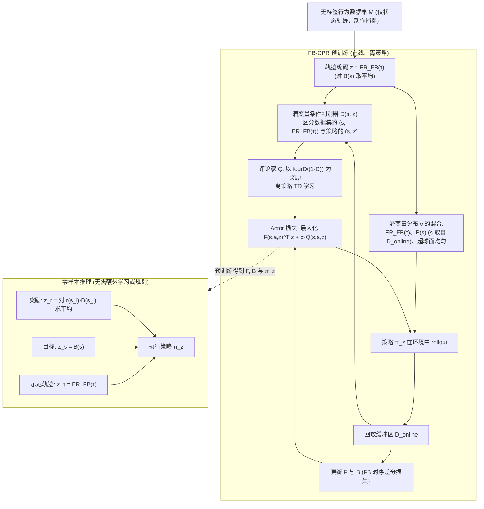
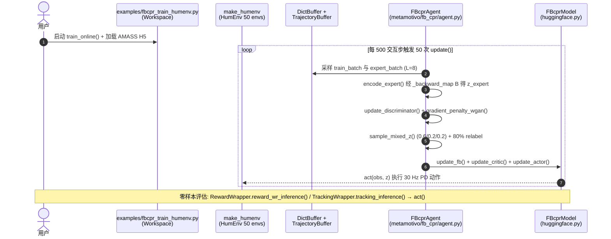

---

type: entity
tags: [paper, bfm, behavior-foundation-model, awesome-bfm-papers, meta]
status: complete
updated: 2026-11-21
arxiv: "2504.11054"
venue: "2025 · ICLR"
code: https://github.com/facebookresearch/metamotivo
summary: "Meta Motivo（ICLR 2025，arXiv:2504.11054，Meta FAIR）：提出 FB-CPR（Forward-Backward 表示 + 条件策略分布匹配正则），在无动作标签 AMASS 动作捕捉上在线无监督预训，单个 24.5M–288M 模型零样本求解 45 项奖励优化、50 项姿态到达与全库动作跟踪。"
related:
  - ../concepts/behavior-foundation-model.md
  - ../overview/bfm-41-papers-technology-map.md
  - ../overview/bfm-category-01-forward-backward-representation.md
  - ./paper-bfm-zero.md
  - ../methods/reinforcement-learning.md
  - ../methods/hierarchical-reinforcement-learning.md
sources:
  - ../../sources/papers/bfm_awesome_metamotivo_arxiv_2504_11054.md
  - ../../sources/repos/metamotivo.md
  - ../../sources/papers/bfm_awesome_41_catalog.md
  - ../../sources/blogs/wechat_embodied_ai_lab_bfm_41_papers_survey.md
original:
  - ../../sources/papers/bfm_awesome_metamotivo_arxiv_2504_11054.md
  - ../../sources/repos/metamotivo.md
---

# Meta Motivo（Zero-shot Whole-body Humanoid Control via BFMs）

**Meta Motivo**（*Zero-shot Whole-body Humanoid Control via Behavioral Foundation Models*，[arXiv:2504.11054](https://arxiv.org/abs/2504.11054)，ICLR 2025，[awesome-bfm-papers #02/41](https://github.com/friedrichyuan/awesome-bfm-papers)）由 **Meta FAIR** 提出：构建首个可用于无监督全身体控的 **Behavioral Foundation Model（BFM）**。作者提出 **FB-CPR（Forward-Backward Representations with Conditional Policy Regularization）**，让智能体在无任务奖励条件下与仿真环境在线交互，并利用无动作标签的 AMASS 轨迹通过 **隐变量条件判别器** 对行为流形做正则化，训练出的模型可在 **不重训、不微调、不做在线规划** 的前提下，直接通过潜变量推断零样本求解奖励优化、目标到达与全身动作跟踪。

## 一句话定义

**通过将 Forward-Backward（FB）零样本无监督后继测度分解与「用 $B(s)$ 嵌入无标签 AMASS 轨迹的条件判别器正则（CPR）」统一在同一超球面潜空间中，单个离线–在线交互预训出的 Meta Motivo 即可零样本执行任意奖励、姿态到达与全身模仿。**

## 英文缩写速查

| 缩写 | 英文全称 | 简要说明 |
|------|----------|----------|
| FB | Forward-Backward Representation | 后继测度低秩分解：$M^{\pi_z}(s'\mid s,a)\approx F(s,a,z)^\top B(s')$ |
| FB-CPR | Forward-Backward with Conditional Policy Regularization | 本文核心算法：在 FB 演员目标上叠加条件分布匹配评论家 $Q(s,a,z)$ |
| $\mathrm{ER}_{\mathrm{FB}}$ | Empirical Reward via FB | 片段平均后端映射编码器 $\frac{1}{L}\sum B(s_t)$，免额外轨迹编码网络 |
| WGAN-GP | Wasserstein GAN Gradient Penalty | 本文用于稳定条件判别器 $D(s,z)$ 训练的梯度惩罚（$\lambda_{\text{GP}}=10$） |
| EMD | Earth Mover's Distance | 对微小时序错位更宽容的轨迹距离指标 |
| BFM | Behavior Foundation Model | 大规模行为先验与多任务零样本身体基础控制器 |

## 为什么重要

- **打通无监督 RL 在高维人形上的坍塌瓶颈：** 纯无监督 FB（如线上 FB）在 69-DoF SMPL 空间几乎零收益（Reward 24.47 / Goal 0% / Tracking 0%），而 METRA 无诱导偏置时仅学「不同姿态倒地静止」；引入无动作标签 AMASS 正则把策略锚定到人类行为流形上。
- **跨三类异构接口同一潜空间：** $z\in \mathbb{R}^{256}$ 超球面既索引策略 $\pi_z$，也承载 $z_r = \mathbb{E}[\exp(10r)B(s)r(s)]$、$z_g = B(g)$ 与 $z_t \propto \sum B(s)$，甚至可直接线性插值 $z_\alpha = \alpha z_1 + (1-\alpha)z_2$ 组合新行为。
- **人类偏置自动正则欠定奖励：** 在 50 名人类评审盲评中，尽管单任务 TD3 奖励分数更高，FB-CPR 在奖励/目标任务上分别有 **83.5%** 与 **69.1%** 被认为显著更「像人」（组合任务上更达 **97.8%**），摆脱不自然 reward hacking。

## 流程总览

图依据：论文 §2–§3 / Fig.2（FB-CPR 的 Eq.5–11 与零样本推理）；humanoid 实验设置不在图内。

## 核心信息

| 字段 | 内容 |
|------|------|
| 编号 / 分组 | #02/41，01 Forward-backward 表征（ICLR 2025） |
| 本体与仿真 | MuJoCo SMPL（24 刚体 / **23 驱动自由度**，358D 本地归一化本体状态，69D PD 目标）；物理 **450 Hz** / 控制 **30 Hz** |
| 训练语料 | 无动作标签 AMASS 子集：**8,902 条训练（29h6m59s）** / **990 条测试（3h7m15s）** |
| 训练预算 | 在线 **30M 环境步**（50 并行环境，buffer 5M，mini-batch 1024，3M 梯度步），每 1M 步按 EMD 分箱更新动作优先权重 |
| 模型规模 | 基础版 **24.5M**（`metamotivo-S-1..5`）；缩放深残差版 **288M**（`metamotivo-M-1`，12 残差块 × 2048，Mish + LayerNorm） |
| 官方代码 | [facebookresearch/metamotivo](https://github.com/facebookresearch/metamotivo) · 环境 [HumEnv](https://github.com/facebookresearch/humenv) · CC BY-NC 4.0 |

## 核心机制

### 1）FB 后继测度低秩分解 + $B(s)$ 统一编码

- 对策略 $\pi_z$ 的折扣状态占据 $M^{\pi_z}(X\mid s,a)\approx \int_X F(s,a,z)^\top B(s')\rho(ds')$ 最小化 Bellman 残差损失 $\mathcal{L}_{\mathrm{FB}}$，配合正交正则（系数 $\lambda=100$）防止 $B$ 坍塌，以及 $F z$ 时序差分辅助项（$\beta=0.1$）。
- **核心设计：** 不像 CALM 另外训独立 Transformer 轨迹编码器，FB-CPR 直接复用后继测度后端嵌入 $\mathrm{ER}_{\mathrm{FB}}(\tau)=\frac{1}{L}\sum_{t=1}^L B(s_t)$ 将无标签 8 步动作片段投射至与策略同空间的半径 $\sqrt{d}$ 超球面（$d=256$）。

### 2）潜条件判别器与评论家（KL 分布匹配）

- 最小化策略联合分布 $p_\pi(s,z)$ 与数据诱导联合分布 $p_\mathcal{M}(s,z)$ 的 KL 散度，转为强化学习期望回报形式：判别器 $D(s,z)$ 在 WGAN-GP（$\lambda_{\mathrm{GP}}=10$）约束下区分真片段 $(s,\mathrm{ER}_{\mathrm{FB}}(\tau))$ 与策略 rollout $(s,z)$；评论家 $Q(s,a,z)$ 用离线 TD 拟合对数几率奖励 $\log\frac{D}{1-D}$。
- 策略优化联合最大化两项：$\mathcal{L}_{\mathrm{FB\text{-}CPR}}(\pi) = -\mathbb{E}[F(s,a,z)^\top z + \alpha\,Q(s,a,z)]$（默认 $\alpha=0.01$）。

### 3）三成分混合潜采样 $\nu$ 与 80% 事后重标

- 训练和 rollout 的潜分布 $\nu$ 混合：**60%** 无标签片段编码 $\mathrm{ER}_{\mathrm{FB}}(\tau)$、**20%** 在线 buffer 目标 $B(s)$、**20%** 超球面均匀采样（`update_z_every_step = 150`，重标概率 $0.8$）。

## 源码运行时序图

节点对齐 [`facebookresearch/metamotivo`](https://github.com/facebookresearch/metamotivo)（[sources/repos/metamotivo.md](../../sources/repos/metamotivo.md)）真实入口：`examples/fbcpr_train_humenv.py` 经 `Workspace` 驱动 `HumEnv` 与 `FBcprAgent`，推理通过 `FBcprModel.from_pretrained` 与 `RewardWrapper` / `TrackingWrapper` 执行：

## 工程实践

| 项 | 建议与源码配置（论文 附录 C–D & `fbcpr_train_humenv.py`） |
|----|----------------------------------------------------------|
| 判别器稳定 | 必须开启 WGAN-GP（$\lambda_{\mathrm{GP}}=10$）；相比简化 GP 在奖励和跟踪消融上明显更稳 |
| 正交系数与 $d$ | $d=256$ + `ortho_coef=100` 为稳定性拐点；$d=32/64$ 学不会复杂杂技，$d=512$ 在小 batch 1024 下易使 $B$ 坍塌 |
| 混合比例 $\nu$ | 纯轨迹编码 `1.0 ER_FB` 反而伤泛化，纯均匀采样失先验；需维持 `60% 轨迹 / 20% 目标 / 20% 均匀` |
| 在线 vs 离线 | 等量 30M 离线训练（FB-AW）明显劣于在线 FB-CPR；在线策略交互是探索高维流形的关键 |
| 推理与缩放 | 奖励推断 `reward_wr_inference` 用 $\exp(10r)$ 加权 100k buffer 样本（耗时约 7s 标重 + 3s 推断 + 2s rollout，对比 Oracle MPPI 30 分钟）；追求更高上限可换用 `facebook/metamotivo-M-1`（288M，启用 `compile=True`） |

## 实验与评测

**基准对比（Table 1 + 缩放模型 288M，HumEnv 45 奖励 / 50 目标 / AMASS 全库跟踪）：**

| 方法 | 类型 | 奖励回报 ↑ (`SCOREnorm`) | 目标 Proximity / Succ ↑ | 跟踪 Test EMD ↓ / Succ ↑ |
|------|------|--------------------------|------------------------|--------------------------|
| 单任务 TD3† / PHC† / MPPI† | 单任务专项 / 规划 | 249.74（TD3）/ 178.50（Oracle MPPI） | 0.98 / 0.98（TD3） | 1.14 / 0.94（PHC†） |
| Goal-TD3 | 多任务目标强化 | — | 0.67 / 0.44 | 1.41 / **0.91** |
| ASE（off-policy 复现） | 零样本 / 对抗 | 105.73 | 0.46 / 0.22 | 1.99 / 0.40 |
| Diffuser（offline 32 步规划） | 扩散规划 | 85.27（单幕 5h） | 0.20 / 0.14 | — |
| **FB-CPR（基础 24.5M）** | 零样本 BFM | **151.68** (`0.61`) | **0.68** / **0.48** | **1.39** / 0.83 |
| **FB-CPR（缩放 288M `M-1`）** | 零样本 BFM | **179.94** (`0.72`) | **0.82** / **0.66** | **1.13** / **0.84** |

- **人工评估（50 人盲评）：** Reward 与 Goal 上 FB-CPR 被评比 TD3 更自然的比例为 **83.5%** 与 **69.1%**；在「移动+举手」组合任务上更达 **97.8%**。
- **行为插值与欠定激励：** 对手写简陋方程如 `RUN_eq`（仅速度阈值）、`WALK-LAM_eq` 与 `STAND-RTM/H_eq`，可零样本直接抽出自然跑步、高抬右腿等行为。
- **与 BFM-Zero（arXiv:2511.04131）及 DIAYN / METRA 的消融：** 纯线上 FB（Reward 24.47 / Goal 0）与纯 METRA（Reward 6.37 / Goal 0）在该 SMPL 人形环境均近乎零分；METRA-ASE 仍显著落后于 FB-CPR。

## 结论

**Meta Motivo 确立了「无监督 RL + 无标签行为分布匹配」的 BFM 技术路线：用同一个超球面特征 $B(s)$ 兼作状态嵌入、轨迹编码与策略条件向量，使得不重训的零样本控制在 23-DoF 人形上达到通用多任务基线甚至逼近单任务专项表现。**

1. **真价值是零样本通用性与自然度，而非打败单任务最优化均值：** 单任务 TD3 仍拿到更高标量奖励，但代价是奇异姿态与逐任务重训；FB-CPR 基础版即达 top-liner 平均 **73.4%**，288M 缩放版目标/跟踪能力再跨级跃升。
2. **动作免标签（Action-free）的现实意义：** 附录 D.2 证明哪怕人工补充了动作标签再用行为克隆正则，效果仍不如状态–潜变量条件判别器；这使得模型可直接利用纯动捕乃至未来的视频提取轨迹。
3. **离线 FB 无法直接替代在线诱导：** 同规模 30M 过渡数据的离线 FB-AW 严重落后于在线 FB-CPR，证明高维物理控制仍需边学边探索。
4. **选型定位：** `metamotivo` 是纯本体仿真角色标杆；若需 **Unitree G1 真机部署与稀疏指令适配**，见同族后续工作 [BFM-Zero](./paper-bfm-zero.md)（FB-CPR-Aux）。

## 局限与风险

- **极远行为分布失效：** 在手倒立（`handstand` 归一化回报仅 0.16）、躺姿切换、趴地与快速侧爬等远离 AMASS 主体直立动作的奖励/目标上明显掉队。
- **纯本体观测无环境感知：** 不含高度图或视觉输入，不能直接完成避障导航或灵巧物体操作（需另接入感知/高层规划，如 P-BFM 系列）。
- **无真机 Sim2Real 验证：** 论文与仓库实验限定在 30 Hz 无延迟 MuJoCo SMPL 仿真（非商用 CC BY-NC 4.0）；后续由 [BFM-Zero](./paper-bfm-zero.md) 推进到真机 Unitree G1。
- **依赖 MoCap 数据源：** 当前仍依赖动捕数据而非互联网直接视频，且非商用许可限制商业产品集成。

## 关联页面

- 技术地图：[bfm-41-papers-technology-map.md](../overview/bfm-41-papers-technology-map.md)
- BFM 概念：[behavior-foundation-model.md](../concepts/behavior-foundation-model.md)
- 真机续作：[paper-bfm-zero.md](./paper-bfm-zero.md) — 将 FB-CPR 拓展至辅助目标、抗扰与 Unitree G1 真机部署
- 无标签技能发现对比：[paper-bfm-30-diayn.md](./paper-bfm-30-diayn.md) — DIAYN / METRA 无先验数据在高维人形失效对照
- 原始 source：[bfm_awesome_metamotivo_arxiv_2504_11054.md](../../sources/papers/bfm_awesome_metamotivo_arxiv_2504_11054.md) · [metamotivo.md](../../sources/repos/metamotivo.md)
- [Reinforcement Learning (RL, 强化学习)](../methods/reinforcement-learning.md) — 行为表征来自无监督或多任务交互学习，调用 latent 与重新训练策略是不同步骤。
- [Hierarchical Reinforcement Learning（分层强化学习，HRL）](../methods/hierarchical-reinforcement-learning.md) — 将上层任务到身体 latent 的接口作为分层控制背景，不把所有 latent 调用都称为重新学习。

## 参考来源

- [bfm_awesome_metamotivo_arxiv_2504_11054.md](../../sources/papers/bfm_awesome_metamotivo_arxiv_2504_11054.md) — arXiv:2504.11054v1 全文精读摘录
- [metamotivo.md](../../sources/repos/metamotivo.md) — `facebookresearch/metamotivo` 官方仓库与训练/推理入口核查
- [bfm_awesome_41_catalog.md](../../sources/papers/bfm_awesome_41_catalog.md) — 41+10 总表
- [wechat_embodied_ai_lab_bfm_41_papers_survey.md](../../sources/blogs/wechat_embodied_ai_lab_bfm_41_papers_survey.md) — 微信公众号编译导读
- 论文：<https://arxiv.org/abs/2504.11054>

## 推荐继续阅读

- [Meta Motivo 官方项目页与交互 Demo](https://metamotivo.metademolab.com/)
- [awesome-bfm-papers](https://github.com/friedrichyuan/awesome-bfm-papers) — 完整列表与数据集表
- [BFM-Zero（arXiv:2511.04131）](./paper-bfm-zero.md) — 同类 FB 表征走向真机控制对比
