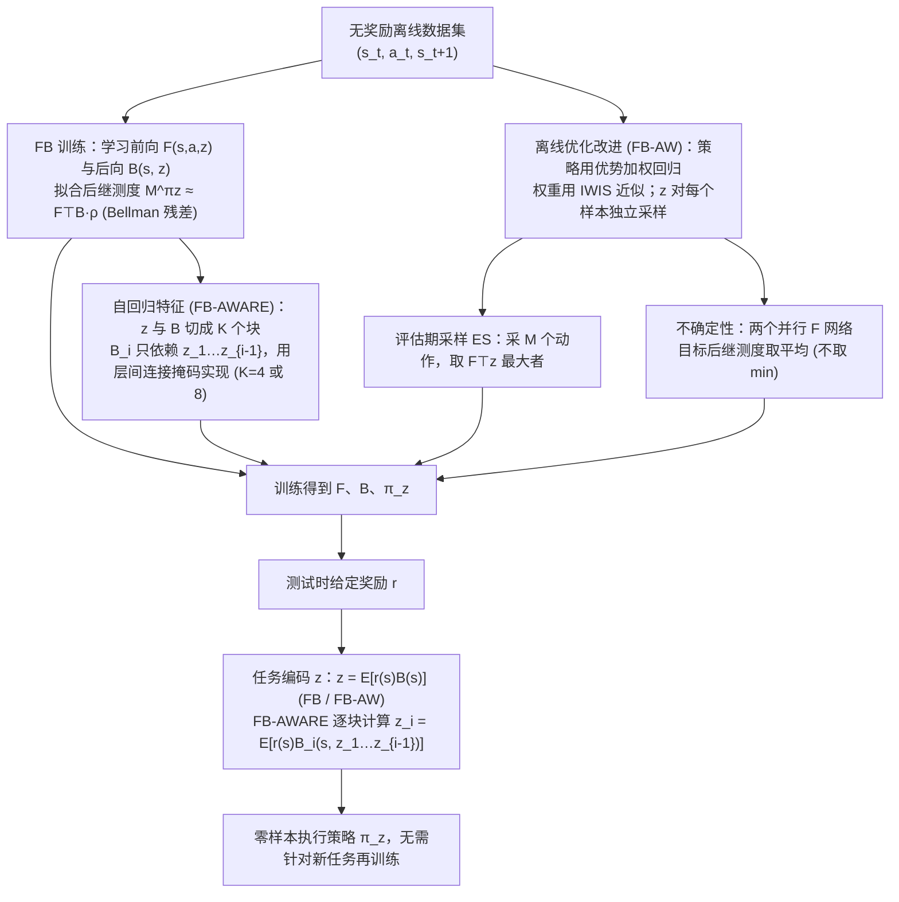

---

type: entity
tags: [paper, bfm, behavior-foundation-model, awesome-bfm-papers, meta]
status: complete
updated: 2026-06-25
arxiv: "2412.04368"
venue: "2024 · arXiv"
summary: "潜空间要「细」才可被上层精确调用；FB-AW / FB-AWARE 在连续控制 benchmark 上优于粗表征。"
related:
  - ../concepts/behavior-foundation-model.md
  - ../overview/bfm-41-papers-technology-map.md
  - ../overview/bfm-category-01-forward-backward-representation.md
sources:
  - ../../sources/papers/bfm_awesome_fb_aw_arxiv_2412_04368.md
  - ../../sources/papers/bfm_awesome_41_catalog.md
  - ../../sources/blogs/wechat_embodied_ai_lab_bfm_41_papers_survey.md
---

# Finer Behavioral Foundation Models via Auto-regressive Features and Advantage Weighting

**Finer Behavioral Foundation Models via Auto-regressive Features and Advantage Weighting** 收录于 [awesome-bfm-papers](https://github.com/friedrichyuan/awesome-bfm-papers) **第 03/41** 篇，归类为 **01 Forward-backward 表征**（2024 · arXiv）。

## 一句话定义

潜空间要「细」才可被上层精确调用；FB-AW / FB-AWARE 在连续控制 benchmark 上优于粗表征。

## 英文缩写速查

| 缩写 | 英文全称 | 简要说明 |
|------|----------|----------|
| BFM | Behavior Foundation Model | 大规模行为数据预训练的可复用全身行为先验 |
| AMP | Adversarial Motion Prior | 用对抗判别约束状态转移接近专家运动分布的先验 |

## 为什么重要

- 潜空间要「细」才可被上层精确调用；FB-AW / FB-AWARE 在连续控制 benchmark 上优于粗表征。
- 在 [BFM 41 篇技术地图](../overview/bfm-41-papers-technology-map.md) 中属于 **01 Forward-backward 表征**（#03/41）。

## 流程总览

图依据：论文 §2 预备（FB 框架 Eq.1-4）、§3.1 自回归特征 / Fig.1、§3.2 优势加权与其他离线改进（Eq.7-9）

## 核心信息

| 字段 | 内容 |
|------|------|
| 编号 | 03/41 |
| 分组 | 01 Forward-backward 表征 |
| 出处 | 2024 · arXiv |
| 论文 | <https://arxiv.org/abs/2412.04368> |

## 核心机制（归纳）

### 1）策展导读要点

在无监督或多任务 RL 中学习 **forward-backward（FB）** 或 successor 结构，把异构任务压进可调用的身体潜空间。

### 2）策展导读要点

上层通过 **目标姿态、奖励向量或 latent prompt** 在潜空间中检索/组合行为，而非为每个技能单独训练策略。

### 3）策展导读要点

与单技能 motion tracking 对照：BFM 关心 **覆盖面与可组合性**，不只单一参考跟踪成功率。

## 结论

**FB-AW 的主张是 BFM 的瓶颈在潜空间的「粒度」：只有足够细的 forward-backward 表征，上层才能精确调用身体；粗表征限制的不是覆盖面而是可控性。**

- 起作用的是 FB / successor 结构把异构任务压进同一身体潜空间，上层用 **目标姿态、奖励向量或 latent prompt** 检索与组合行为，而不是为每个技能单独训策略。
- 评价维度与单技能 motion tracking 不同：BFM 关心 **覆盖面与可组合性**，用「单条参考跟得多准」去衡量它会得出错误结论。
- 本页是清单坐标（awesome-bfm #03/41，**01 Forward-backward 表征**，2024 · arXiv）；连续控制 benchmark 的具体数值、消融与实机指标需回原文 PDF 与 [BFM 41 篇技术地图](../overview/bfm-41-papers-technology-map.md) 的实验段落。

## 常见误区

1. BFM-Zero 类工作不是「更大动作数据集」本身，而是 **潜空间可被 prompt 检索** 的身体接口。

## 实验与评测

- 本页在公众号/survey **策展编译**基础上补充机制归纳；**量化 benchmark、消融与实机指标以原文 PDF / 项目页为准**（链接见 [参考来源](#参考来源)）。
- 与同栈姊妹篇对照时，请回到对应 **技术地图 / 42 篇栈 / BFM 地图 / VLN 地图** 总览中的实验段落。

## 与其他页面的关系

- 技术地图：[bfm-41-papers-technology-map.md](../overview/bfm-41-papers-technology-map.md)
- BFM 概念：[behavior-foundation-model.md](../concepts/behavior-foundation-model.md)
- 原始 source：[bfm_awesome_fb_aw_arxiv_2412_04368.md](../../sources/papers/bfm_awesome_fb_aw_arxiv_2412_04368.md)

## 参考来源

- [bfm_awesome_fb_aw_arxiv_2412_04368.md](../../sources/papers/bfm_awesome_fb_aw_arxiv_2412_04368.md) — awesome-bfm 策展摘录
- [bfm_awesome_41_catalog.md](../../sources/papers/bfm_awesome_41_catalog.md) — 41+10 总表
- [wechat_embodied_ai_lab_bfm_41_papers_survey.md](../../sources/blogs/wechat_embodied_ai_lab_bfm_41_papers_survey.md) — 微信公众号编译导读
- 论文：<https://arxiv.org/abs/2412.04368>
- [arXiv PDF](https://arxiv.org/pdf/2412.04368)：已通读方法部分（实验与附录以略读为准）：摘要、§2 预备、§3 方法（3.1 自回归特征、3.2 优势加权/评估期采样/不确定性表示）

## 推荐继续阅读

- [awesome-bfm-papers](https://github.com/friedrichyuan/awesome-bfm-papers) — 完整列表与数据集表
- [A Survey of Behavior Foundation Model](https://arxiv.org/abs/2506.20487) — TPAMI 2025 综述
