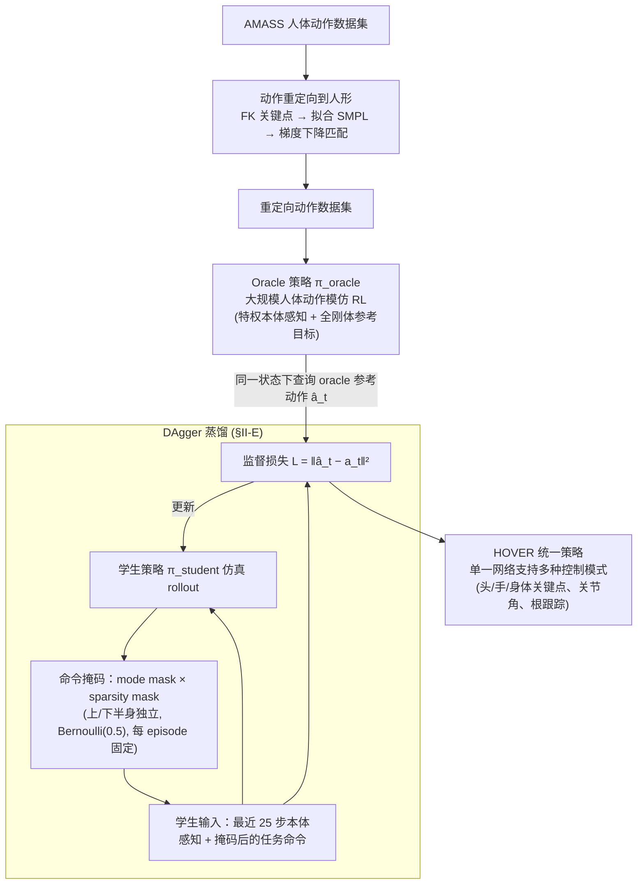
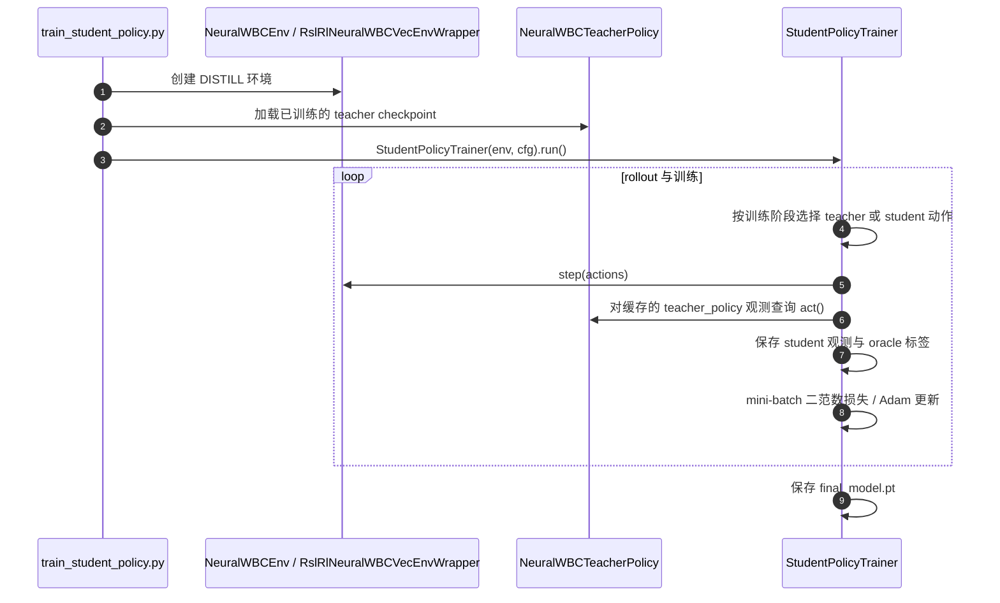

---

type: entity
tags: [paper, bfm, behavior-foundation-model, awesome-bfm-papers, nvidia]
status: complete
updated: 2026-11-21
arxiv: "2410.21229"
venue: "2025 · ICRA"
code: https://github.com/NVlabs/HOVER/
summary: "统一头/手/身体/根目标的神经全身接口，供上层规划器调用。"
related:
  - ../concepts/behavior-foundation-model.md
  - ../overview/bfm-41-papers-technology-map.md
  - ../overview/bfm-category-02-goal-conditioned-learning.md
  - ../concepts/whole-body-control.md
original:
  - ../../sources/papers/bfm_awesome_hover_arxiv_2410_21229.md
sources:
  - ../../sources/papers/bfm_awesome_hover_arxiv_2410_21229.md
  - ../../sources/papers/bfm_awesome_41_catalog.md
  - ../../sources/blogs/wechat_embodied_ai_lab_bfm_41_papers_survey.md
---

# HOVER

**HOVER** 收录于 [awesome-bfm-papers](https://github.com/friedrichyuan/awesome-bfm-papers) **第 14/41** 篇，归类为 **02 Goal-conditioned 学习**（2025 · ICRA）。

## 一句话定义

统一头/手/身体/根目标的神经全身接口，供上层规划器调用。

## 英文缩写速查

| 缩写 | 英文全称 | 简要说明 |
|------|----------|----------|
| BFM | Behavior Foundation Model | 大规模行为数据预训练的可复用全身行为先验 |
| PPO | Proximal Policy Optimization | Oracle 强化学习训练 |
| DAgger | Dataset Aggregation | 学生 rollout 状态上的教师监督 |
| WBC | Whole-Body Control | 全身控制 |

## 为什么重要

- 统一头/手/身体/根目标的神经全身接口，供上层规划器调用。
- 在 [BFM 41 篇技术地图](../overview/bfm-41-papers-technology-map.md) 中属于 **02 Goal-conditioned 学习**（#14/41）。

## 流程总览

图依据：论文 §II-C 动作重定向、§II-D Oracle 训练、§II-E 蒸馏（Fig. 2 HOVER distillation process）。

## 核心信息

| 字段 | 内容 |
|------|------|
| 编号 | 14/41 |
| 分组 | 02 Goal-conditioned 学习 |
| 出处 | 2025 · ICRA |
| 论文 | <https://arxiv.org/abs/2410.21229> |
- **代码/项目：** <https://github.com/NVlabs/HOVER/>

## 核心机制（归纳）

Oracle 在完整刚体目标与特权状态下用 PPO 学习 AMASS 重定向运动；学生使用最近 25 步本体观测和动作历史，以及上/下身独立的 mode 与 sparsity mask。每个 episode 按 Bernoulli(0.5) 采样并固定命令掩码；DAgger 在学生访问的状态上重新查询 oracle 动作，训练一个可切换控制模式的策略。

## 工程实践

官方当前仓是 **Isaac Lab 2.0 移植**，与原文 Isaac Gym 实验环境分开。先准备 AMASS、SMPL、H1 重定向数据，再通过 `scripts/rsl_rl/train_teacher_policy.py` 训练 teacher，最后将 checkpoint 传入 `train_student_policy.py`。仓内不提供 teacher 或示例 `stable_punch.pkl`；默认配置仅 OmniH2O specialist，generalist 需启用 `DISTILL_MASK_MODES_ALL`。当前 README 推荐关闭 sparsity randomization，避免命令歧义。部署 wrapper 只支持 H1。

## 源码运行时序图

依据本次核查的 Isaac Lab 移植入口，不用旧 Gym 论文图冒充源码。

实现使用动作向量二范数均值，论文写平方 L2；复现时要保留这一版本差异。源码核对不代表已运行训练。

## 实验与评测

- 仿真：与 multi-mode RL 相比，在八模式的 32 个指标上全部更优；与各 specialist 相比，每模式至少 7/12 指标更优（论文 Table III、Fig. 4）。
- 真机：19-DoF Unitree H1、20 段站立动作、5 次测试，11/12 指标优于 specialist（Table V）；不能把这些跟踪指标当作任意操作任务成功率。
- 论文演示行走中切模式与 VR 遥操作，但自动模式切换模块仍属未来工作。

## 结论

**HOVER 在 BFM 图谱里的位置是「接口」：把头、手、身体、根等异构目标收敛成一个神经全身控制入口，供上层规划器调用。**

- 关键取舍是 **goal / reference / command 条件化**——一套策略覆盖多种目标条件技能，而不是每类目标各训一个控制器。
- 边界写得很直白：goal-conditioned 跟踪 **不等于 unlimited skills**，仍受数据分布、接触建模与实机 Sim2Real 约束。
- 工程可及性较好（代码 <https://github.com/NVlabs/HOVER/>），需单独准备授权动作数据、teacher 与命令掩码配置。

## 与其他工作对比

- **对比单模式全身控制 Specialist：** 论文 §III-A 将 HOVER 固定到不同掩码模式，分别对齐 [ExBody](./paper-exbody-expressive-humanoid.md)（上身关节 + 根速度）、[HumanPlus](./paper-loco-manip-161-012-humanplus.md)（全身关节 + 根速度）、H2O（8 关键点位置）与 [OmniH2O](./paper-hrl-stack-08-omnih2o.md)（头/双手关键点）四类模式并重训各自 RL specialist（Table III），外加左/右/双手与头部跟踪四组模式（Table IV）。单一通用策略 HOVER 在各先验模式下至少 **7/12** 项指标优于专门训练的 specialist，真机 Unitree H1 上也有 **11/12** 项优于 specialist（Table V），说明 Oracle 蒸馏在单模式跟踪上同样超越从零 RL。
- **对比多模式从头 RL 训练（Multi-mode RL）：** 论文 §III-B 对照了使用完全相同 mode/sparsity 掩码流程但直接从零用 PPO 训练的多模式基线；HOVER 在全部 8 种模式共 **32 项**评估指标上全面胜出，表明两阶段「全信息 Oracle → DAgger 掩码蒸馏」显著降低了多接口联合学习的优化难度。
- **在 BFM 与遥操作生态中的定位：** HOVER 解决的是单一控制器对多输入模态（遥操作关键点 vs 关节角 vs 根速度）的兼容接口问题，但自身不含自动模式切换与上层任务规划，且官方代码已由原论文 Isaac Gym 迁移为 Isaac Lab 2.0 移植版。

## 局限与风险

1. Goal-conditioned 跟踪不等于 unlimited skills：仍受数据分布、接触建模与实机 Sim2Real 约束。

## 关联页面

- 技术地图：[bfm-41-papers-technology-map.md](../overview/bfm-41-papers-technology-map.md)
- BFM 概念：[behavior-foundation-model.md](../concepts/behavior-foundation-model.md)
- 原始 source：[bfm_awesome_hover_arxiv_2410_21229.md](../../sources/papers/bfm_awesome_hover_arxiv_2410_21229.md)

## 参考来源

- [bfm_awesome_hover_arxiv_2410_21229.md](../../sources/papers/bfm_awesome_hover_arxiv_2410_21229.md) — 原文 v2 复核记录
- [bfm_awesome_41_catalog.md](../../sources/papers/bfm_awesome_41_catalog.md) — 41+10 总表
- [wechat_embodied_ai_lab_bfm_41_papers_survey.md](../../sources/blogs/wechat_embodied_ai_lab_bfm_41_papers_survey.md) — 微信公众号编译导读
- 论文：<https://arxiv.org/abs/2410.21229>
- [arXiv PDF](https://arxiv.org/pdf/2410.21229)：本次已核对正文 I–V、表格与图注。

## 推荐继续阅读

- [机器人论文阅读笔记：HOVER Versatile Neural Whole-Body Controller](https://imchong.github.io/Robot_Learning_Paper_Notebooks/papers/03_High_Impact_Selection/HOVER_Versatile_Neural_Whole-Body_Controller/HOVER_Versatile_Neural_Whole-Body_Controller.html)
- [awesome-bfm-papers](https://github.com/friedrichyuan/awesome-bfm-papers) — 完整列表与数据集表
- [A Survey of Behavior Foundation Model](https://arxiv.org/abs/2506.20487) — TPAMI 2025 综述

- 官方实现归档：[HOVER WBC](../../sources/repos/hover-wbc-official.md)
- [全身控制方法](../methods/centroidal-nmpc-wbc-stack.md)
- [Locomotion 任务](../tasks/locomotion.md)
