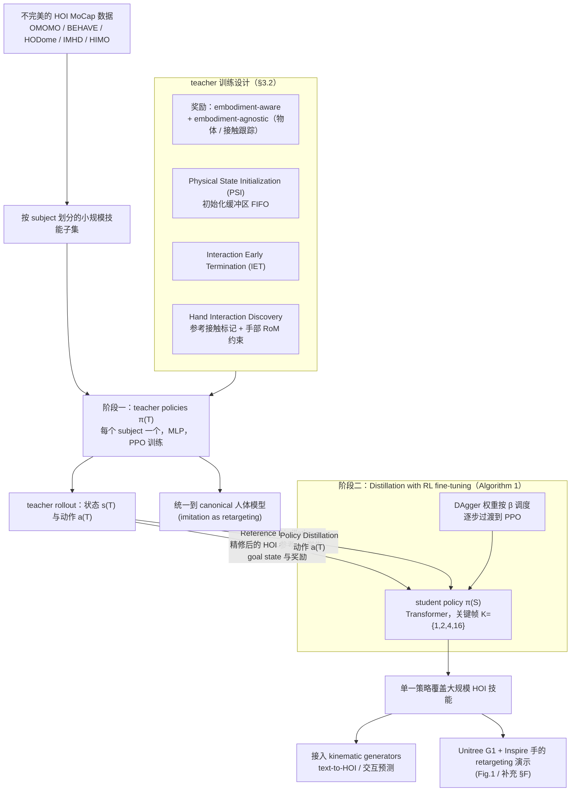

---

type: entity
tags: [paper, bfm, behavior-foundation-model, awesome-bfm-papers, sjtu]
status: complete
updated: 2026-09-29
arxiv: "2502.20390"
venue: "2025 · CVPR"
code: https://github.com/Sirui-Xu/InterMimic
summary: "从纯身体动作走向人-物交互与接触结果。"
related:
  - ../concepts/behavior-foundation-model.md
  - ../overview/bfm-41-papers-technology-map.md
  - ../overview/bfm-category-02-goal-conditioned-learning.md
  - ./paper-lucid.md
  - ./paper-dreammimic.md
sources:
  - ../../sources/papers/bfm_awesome_intermimic_arxiv_2502_20390.md
  - ../../sources/papers/bfm_awesome_41_catalog.md
  - ../../sources/blogs/wechat_embodied_ai_lab_bfm_41_papers_survey.md
  - ../../sources/papers/lucid_arxiv_2608_07746.md
---

# InterMimic

**InterMimic** 收录于 [awesome-bfm-papers](https://github.com/friedrichyuan/awesome-bfm-papers) **第 15/41** 篇，归类为 **02 Goal-conditioned 学习**（2025 · CVPR）。

## 一句话定义

从纯身体动作走向人-物交互与接触结果。

## 英文缩写速查

| 缩写 | 英文全称 | 简要说明 |
|------|----------|----------|
| BFM | Behavior Foundation Model | 大规模行为数据预训练的可复用全身行为先验 |
| AMP | Adversarial Motion Prior | 用对抗判别约束状态转移接近专家运动分布的先验 |
| HOI | Human–Object Interaction | 人–物交互与接触结果建模 |

## 为什么重要

- 从纯身体动作走向人-物交互与接触结果。
- 在 [BFM 41 篇技术地图](../overview/bfm-41-papers-technology-map.md) 中属于 **02 Goal-conditioned 学习**（#15/41）。

## 流程总览

图依据：论文 §3 Methodology（Overview、§3.1 Policy Representation、§3.2 Imitation as Perfecting、§3.3 Imitation with Distillation、§3.4 Architecture、Algorithm 1）与 §4 Implementation Details / Fig.2。

## 核心信息

| 字段 | 内容 |
|------|------|
| 编号 | 15/41 |
| 分组 | 02 Goal-conditioned 学习 |
| 出处 | 2025 · CVPR |
| 论文 | <https://arxiv.org/abs/2502.20390> |
- **代码/项目：** <https://github.com/Sirui-Xu/InterMimic>

## 核心机制（归纳）

### 1）策展导读要点

以 **goal / reference / command** 为条件训练全身跟踪或交互策略，扩展人形可执行动作库。

### 2）策展导读要点

数据侧常融合 MoCap、视频、遥操作与 HOI；控制侧强调 **抗扰、恢复与跨参考泛化**。

### 3）策展导读要点

在 BFM taxonomy 中回答「身体能覆盖多少目标条件技能」。

## 结论

**InterMimic 把 goal-conditioned 的条件对象从身体自身推到人–物交互与接触结果：衡量标准不再是姿态像不像，而是交互成不成立。**

- 机制仍属 **02 Goal-conditioned** 路线——以 goal / reference / command 为条件训练全身跟踪或交互策略；差异在数据侧融合 HOI、控制侧强调抗扰、恢复与跨参考泛化。
- 边界很实在：条件化跟踪不等于 unlimited skills，仍受**数据分布、接触建模与实机 Sim2Real** 三重约束。
- 在 BFM taxonomy 中它回答的是「身体能覆盖多少目标条件技能」；同类接触技能可与 [SkillMimic](./paper-notebook-skillmimic-learning-basketball-interaction-skill.md) 的篮球 HOI 模仿对照阅读。
- 本页为清单索引策展编译，量化 benchmark 与消融以原文 PDF 及 `Sirui-Xu/InterMimic` 为准。

## 常见误区

1. Goal-conditioned 跟踪不等于 unlimited skills：仍受数据分布、接触建模与实机 Sim2Real 约束。

## 实验与评测

- 本页在公众号/survey **策展编译**基础上补充机制归纳；**量化 benchmark、消融与实机指标以原文 PDF / 项目页为准**（链接见 [参考来源](#参考来源)）。
- 与同栈姊妹篇对照时，请回到对应 **技术地图 / 42 篇栈 / BFM 地图 / VLN 地图** 总览中的实验段落。

## 与其他页面的关系

- 技术地图：[bfm-41-papers-technology-map.md](../overview/bfm-41-papers-technology-map.md)
- BFM 概念：[behavior-foundation-model.md](../concepts/behavior-foundation-model.md)
- 篮球 HOI 技能模仿对照：[SkillMimic](./paper-notebook-skillmimic-learning-basketball-interaction-skill.md)
- 视觉学生蒸馏对照：[DreamMimic](./paper-dreammimic.md) — 以本页特权教师配方为蒸馏源；RSSM+PCG，代码未发布
- 原始 source：[bfm_awesome_intermimic_arxiv_2502_20390.md](../../sources/papers/bfm_awesome_intermimic_arxiv_2502_20390.md)

## 参考来源

- [bfm_awesome_intermimic_arxiv_2502_20390.md](../../sources/papers/bfm_awesome_intermimic_arxiv_2502_20390.md) — awesome-bfm 策展摘录
- [bfm_awesome_41_catalog.md](../../sources/papers/bfm_awesome_41_catalog.md) — 41+10 总表
- [wechat_embodied_ai_lab_bfm_41_papers_survey.md](../../sources/blogs/wechat_embodied_ai_lab_bfm_41_papers_survey.md) — 微信公众号编译导读
- 论文：<https://arxiv.org/abs/2502.20390>
- [arXiv PDF](https://arxiv.org/pdf/2502.20390)：已通读方法部分（实验与附录以略读为准）：§1 Introduction、§3 Methodology（3.1–3.4、Algorithm 1）、§4 的数据集 / 基线 / 实现细节

## 推荐继续阅读

- [awesome-bfm-papers](https://github.com/friedrichyuan/awesome-bfm-papers) — 完整列表与数据集表
- [A Survey of Behavior Foundation Model](https://arxiv.org/abs/2506.20487) — TPAMI 2025 综述
