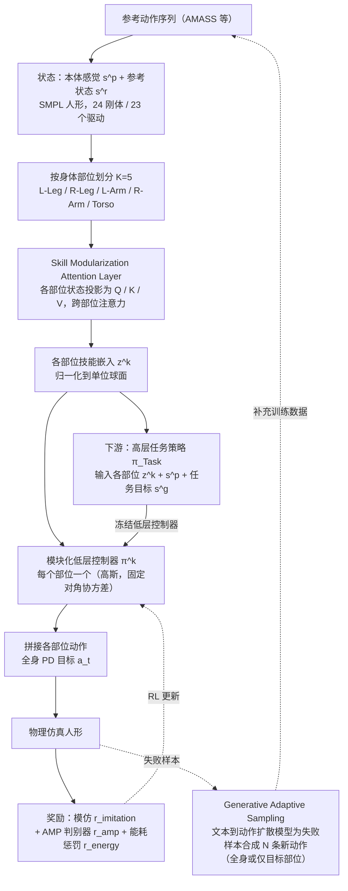

---

type: entity
tags: [paper, bfm, behavior-foundation-model, awesome-bfm-papers, hku, upenn]
status: complete
updated: 2026-06-25
arxiv: "2502.14140"
venue: "2025 · arXiv"
summary: "技能模块化、可组合，避免基座内部技能缠成一团黑箱。"
related:
  - ../concepts/behavior-foundation-model.md
  - ../overview/bfm-41-papers-technology-map.md
  - ../overview/bfm-category-02-goal-conditioned-learning.md
sources:
  - ../../sources/papers/bfm_awesome_modskill_arxiv_2502_14140.md
  - ../../sources/papers/bfm_awesome_41_catalog.md
  - ../../sources/blogs/wechat_embodied_ai_lab_bfm_41_papers_survey.md
---

# ModSkill

**ModSkill** 收录于 [awesome-bfm-papers](https://github.com/friedrichyuan/awesome-bfm-papers) **第 16/41** 篇，归类为 **02 Goal-conditioned 学习**（2025 · arXiv）。

## 一句话定义

技能模块化、可组合，避免基座内部技能缠成一团黑箱。

## 英文缩写速查

| 缩写 | 英文全称 | 简要说明 |
|------|----------|----------|
| BFM | Behavior Foundation Model | 大规模行为数据预训练的可复用全身行为先验 |
| AMP | Adversarial Motion Prior | 用对抗判别约束状态转移接近专家运动分布的先验 |

## 为什么重要

- 技能模块化、可组合，避免基座内部技能缠成一团黑箱。
- 在 [BFM 41 篇技术地图](../overview/bfm-41-papers-technology-map.md) 中属于 **02 Goal-conditioned 学习**（#16/41）。

## 流程总览

图依据：论文 §3 ModSkill 概述与 Fig.2、§3.1 Preliminaries、§3.2 Skill Modularization / Fig.3、§3.3 Modular Low-Level Controllers、§3.4 Generative Adaptive Sampling / Fig.4、§3.5 Skill Transfer。

## 核心信息

| 字段 | 内容 |
|------|------|
| 编号 | 16/41 |
| 分组 | 02 Goal-conditioned 学习 |
| 出处 | 2025 · arXiv |
| 论文 | <https://arxiv.org/abs/2502.14140> |

## 核心机制（归纳）

### 1）策展导读要点

以 **goal / reference / command** 为条件训练全身跟踪或交互策略，扩展人形可执行动作库。

### 2）策展导读要点

数据侧常融合 MoCap、视频、遥操作与 HOI；控制侧强调 **抗扰、恢复与跨参考泛化**。

### 3）策展导读要点

在 BFM taxonomy 中回答「身体能覆盖多少目标条件技能」。

## 结论

**ModSkill 的主张是让技能在基座内部保持模块化、可组合，而不是把所有技能揉成一团难以拆解的黑箱策略。**

- 所在分组的共性机制是以 **goal / reference / command** 为条件训练全身跟踪或交互策略，用以扩展人形可执行动作库；模块化解决的是这条路线上的「可拆解性」缺口。
- 数据侧常融合 MoCap、视频、遥操作与 HOI，控制侧看 **抗扰、恢复与跨参考泛化**——这也是判断模块划分是否有效的评测语言。
- 边界：模块化不等于 unlimited skills，覆盖面仍受 **数据分布、接触建模与实机 Sim2Real** 约束。
- 本页为 **#16/41 清单索引策展编译**，未列开源代码；量化 benchmark 与消融以原文 PDF / 项目页为准。

## 常见误区

1. Goal-conditioned 跟踪不等于 unlimited skills：仍受数据分布、接触建模与实机 Sim2Real 约束。

## 实验与评测

- 本页在公众号/survey **策展编译**基础上补充机制归纳；**量化 benchmark、消融与实机指标以原文 PDF / 项目页为准**（链接见 [参考来源](#参考来源)）。
- 与同栈姊妹篇对照时，请回到对应 **技术地图 / 42 篇栈 / BFM 地图 / VLN 地图** 总览中的实验段落。

## 与其他页面的关系

- 技术地图：[bfm-41-papers-technology-map.md](../overview/bfm-41-papers-technology-map.md)
- BFM 概念：[behavior-foundation-model.md](../concepts/behavior-foundation-model.md)
- 原始 source：[bfm_awesome_modskill_arxiv_2502_14140.md](../../sources/papers/bfm_awesome_modskill_arxiv_2502_14140.md)

## 参考来源

- [bfm_awesome_modskill_arxiv_2502_14140.md](../../sources/papers/bfm_awesome_modskill_arxiv_2502_14140.md) — awesome-bfm 策展摘录
- [bfm_awesome_41_catalog.md](../../sources/papers/bfm_awesome_41_catalog.md) — 41+10 总表
- [wechat_embodied_ai_lab_bfm_41_papers_survey.md](../../sources/blogs/wechat_embodied_ai_lab_bfm_41_papers_survey.md) — 微信公众号编译导读
- 论文：<https://arxiv.org/abs/2502.14140>
- [arXiv PDF](https://arxiv.org/pdf/2502.14140)：已通读方法部分（实验与附录以略读为准）：§3 ModSkill（3.1–3.5）、§4 评测指标设置

## 推荐继续阅读

- [awesome-bfm-papers](https://github.com/friedrichyuan/awesome-bfm-papers) — 完整列表与数据集表
- [A Survey of Behavior Foundation Model](https://arxiv.org/abs/2506.20487) — TPAMI 2025 综述
