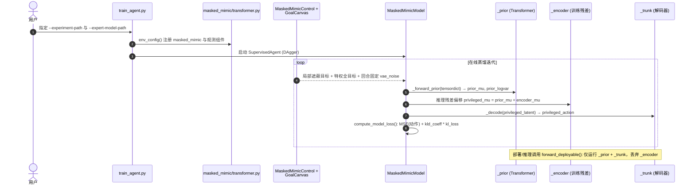

---

type: entity
tags: [paper, bfm, behavior-foundation-model, awesome-bfm-papers, nvidia]
status: complete
updated: 2026-11-21
venue: "SIGGRAPH Asia 2024 · ACM TOG"
code: https://github.com/NVlabs/ProtoMotions
summary: "MaskedMimic（TOG 2024，NVIDIA PAR）：将物理角色控制表述为掩码运动补全（CVAE + Transformer 先验 + 结构化时序掩码蒸馏），单策略支持任意关节任意时刻、文本与物体交互，官方实现合入 NVlabs/ProtoMotions。"
related:
  - ../overview/humanoid-motion-cerebellum-technology-map.md
  - ../overview/motion-cerebellum-category-02-motion-imitation.md
  - ../concepts/behavior-foundation-model.md
  - ../overview/bfm-41-papers-technology-map.md
  - ../overview/bfm-category-02-goal-conditioned-learning.md
  - ./protomotions.md
  - ./phc.md
  - ./paper-loco-manip-161-097-harmon.md
sources:
  - ../../sources/sites/maskedmimic-nvidia-par.md
  - ../../sources/papers/bfm_awesome_maskedmimic_tog_2024.md
  - ../../sources/repos/protomotions.md
  - ../../sources/papers/bfm_awesome_41_catalog.md
  - ../../sources/blogs/wechat_embodied_ai_lab_bfm_41_papers_survey.md
  - ../../sources/papers/motion_cerebellum_64_catalog.md
  - ../../sources/blogs/wechat_embodied_ai_lab_humanoid_motion_cerebellum_survey.md
original:
  - ../../sources/papers/bfm_awesome_maskedmimic_tog_2024.md
  - ../../sources/repos/protomotions.md
---

# MaskedMimic

**MaskedMimic**（*Unified Physics-Based Character Control Through Masked Motion Inpainting*，SIGGRAPH Asia 2024 · ACM TOG；[NVIDIA PAR PDF](https://research.nvidia.com/labs/par/maskedmimic/assets/SIGGRAPHAsia2024_MaskedMimic.pdf)，[awesome-bfm-papers #17/41](https://github.com/friedrichyuan/awesome-bfm-papers)）由 NVIDIA 与 SFU 提出：把「由部分观测/多模态目标驱动物理角色控制」统一建模为 **掩码运动补全（masked motion inpainting）** 问题。通过随机时序结构化掩码在线蒸馏一个带可学习 Transformer 先验的 C-VAE 学生策略 $\pi^{\mathrm{PC}}$，仅需单一非微调模型即可统一完成全身跟踪、VR 稀疏点、任意关节目标、文本控制、不规则地形穿越与未见家具交互。

## 一句话定义

**把多模态全身控制统一成「给部分稀疏条件、由物理策略在线补全全身动作」的 C-VAE 运动补全问题——以结构化时序掩码从全观测教师蒸馏出 Transformer 可学习先验 $\rho(z_t \mid s_t, g_t^{\mathrm{partial}})$，推理时丢弃后验编码器直接从先验解码全身 PD 目标。**

## 英文缩写速查

| 缩写 | 英文全称 | 简要说明 |
|------|----------|----------|
| C-VAE | Conditional Variational Autoencoder | 条件变分自编码器（残差编码器 + Transformer 先验 + MLP 解码器） |
| $\pi^{\mathrm{FC}}$ / $\pi^{\mathrm{PC}}$ | Fully- / Partially-Constrained Controller | 全约束 A2C 教师策略与部分约束 DAgger 学生策略 |
| BFM | Behavior Foundation Model | 大规模行为数据预训练的可复用全身控制底座 |
| MPJPE / MPOJPE | Mean Per-Joint / Observed Joint Position Error | 全身及稀疏观测关节点误差（mm） |
| KL | Kullback–Leibler Divergence | 训练期退火约束先验与编码器一致的散度项（$10^{-4}\to 0.01$） |
| XCLIP | Cross-modal Video-Language Embedding | 编码带时序语义的 512 维文本指令特征 |

## 为什么重要

- **单模型多模态泛化而非 MoE 拼接：** 证明单一 Transformer+MLP 架构在测试集全约束跟踪（**99.2% / 35.1 mm** vs PULSE 97.1% / 54.1 mm）和稀疏 VR 跟踪（**98.1% / 58.1 mm** vs PULSE 93.4% / 88.6 mm）上均超过先前的 MoE 与无结构化掩码蒸馏路线。
- **「目标工程」替代重训：** 引入任意关节-任意时刻（any-joint-any-time）、XCLIP 文本（HumanML3D）与 8 角点物体包围盒（SAMP）token；配合简单有限状态机即可零微调完成 3D 路径跟踪、转向、手部到达与未见椅子/沙发落座。
- **ProtoMotions 与 Metatron 的方法母体：** 官方仓库 [NVlabs/ProtoMotions](https://github.com/NVlabs/ProtoMotions)（2026 年 10 月演化至 `MaskedMimicModel` + Metatron G1 真机策略）直接沿袭其「教师跟踪→学习先验 VAE 蒸馏」范式。

## 核心信息

| 字段 | 内容 |
|------|------|
| 论文出处 | SIGGRAPH Asia 2024 · ACM Trans. Graph. 43(6) |
| BFM 地图坐标 | `#17/41`，02 Goal-conditioned 学习 |
| 角色与环境 | SMPL 69-DoF 人形（358D 状态 / 69D exp-map PD 目标）；Isaac Gym 16,384 envs（4× A100，30 Hz 策略 / 120 Hz 仿真，约 2 周） |
| 数据混合 | AMASS（经 PHC 式过滤）+ HumanML3D（文本镜像）+ SAMP（随机同类椅子/沙发替换）+ 不规则地形/高程图（16×16 @ 10 cm） |
| 论文 PDF | <https://research.nvidia.com/labs/par/maskedmimic/assets/SIGGRAPHAsia2024_MaskedMimic.pdf> |
| 官方代码 | [NVlabs/ProtoMotions](https://github.com/NVlabs/ProtoMotions)（Apache-2.0；`protomotions/agents/supervised/masked_mimic_model.py`） |

## 核心机制

### 1）两阶段架构：全约束教师 $\pi^{\mathrm{FC}}$ → 部分约束 C-VAE 学生 $\pi^{\mathrm{PC}}$

1. **阶段 1（$\pi^{\mathrm{FC}}$）：** 用 A2C（$\gamma=0.99$，$\tau=0.95$，30B 步，失败加权自适应采样最小权重 $3\times10^{-3}$）在全观测 11 帧未来参考 + 16×16 高程图上训练全能跟踪教师（AMASS 测试 **99.8% / 31.3 mm**）。
2. **阶段 2（$\pi^{\mathrm{PC}}$ C-VAE）：** 在线 DAgger 蒸馏（10B 步）：
   - **Prior $\rho(z_t \mid s_t, g_t^{\mathrm{partial}})$**：4 层 4 头 Transformer Encoder（隐维 512 / FFN 1024，支持模态分 token + 缺失 token attention mask；未来 $K=11$ 帧为 10 近帧 + 1 远期帧，过去 40 步每 8 步抽 5 帧），输出 $64$D 高斯先验均值/对数标准差。
   - **残差 Encoder $\mathcal{E}(z_t \mid s_t, g_t^{\mathrm{full}})$**：仅训练使用（3 层 1024 MLP），见全量未来帧并输出相对先验的偏移 $\mu_\rho + \mu_{\mathcal{E}}$。
   - **Decoder $\mathcal{D}(a_t \mid s_t, z_t)$**：3 层 1024 MLP，输入当前姿态 + 高程图 + 采样隐变量 $z_t$（**不直看任何目标 $g$**），直接输出 69D 确定性 PD 目标动作。

### 2）关键训练稳态四件套（§6.3 & 附录 B.1–B.2）

- **结构化时序掩码（Listing 1 `sample_body_masks`）：** 98% 概率沿用上一帧约束模态，1% 概率开启 1–9 步全遮蔽 time-gap（有文本/物体/远期目标时 gap×4）；文本 80% 概率屏蔽、物体 20% 屏蔽，迫使模型真正依赖语言/场景上下文而非偷看相邻帧暴露的关节。
- **KL 退火：** $\beta$ 自 epoch 3000 起在 6000 epochs 内从 $10^{-4}$ 线性增至 $0.01$，先保行动重建再正则隐空间。
- **回合级固定噪声（Episodic latent noise）：** 每个 episode 重置时采样一次 $\epsilon_\tau \sim \mathcal{N}(0,I)$ 并在整回合内复用 $z_t^\tau=\mu_t^\tau+\sigma_t^\tau \epsilon_\tau$，确保长时序动作连贯性。
- **历史姿态窗 + 提前终止：** 缺乏历史姿态在文本转向与坐椅任务中会失效；蒸馏阶段同时沿用提前终止防止进入 $\pi^{\mathrm{FC}}$ 未覆盖的崩溃状态。

## 源码运行时序图

节点对齐 [NVlabs/ProtoMotions](https://github.com/NVlabs/ProtoMotions)（[protomotions.md](../../sources/repos/protomotions.md)）当前核心实现（`protomotions/train_agent.py`、`examples/experiments/masked_mimic/transformer.py` 与 `protomotions/agents/supervised/masked_mimic_model.py`）：

## 工程实践

| 项 | 建议与原文 / ProtoMotions3 经验 |
|----|--------------------------------|
| 结构化掩码必不可少 | 论文 Table 6 显示「No structured masking（每步独立掩码）」坐椅与稀疏任务几乎坍塌（**0.0%**），必须按时序保持持续遮蔽或 time-gap |
| 残差先验初始化 | 消融「No residual prior（标准 $\mathcal{N}(0,I)$ 先验）」下坐椅从 **96.9%** 骤降至 **21.1%** |
| 超时与未来窗选择 | 原文用 10 近帧+1 远帧+40 步抽 5 历史；ProtoMotions3 实验默认示例（`transformer.py`）已可按 `NUM_FUTURE_STEPS = 5` 等模块化配置，并支持 `SPHERE` 超球面潜几何选项 |
| 从虚拟角色到真机 | 原文仅验证 69-DoF SMPL 仿真；真机机器人部署（如 Unitree G1）需转用 ProtoMotions3 中的 `Metatron` / `BONES` 管线配合传感器噪声与延迟域随机化 |

## 实验与评测

| 基准 / 任务（论文 Table 1–6） | MaskedMimic ($\pi^{\mathrm{PC}}$) | 关键对照与数值解读 |
|-------------------------------|----------------------------------|--------------------|
| **全约束跟踪（平地 Test）** | **99.2% / MPJPE 35.1 mm** | 超过 PULSE（97.1% / 54.1 mm），接近 PHC+（99.2% / 36.1 mm）与自身教师 $\pi^{\mathrm{FC}}$（99.8% / 31.3 mm） |
| **稀疏 VR 跟踪（平地 Test）** | **98.1% / 58.1 mm**（MPOJPE **45.8 mm**） | 显式超越 PULSE（93.4% / 88.6 mm）、ASE（37.6%）、CALM（10.1%），尽管未针对 VR 专门训练 |
| **Test 极端稀疏追踪（Table 3）** | Full **99.1%** / VR **98.1%** / Head **97.9%** / Hands **93.4%** / Feet **91.8%** | 只给头或双脚仍能补全自然全身，但仅给双脚误差较大（MPJPE 162.1 mm） |
| **不规则地形 Test（Table 4）** | Full **95.4%**（65.2 mm）/ VR **93.6%**（79.4 mm） | 在碎石坡、楼梯与斜坡上稳定泛化 |
| **零微调 FSM 下游任务（Table 5–6）** | Path Following **96.3%** / Steering **97.8% & 93.8%** / Reach **88.7% & 87.3%** / Sitting **96.9%** | Sitting（未见家具）vs No residual prior **21.1%**、No history **84.2%**、No structured masking **0.0%** |

## 结论

**MaskedMimic 用「随机时序遮蔽 + 残差 C-VAE」打通了全能跟踪教师与稀疏交互用户接口：只要在训练期用足够长时间窗结构化隐藏信息，单个多模态先验就能在部署时兼顾精准全身跟踪、VR 遥操作、文本响应与物体交互。**

1. **统一接口的本质是 Inpainting：** 不再为每个任务另起强化学习，而是训练单一模型填补「任意已知部位与时间」之间的动力学空白。
2. **结构化时序掩码与残差先验缺一不可：** 否则先验退化成局部帧内插值或无法在无近帧约束时依赖高级语义（Text/Object）。
3. **单一大型策略超越 MoE 门槛：** 当动作多样且多地形混训时，统一 Transformer 先验比 PHC/PULSE 类多专家混合更易在线蒸馏且 test 泛化更稳。
4. **真机定位清晰：** 论文针对 69-DoF SMPL 虚拟角色（30B + 10B 步、4× A100 训 2 周），工程上真机人形演化参考 `NVlabs/ProtoMotions` 的 G1 / Metatron 配方。

## 常见误区

1. **Goal-conditioned 跟踪不等于无上限技能：** 仍受 AMASS/HumanML3D/SAMP 数据分布覆盖（未见物理交互模态难凭空产生）以及高度图局部 2.5D 表示限制。
2. **不要混淆虚拟角色验证与真机可部署：** 原文角色具有 69 DoF、358D 本地几何状态与 16×16 真值局部高度图，直接迁移硬件需做观测可实现化重构与系统延迟适配。

## 局限与风险

- **极长预训练开销：** 教师需约 30B 步 + 学生 10B 步（4× A100 累计约两周），且依赖已事先训好的 $\pi^{\mathrm{FC}}$ 专家动作标签。
- **静态刚体交互局限：** 场景与物体仅以静态 8 角点包围盒与类别 ID 传入，未建模灵巧手抓握、物体动力学位移及动态障碍避让。
- **稀疏条件多解模糊：** 例如仅指定头或手部时，下肢或跨步相位只能生成「统计上合理」的运动而非唯一精确姿态（仅 Feet 条件下 MPJPE 升至 162.1 mm）。

## 关联页面

- 技术地图：[bfm-41-papers-technology-map.md](../overview/bfm-41-papers-technology-map.md)
- BFM 概念：[behavior-foundation-model.md](../concepts/behavior-foundation-model.md)
- 代码生态：[protomotions.md](./protomotions.md) — MaskedMimic 所属 NVIDIA 开源仿人仿真与训练平台（含 Metatron）
- 前置对比：[phc.md](./phc.md) — `π^FC` 对比对象（PHC+/PULSE），展示单体大网络相对 MoE 路线的优势
- [Imitation Learning (IL, 模仿学习)](../methods/imitation-learning.md) — 稀疏约束下的物理动作补全与完整参考轨迹模仿可据此对照。
- [DeepMimic: 示例引导的技能学习](../methods/deepmimic.md) — 对比逐帧参考跟踪与 masked motion inpainting 的控制条件差异。

## 参考来源

- [MaskedMimic 项目/PDF 归档](../../sources/sites/maskedmimic-nvidia-par.md)
- [ProtoMotions 仓库归档](../../sources/repos/protomotions.md)
- [bfm_awesome_maskedmimic_tog_2024.md](../../sources/papers/bfm_awesome_maskedmimic_tog_2024.md) — 论文 PDF 全文精读摘录与 awesome-bfm 条目
- [bfm_awesome_41_catalog.md](../../sources/papers/bfm_awesome_41_catalog.md) — 41+10 总表
- [wechat_embodied_ai_lab_bfm_41_papers_survey.md](../../sources/blogs/wechat_embodied_ai_lab_bfm_41_papers_survey.md) — 微信公众号编译导读
- 论文：<https://research.nvidia.com/labs/par/maskedmimic/assets/SIGGRAPHAsia2024_MaskedMimic.pdf>

## 推荐继续阅读

- [机器人论文阅读笔记：MaskedMimic Unified Physics-Based Character Control Through Masked Motion Inpainting](https://imchong.github.io/Robot_Learning_Paper_Notebooks/papers/03_High_Impact_Selection/MaskedMimic_Unified_Physics-Based_Character_Control_Through_Masked_Motion_Inpainting/MaskedMimic_Unified_Physics-Based_Character_Control_Through_Masked_Motion_Inpainting.html)
- [awesome-bfm-papers](https://github.com/friedrichyuan/awesome-bfm-papers) — 完整列表与数据集表
- [A Survey of Behavior Foundation Model](https://arxiv.org/abs/2506.20487) — TPAMI 2025 综述
