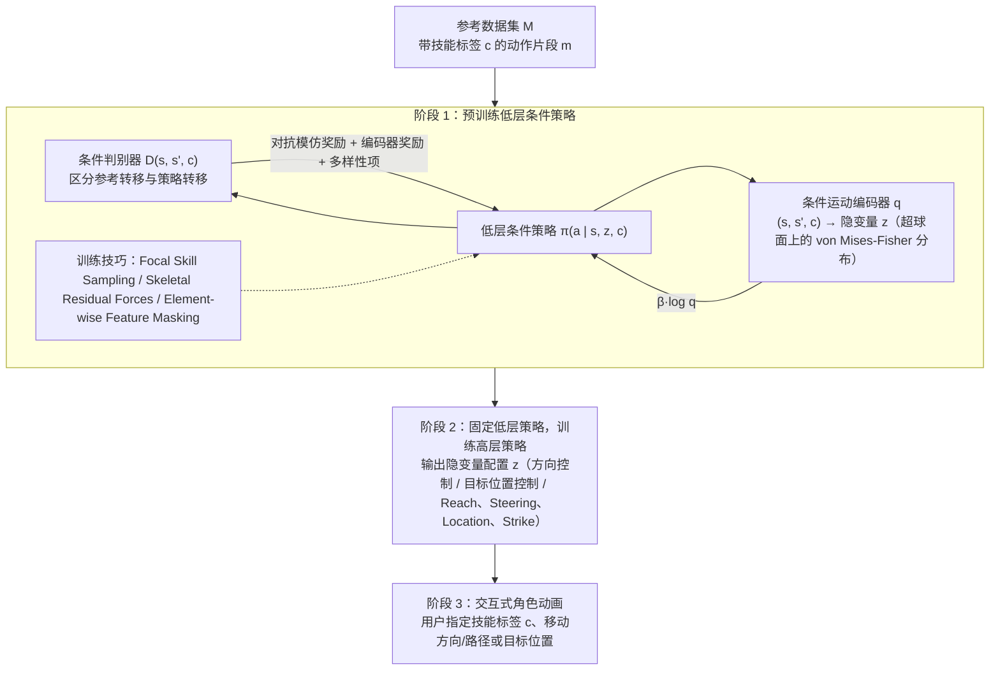

---

type: entity
tags: [paper, bfm, behavior-foundation-model, awesome-bfm-papers, hku]
status: complete
updated: 2026-09-15
arxiv: "2309.11351"
venue: "2023 · SIGGRAPH Asia"
code: https://github.com/Frank-ZY-Dou/CASE
summary: "条件技能嵌入；与「按 prompt 调身体」同思路。"
related:
  - ../concepts/behavior-foundation-model.md
  - ../overview/bfm-41-papers-technology-map.md
  - ../overview/bfm-category-02-goal-conditioned-learning.md
  - ./paper-cmp.md
sources:
  - ../../sources/papers/bfm_awesome_case_arxiv_2309_11351.md
  - ../../sources/papers/bfm_awesome_41_catalog.md
  - ../../sources/blogs/wechat_embodied_ai_lab_bfm_41_papers_survey.md
---

# CASE

**CASE** 收录于 [awesome-bfm-papers](https://github.com/friedrichyuan/awesome-bfm-papers) **第 21/41** 篇，归类为 **02 Goal-conditioned 学习**（2023 · SIGGRAPH Asia）。

## 一句话定义

条件技能嵌入；与「按 prompt 调身体」同思路。

## 英文缩写速查

| 缩写 | 英文全称 | 简要说明 |
|------|----------|----------|
| BFM | Behavior Foundation Model | 大规模行为数据预训练的可复用全身行为先验 |
| AMP | Adversarial Motion Prior | 用对抗判别约束状态转移接近专家运动分布的先验 |

## 为什么重要

- 条件技能嵌入；与「按 prompt 调身体」同思路。
- 在 [BFM 41 篇技术地图](../overview/bfm-41-papers-technology-map.md) 中属于 **02 Goal-conditioned 学习**（#21/41）。

## 流程总览

图依据：论文 §3 开头、§3.1、§3.2、Fig. 2。

## 核心信息

| 字段 | 内容 |
|------|------|
| 编号 | 21/41 |
| 分组 | 02 Goal-conditioned 学习 |
| 出处 | 2023 · SIGGRAPH Asia |
| 论文 | <https://arxiv.org/abs/2309.11351> |
- **代码/项目：** <https://github.com/Frank-ZY-Dou/CASE>

## 核心机制（归纳）

### 1）策展导读要点

以 **goal / reference / command** 为条件训练全身跟踪或交互策略，扩展人形可执行动作库。

### 2）策展导读要点

数据侧常融合 MoCap、视频、遥操作与 HOI；控制侧强调 **抗扰、恢复与跨参考泛化**。

### 3）策展导读要点

在 BFM taxonomy 中回答「身体能覆盖多少目标条件技能」。

## 结论

**CASE 的贡献在接口而非技能数量：把技能编码成可条件化的嵌入，于是「换任务」变成换条件/prompt，而不是换一套策略。**

- 它与 goal-conditioned 一族共享同一机制假设：以 **goal / reference / command** 为条件训练全身跟踪或交互策略，数据侧融合 MoCap、视频、遥操作与 HOI，控制侧看抗扰、恢复与跨参考泛化。
- 它在 BFM taxonomy 中回答「身体能覆盖多少目标条件技能」，边界也正在此：条件技能嵌入不等于无限技能，仍受数据分布、接触建模与实机 Sim2Real 约束。
- 本页为清单坐标（awesome-bfm #21/41，**02 Goal-conditioned 学习**，2023 · SIGGRAPH Asia，代码 <https://github.com/Frank-ZY-Dou/CASE>）；量化 benchmark、消融与实机指标以原文 PDF / 项目页为准。

## 常见误区

1. Goal-conditioned 跟踪不等于 unlimited skills：仍受数据分布、接触建模与实机 Sim2Real 约束。

## 实验与评测

- 本页在公众号/survey **策展编译**基础上补充机制归纳；**量化 benchmark、消融与实机指标以原文 PDF / 项目页为准**（链接见 [参考来源](#参考来源)）。
- 与同栈姊妹篇对照时，请回到对应 **技术地图 / 42 篇栈 / BFM 地图 / VLN 地图** 总览中的实验段落。

## 与其他页面的关系

- 技术地图：[bfm-41-papers-technology-map.md](../overview/bfm-41-papers-technology-map.md)
- BFM 概念：[behavior-foundation-model.md](../concepts/behavior-foundation-model.md)
- 原始 source：[bfm_awesome_case_arxiv_2309_11351.md](../../sources/papers/bfm_awesome_case_arxiv_2309_11351.md)
- 对照：[CMP](./paper-cmp.md) — 不切数据集、不学条件 skill 子集，在原参考空间按上下文软重权

## 参考来源

- [bfm_awesome_case_arxiv_2309_11351.md](../../sources/papers/bfm_awesome_case_arxiv_2309_11351.md) — awesome-bfm 策展摘录
- [bfm_awesome_41_catalog.md](../../sources/papers/bfm_awesome_41_catalog.md) — 41+10 总表
- [wechat_embodied_ai_lab_bfm_41_papers_survey.md](../../sources/blogs/wechat_embodied_ai_lab_bfm_41_papers_survey.md) — 微信公众号编译导读
- 论文：<https://arxiv.org/abs/2309.11351>
- [arXiv PDF](https://arxiv.org/pdf/2309.11351)：已通读方法部分（实验与附录以略读为准）：§3 Method 概述、§3.1 条件对抗技能嵌入（含 FSS / SRF / EFM）、§3.2 交互式角色动画

## 推荐继续阅读

- [awesome-bfm-papers](https://github.com/friedrichyuan/awesome-bfm-papers) — 完整列表与数据集表
- [A Survey of Behavior Foundation Model](https://arxiv.org/abs/2506.20487) — TPAMI 2025 综述
