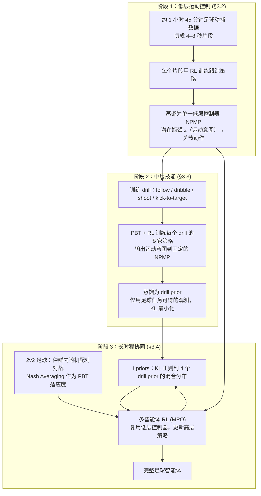

---

type: entity
tags: [paper, bfm, behavior-foundation-model, awesome-bfm-papers, google-deepmind]
status: complete
updated: 2026-11-22
arxiv: "2105.12196"
venue: "2021 · Science Robotics"
summary: "底层 motor control 成熟后上层协作/战术才有空间。"
related:
  - ../concepts/behavior-foundation-model.md
  - ../overview/bfm-41-papers-technology-map.md
  - ../overview/bfm-category-02-goal-conditioned-learning.md
  - ../overview/humanoid-rl-motion-control-body-system-stack.md
sources:
  - ../../sources/papers/bfm_awesome_teamplay_arxiv_2105_12196.md
  - ../../sources/papers/bfm_awesome_41_catalog.md
  - ../../sources/blogs/wechat_embodied_ai_lab_bfm_41_papers_survey.md
original: ../../sources/papers/bfm_awesome_teamplay_arxiv_2105_12196.md
---

# TeamPlay

**TeamPlay** 收录于 [awesome-bfm-papers](https://github.com/friedrichyuan/awesome-bfm-papers) **第 23/41** 篇，归类为 **02 Goal-conditioned 学习**（2021 · Science Robotics）。

## 一句话定义

底层 motor control 成熟后上层协作/战术才有空间。

## 英文缩写速查

| 缩写 | 英文全称 | 简要说明 |
|------|----------|----------|
| BFM | Behavior Foundation Model | 大规模行为数据预训练的可复用全身行为先验 |
| AMP | Adversarial Motion Prior | 用对抗判别约束状态转移接近专家运动分布的先验 |

## 为什么重要

- 底层 motor control 成熟后上层协作/战术才有空间。
- 在 [BFM 41 篇技术地图](../overview/bfm-41-papers-technology-map.md) 中属于 **02 Goal-conditioned 学习**（#23/41）。

## 流程总览

图依据：论文 §3 / Table 1、Fig.2、§3.1–3.4

## 核心信息

| 字段 | 内容 |
|------|------|
| 编号 | 23/41 |
| 分组 | 02 Goal-conditioned 学习 |
| 出处 | 2021 · Science Robotics |
| 论文 | <https://arxiv.org/abs/2105.12196> |

## 核心机制（归纳）

### 1）策展导读要点

以 **goal / reference / command** 为条件训练全身跟踪或交互策略，扩展人形可执行动作库。

### 2）策展导读要点

数据侧常融合 MoCap、视频、遥操作与 HOI；控制侧强调 **抗扰、恢复与跨参考泛化**。

### 3）策展导读要点

在 BFM taxonomy 中回答「身体能覆盖多少目标条件技能」。

## 工程实践

- **复现三阶段渐进与先验正则接口**：工程构建物理拟人团队对抗智能体时，切忌直接在 2v2/多机环境下端到端探索——应如 `arXiv:2105.12196` §3 般先以 ~1.75h 动捕切片经 RL+蒸馏沉淀潜在瓶颈低层控制器（NPMP），再为追/带/射等中层技能训练专家并蒸馏出可按任务观测读取的 drill priors，最后在 Nash Averaging 种群博弈 MARL 中通过 KL 先验约束保持动作自然协调。

## 结论

**TeamPlay 在 BFM 谱系里被当作「底层先成熟、上层才有空间」的论据：协作与战术是低层 motor control 打牢之后才谈得上的能力。**

- 收录位置为 **02 Goal-conditioned 学习**（#23/41，2021 · Science Robotics），是该线中较早把全身运动能力接到上层多智能体目标的工作。
- 它提示的取舍是层级分工：上层战术的上限受 **底层动作库与跟踪鲁棒性** 约束，而不只由协作算法决定。
- 本页为 **清单索引条目**，无量化归纳；指标与实机细节以原文为准。

## 局限与风险

1. Goal-conditioned 跟踪不等于 unlimited skills：仍受数据分布、接触建模与实机 Sim2Real 约束。

## 实验与评测

- 本页在公众号/survey **策展编译**基础上补充机制归纳；**量化 benchmark、消融与实机指标以原文 PDF / 项目页为准**（链接见 [参考来源](#参考来源)）。
- 与同栈姊妹篇对照时，请回到对应 **技术地图 / 42 篇栈 / BFM 地图 / VLN 地图** 总览中的实验段落。

## 与其他工作对比

| 对比维度 / 工作 | TeamPlay（本文） | 端到端多智能体 RL（无分层先验） | 同期 MuJoCo 角色（ASE / PHC / MoConVQ） | 面向真机的 BFM / WBC 路线 |
|---|---|---|---|---|
| 技能与协同分层 | 三阶段渐进：1.75h 动捕蒸馏低层 NPMP → PBT+RL 蒸馏 4 类 drill priors → 2v2 Nash Averaging MARL + 混合先验 KL 正则 | 直接在 2v2 物理环境中从零探索全身控制与协同 | 聚焦单角色无对抗通用技能或参考跟踪，不含多智能体种群博弈战术 | 先验或跟踪器需额外纳入域随机化、足端摩擦与执行器延迟建模 |
| 物理与部署边界 | 仿真人形 2v2 足球（MuJoCo 角色物理），侧重验证「底层成熟度决定上层战术空间」 | 高维拟人身体下易动作僵硬或陷入局部非自然步态 | 同样针对仿真图形学/物理角色，缺真机 Sim2Real 适配 | 面向真机抗扰与硬件部署（如 Unitree G1 等平台） |

> **核对边界**：本页目前已精读并校验 `arXiv:2105.12196` §3（3.1–3.4）三阶段方法框架与 [bfm-category-02-goal-conditioned-learning.md](../overview/bfm-category-02-goal-conditioned-learning.md) 策展定位；原文 §4 量化胜率与消融数值尚未展开到本页，对比仅覆盖结构范式与部署边界。

## 关联页面

- 技术地图：[bfm-41-papers-technology-map.md](../overview/bfm-41-papers-technology-map.md)
- BFM 概念：[behavior-foundation-model.md](../concepts/behavior-foundation-model.md)
- 原始 source：[bfm_awesome_teamplay_arxiv_2105_12196.md](../../sources/papers/bfm_awesome_teamplay_arxiv_2105_12196.md)

- [强化学习](../methods/reinforcement-learning.md)：用于理解基于奖励的策略学习。
- [遥操作](../tasks/teleoperation.md)：了解操作员与机器人之间的接口。

## 参考来源

- [bfm_awesome_teamplay_arxiv_2105_12196.md](../../sources/papers/bfm_awesome_teamplay_arxiv_2105_12196.md) — awesome-bfm 策展摘录
- [bfm_awesome_41_catalog.md](../../sources/papers/bfm_awesome_41_catalog.md) — 41+10 总表
- [wechat_embodied_ai_lab_bfm_41_papers_survey.md](../../sources/blogs/wechat_embodied_ai_lab_bfm_41_papers_survey.md) — 微信公众号编译导读
- 论文：<https://arxiv.org/abs/2105.12196>
- [arXiv PDF](https://arxiv.org/pdf/2105.12196)：已通读方法部分（实验与附录以略读为准）：§3 Learning Framework（3.1–3.4，含 Table 1 与 Fig.2）

## 推荐继续阅读

- [awesome-bfm-papers](https://github.com/friedrichyuan/awesome-bfm-papers) — 完整列表与数据集表
- [A Survey of Behavior Foundation Model](https://arxiv.org/abs/2506.20487) — TPAMI 2025 综述
