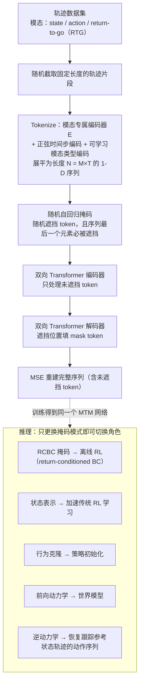

---

type: entity
tags: [paper, bfm, behavior-foundation-model, awesome-bfm-papers, meta]
status: complete
updated: 2026-06-25
arxiv: "2305.02968"
venue: "2023 · ICML"
code: https://github.com/facebookresearch/mtm
summary: "轨迹作为预训练对象；行为基座不必只靠传统 RL 交互。"
related:
  - ../concepts/behavior-foundation-model.md
  - ../overview/bfm-41-papers-technology-map.md
  - ../overview/bfm-category-02-goal-conditioned-learning.md
sources:
  - ../../sources/papers/bfm_awesome_mtm_arxiv_2305_02968.md
  - ../../sources/papers/bfm_awesome_41_catalog.md
  - ../../sources/blogs/wechat_embodied_ai_lab_bfm_41_papers_survey.md
---

# MTM

**MTM** 收录于 [awesome-bfm-papers](https://github.com/friedrichyuan/awesome-bfm-papers) **第 24/41** 篇，归类为 **02 Goal-conditioned 学习**（2023 · ICML）。

## 一句话定义

轨迹作为预训练对象；行为基座不必只靠传统 RL 交互。

## 英文缩写速查

| 缩写 | 英文全称 | 简要说明 |
|------|----------|----------|
| RL | Reinforcement Learning | 通过与环境交互最大化长期回报来学习策略的范式 |
| BFM | Behavior Foundation Model | 大规模行为数据预训练的可复用全身行为先验 |
| AMP | Adversarial Motion Prior | 用对抗判别约束状态转移接近专家运动分布的先验 |

## 为什么重要

- 轨迹作为预训练对象；行为基座不必只靠传统 RL 交互。
- 在 [BFM 41 篇技术地图](../overview/bfm-41-papers-technology-map.md) 中属于 **02 Goal-conditioned 学习**（#24/41）。

## 流程总览

图依据：论文 §3.1–§3.3 / Fig.1–Fig.3

## 核心信息

| 字段 | 内容 |
|------|------|
| 编号 | 24/41 |
| 分组 | 02 Goal-conditioned 学习 |
| 出处 | 2023 · ICML |
| 论文 | <https://arxiv.org/abs/2305.02968> |
- **代码/项目：** <https://github.com/facebookresearch/mtm>

## 核心机制（归纳）

### 1）训练：轨迹上的随机掩码重建

轨迹 τ = (s, a, RTG …) 各模态经模态专属编码器 tokenize，加正弦时间步编码与可学习模态类型编码后展平；用「随机自回归掩码」（序列最后一个元素必被遮挡）遮挡 token，双向 Transformer 编码器只处理未遮挡 token，解码器填 mask token 后以 MSE 重建整条序列（依据 arXiv:2305.02968 §3.1–§3.2）。

### 2）推理：只换掩码即换用途

同一网络通过不同掩码模式充当 return-conditioned BC（RCBC，离线 RL）、行为克隆、前向 / 逆动力学、状态表示等（依据 §3.2 Masking Pattern、Fig. 1、Fig. 3）。

### 3）论文声称的性质

通用性、对异模态（state-only 与 state-action 混合）数据的缺失补全（heteromodality）、数据效率（依据 §1）。

## 结论

**MTM 的取舍是把预训练对象从「与环境交互」换成「轨迹本身」：行为基座因此不再被传统 RL 的在线采样成本卡住。**

- 起作用的是数据形态与训练目标而非新控制器——在 state / action / RTG 轨迹上做随机掩码重建，推理时换掩码即可充当 RCBC、BC、前向 / 逆动力学、状态表示（依据 arXiv:2305.02968 §3）。
- 本页归入 awesome-bfm 的 **02 Goal-conditioned 学习** 是策展分类；论文本身是通用轨迹预训练框架，其「goal-conditioned」读法（如用 RTG 或参考轨迹作条件）以原文为准。
- 本页为清单索引策展编译，量化 benchmark 与消融以 arXiv:2305.02968 原文及 `facebookresearch/mtm` 为准。

## 常见误区

1. 不要把 MTM 读成人形全身跟踪控制器：论文实验面向通用 RL / 连续控制基准（依据 arXiv:2305.02968 §4），不含人形全身控制或实机结论。

## 实验与评测

- 本页在公众号/survey **策展编译**基础上补充机制归纳；**量化 benchmark、消融与实机指标以原文 PDF / 项目页为准**（链接见 [参考来源](#参考来源)）。
- 与同栈姊妹篇对照时，请回到对应 **技术地图 / 42 篇栈 / BFM 地图 / VLN 地图** 总览中的实验段落。

## 与其他页面的关系

- 技术地图：[bfm-41-papers-technology-map.md](../overview/bfm-41-papers-technology-map.md)
- BFM 概念：[behavior-foundation-model.md](../concepts/behavior-foundation-model.md)
- 原始 source：[bfm_awesome_mtm_arxiv_2305_02968.md](../../sources/papers/bfm_awesome_mtm_arxiv_2305_02968.md)

## 参考来源

- [bfm_awesome_mtm_arxiv_2305_02968.md](../../sources/papers/bfm_awesome_mtm_arxiv_2305_02968.md) — awesome-bfm 策展摘录
- [bfm_awesome_41_catalog.md](../../sources/papers/bfm_awesome_41_catalog.md) — 41+10 总表
- [wechat_embodied_ai_lab_bfm_41_papers_survey.md](../../sources/blogs/wechat_embodied_ai_lab_bfm_41_papers_survey.md) — 微信公众号编译导读
- 论文：<https://arxiv.org/abs/2305.02968>
- 核对（2026-11-02）：对照 arXiv:2305.02968 §1、§3.1–§3.3、Fig. 1–3，把「核心机制」的 BFM 通用套话（goal/reference/command 条件跟踪等）改为论文的掩码重建机制；流程图与论文一致，未改。
- [arXiv PDF](https://arxiv.org/pdf/2305.02968)：已通读方法部分（实验与附录以略读为准）：摘要、§1、§2 相关工作、§3 Masked Trajectory Modeling（轨迹数据、架构与掩码、通用 RL 抽象）、§4 开头的实验问题设置

## 推荐继续阅读

- [awesome-bfm-papers](https://github.com/friedrichyuan/awesome-bfm-papers) — 完整列表与数据集表
- [A Survey of Behavior Foundation Model](https://arxiv.org/abs/2506.20487) — TPAMI 2025 综述
