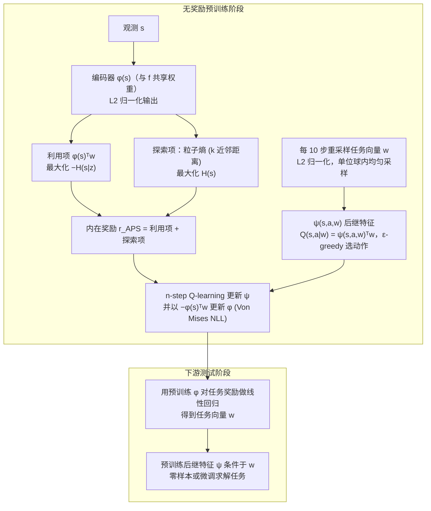

---

type: entity
tags: [paper, bfm, behavior-foundation-model, awesome-bfm-papers, berkeley]
status: complete
updated: 2026-06-25
arxiv: "2108.13956"
venue: "2021 · ICML"
code: https://github.com/rll-research/url_benchmark
summary: "任务到来前的主动预训练；低层身体需先积累可迁移经验。"
related:
  - ../concepts/behavior-foundation-model.md
  - ../overview/bfm-41-papers-technology-map.md
  - ../overview/bfm-category-03-intrinsic-reward-pretraining.md
sources:
  - ../../sources/papers/bfm_awesome_aps_icml_2021.md
  - ../../sources/papers/bfm_awesome_41_catalog.md
  - ../../sources/blogs/wechat_embodied_ai_lab_bfm_41_papers_survey.md
---

# Active Pretraining with Successor Features

**Active Pretraining with Successor Features** 收录于 [awesome-bfm-papers](https://github.com/friedrichyuan/awesome-bfm-papers) **第 26/41** 篇，归类为 **03 Intrinsic reward 预训练**（2021 · ICML）。

## 一句话定义

任务到来前的主动预训练；低层身体需先积累可迁移经验。

## 英文缩写速查

| 缩写 | 英文全称 | 简要说明 |
|------|----------|----------|
| BFM | Behavior Foundation Model | 大规模行为数据预训练的可复用全身行为先验 |
| AMP | Adversarial Motion Prior | 用对抗判别约束状态转移接近专家运动分布的先验 |

## 为什么重要

- 任务到来前的主动预训练；低层身体需先积累可迁移经验。
- 在 [BFM 41 篇技术地图](../overview/bfm-41-papers-technology-map.md) 中属于 **03 Intrinsic reward 预训练**（#26/41）。

## 流程总览

图依据：论文 §4.4 / Algorithm 1、Eq.(4)–(7) 与 Fig.2（测试阶段线性回归来自 Fig.2 图注）

## 核心信息

| 字段 | 内容 |
|------|------|
| 编号 | 26/41 |
| 分组 | 03 Intrinsic reward 预训练 |
| 出处 | 2021 · ICML |
| 论文 | <https://arxiv.org/abs/2108.13956> |
- **代码/项目：** <https://github.com/rll-research/url_benchmark>

## 核心机制（归纳）

### 1）策展导读要点

无明确外部任务时，用 **intrinsic reward**（探索、多样性、后继态等）预训练身体策略。

### 2）策展导读要点

为后续 goal-conditioned 或 imitation 提供 **可迁移的探索先验**，降低冷启动样本需求。

## 结论

**APS 把「任务到来之前先攒可迁移经验」当成一等公民：用 successor features 做主动预训练，为下游省掉冷启动成本。**

- 起作用的机制是无外部任务时用 **intrinsic reward**（探索、多样性、后继态）预训练身体策略，产出的是 **可迁移探索先验** 而非可直接交付的技能。
- 收益点落在下游：给后续 **goal-conditioned 或 imitation** 降低冷启动样本需求，这也是它在 BFM taxonomy 中 **03 Intrinsic reward 预训练** 的位置。
- 边界：intrinsic 预训练 **不替代任务奖励**，下游仍需任务或示范对齐；本页为 #26/41 清单索引策展编译，有 url_benchmark 开源实现可作对照基线，量化指标以原文 PDF 为准。

## 常见误区

1. Intrinsic 预训练不替代任务奖励；它提供 **探索覆盖**，下游仍需任务或示范对齐。

## 实验与评测

- 本页在公众号/survey **策展编译**基础上补充机制归纳；**量化 benchmark、消融与实机指标以原文 PDF / 项目页为准**（链接见 [参考来源](#参考来源)）。
- 与同栈姊妹篇对照时，请回到对应 **技术地图 / 42 篇栈 / BFM 地图 / VLN 地图** 总览中的实验段落。

## 与其他页面的关系

- 技术地图：[bfm-41-papers-technology-map.md](../overview/bfm-41-papers-technology-map.md)
- BFM 概念：[behavior-foundation-model.md](../concepts/behavior-foundation-model.md)
- 原始 source：[bfm_awesome_aps_icml_2021.md](../../sources/papers/bfm_awesome_aps_icml_2021.md)

## 参考来源

- [bfm_awesome_aps_icml_2021.md](../../sources/papers/bfm_awesome_aps_icml_2021.md) — awesome-bfm 策展摘录
- [bfm_awesome_41_catalog.md](../../sources/papers/bfm_awesome_41_catalog.md) — 41+10 总表
- [wechat_embodied_ai_lab_bfm_41_papers_survey.md](../../sources/blogs/wechat_embodied_ai_lab_bfm_41_papers_survey.md) — 微信公众号编译导读
- 论文：<https://arxiv.org/abs/2108.13956>
- [arXiv PDF](https://arxiv.org/pdf/2108.13956)：已通读方法部分（实验与附录以略读为准）：§3 Preliminaries、§4 Method（4.1–4.5，含 Algorithm 1 与 Fig.2 图注）

## 推荐继续阅读

- [awesome-bfm-papers](https://github.com/friedrichyuan/awesome-bfm-papers) — 完整列表与数据集表
- [A Survey of Behavior Foundation Model](https://arxiv.org/abs/2506.20487) — TPAMI 2025 综述

- 核对（2026-11-02）：原 arXiv 编号 2106.14910 对应的是另一篇论文，已按 arXiv 官方记录（API 标题、作者、提交日期）更正为 2108.13956。
