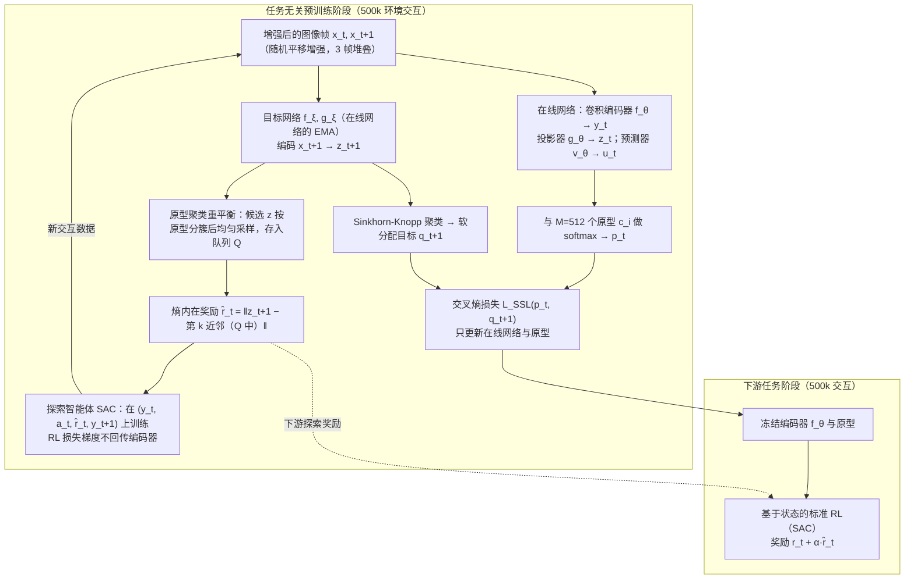

---

type: entity
tags: [paper, bfm, behavior-foundation-model, awesome-bfm-papers, meta]
status: complete
updated: 2026-06-25
arxiv: "2102.11271"
venue: "2021 · ICML"
code: https://github.com/denisyarats/proto
summary: "原型表示组织行为空间，便于上层组合与选择技能。"
related:
  - ../concepts/behavior-foundation-model.md
  - ../overview/bfm-41-papers-technology-map.md
  - ../overview/bfm-category-03-intrinsic-reward-pretraining.md
sources:
  - ../../sources/papers/bfm_awesome_proto_rl_icml_2021.md
  - ../../sources/papers/bfm_awesome_41_catalog.md
  - ../../sources/blogs/wechat_embodied_ai_lab_bfm_41_papers_survey.md
---

# Reinforcement Learning with Prototypical Representations

**Reinforcement Learning with Prototypical Representations** 收录于 [awesome-bfm-papers](https://github.com/friedrichyuan/awesome-bfm-papers) **第 27/41** 篇，归类为 **03 Intrinsic reward 预训练**（2021 · ICML）。

## 一句话定义

原型表示组织行为空间，便于上层组合与选择技能。

## 英文缩写速查

| 缩写 | 英文全称 | 简要说明 |
|------|----------|----------|
| BFM | Behavior Foundation Model | 大规模行为数据预训练的可复用全身行为先验 |
| AMP | Adversarial Motion Prior | 用对抗判别约束状态转移接近专家运动分布的先验 |

## 为什么重要

- 原型表示组织行为空间，便于上层组合与选择技能。
- 在 [BFM 41 篇技术地图](../overview/bfm-41-papers-technology-map.md) 中属于 **03 Intrinsic reward 预训练**（#27/41）。

## 流程总览

图依据：论文 §4.1 原型表示学习、§4.2 最大熵探索、§4.3 任务无关预训练、§4.4 下游任务应用与 Fig.2 / Fig.3。

## 核心信息

| 字段 | 内容 |
|------|------|
| 编号 | 27/41 |
| 分组 | 03 Intrinsic reward 预训练 |
| 出处 | 2021 · ICML |
| 论文 | <https://arxiv.org/abs/2102.11271> |
- **代码/项目：** <https://github.com/denisyarats/proto>

## 核心机制（归纳）

### 1）策展导读要点

无明确外部任务时，用 **intrinsic reward**（探索、多样性、后继态等）预训练身体策略。

### 2）策展导读要点

为后续 goal-conditioned 或 imitation 提供 **可迁移的探索先验**，降低冷启动样本需求。

## 结论

**Proto-RL 属于 BFM 栈的「冷启动」层：它不负责完成任务，而是用原型表示把无外部奖励阶段探索到的行为组织成可检索的空间，供下游 goal-conditioned 或模仿阶段复用。**

- 起作用的是 **intrinsic reward**（探索、多样性、后继态等）驱动的无任务预训练，产出可迁移的探索先验，从而降低下游冷启动的样本需求。
- 边界很硬：intrinsic 预训练不替代任务奖励，它提供的是 **探索覆盖**，下游仍需任务信号或示范对齐才能定向到具体行为。
- 本页为清单坐标（awesome-bfm #27/41，**03 Intrinsic reward 预训练**，2021 · ICML，代码 <https://github.com/denisyarats/proto>）；量化 benchmark、消融与实机指标以原文 PDF 为准。

## 常见误区

1. Intrinsic 预训练不替代任务奖励；它提供 **探索覆盖**，下游仍需任务或示范对齐。

## 实验与评测

- 本页在公众号/survey **策展编译**基础上补充机制归纳；**量化 benchmark、消融与实机指标以原文 PDF / 项目页为准**（链接见 [参考来源](#参考来源)）。
- 与同栈姊妹篇对照时，请回到对应 **技术地图 / 42 篇栈 / BFM 地图 / VLN 地图** 总览中的实验段落。

## 与其他页面的关系

- 技术地图：[bfm-41-papers-technology-map.md](../overview/bfm-41-papers-technology-map.md)
- BFM 概念：[behavior-foundation-model.md](../concepts/behavior-foundation-model.md)
- 原始 source：[bfm_awesome_proto_rl_icml_2021.md](../../sources/papers/bfm_awesome_proto_rl_icml_2021.md)

## 参考来源

- [bfm_awesome_proto_rl_icml_2021.md](../../sources/papers/bfm_awesome_proto_rl_icml_2021.md) — awesome-bfm 策展摘录
- [bfm_awesome_41_catalog.md](../../sources/papers/bfm_awesome_41_catalog.md) — 41+10 总表
- [wechat_embodied_ai_lab_bfm_41_papers_survey.md](../../sources/blogs/wechat_embodied_ai_lab_bfm_41_papers_survey.md) — 微信公众号编译导读
- 论文：<https://arxiv.org/abs/2102.11271>
- [arXiv PDF](https://arxiv.org/pdf/2102.11271)：已通读方法部分（实验与附录以略读为准）：§4 Proto-RL Algorithm（§4.1 至 §4.4）、§5.1 实验设定

## 推荐继续阅读

- [awesome-bfm-papers](https://github.com/friedrichyuan/awesome-bfm-papers) — 完整列表与数据集表
- [A Survey of Behavior Foundation Model](https://arxiv.org/abs/2506.20487) — TPAMI 2025 综述
